# site-skills

**Claude skills that rebuild a private team site, and the team working rules around it.**

A small team (a capstone, a lab, a study group) gets one site that only its members can open: a shared calendar
everyone can edit, a weekly research log, a references list, a reader for lecture notes, a team chat where you can
comment on any sentence, and an iPhone Home Screen app that tells you when an event is added. It runs on Cloudflare's
free plan with Google sign-in. Every piece is a skill: working code, a design write-up with every measurement, setup
steps, tests and a self-check.

<p align="center">
  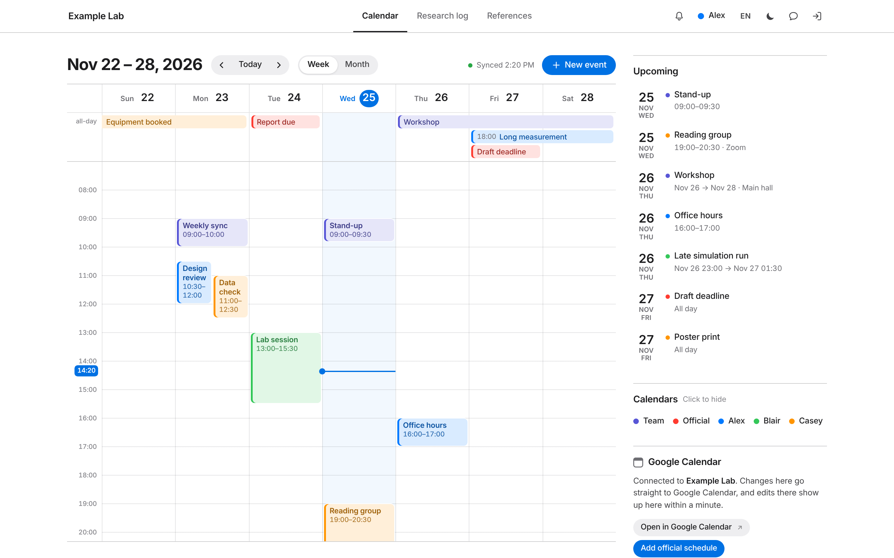
  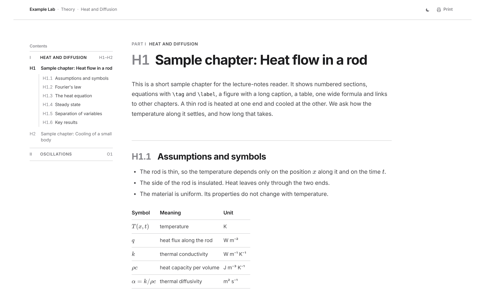
  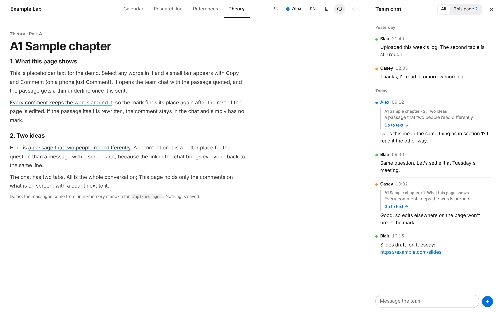
</p>
<p align="center">
  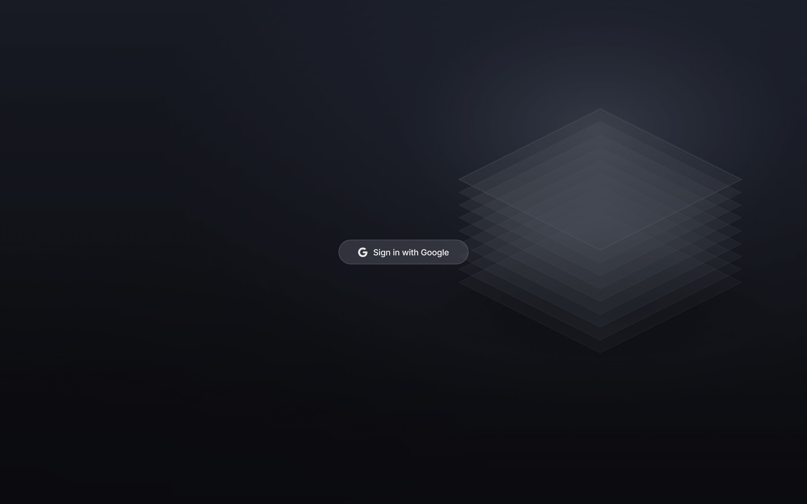
  
  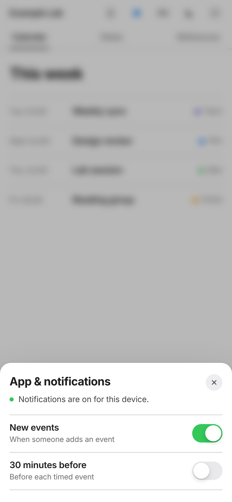
  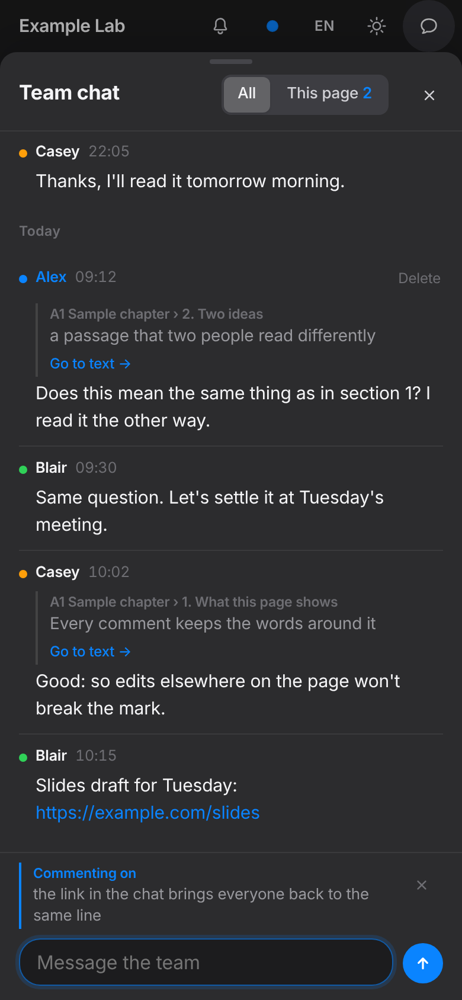
</p>

## Skills

In build order. Each folder has `SKILL.md` (what, when, steps, rules, self-check), `references/` (design and setup in
detail), `assets/` (code to copy, a demo with placeholder data) and `screenshots/`.

<table>
<tr>
<td>1</td>
<td><a href="skills/team-project-playbook/SKILL.md"><b>Team project playbook</b></a><br><code>team-project-playbook</code><br>The working rules: one repo, English records, weekly logs that lock, branch → PR, Claude sessions with clear roles. Every decision with its reason.</td>
<td></td>
</tr>
<tr>
<td>2</td>
<td><a href="skills/team-site-setup/SKILL.md"><b>Team site setup</b></a><br><code>team-site-setup</code><br>The skeleton (stdlib Python build, Pages Functions, D1) and every console click, from an empty Cloudflare account to a live site.</td>
<td></td>
</tr>
<tr>
<td>3</td>
<td><a href="skills/team-site-design-system/SKILL.md"><b>Design system</b></a><br><code>team-site-design-system</code><br>Apple-like greys, a soft dark mode, hairlines instead of boxes, pills, sheets on phones, 44 px taps, the header at every width, EN/KO.</td>
<td>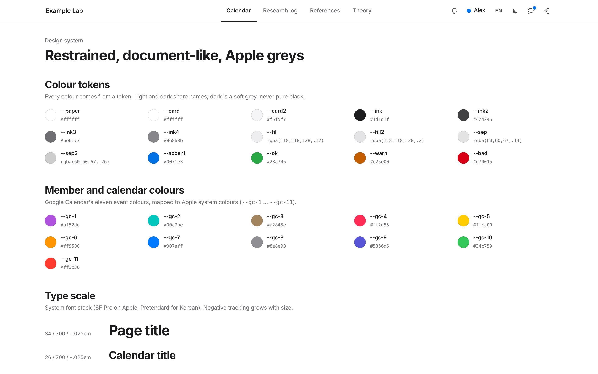</td>
</tr>
<tr>
<td>4</td>
<td><a href="skills/google-signin-team-gate/SKILL.md"><b>Google sign-in gate</b></a><br><code>google-signin-team-gate</code><br>Only the team's Google accounts get in, for 180 days, in the browser and the Home Screen app. One button, one refusal line.</td>
<td></td>
</tr>
<tr>
<td>5</td>
<td><a href="skills/shared-google-calendar/SKILL.md"><b>Shared Google Calendar</b></a><br><code>shared-google-calendar</code><br>Week and month views over one shared Google Calendar that everyone edits from the site or from Google.</td>
<td></td>
</tr>
<tr>
<td>6</td>
<td><a href="skills/weekly-research-log/SKILL.md"><b>Weekly research log</b></a><br><code>weekly-research-log</code><br>One Markdown file per person per week, rendered as a log; a week locks after its last day, enforced in CI.</td>
<td>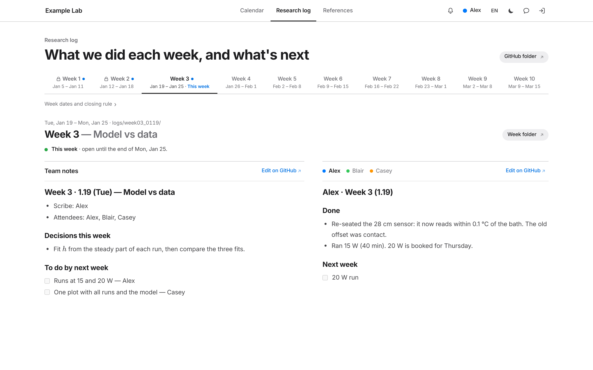</td>
</tr>
<tr>
<td>7</td>
<td><a href="skills/references-library/SKILL.md"><b>References library</b></a><br><code>references-library</code><br>Papers from a CSV and a link list, with search, filters and a contents column.</td>
<td>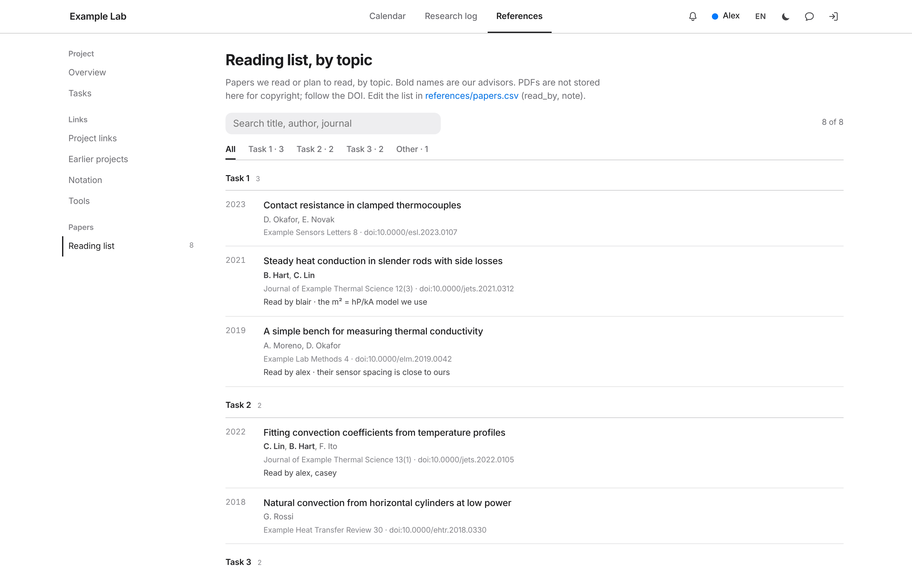</td>
</tr>
<tr>
<td>8</td>
<td><a href="skills/lecture-notes-reader/SKILL.md"><b>Lecture-notes reader</b></a><br><code>lecture-notes-reader</code><br>Markdown + KaTeX chapters with numbered sections and equations, an outline that follows you, resume where you stopped, print.</td>
<td></td>
</tr>
<tr>
<td>9</td>
<td><a href="skills/ios-webapp-push/SKILL.md"><b>iPhone app + notifications</b></a><br><code>ios-webapp-push</code><br>Add to Home Screen, web push for new events and 30 minutes before, a cron Worker, keys made inside D1.</td>
<td></td>
</tr>
<tr>
<td>10</td>
<td><a href="skills/team-chat/SKILL.md"><b>Team chat</b></a><br><code>team-chat</code><br>Select any text → Copy · Comment. The passage is underlined, the chat links back to it. D1, polling, soft deletes.</td>
<td></td>
</tr>
<tr>
<td>11</td>
<td><a href="skills/first-visit-spotlight-guide/SKILL.md"><b>First-visit guide</b></a><br><code>first-visit-spotlight-guide</code><br>A short spotlight tour that shows a new member each part once, remembered on the server too.</td>
<td>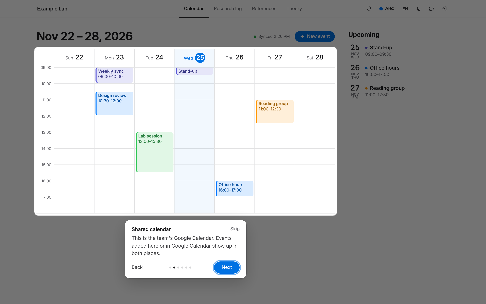</td>
</tr>
<tr>
<td>12</td>
<td><a href="skills/kakao-link-preview/SKILL.md"><b>Link preview</b></a><br><code>kakao-link-preview</code><br>A sharp 2400 × 1260 card in KakaoTalk and other messengers for a signed-in site, with a versioned image URL.</td>
<td>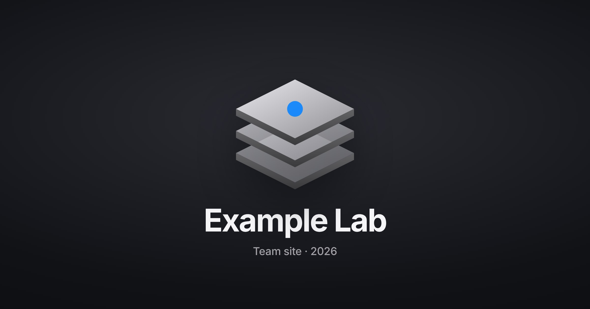</td>
</tr>
<tr>
<td>13</td>
<td><a href="skills/scroll-3d-intro/SKILL.md"><b>3D scroll intro</b></a><br><code>scroll-3d-intro</code><br>A three.js scene driven by scrolling, with a quality bar checked on every frame. Optional and the largest.</td>
<td></td>
</tr>
</table>

Every screenshot on one page: [docs/gallery.md](docs/gallery.md). Design, UI and UX across all skills (tokens with
their real values, motion, component states, every screen at every width in light and dark, journeys and states):
[docs/design/](docs/design/README.md).

## Use it

### With Claude Code (plugin)

```text
/plugin marketplace add suhan-dev/site-skills
/plugin install team-site-skills@site-skills
```

Then ask: *"Build our team site with the site-skills"*. Claude reads [CLAUDE.md](CLAUDE.md) and
[docs/START-HERE.md](docs/START-HERE.md), asks a short list of questions in one message (site name, members, time
zone, which features, who may sign in), then works skill by skill and tells you exactly which console buttons to press
when a step needs your account.

### By hand

Copy the skill folders you want into `~/.claude/skills/` (or your project's `.claude/skills/`), or just read them: every
`SKILL.md` is written for a person too. Start with [team-site-setup](skills/team-site-setup/SKILL.md) and its
[end-to-end guide](skills/team-site-setup/references/end-to-end.md), which lists every click from an empty Cloudflare
account to a live, signed-in site.

### For other AI tools

[llms.txt](llms.txt) indexes everything; [AGENTS.md](AGENTS.md) points to [CLAUDE.md](CLAUDE.md).

## How it fits together

```
GitHub repo ──merge to main──▶ Cloudflare Pages ── python3 build.py ──▶ dist/ (static pages + data JSON)
                                     │
                                     ├── functions/_middleware.js   Google sign-in gate on every request
                                     ├── functions/api/*            calendar · notifications · chat · me
                                     ├── Variables and Secrets      GOOGLE_CLIENT_ID · ALLOWED_EMAILS · GOOGLE_CALENDAR_ID · GOOGLE_SA_JSON
                                     └── D1 (DB)                    sessions · push devices · chat · "seen once"
                                                                       ▲
Google: sign-in client · service account + shared calendar      cron Worker, every minute (notifications)
```

Free plans throughout; a three-person team uses a small fraction of each allowance
([architecture](skills/team-site-setup/references/architecture.md)).

## Security

Nothing secret is in this repository, and nothing you build with it needs a secret in your repo either.

- Secrets (the calendar service-account key, the sign-in allow-list) go into Cloudflare **Variables and Secrets** as type
  Secret, typed by you. Claude is told never to ask for them in chat.
- Push keys and the cron secret are generated inside D1 by the code and never leave it.
- The site is out of search engines (`robots.txt` + `X-Robots-Tag: noindex`), and every API answers only a signed-in
  member.
- Before every push, `bash tools/privacy-scan.sh` looks for addresses, keys, ids and names, and must print only ✓.

Details and how to report a problem: [SECURITY.md](SECURITY.md).

## Contributing

[CONTRIBUTING.md](CONTRIBUTING.md): the folder layout, placeholder data (members Alex, Blair and Casey, "Example Lab"),
screenshots, and the checks to run.

```bash
bash tools/privacy-scan.sh     # must print only ✓
node tools/check-skills.mjs    # frontmatter, sections, links, sizes, marketplace
node tools/make-index.mjs      # docs/gallery.md and llms.txt
```

## Licence

[MIT](LICENSE). Libraries the skills download at pinned versions keep their own licences (three.js, marked, KaTeX: MIT).

Built from the NAND Capstone 2026 Winter team site. All names, events and chapter text in the demos and screenshots are
placeholders.

If these skills helped, a ⭐ on [the repository](https://github.com/suhan-dev/site-skills) is appreciated.
