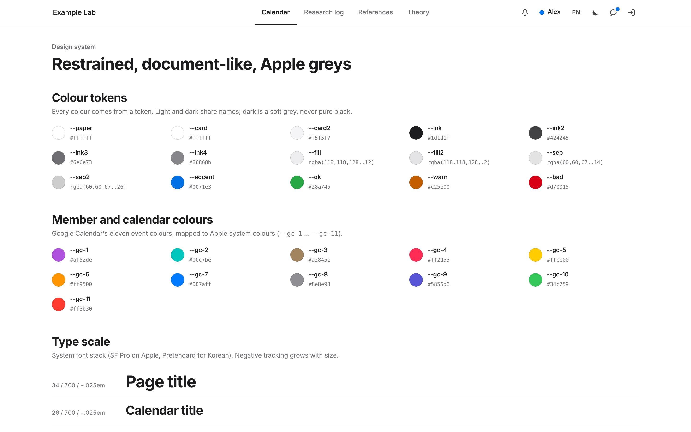

# Design, UI and UX

Everything about how the site looks and behaves, in one place. The skills each carry their own `references/design.md`
with every measurement for their screen. This folder is the view across all of them: the shared tokens with their real
values, every motion, every component state, every screen at every width in light and dark, and the journeys people
take through the site.

## The look in one paragraph

A calm document, not an app dashboard. Apple's system colours and greys, one accent blue, one system font stack with
Pretendard for Korean. No boxes: a section is a hairline and some space; fills are only for controls. Controls are
pills. Dark mode is soft grey (`#1c1c1e` / `#2c2c2e`), never black, with fainter hairlines. Motion is short (150 ms for
colour, 220 ms for a dialog, 280 to 320 ms for a sheet); with reduced motion the dialogs, sheets and switches stop
moving and only colour fades stay. Phones are first-class: dialogs become bottom sheets, controls get a 44 px tap area
(a few small ones in the header and the chat do not yet; see [components.md](components.md)), nothing scrolls sideways
at 320 px, and an upright phone never zooms. The header, the intro and the calendar stay English; the rest switches between English and Korean.

## Pages in this folder

| Page | What it answers | How it is made |
|---|---|---|
| [tokens.md](tokens.md) | Every colour, font, shadow, radius, spacing value, z-index and breakpoint, with the value in light and dark and where it is used | Generated from the CSS: `node tools/design-inventory.mjs` |
| [motion.md](motion.md) | Every transition, animation and timed delay: property, duration, easing, file and line; what reduced motion does | Generated from the CSS, plus the timers in the JS |
| [components.md](components.md) | Each shared control in every state: default, hover, pressed, focus, disabled, selected, dark, phone | Written from the CSS, every value cited |
| [screens.md](screens.md) | Each screen from top to bottom, how it changes at 1440, 1024, 768, 390 and 320 px, with light and dark side by side | Screenshots from the skill demos: `node tools/shoot-screens.mjs` |
| [ux.md](ux.md) | The journeys (first visit, adding an event, writing the log, commenting, notifications), empty, loading and error states with their exact words, wording rules, keyboard and accessibility | Written from the code, every claim cited |

## Where the details live

| Topic | Page |
|---|---|
| Tokens, type, space, breakpoints, header, buttons, dialogs, states, motion, icons | [team-site-design-system/references/design.md](../../skills/team-site-design-system/references/design.md) |
| Phones: zoom, where scrolling is locked and how, closing sheets, keyboard, safe areas, selection, taps | [team-site-design-system/references/mobile.md](../../skills/team-site-design-system/references/mobile.md) |
| English and Korean: what switches, what stays English, how strings are kept | [team-site-design-system/references/language.md](../../skills/team-site-design-system/references/language.md) |
| What changed and why (before → after), and what was rejected | [team-site-design-system/references/decisions.md](../../skills/team-site-design-system/references/decisions.md) |
| Calendar: week and month views, event blocks, the event sheet, the day list | [shared-google-calendar/references/design.md](../../skills/shared-google-calendar/references/design.md) |
| Research log: the week strip, the closing table, the week's head, member columns, states (logs are written in GitHub, not on the site) | [weekly-research-log/references/design.md](../../skills/weekly-research-log/references/design.md) |
| References: the contents column, overview facts, tasks, link lists, the reading list with its tools row (edited in GitHub, not on the site) | [references-library/references/design.md](../../skills/references-library/references/design.md) |
| Lecture notes: the Theory tab and the reader (contents, section bar, maths, print) | [lecture-notes-reader/references/design.md](../../skills/lecture-notes-reader/references/design.md) |
| Sign-in screen | [google-signin-team-gate/references/design.md](../../skills/google-signin-team-gate/references/design.md) |
| The bell, the install sheet, notifications, the app icon | [ios-webapp-push/references/design.md](../../skills/ios-webapp-push/references/design.md) |
| Team chat: panel and sheet, messages, composer, Copy · Comment, marks | [team-chat/references/design.md](../../skills/team-chat/references/design.md) |
| First-visit guide: the spotlight and the panel | [first-visit-spotlight-guide/references/design.md](../../skills/first-visit-spotlight-guide/references/design.md) |
| 3D intro at every width and in every state | [scroll-3d-intro/references/design.md](../../skills/scroll-3d-intro/references/design.md) |
| Link preview card | [kakao-link-preview/references/kakao.md](../../skills/kakao-link-preview/references/kakao.md) |

## Keeping it true

- The generated pages are rebuilt with `node tools/design-inventory.mjs` and `node tools/shoot-screens.mjs` (serve the
  repository root first: `python3 -m http.server 8901 --bind 127.0.0.1`). Run them after any change to a skill's CSS
  or demo, and commit the result with the change.
- The written pages cite the file each value comes from. When a value changes in the code, change it in the page in
  the same pull request.
- Screenshots use placeholder data only (Alex, Blair, Casey, "Example Lab"). Run `bash tools/privacy-scan.sh` before
  every push.
