# Screens

Every screen of every demo, at five widths, in light and dark. Each section says what is on the screen, how its layout
changes at each width (with the CSS rule that does it), what stays put while the page scrolls, and shows the screenshots.

Regenerate the pictures with one command, from the repository root:

```bash
node tools/shoot-screens.mjs                  # every screen, about 6 minutes (the 3D intro is the slow one)
node tools/shoot-screens.mjs calendar-week    # only the screens you name
```

It needs Playwright, `python3` with Pillow, Node 22.13 or later, and the demos' vendor files (run once:
`bash skills/<name>/assets/fetch-vendor.sh` for `weekly-research-log`, `references-library`, `lecture-notes-reader` and
`scroll-3d-intro`). It starts its own servers (the repository root, the reader demo and the sign-in demo), so nothing else
needs to run. It prints the horizontal-overflow check at the end.

## Contents

- [How to read this page](#how-to-read-this-page)
- [Breakpoints](#breakpoints)
- [The shared header](#the-shared-header)
- Screens:
  [1 Style guide](#1-style-guide) ·
  [2 Dialog and sheet](#2-dialog-and-sheet) ·
  [3 Calendar, week](#3-calendar-week) ·
  [4 Calendar, month](#4-calendar-month) ·
  [5 Event sheet](#5-event-sheet) ·
  [6 Research log](#6-research-log) ·
  [7 References](#7-references) ·
  [8 Reading list](#8-reading-list) ·
  [9 Theory tab](#9-theory-tab) ·
  [10 Reader](#10-reader) ·
  [11 Reader contents sheet](#11-reader-contents-sheet) ·
  [12 Team chat](#12-team-chat) ·
  [13 Chat with a quote](#13-chat-with-a-quote) ·
  [14 Sign-in](#14-sign-in) ·
  [15 After sign-in](#15-after-sign-in) ·
  [16 App and notifications](#16-app-and-notifications) ·
  [17 Add to Home Screen](#17-add-to-home-screen) ·
  [18 Site guide](#18-site-guide) ·
  [19 3D intro](#19-3d-intro)
- [Found while capturing](#found-while-capturing)

## How to read this page

- **Each picture is two shots side by side: light on the left, dark on the right**, with a 16 px grey gap.
- **A shot is one screen, not the whole page**: the viewport at that size, at the top of the page unless the section
  says otherwise.
- **Sizes** (CSS px, 1 device pixel per CSS px): 1440 × 900 (laptop), 1024 × 768 (small laptop, iPad on its side),
  768 × 1024 (iPad upright), 390 × 844 (iPhone), 320 × 640 (iPhone SE class). At 760 px and below the shots use touch
  and mobile emulation, so the phone rules and the meta viewport apply.
- **Theme**: set both ways the pages read it: `prefers-color-scheme` and `localStorage["site_theme"]` before the first
  paint.
- **Motion**: shots use `prefers-reduced-motion: reduce`, so dialogs and sheets are at rest. The 3D intro is the
  exception (normal motion, 4.5 s after its first frame).
- **Data**: the demos' placeholder data (Alex, Blair, Casey, "Example Lab"). The calendar's clock is frozen at
  Wednesday 25 November 2026, 14:20 (Asia/Seoul) with `?now=`.
- **Numbers come from the CSS.** A citation like `calendar.css:170` is a line in that skill's `assets/` file. Paths:
  `components.css`, `tokens.css`, `doc.css` → `skills/team-site-design-system/assets/`; `calendar.css` →
  `skills/shared-google-calendar/assets/site/css/`; `records.css` → `skills/weekly-research-log/assets/site/css/`;
  `refs.css` → `skills/references-library/assets/site/css/`; `theory.css`, `reader.css` →
  `skills/lecture-notes-reader/assets/site/css/`; `chat.css` → `skills/team-chat/assets/site/css/`; `push.css` →
  `skills/ios-webapp-push/assets/site/css/`; `guide.css` → `skills/first-visit-spotlight-guide/assets/site/css/`;
  `intro.css` → `skills/scroll-3d-intro/assets/`; `_middleware.js` → `skills/google-signin-team-gate/assets/functions/`.
- **"Phone"** means 760 px wide or less. That one line is shared by the CSS and the scripts.
- Tokens, motion, components and user journeys have their own pages: [tokens.md](tokens.md), [motion.md](motion.md),
  [components.md](components.md), [ux.md](ux.md).

## Breakpoints

Every width threshold in the skills' CSS, widest first, and what changes at it.

| Width | Query (file:line) | What changes |
|---|---|---|
| ≥ 1100 | `(min-width:1100px)` chat.css:11 | The open chat panel sits beside the page: `body` gets `padding-right:380px`, no shadow. |
| ≥ 1101 / ≤ 1100 | `(max-width:1100px)` calendar.css:170 | Calendar: the 312 px right column moves under the calendar as a grid of cards. |
| | `(max-width:1100px)` records.css:89 | Research log: team notes and personal logs go from two columns to one. |
| | `(max-width:1100px)` reader.css:156 | Reader: the right air column goes; contents 220 px, text up to 72ch, gap 40; padding 52 32 96. |
| | `(min-width:761px) and (max-width:1100px)` refs.css:99 | References: the facts go from two columns to one. |
| 761–1023 | `(min-width:761px) and (max-width:1023px)` components.css:144 | Header stays one row but tighter: padding 0 20 px, gap 12, tab padding 0 10 px; page sides 20 px. |
| ≤ 960 | `(max-width:960px)` components.css:154 | The sign-out icon leaves the header (it is in the name menu). |
| 761–900 | `(min-width:761px) and (max-width:900px)` components.css:150 | The name pill shows only its colour dot. |
| ≤ 899 | `(max-width:899px)` refs.css:102 | References: the row of four numbers becomes two by two. |
| ≥ 761 | `(min-width:761px)` components.css:102, calendar.css:155, records.css:72, refs.css:83, theory.css:84 | Desktop-only rules: wide dialogs (620 px), the event editor at 620 px, "desktop polish" in the log and references, the Theory chapter head grid. |
| ≤ 760 | `(max-width:760px)` components.css:132, :155, :176; doc.css:43; calendar.css:176; records.css:94; refs.css:108; theory.css:54, :99; reader.css:124, :162; chat.css:78, :136; push.css:71; guide.css:36 | **Phone layout.** Header in two rows, dialogs become bottom sheets, every control gets a 44 px tap area, inputs 16 px, one column everywhere, the chat and the guide become bottom sheets, the reader gets its section bar. |
| ≤ 760 (scripts) | `matchMedia("(max-width: 760px)")` in calendar.js:24, reader.js:18, theory-tab.js:125, chat.js:25, sheet.js:11, guide.js:21, intro.js:32 | The same line in JavaScript: the calendar redraws for phones, sheets lock the page, the intro is not shown. |
| ≤ 760, upright | `(max-width:760px) and (orientation:portrait)` components.css:213, theme.js:61 | No zoom on an upright phone (`touch-action:pan-x pan-y`, viewport `maximum-scale=1`). |
| ≤ 760, touch | `(max-width:760px) and (pointer:coarse)` calendar.css:256 | Chrome's small date and time picker icons are hidden. |
| ≤ 700 or portrait | `(max-aspect-ratio:4/5),(max-width:700px)` intro.css:61, _middleware.js:110 | Intro text in portrait form (20 px gutter, smaller headline that may wrap); the sign-in shade comes from the bottom. |
| portrait | `(max-aspect-ratio:4/5)` intro.css:17, _middleware.js:111 | The tall poster behind the sign-in page and the intro's no-WebGL stage. |
| ≤ 460 | `(max-width:460px)` components.css:164 | Header: name text hidden (dot only), language button min 30 px, icon buttons 30 px wide. |
| ≤ 374 | `(max-width:374px)` components.css:195, calendar.css:260, theory.css:119 | Small phones: header and tabs close up (tabs 12.5 px); calendar title 19 px; Theory sub-tabs 13 px. |
| ≤ 340 | `(max-width:340px)` components.css:203, calendar.css:265 | 320 px phones: tabs 11.5 px with no gap, brand 14 px; calendar title 17 px, narrower ‹ › buttons, Starts / Ends labels above their fields. |

Rules that are not about width:

| Query (file:line) | What changes |
|---|---|
| `(hover:hover) and (pointer:fine)` calendar.css:103 | With a mouse, the week grid keeps the wheel (`overscroll-behavior:contain`). |
| `(hover:hover)` _middleware.js:120 | The sign-in pill's hover fill (never on touch). |
| `(pointer:coarse)` intro.css:72 | Intro beat dots get 44 px targets. |
| `(pointer:coarse) and (max-height:500px)` intro.js:32, intro-markup.html:16 | A phone on its side counts as a phone: no intro. |
| `pointer:coarse` or shorter side < 600 px, intro-scene.js:40 | The intro's low render tier. |
| aspect < 0.8, intro-scene.js:336 | The intro's portrait framing (wider lens, subject above the text). |
| `prefers-reduced-motion`, `prefers-color-scheme`, `print` | See [motion.md](motion.md) and [tokens.md](tokens.md). |

Where the five captured widths fall:

| Shot | Bands it is in |
|---|---|
| 1440 × 900 | ≥ 1101: every wide layout (calendar sidebar, two-column log, three-column reader, chat beside the page). |
| 1024 × 768 | 761–1100: one-column calendar and log, two-column reader, chat over the page; the header keeps its 28 px sides (≥ 1024). |
| 768 × 1024 | 761–900 and ≤ 899: header without the name text and sign-out; numbers two by two. Portrait (aspect ≤ 4/5): tall poster on the sign-in page. |
| 390 × 844 | Phone, and ≤ 460. |
| 320 × 640 | Phone, ≤ 460, ≤ 374 and ≤ 340. |

## The shared header

Every app screen starts with the same header (`.bar`, components.css:6–40). It is sticky at the top (`position:sticky;
top:0; z-index:30`) with a frosted background (`--paper` at 78 %, `blur(20px)`) and a hairline under it. Left to right:
the brand "Example Lab", the tabs, then bell · name · language · theme · chat · sign-out.

| Width | Header (components.css) |
|---|---|
| 1440, 1024 | One row, 52 px. Grid `minmax(max-content,1fr) auto minmax(max-content,1fr)`, gap 20, sides 28 px (:10). The tabs sit in the middle while both sides fit. All buttons show, the name with its text. |
| 768 | One row, 52 px, tighter: sides 20 px, gap 12, tab padding 0 10 px (:144–149). Name pill as a dot only (:150–153). No sign-out (:154). |
| 390 | Two rows: 44 px (brand left, buttons right) and 38 px (tabs spread edge to edge, `space-between`) (:155–163). Buttons are 44 px targets (:176–194). Name as a dot only, buttons 30 px wide (:164–171), then 44 px again from the 44 px rule. |
| 320 | As 390, closer: left padding 14, tabs 12.5 px (≤ 374, :195–202), then 11.5 px with no gap, brand 14 px, buttons 36 px (≤ 340, :203–210). |

Things under the header that stick use the header's height: `top:72px` (calendar right column), `top:76px`
(references and Theory contents: 52 + 24), `top:82px` on phones (44 + 38).

---

## 1. Style guide

`styleguide-*` · skill `team-site-design-system` · demo
[`assets/demo/index.html`](../../skills/team-site-design-system/assets/demo/index.html) · top of the page.

**On screen, top to bottom:** the header (four tabs: Calendar, Research log, References, Theory); the eyebrow "Design
system" and the page title (`.page-h`, `clamp(26px,2.6vw,34px)`, components.css:59); colour tokens and member colours
as swatch grids (`repeat(auto-fill,minmax(190px,1fr))`, demo index.html:17); the type scale; buttons, pill nav,
segmented control, owner pills, switches; two hairline cards (Document style · States); the footer.

**By width:**

| Width | What changes |
|---|---|
| 1440 | Main column up to 1280 px, padding 36 28 56 (components.css:39). Swatches fill as many 190 px columns as fit. |
| 1024 | Same rules; fewer swatch columns. |
| 768 | Header as in [the shared header](#the-shared-header); page sides 20 px (components.css:147). The two cards are still side by side. |
| 390 | Page padding 22 16 36 (components.css:161). Buttons 44 px tall (:182). The two cards stack (`.two` one column, demo index.html:29). The title stays at 26 px, the clamp's minimum. |
| 320 | As 390, with the small-phone header. |

**Fixed and scrolling:** the header is sticky; the page scrolls under it.

| Width | Light · Dark |
|---|---|
| 1440 | 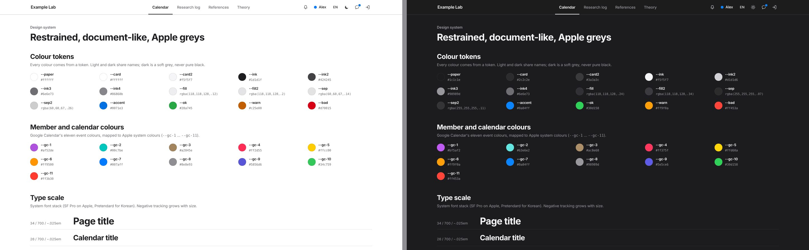 |
| 1024 | 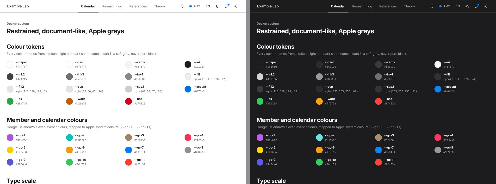 |
| 768 | 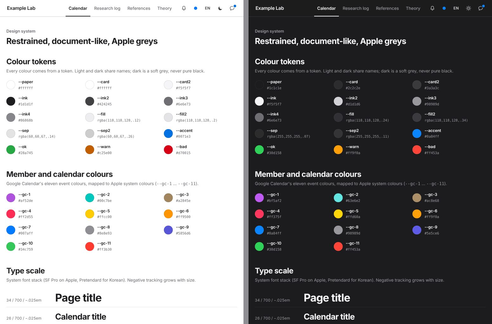 |
| 390 | 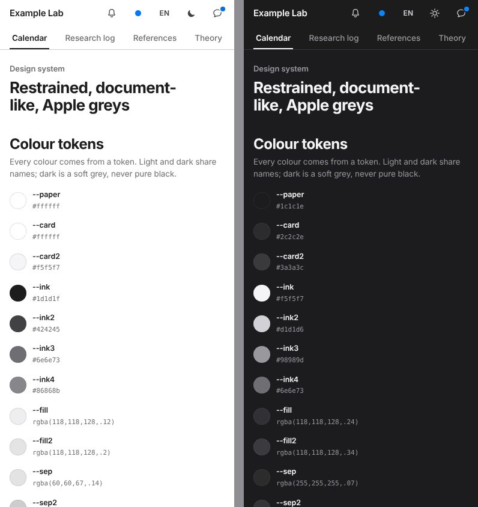 |
| 320 | 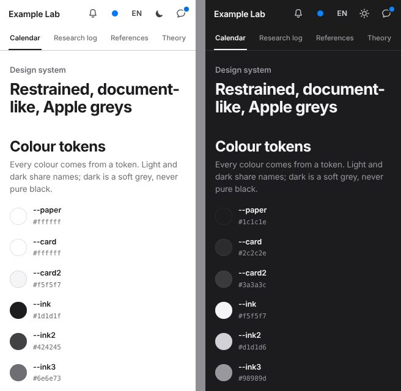 |

## 2. Dialog and sheet

`styleguide-sheet-*` · same demo with `#sheet`, which opens the sample "New event" dialog.

**On screen, top to bottom:** the dimmed, blurred page; the dialog: title and a 28 px round close button; Title
field; All day; owner pills (Alex, Blair, Team); a note line; Cancel and Save.

**By width:**

| Width | What changes |
|---|---|
| 1440, 1024, 768 | A centred dialog: `width:min(560px, 100vw − 32px)`, `max-height:calc(100vh − 48px)`, radius 20 (components.css:83). Backdrop `rgba(0,0,0,.28)` with a 6 px blur (:87). Inside: padding 20 22, one column, gap 14 (:88). |
| 390, 320 | A bottom sheet: full width, `margin:auto 0 0`, `max-height:calc(100dvh − 32px)`, radius 18 18 0 0, its own vertical scroll (:133–134). Padding `18px max(16px,(100% − 560px)/2) max(20px, var(--sab) + 10px)`, so the content stays 560 px wide on wider phones and keeps room for the home indicator (:136). Inputs 16 px (:137), 44 px tall (:187); buttons 44 px (:182); the close button and pills keep their size with an invisible 44 px area (:190–192). |

**Fixed and scrolling:** the dialog is modal. On phones the page behind is locked (`html.locked`, components.css:131,
and `lockPage` in `sheet.js`); only the sheet scrolls.

| Width | Light · Dark |
|---|---|
| 1440 | 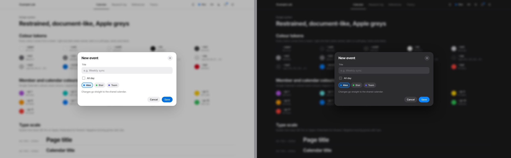 |
| 1024 | 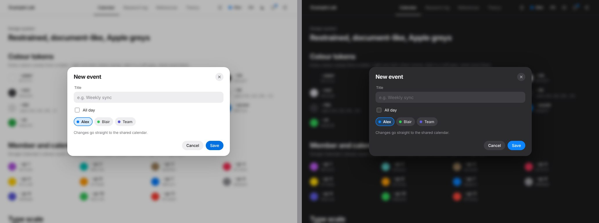 |
| 768 | 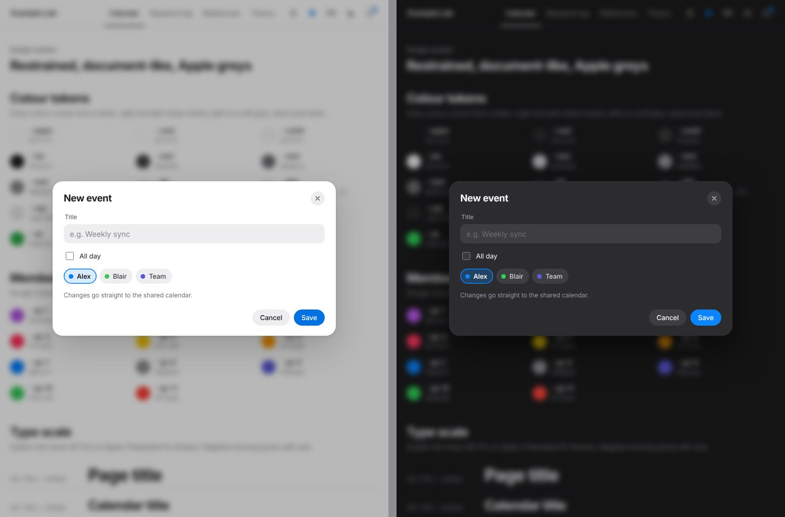 |
| 390 | 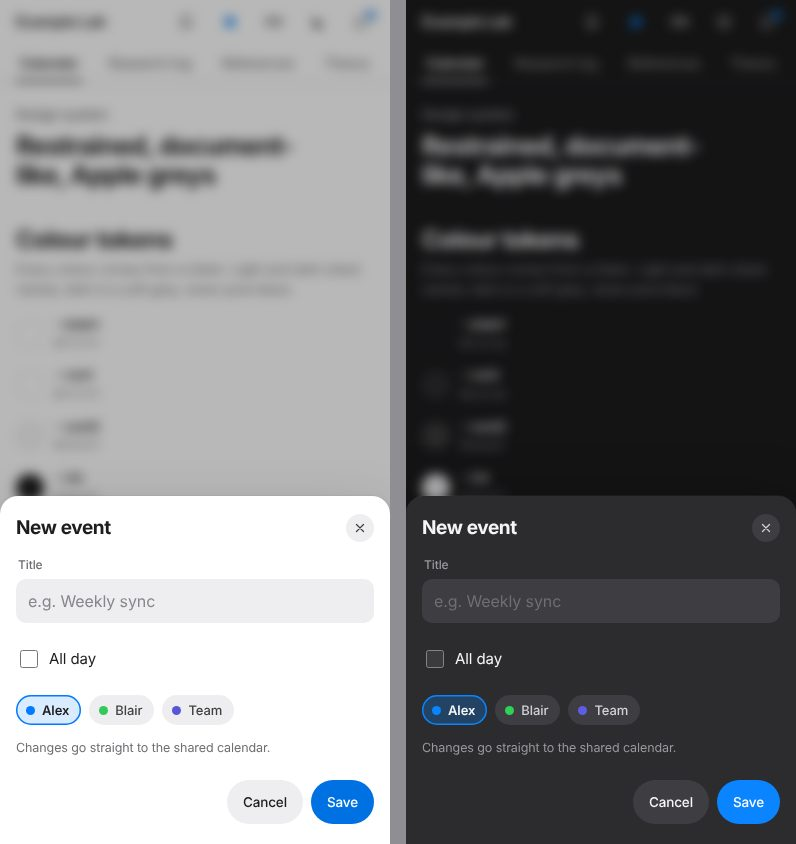 |
| 320 | 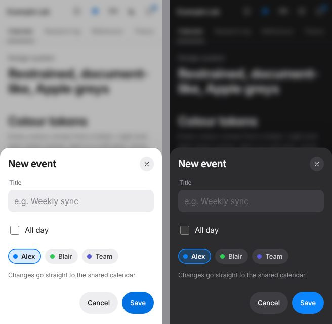 |

## 3. Calendar, week

`calendar-week-*` · skill `shared-google-calendar` · demo
[`assets/demo/index.html`](../../skills/shared-google-calendar/assets/demo/index.html)`?now=2026-11-25T14:20:00+09:00`
· live mode (in-page fake API).

**On screen, top to bottom:**

1. The header (three tabs).
2. The head row: title "Nov 22 – 28, 2026", the ‹ Today › pill, the Week | Month control, then on the right the sync
   note ("Synced 2:20 PM") and **New event**.
3. The banner (hidden while live).
4. The week grid: the day header (weekday and date; today in an accent circle), the all-day row (up to three lanes,
   then "+n more"), and the hours from 07:00 to 07:00 (labels 08:00 … 06:00, a midnight line, the now line at 14:20
   with its accent label in the gutter).
5. Beside or under the grid: Upcoming, Calendars (the legend, click to hide), Google Calendar.

**By width:**

| Width | What changes |
|---|---|
| 1440 | Two columns: `minmax(0,1fr) 312px`, gap 28 (calendar.css:7). The head row fits on one line (`flex-wrap`, :9). The grid runs down to 28 px above the window's bottom edge: `height:max(440px, calc(100vh − var(--cal-top) − 28px))` (:102). |
| 1024 | One column (:170–173). The right column moves under the grid as cards (`repeat(auto-fill,minmax(260px,1fr))`), below the fold here because the grid fills the window. |
| 768 | As 1024. The head row wraps: the sync note and New event go to a second line, still on the right (`.cal-end{margin-left:auto}`, :10). |
| 390 | One head row that never wraps, at least 44 px (:180). Title 20 px, the month only, cut with an ellipsis (:181). No sync note and no New event (:182): a tap on an empty slot adds an event. Today becomes a small calendar page with the date (:201–204). Day header: weekday letter over the date (:216–218). Gutter 36 px, labels 9.5 px (:213, :220). Blocks keep their own height; titles are clamped (:223–226). All-day bars 19 px, one line (:228–232). The grid ends at the bottom edge: `max(320px, calc(100dvh − var(--cal-top) − 1px))` (:213). The main area's top padding drops to 8 px (:179). |
| 320 | Head gap 6, title 19 px (≤ 374, :260–263), then 17 px; ‹ › 26 px wide; Week | Month 12 px with 7 px sides (≤ 340, :265–268). |

**Fixed and scrolling:**

- The header is sticky. At 1440 the right column is sticky too (`top:72px`, calendar.css:71); at 1100 and below it is
  static (:172).
- The week body is its own scroller (`overflow:auto`, :102). Inside it the day header and the all-day row stick to its
  top (`.wv-top`, z 4, :108) and the hour gutter sticks to the left (:110).
- With a mouse the wheel stays inside the hours (:103). On touch, a scroll that reaches the end carries on with the page.
- Phones: the grid takes `touch-action:pan-y` (:211) and `overflow-x:hidden` (:213): a sideways swipe changes the week
  and nothing pans or zooms.

| Width | Light · Dark |
|---|---|
| 1440 | 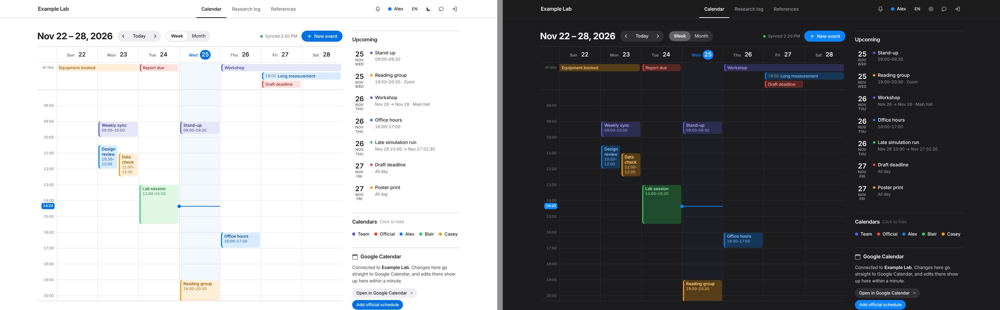 |
| 1024 | 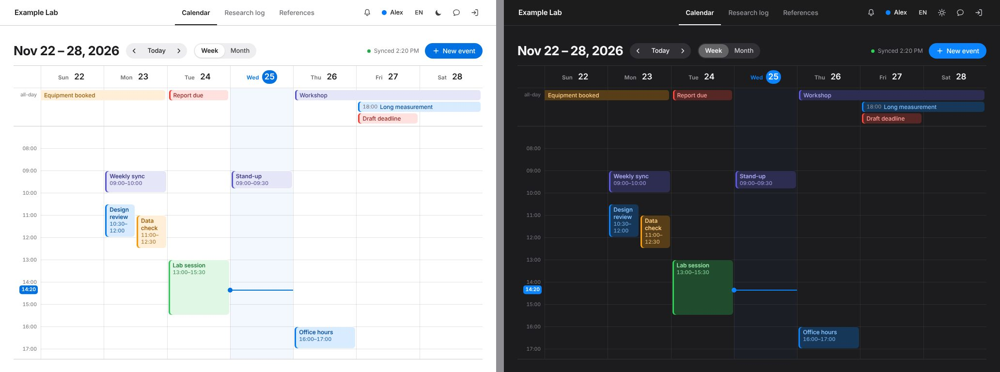 |
| 768 | 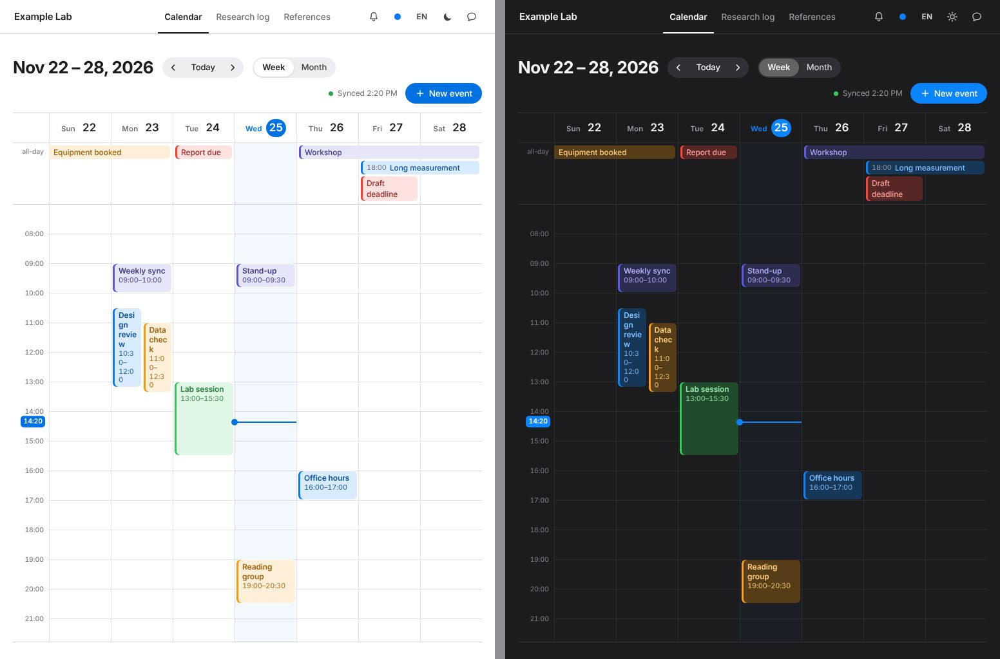 |
| 390 | 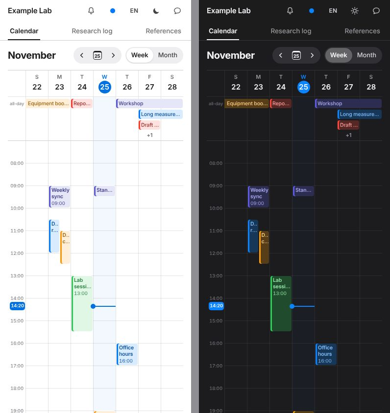 |
| 320 | 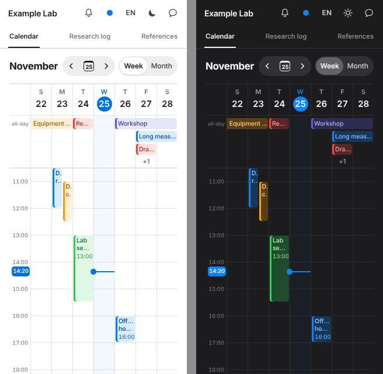 |

## 4. Calendar, month

`calendar-month-*` · same demo, `demoCal.setView("month")`.

**On screen, top to bottom:** the header; the head row with "November 2026"; the weekday row (right-aligned); six week
rows of day cells with the date at the top right (today in an accent circle, other months faint); event lanes over the
cells: all-day bars (owner tint, 3 px edge), timed events (dot · time · title), "+n more".

**By width:**

| Width | What changes |
|---|---|
| 1440 | Two columns as in the week. Each week row is at least 118 px (calendar.css:37); the weeks share the window's height: `min-height:max(520px, calc(100vh − var(--cal-top) − 28px))` and `flex:1 0 auto` (:105–106). |
| 1024, 768 | One column. At 768 the head row wraps as in the week. Titles in the lanes cut with an ellipsis (:55). |
| 390, 320 | Week rows at least 88 px (:183). Every event becomes a 5 px colour bar with no words (:185–189): timed events solid, all-day bars at 70 %. "+n" is centred at the bottom (:193). Day padding 3 px (:192). A tap anywhere in a day opens its week. |

**Fixed and scrolling:** the header is sticky; the month is part of the page and scrolls with it.

| Width | Light · Dark |
|---|---|
| 1440 | 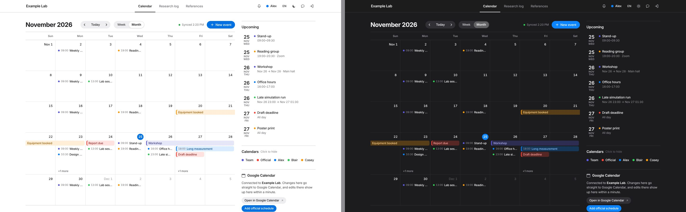 |
| 1024 | 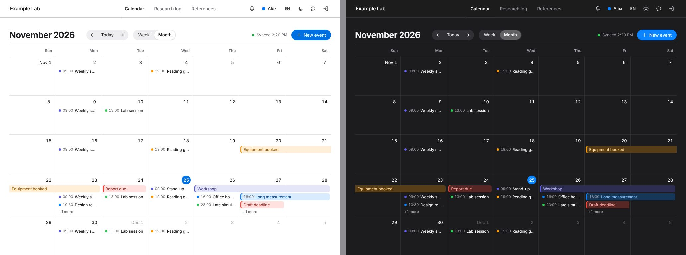 |
| 768 | 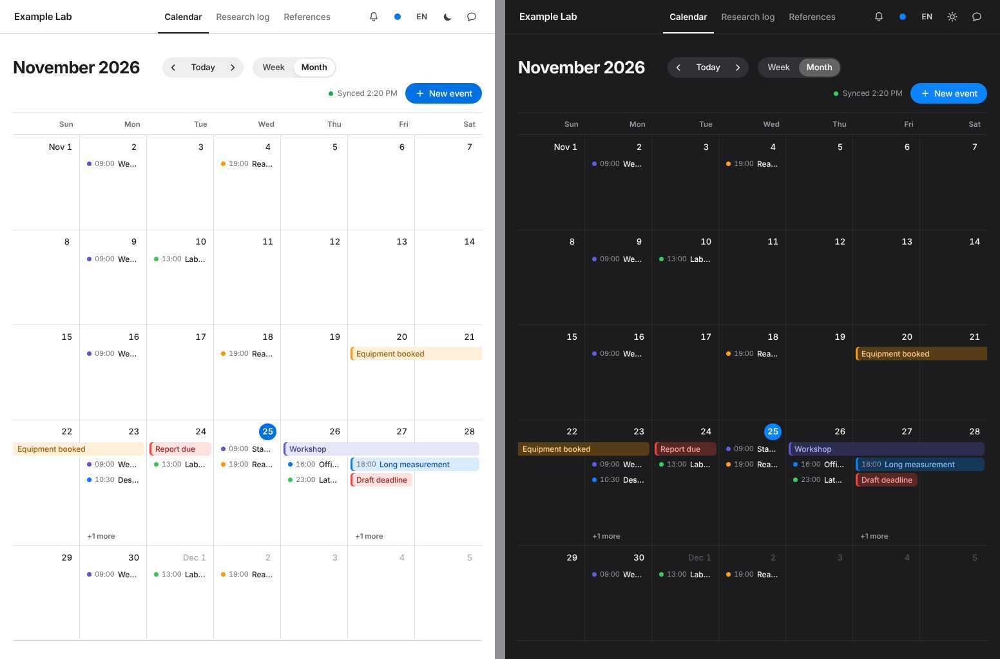 |
| 390 | 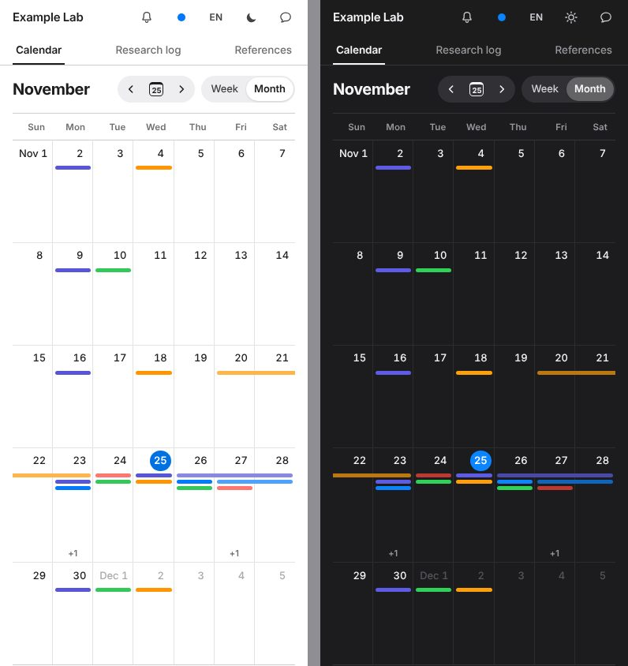 |
| 320 | 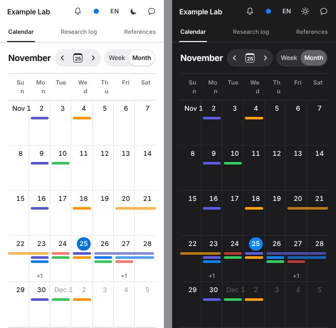 |

## 5. Event sheet

`calendar-event-*` · same demo, the existing event "Design review" opened with `demoCal.openEditor(…)` (owner Alex,
added by Blair, two comments).

**On screen, top to bottom:** "Edit event" and the close button; Title; Calendar (owner pills, Alex chosen); All day;
Starts and Ends; Location; Notes; the note line "Added by Blair"; Delete, Google Calendar ↗ and Comment (bubble and
count); Cancel and Save.

**By width:**

| Width | What changes |
|---|---|
| 1440, 1024, 768 | A centred dialog, 620 px wide: `min(620px, 100vw − 32px)` (calendar.css:155). Starts and Ends share one row: `date | time | → | date | time` (:156), so a time has as much room as a date. A spacer pushes Cancel and Save to the right. |
| 390 | A bottom sheet (components.css:132–140). Starts and Ends take one row each: the word (3.4em), the date, the time, columns `1.75fr 1fr` (:240–242); the arrow and the time labels are hidden (:243). Delete, Google Calendar and Comment share the first line, Cancel and Save share the last line half and half (:248–250). Comment shrinks to its bubble and count (:252–253). With touch, the date and time picker icons are hidden (:256–258). |
| 320 | The words Starts and Ends go back above their fields, columns `1.25fr 1fr` (≤ 340, :269–272). |

**Fixed and scrolling:** modal. On phones the sheet scrolls inside and the page behind is locked.

| Width | Light · Dark |
|---|---|
| 1440 | 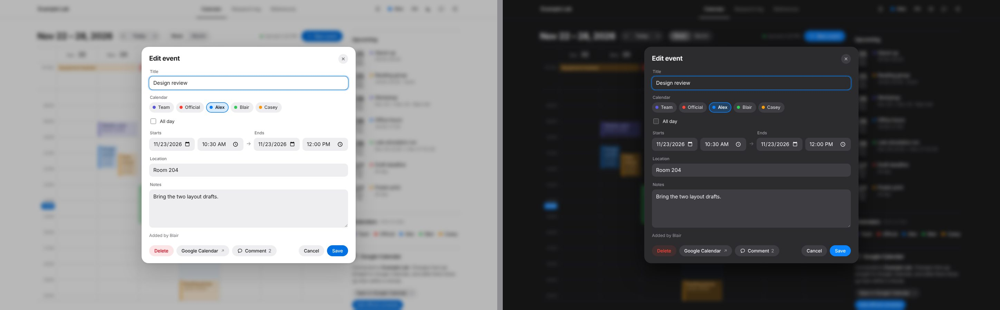 |
| 1024 | 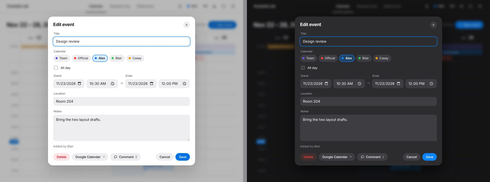 |
| 768 | 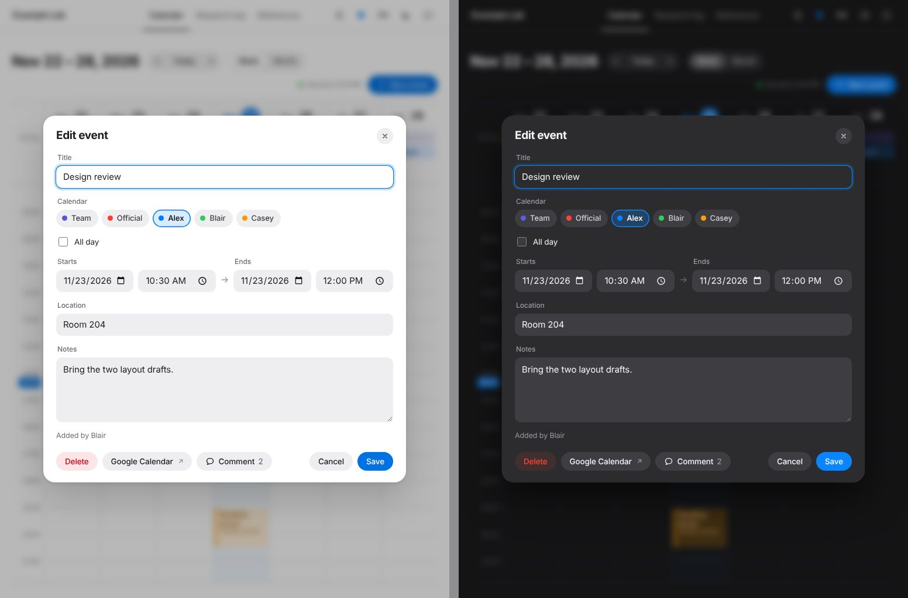 |
| 390 | 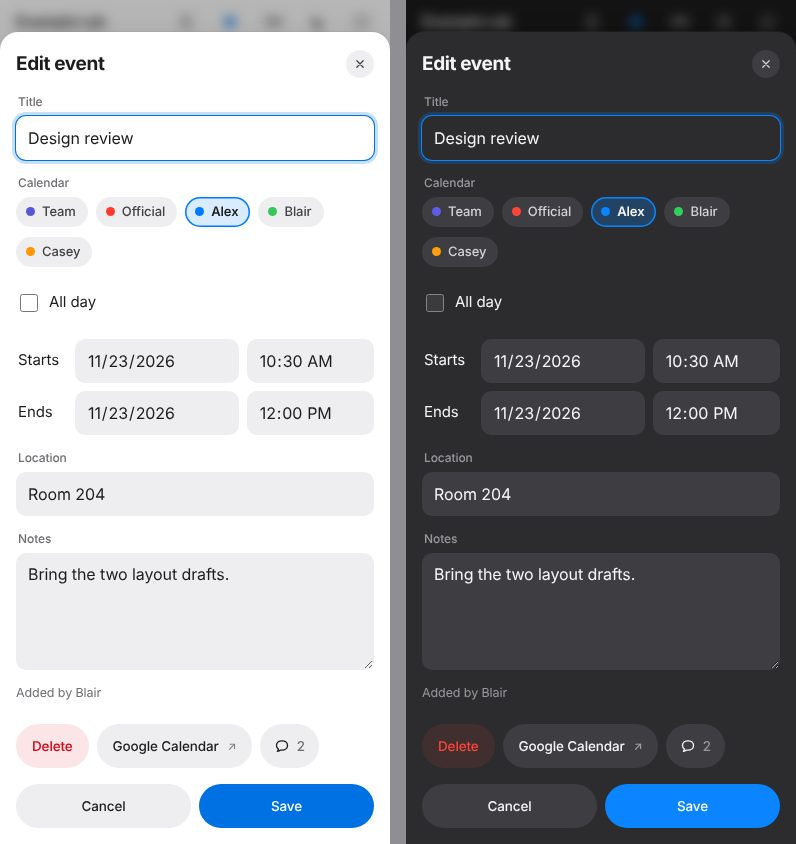 |
| 320 | 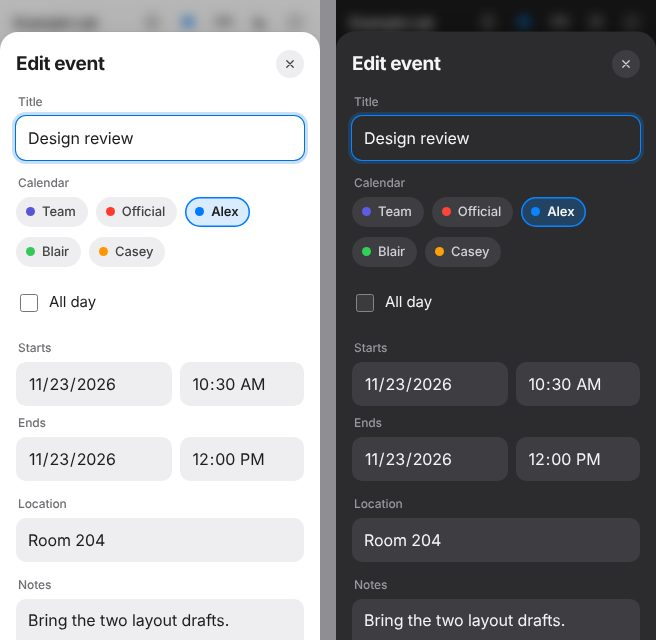 |

## 6. Research log

`research-log-*` · skill `weekly-research-log` · demo
[`assets/demo/index.html`](../../skills/weekly-research-log/assets/demo/index.html) · clock frozen in week 3 (open),
signed in as Alex.

**On screen, top to bottom:**

1. The header.
2. The page head: eyebrow "Research log", the title, and **GitHub folder ↗**.
3. The week strip: Week 1 … Week 10 with their dates, a lock on closed weeks, a dot on weeks with entries, " · This
   week" in accent; the chosen week underlined.
4. "Week dates and closing rule" (a disclosure).
5. The week's head: dates and folder, "Week 3 — Model vs data", **Week folder ↗**.
6. The state line: a green dot, "This week · open until the end of Mon, Jan 25."
7. Team notes, then the personal logs with one tab per member (rendered Markdown).

**By width:**

| Width | What changes |
|---|---|
| 1440 | Two columns: team notes `minmax(0,1.15fr)`, logs `minmax(0,1fr)`, gap 24 44 (records.css:32). Desktop polish (≥ 761, :72–86): both column heads 48 px so their rules line up, log `h1` 19 px, the entries dot right after the week name, the strip fades its last 32 px while more weeks are hidden. |
| 1024, 768 | One column: team notes, then the logs (≤ 1100, :89–91). Desktop polish still applies. |
| 390, 320 | The page head becomes a grid: eyebrow and a small GitHub link on line 1, the title (23 px) across line 2 (:96–100). Strip tabs at least 44 px tall, the strip fades at the right (:103–105). The week head stacks, title 22 px (:107–108). Member tabs 44 px (:110); small links get 44 px areas (:111–113). Column gap 28 (:101). |

**Fixed and scrolling:** the header is sticky; the page scrolls. The week strip scrolls sideways on its own with no
scrollbar (:10–11); the chosen week is scrolled 16 px from its left edge.

| Width | Light · Dark |
|---|---|
| 1440 | 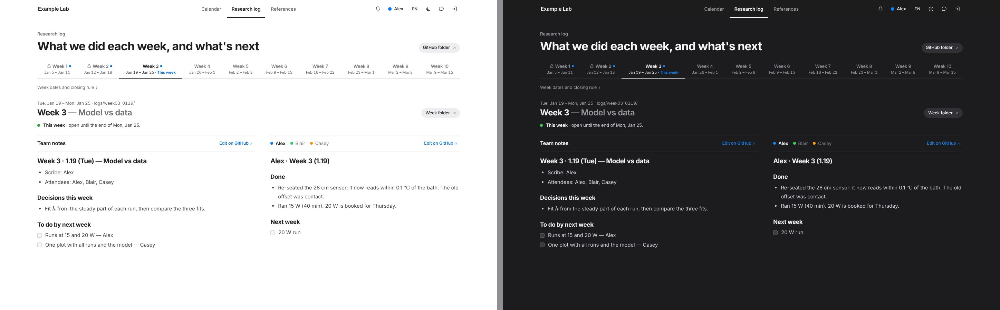 |
| 1024 | 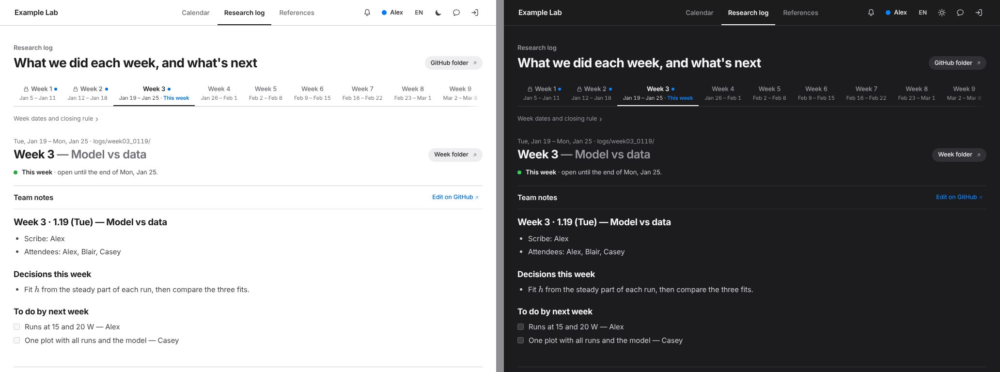 |
| 768 | 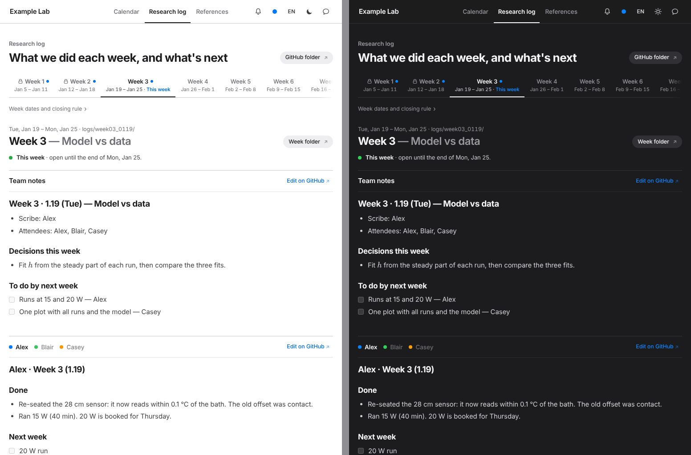 |
| 390 | 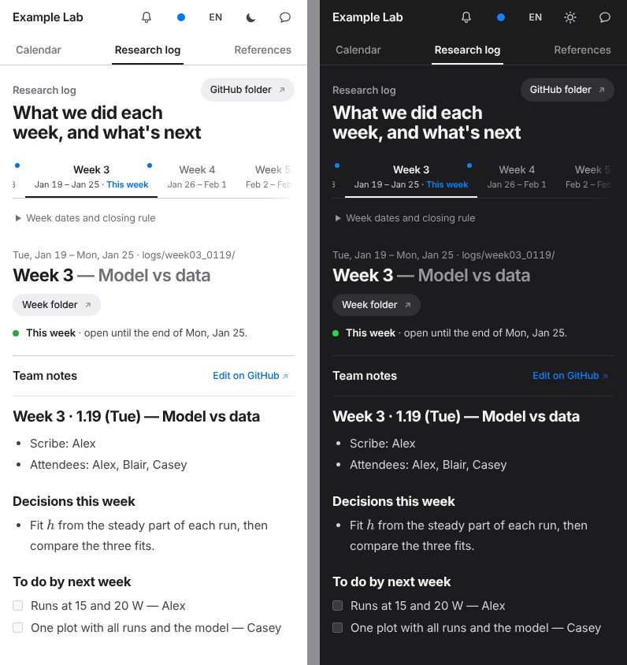 |
| 320 | 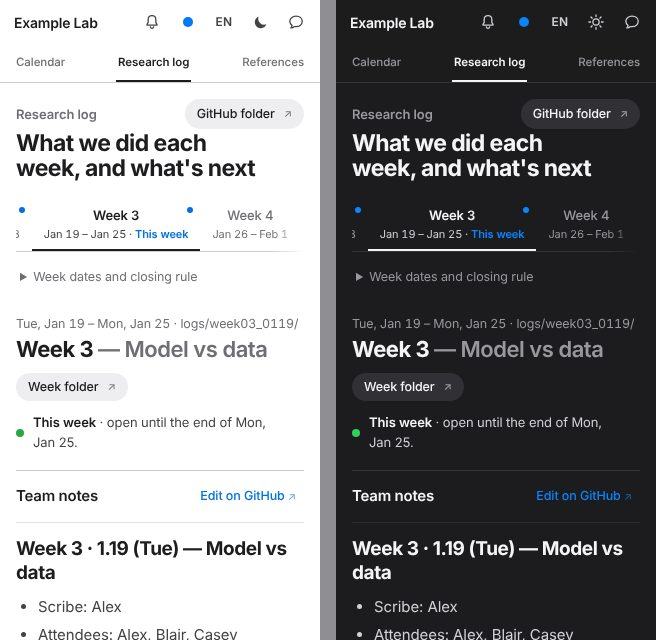 |

## 7. References

`references-*` · skill `references-library` · demo
[`assets/demo/index.html`](../../skills/references-library/assets/demo/index.html) · top of the page (Overview).

**On screen, top to bottom:** the header; the contents column (Project: Overview, Tasks · Links: four README sections ·
Papers: Reading list with its count); the Overview: eyebrow "Example Lab · Winter 2027", the title, the facts (label ·
value rows), Weights (four numbers), the background text and premises; then Tasks and the link sections further down.

**By width:**

| Width | What changes |
|---|---|
| 1440 | Contents 208 px, then the sections, gap 40 (refs.css:8). The contents start at the page edge and hang their marker in the margin (≥ 761, :86). Facts in two columns, gap 44 (:24). Numbers four in a row (:29). Prose at 68ch (:91). |
| 1024 | Facts in one column (761–1100, :99–101), so dates and places stay on one line. Numbers still four in a row. The contents column stays: no rule removes it above 760. |
| 768 | As 1024, and the numbers go two by two; the third loses its left rule (≤ 899, :102–105). |
| 390, 320 | One column, the contents column hidden (:109–110). Instead a jump row (Overview · Tasks · Links · Papers) sticks under the header: `top:var(--refs-bar-h, 82px)`, frosted, 44 px links (:119–123). Fact labels 6.5em (:112). Figures 28 px (:114). Tasks and link rows stack (:115–117). |

**Fixed and scrolling:** the header is sticky. The contents column is sticky at `top:76px` (:9) on wider screens; on
phones the jump row is sticky under the header. Both mark the section being read. Jumps land with
`scroll-margin-top` 80 px (:18), 136 px on phones (:125).

| Width | Light · Dark |
|---|---|
| 1440 | 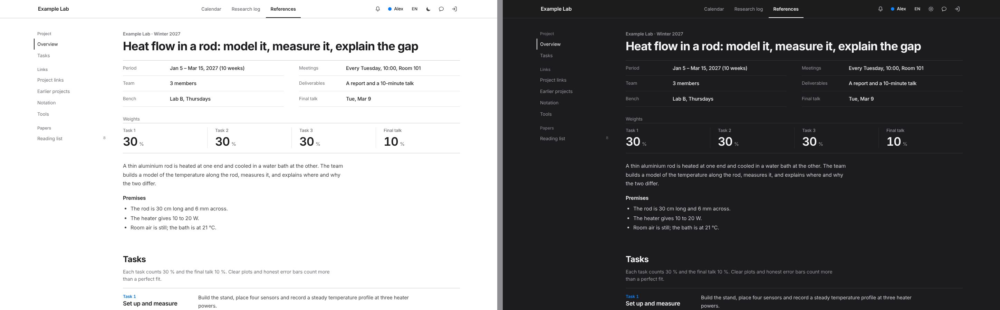 |
| 1024 | 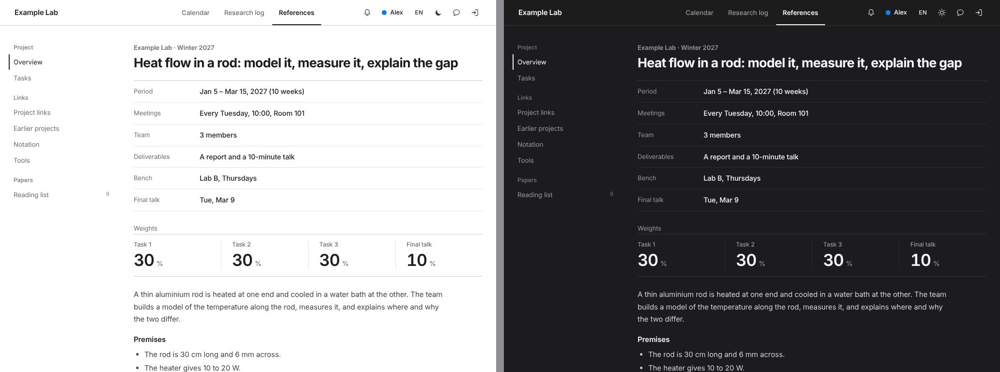 |
| 768 | 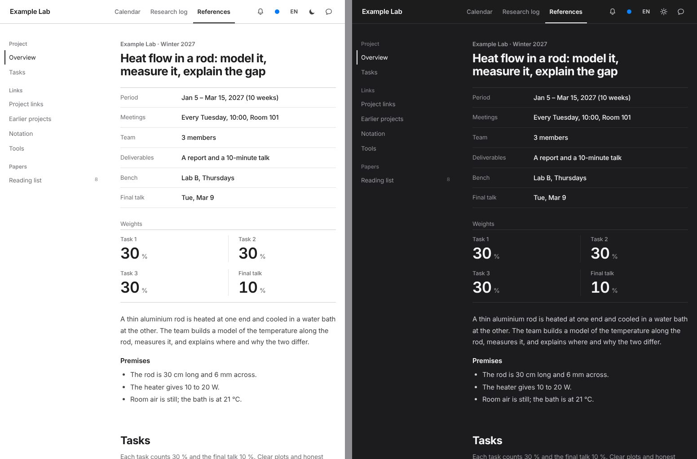 |
| 390 | 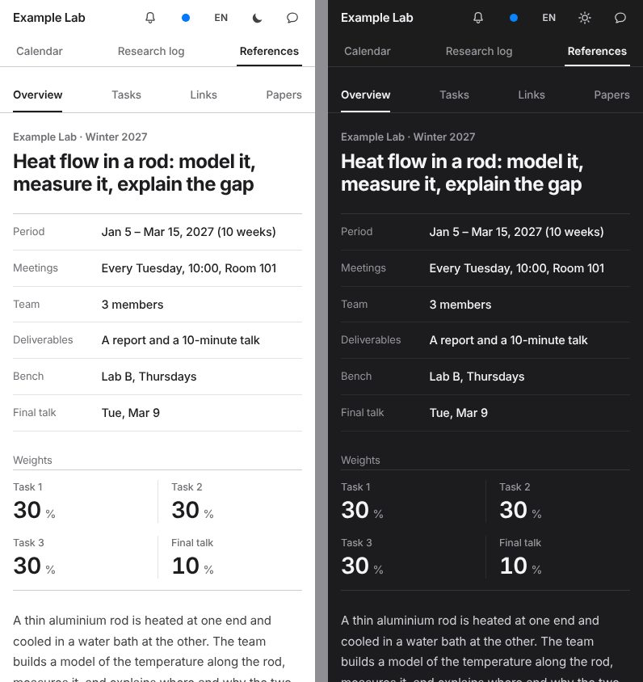 |
| 320 | 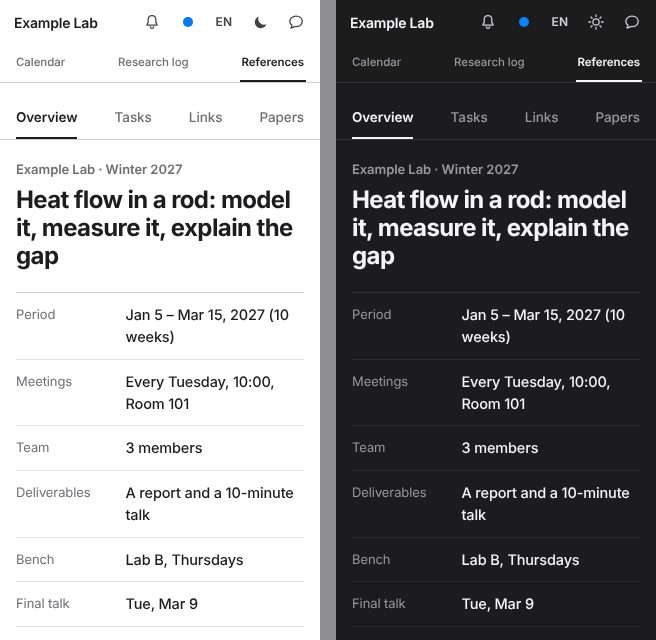 |

## 8. Reading list

`references-papers-*` · same demo with `?at=sec-papers` (scrolled to the reading list).

**On screen, top to bottom:** "Reading list, by topic" and its lead; the tools: search, topic filters ("All", "Task 1 ·
3" …), the count "8 of 8"; the papers grouped by topic: year · title · authors (advisors in bold) · venue and DOI ·
"Read by …" note.

**By width:**

| Width | What changes |
|---|---|
| 1440, 1024, 768 | Search and count on one line (search `flex:0 1 340px`); the filters on their own line under them, 20 px apart, so their underlines sit on the list's top rule like tabs (≥ 761, refs.css:93–96). Section title 24 px (:89). Paper rows `48px minmax(0,1fr)` (:72). |
| 390, 320 | Search on its own line, 44 px tall, 16 px text (:129). The filters wrap with 6 px between rows; each has a 44 px tap area (:128, :130–131). The count sits on its own line at the right. The jump row marks Papers. |

**Fixed and scrolling:** as in [References](#7-references).

| Width | Light · Dark |
|---|---|
| 1440 | 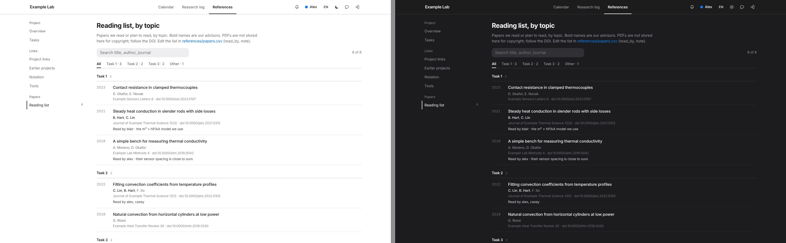 |
| 1024 | 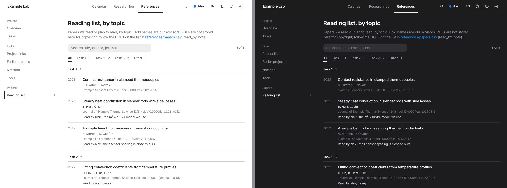 |
| 768 | 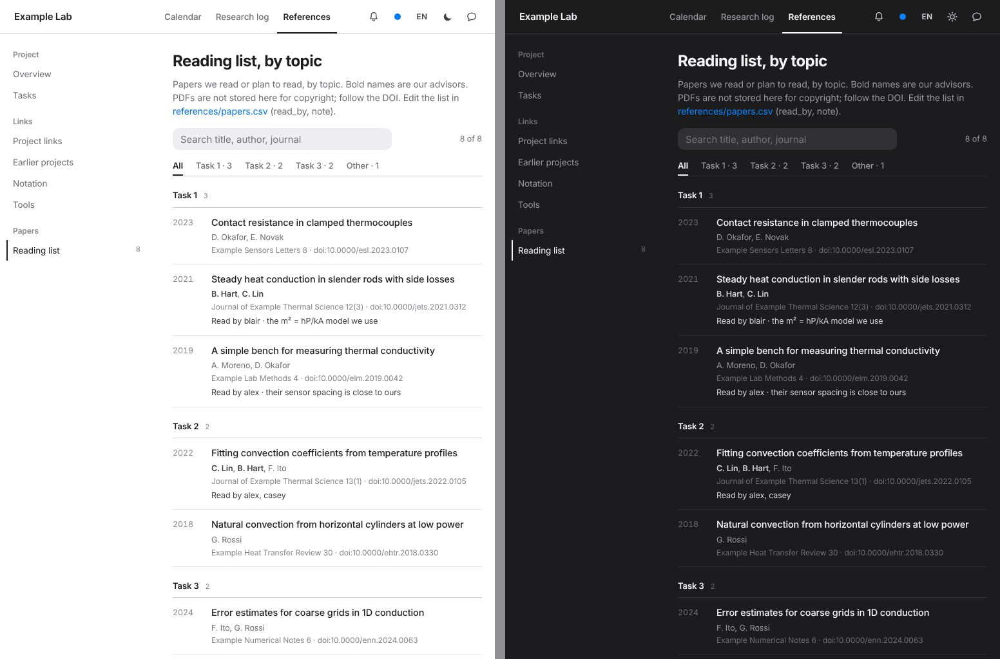 |
| 390 | 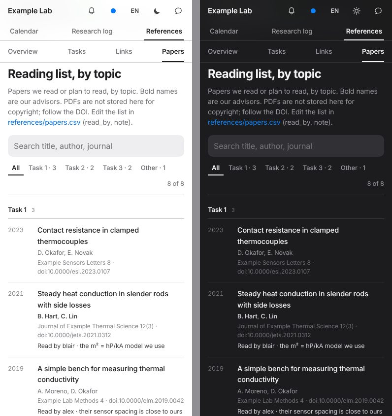 |
| 320 | 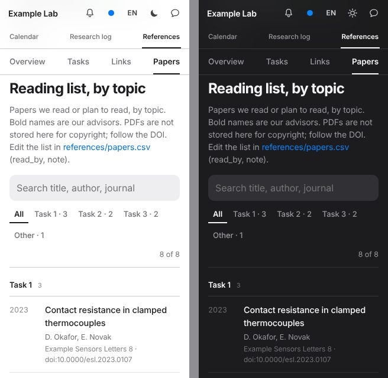 |

## 9. Theory tab

`theory-tab-*` · skill `lecture-notes-reader` · demo
[`assets/demo/index.html`](../../skills/lecture-notes-reader/assets/demo/index.html) served by its `serve.mjs`
(the demo uses root paths) at `/#theory/heat/h1-heat-flow-in-a-rod`.

**On screen, top to bottom:** the header (Theory chosen); the sub-tabs (Heat and Diffusion · Oscillations); the chapter
list (Chapters, H1, H2, Open in reader ↗); the chapter: eyebrow "Heat and Diffusion · Chapter H1", the title, **Open in
reader ↗**, the text (`.doc`), numbered sections with hairlines, equations, a table, a figure; previous / next.

**By width:**

| Width | What changes |
|---|---|
| 1440, 1024, 768 | Sub-tabs with gap 28 on a hairline (theory.css:7). Chapter list 208 px, then the chapter, gap 40 (:15). Text at most 70ch (:23). The chapter head is a grid: eyebrow left, "Open in reader" right, the title across both (≥ 761, :84–90). |
| 390 | Sub-tabs use their short names ("Heat", "Oscillations"), spread edge to edge, 44 px tall (:107–113). The chapter list folds into "Chapters ›" above the chapter (:102–104, :114–115). "Open in reader" sits under the title with a 44 px area (:116–117). Display math at 1.1em (:100). |
| 320 | Sub-tabs gap 6, 13 px (≤ 374, :119–122). |

**Fixed and scrolling:** the header is sticky. The chapter list is sticky at `top:76px` and scrolls on its own
(`max-height:calc(100vh − 96px)`, :17). The sub-tab row scrolls sideways (no scrollbar) only if it ever overflows (:7–8).

| Width | Light · Dark |
|---|---|
| 1440 | 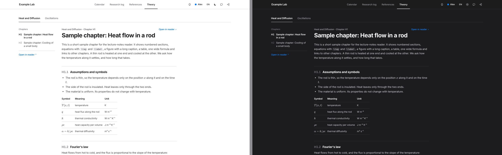 |
| 1024 | 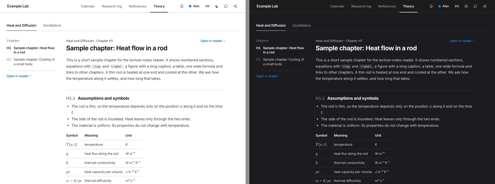 |
| 768 | 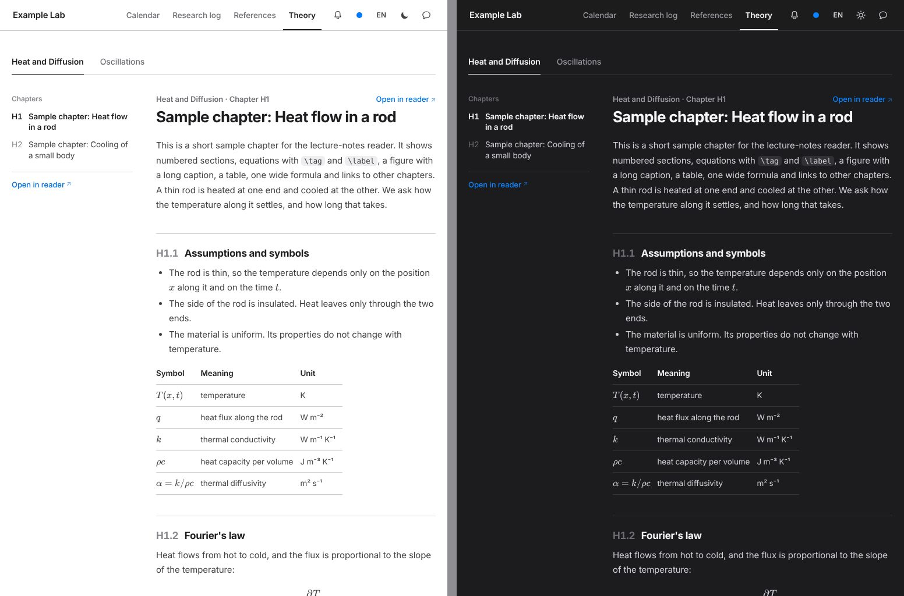 |
| 390 | 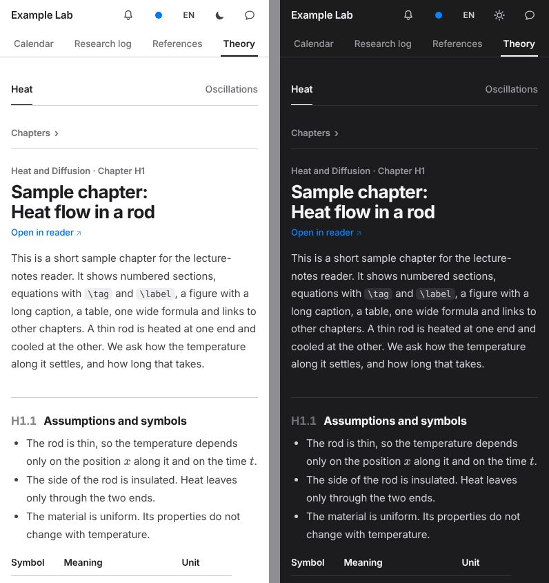 |
| 320 | 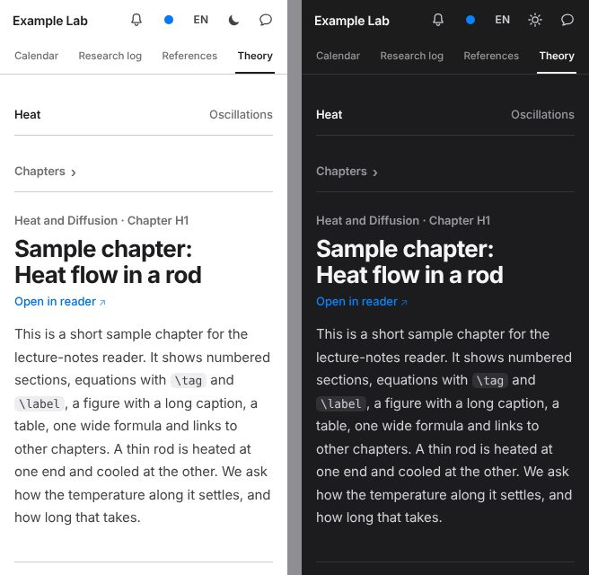 |

## 10. Reader

`reader-*` · skill `lecture-notes-reader` · the reader page
[`assets/site/reader.html`](../../skills/lecture-notes-reader/assets/site/reader.html) at
`/theory/heat/h1-heat-flow-in-a-rod` (served by the demo's `serve.mjs`). A page of its own: no site header.

**On screen, top to bottom:** the top line (Example Lab · Theory · Heat and Diffusion, then the theme button and
Print); the contents column (parts with roman numerals, chapters, and the open chapter's sections on a thin rule); the
text column: the part line "PART I HEAT AND DIFFUSION", the title "H1 Sample chapter: Heat flow in a rod", the text at
17 px / 1.72, sections with hairlines, numbered equations, a table, a figure; previous / next at the end.

**By width:**

| Width | What changes |
|---|---|
| 1440 | Three columns: `minmax(220px,1.3fr) minmax(0,72ch) minmax(0,.7fr)`, gap 56, at most 1360 px, padding 64 48 112 (reader.css:24–25). Contents `min(264px,100%)` wide, against the text (:30). Top line padding 14 48 (:7). |
| 1024, 768 | Two columns: `220px minmax(0,72ch)`, gap 40, start-aligned, padding 52 32 96; top line padding 14 32 (≤ 1100, :156–159). At 768 the text column is what is left after the 220 px contents. |
| 390 | One column, padding 32 20 72 (:164). Contents hidden (:165). Title 28 px, part line 11.5 px (:167–168). The section bar appears under the title (:170–180, see [11](#11-reader-contents-sheet)). Text 16 px / 1.7, `h2` 21.5 px (:190, :194). Top line: "‹ Theory" (accent, 15 px) replaces the crumbs; the tools are 44 × 44 (:200–208). |
| 320 | As 390: the reader has no rules below 760. |

**Fixed and scrolling:** the top line scrolls away with the page (it is not sticky). On wider screens the contents
column is sticky at `top:28px` and scrolls on its own (`max-height:calc(100vh − 56px)`, `overscroll-behavior:contain`,
:30–31). On phones the section bar is sticky at the top (`top:0`, z 30, :170).

| Width | Light · Dark |
|---|---|
| 1440 | 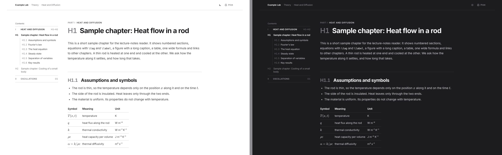 |
| 1024 | 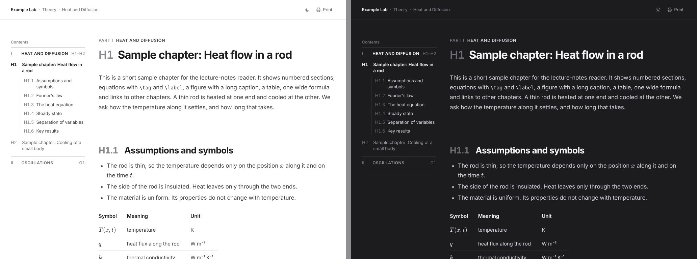 |
| 768 | 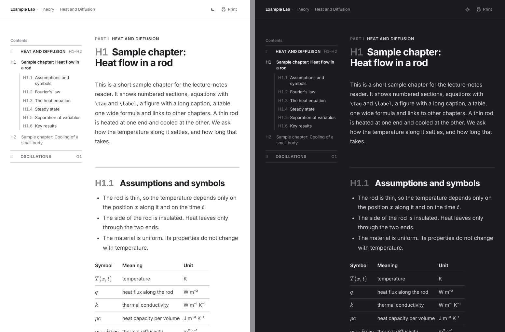 |
| 390 | 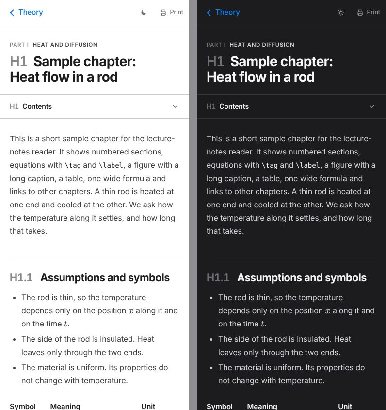 |
| 320 | 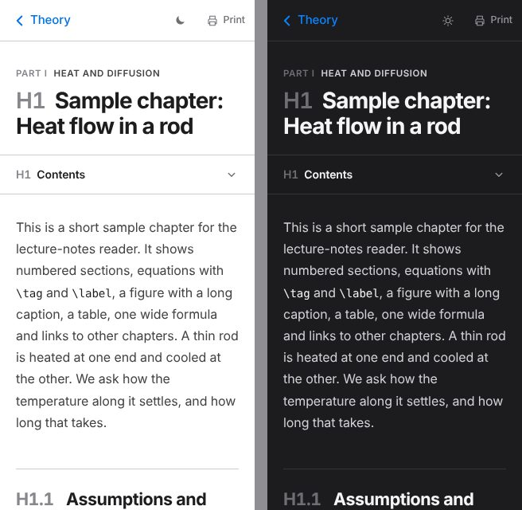 |

## 11. Reader contents sheet

`reader-contents-*` · the reader on a phone, scrolled to section H1.2, then a tap on the section bar. Phones only: above
760 px the same contents is the side column of [the reader](#10-reader).

**On screen, top to bottom:** the section bar, now solid (`H1.2 Fourier's law`, the chevron turned up); the sheet: part
I with its chapters, the open chapter's sections with H1.2 marked by a 1.5 px rule, part II; under the sheet, the text
behind a scrim.

**Layout** (reader.css): the bar is full bleed, at least 48 px, frosted while closed and solid `--paper` while open
(:170–174). The sheet hangs from the bar (`position:absolute; top:100%`), `max-height:min(72vh, 620px)`, scrolls inside
with `overscroll-behavior:contain`, padding 4 / 20 / 16, text 14.5 px (:182–183). Part rows at least 44 px, chapter rows
padding 11 0, section rows 10 0 (:186–189). The scrim is fixed over the page, `rgba(0,0,0,.18)` in light and `.45` in
dark (:62–64). The chevron turns 180° (:180).

| Width | Light · Dark |
|---|---|
| 390 |  |
| 320 |  |

## 12. Team chat

`chat-open-*` · skill `team-chat` · demo [`assets/demo/index.html`](../../skills/team-chat/assets/demo/index.html)`?state=open`
· the All tab, opened on a sample chapter.

**On screen, top to bottom:** the header (the chat button pressed: `--ink` on `--fill`, components.css:29); the sample
chapter with two commented passages underlined; the chat: head ("Team chat", All | This page 2, close), the list (day
labels; each message: colour dot, name, time, an optional quote with "Go to text →", the text), the composer (field
and round send button).

**By width:**

| Width | What changes |
|---|---|
| 1440 | A 380 px panel on the right, full height from the top (chat.css:5). The page makes room: `html.chat-open body{padding-right:380px}`, so the header and the text move left; no shadow (≥ 1100, :11–15). |
| 1024, 768 | The same 380 px panel, under the header (`top:var(--chat-top)`), over the page's right edge, with a soft shadow on its left (:5–7). The page does not move. |
| 390, 320 | A sheet from the bottom: full width, from 44 px below the top (or the safe area) to the bottom, radius 14 14 0 0, `--card` background, a grab handle (:80–85). A scrim `rgba(0,0,0,.28)` dims the page (:76). Title 17 px, tabs 30 px, close 44 px (:86–89). Message text 15 px; Delete always visible on your own messages (:93–94). Composer field 16 px text (:99). |

**Fixed and scrolling:** the panel and the sheet are fixed. Only the message list scrolls (`overflow-y:auto`,
`overscroll-behavior:contain`, :31); its day labels stick to its top (:32). The head and the composer stay. On phones
the page behind is locked while the sheet is open.

| Width | Light · Dark |
|---|---|
| 1440 |  |
| 1024 |  |
| 768 |  |
| 390 |  |
| 320 |  |

## 13. Chat with a quote

`chat-quote-*` · same demo with `?state=quote`: a passage is selected in the text and **Comment** is pressed.

**On screen:** as [Team chat](#12-team-chat), plus the quoted passage above the field: a 2 px accent rule, "Commenting
on" in accent, the words (two lines at most) and a small × (chat.css:58–64). The field has focus (accent border and a
3 px ring, :68). Comment has cleared the selection in the text.

**By width:** as [Team chat](#12-team-chat). On phones the quote's × grows to 36 px (:101).

| Width | Light · Dark |
|---|---|
| 1440 |  |
| 1024 |  |
| 768 |  |
| 390 |  |
| 320 |  |

## 14. Sign-in

`signin-*` · skill `google-signin-team-gate` · the gate's own page from `functions/_middleware.js`, served by
[`assets/demo/serve.mjs`](../../skills/google-signin-team-gate/assets/demo/serve.mjs) (the real middleware with a mock
Google) · not signed in.

**On screen:** a full-screen poster under a shade and a dim, and one translucent pill, "Sign in with Google", in the
middle. Nothing else: no title, no form, no footer.

**Layout** (_middleware.js): the pill group is fixed at the centre (`left:50%; top:50%; translate(−50%,−50%)`), width
`min(320px, 100vw − 48px)` (:113). The pill is at least 232 px wide and 44 px tall (:114). The poster covers the screen
(:107). Wide screens shade from the lower left; at ≤ 700 px or in portrait (aspect ≤ 4/5) the shade comes from the
bottom (:110); in portrait the tall poster replaces the wide one (:111). That makes 768 × 1024, 390 and 320 portrait.

**Light and dark:** the same picture on purpose. The page sets `color-scheme:dark` and has no
`prefers-color-scheme` rule.

**Fixed and scrolling:** nothing scrolls (`body{overflow:hidden}`); the background and the pill group are fixed.

| Width | Light · Dark |
|---|---|
| 1440 |  |
| 1024 |  |
| 768 |  |
| 390 |  |
| 320 |  |

## 15. After sign-in

`gate-home-*` · the same demo after signing in as Alex through the mock Google: the demo's stand-in for the app,
[`assets/demo/home.html`](../../skills/google-signin-team-gate/assets/demo/home.html).

**On screen:** "Example Lab", "Signed in as alex.", what `GET /api/me` answered (the member id, never an address), and
Sign out.

**Layout:** one block, at most 520 px wide, 18vh from the top, 24 px sides (home.html:11). No breakpoints. It follows
the theme through `tokens.css`.

| Width | Light · Dark |
|---|---|
| 1440 |  |
| 1024 |  |
| 768 |  |
| 390 |  |
| 320 |  |

## 16. App and notifications

`push-sheet-*` · skill `ios-webapp-push` · demo
[`assets/demo/index.html`](../../skills/ios-webapp-push/assets/demo/index.html)`?state=on&prefs=10&open=push` · this
device is subscribed; "New events" is on, "30 minutes before" is off.

**On screen, top to bottom:** behind, the demo page (header with the bell first on the right, "This week"); the sheet:
"App & notifications" and close; the status line with a green dot ("Notifications are on for this device."); two
switch rows, each a title, a line under it and an iOS switch; the folded "On iPhone" steps.

**By width:**

| Width | What changes |
|---|---|
| 1440, 1024, 768 | A centred dialog, `min(460px, 100vw − 32px)` (push.css:5). Switch rows at least 60 px with hairlines (:18). |
| 390, 320 | A bottom sheet (components.css:132–140), the same rows full width. |

**Fixed and scrolling:** modal; on phones the page behind is locked.

| Width | Light · Dark |
|---|---|
| 1440 |  |
| 1024 |  |
| 768 |  |
| 390 |  |
| 320 |  |

## 17. Add to Home Screen

`push-install-*` · same demo with `?ua=ios&open=install` (the page pretends to be Safari on an iPhone).

**On screen:** "Add Lab to your Home Screen", "Add it as an app to get notifications.", four numbered steps (with
Safari's Share glyph and the app's own icon), then **Not now** and **Got it**. No close cross.

**By width:**

| Width | What changes |
|---|---|
| 1440, 1024, 768 | A small centred dialog, `min(440px, 100vw − 32px)` (push.css:56); the two buttons right-aligned, 36 px (:66–67). This is how an iPad sees it. |
| 390, 320 | A bottom sheet; **Got it** across the sheet, 50 px, 16 px / 600, and **Not now** under it, 44 px, both within thumb reach (`column-reverse`, :71–75). |

| Width | Light · Dark |
|---|---|
| 1440 |  |
| 1024 |  |
| 768 |  |
| 390 |  |
| 320 |  |

## 18. Site guide

`guide-*` · skill `first-visit-spotlight-guide` · demo
[`assets/demo/index.html`](../../skills/first-visit-spotlight-guide/assets/demo/index.html)`?reset&as=alex` · step 2
of 6, "Shared calendar" (one press of → from the welcome step, so Next shows its keyboard focus ring).

**On screen:** the page under a dim, with one rounded hole around the calendar grid (a white hairline on its edge); the
panel: "Shared calendar" and Skip, one sentence, then Back, six dots and **Next**.

**By width:**

| Width | What changes |
|---|---|
| 1440, 1024, 768 | The panel is a card, `min(360px, 100vw − 32px)` wide, radius 14 (guide.css:11–13), placed next to the hole where it fits whole: below, above, right, then left (`guide.js`). The demo page drops its Upcoming list at ≤ 1100 (demo index.html:45). |
| 390, 320 | The panel is docked at the bottom as a sheet: full width, radius 14 14 0 0, sides `max(20px, (100vw − 440px)/2)`, room for the home indicator (:36–40). The hole ends above it. The demo calendar shows three days and no New event button (demo index.html:46–50). |

**Fixed and scrolling:** the guide is a fixed layer over everything (`position:fixed; inset:0; z-index:1000`, :3). The
dim is the hole's own shadow (`0 0 0 200vmax rgba(0,0,0,.55)`, :6–8). The page is scrolled before each step so the
target is in view.

| Width | Light · Dark |
|---|---|
| 1440 |  |
| 1024 |  |
| 768 |  |
| 390 |  |
| 320 |  |

## 19. 3D intro

`intro-*` · skill `scroll-3d-intro` · demo
[`assets/demo/index.html`](../../skills/scroll-3d-intro/assets/demo/index.html)`?again` · the first frame of the story,
4.5 s after the scene started (normal motion). WebGL runs on SwiftShader in headless Chromium.

**On screen:** the WebGL stage (the placeholder device); "Example Lab" top left and Skip top right over a dark fade;
four beat dots at the right; the headline "Example Lab" at the lower left over a shade from that corner.

**Layout** (intro.css): the section is `373svh` tall (:6) and the stage is sticky at the top, `100svh` (:13). Gutter
`clamp(24px,5.4vw,88px)` (:4). Headline `clamp(44px,6.9vw,106px)`, one line, `bottom:clamp(56px,12vh,128px)` (:45–48).
Dots 26 px buttons, centred on the right (:38–41).

**By width:**

| Width | What shows |
|---|---|
| 1440 × 900, 1024 × 768 | The landscape layout above (shot). Both are the high render tier (no coarse pointer, shorter side ≥ 600, intro-scene.js:40). |
| 768 × 1024 | Not shot (out of scope here). Portrait (aspect ≤ 4/5): 20 px gutter, headline `clamp(34px,10.2vw,44px)` that may wrap, shade from the bottom (intro.css:61–70), and the portrait camera framing (aspect < 0.8, intro-scene.js:336). |
| 390, 320 | **No intro.** At ≤ 760 px (or a phone on its side) the page opens on the app (intro.js:32, demo index.html:16). |

**Light and dark:** the stage is `#111216` in both themes (`--ix-bg`, intro.css:4); only the end fade differs (it fades
into `--paper`). The two shots differ only in the live render.

**Fixed and scrolling:** scrolling drives the story while the stage stays put; at the end the page colour comes over
the picture and the app fades in.

| Width | Light · Dark |
|---|---|
| 1440 |  |
| 1024 |  |

---

## Found while capturing

**Horizontal overflow.** None. Every shot (every screen and state, light and dark, at all five widths, 320 px included) was checked
the same way. After the screenshot, the script reads `document.documentElement.scrollWidth` and scrolls down the page
in half-screen steps, reading it again after each step, so content that only appears lower down is checked too. Then
it compares the largest value with `innerWidth`. No page was wider than its viewport. The 3D intro is checked at the
top only, because scrolling it plays the film. The script prints this check at the end of every run.

**Things that look off.** No code was changed; these are notes for the skill owners.

1. **Chat: the sticky day label covers the first message in view.** The list opens scrolled to the end, so the
   top row is cut in half. The sticky day label then sits over it. Its background fades to transparent over the
   last 30% (`linear-gradient(var(--paper) 70%,transparent)`, chat.css:32-33; `--card` on phones, chat.css:92), so
   the label and the message text show through each other. You can see "Yesterday" over "Casey 22:05" in
   [chat-open-1024.jpg](screens/chat-open-1024.jpg) and "Today" over "Go to text" in
   [chat-open-320.jpg](screens/chat-open-320.jpg).
2. **Calendar week at 320: overlapping events are too narrow to read.** Design review and Data check overlap on the
   same day, so they share one narrow column. The titles are clamped and never split inside a word
   (calendar.css:222-226), so only the first letter and an ellipsis show. This follows the CSS as written, but the
   blocks cannot be read without opening them. See [calendar-week-320.jpg](screens/calendar-week-320.jpg).
3. **Guide demo: the stand-in calendar cuts off event times.** The event blocks in the demo page have a fixed height
   and `overflow:hidden` (first-visit-spotlight-guide/assets/demo/index.html:31). At 768 and 320 the time line under
   the title is cut. This CSS is in the demo page only, not in the skill. See
   [guide-768.jpg](screens/guide-768.jpg) and [guide-320.jpg](screens/guide-320.jpg).
4. **Research log on phones: a cut-off piece of the previous week shows at the left of the week strip.** The strip
   scrolls the chosen week in so it sits 16 px from the left edge (rec-util.js:52). A sliver of the week before
   stays in view, with a clipped label and its "has entries" dot. The strip only fades at the right edge
   (records.css:103). The dot sits at the top right of its tab (records.css:22), so it looks as if it belongs to the
   next tab. Minor. See [research-log-390.jpg](screens/research-log-390.jpg) and
   [research-log-320.jpg](screens/research-log-320.jpg).

Checked and not a bug: the app icon in the push install sheet looks a little different in light and dark at 1x, but
it is the same opaque PNG in both.
