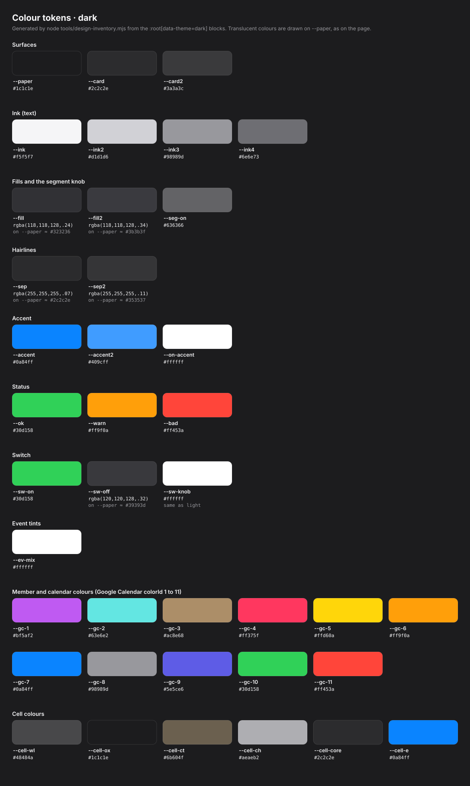

# Design tokens and measurements

> Generated by `node tools/design-inventory.mjs` from every `.css` file under `skills/*/assets/` (13 files, 1628 lines, 3540 declarations). Do not edit by hand: change the CSS and run the command again.
> The hand-written guide is [design.md](../../skills/team-site-design-system/references/design.md). Component states: [components.md](components.md). Motion: [motion.md](motion.md).

Every row links to the line it comes from. `›` joins nested `@media` blocks. The sign-in page keeps its own small style sheet inside `functions/_middleware.js`; it is not part of these tables (its motion is in [motion.md](motion.md)).

## Contents

- [Files scanned](#files-scanned)
- [Colour palette](#colour-palette)
- [Tokens on :root](#tokens-on-root)
- [Print overrides](#print-overrides)
- [Custom properties on components](#custom-properties-on-components)
- [Custom properties set outside the CSS](#custom-properties-set-outside-the-css)
- [Colour literals outside the token blocks](#colour-literals-outside-the-token-blocks)
- [Font sizes](#font-sizes)
- [Font weights](#font-weights)
- [Line heights](#line-heights)
- [Letter spacing](#letter-spacing)
- [Radii](#radii)
- [Spacing](#spacing)
- [Z-index layers](#z-index-layers)
- [Box shadows](#box-shadows)
- [Breakpoints](#breakpoints)
- [Media queries in the JS](#media-queries-in-the-js)

## Files scanned

| File | Skill | Lines | Rules | Declarations | `@media` blocks |
|---|---|---:|---:|---:|---:|
| [guide.css](../../skills/first-visit-spotlight-guide/assets/site/css/guide.css) | first-visit-spotlight-guide | 48 | 27 | 133 | 2 |
| [push.css](../../skills/ios-webapp-push/assets/site/css/push.css) | ios-webapp-push | 79 | 52 | 165 | 2 |
| [lecture-notes-reader/doc.css](../../skills/lecture-notes-reader/assets/site/css/doc.css) | lecture-notes-reader | 48 | 34 | 97 | 2 |
| [reader.css](../../skills/lecture-notes-reader/assets/site/css/reader.css) | lecture-notes-reader | 243 | 174 | 484 | 9 |
| [theory.css](../../skills/lecture-notes-reader/assets/site/css/theory.css) | lecture-notes-reader | 127 | 88 | 216 | 7 |
| [refs.css](../../skills/references-library/assets/site/css/refs.css) | references-library | 132 | 94 | 300 | 4 |
| [intro.css](../../skills/scroll-3d-intro/assets/intro.css) | scroll-3d-intro | 87 | 47 | 165 | 6 |
| [calendar.css](../../skills/shared-google-calendar/assets/site/css/calendar.css) | shared-google-calendar | 282 | 199 | 653 | 9 |
| [chat.css](../../skills/team-chat/assets/site/css/chat.css) | team-chat | 135 | 97 | 339 | 6 |
| [components.css](../../skills/team-site-design-system/assets/components.css) | team-site-design-system | 214 | 158 | 485 | 13 |
| [team-site-design-system/doc.css](../../skills/team-site-design-system/assets/doc.css) | team-site-design-system | 46 | 34 | 97 | 2 |
| [tokens.css](../../skills/team-site-design-system/assets/tokens.css) | team-site-design-system | 69 | 17 | 169 | 1 |
| [records.css](../../skills/weekly-research-log/assets/site/css/records.css) | weekly-research-log | 118 | 80 | 237 | 4 |

## Colour palette

Every token whose value is a colour, drawn by this script. Translucent fills and hairlines are drawn on `--paper`, as they appear on the page; the third line gives the colour that results.

## Tokens on :root

Three blocks carry the same names: `:root` (light), `:root[data-theme=dark]` (dark chosen with the theme button) and `@media (prefers-color-scheme:dark) { :root:not([data-theme=light]) }` (dark from the system when nothing is chosen). An empty cell means the block does not set the token, so the light value is inherited. **Read** counts the `var()` reads in all skill CSS.

**Check:** the dark block and the system-dark block set the same tokens to the same values (compared by this script).

**Read only from the JS** (no CSS rule reads them; the JS writes `var(...)` into an inline style): `--gc-1`, `--gc-2`, `--gc-3`, `--gc-4`, `--gc-5`, `--gc-6`, `--gc-7`, `--gc-8`, `--gc-9`, `--gc-10`, `--gc-11`, in [cal-util.js](../../skills/shared-google-calendar/assets/site/js/cal-util.js), [chat-util.js](../../skills/team-chat/assets/site/js/chat-util.js), [rec-util.js](../../skills/weekly-research-log/assets/site/js/rec-util.js).

**Not read anywhere** (no skill CSS, no site JS or HTML outside the demos): `--card2`, `--lift`, `--cell-wl`, `--cell-ox`, `--cell-ct`, `--cell-ch`, `--cell-core`, `--cell-e`.

### Surfaces

| Token | Light `:root` | Dark `[data-theme=dark]` | System dark `@media` | Read | Defined at |
|---|---|---|---|---:|---|
| `--paper` | `#ffffff` | `#1c1c1e` | `#1c1c1e` | 22 | tokens.css [6](../../skills/team-site-design-system/assets/tokens.css#L6) [21](../../skills/team-site-design-system/assets/tokens.css#L21) [37](../../skills/team-site-design-system/assets/tokens.css#L37) |
| `--card` | `#ffffff` | `#2c2c2e` | `#2c2c2e` | 7 | tokens.css [6](../../skills/team-site-design-system/assets/tokens.css#L6) [21](../../skills/team-site-design-system/assets/tokens.css#L21) [37](../../skills/team-site-design-system/assets/tokens.css#L37) |
| `--card2` | `#f5f5f7` | `#3a3a3c` | `#3a3a3c` | 0 | tokens.css [6](../../skills/team-site-design-system/assets/tokens.css#L6) [21](../../skills/team-site-design-system/assets/tokens.css#L21) [37](../../skills/team-site-design-system/assets/tokens.css#L37) |

### Ink (text)

| Token | Light `:root` | Dark `[data-theme=dark]` | System dark `@media` | Read | Defined at |
|---|---|---|---|---:|---|
| `--ink` | `#1d1d1f` | `#f5f5f7` | `#f5f5f7` | 98 | tokens.css [7](../../skills/team-site-design-system/assets/tokens.css#L7) [22](../../skills/team-site-design-system/assets/tokens.css#L22) [38](../../skills/team-site-design-system/assets/tokens.css#L38) |
| `--ink2` | `#424245` | `#d1d1d6` | `#d1d1d6` | 32 | tokens.css [7](../../skills/team-site-design-system/assets/tokens.css#L7) [22](../../skills/team-site-design-system/assets/tokens.css#L22) [38](../../skills/team-site-design-system/assets/tokens.css#L38) |
| `--ink3` | `#6e6e73` | `#98989d` | `#98989d` | 70 | tokens.css [7](../../skills/team-site-design-system/assets/tokens.css#L7) [22](../../skills/team-site-design-system/assets/tokens.css#L22) [38](../../skills/team-site-design-system/assets/tokens.css#L38) |
| `--ink4` | `#86868b` | `#6e6e73` | `#6e6e73` | 43 | tokens.css [7](../../skills/team-site-design-system/assets/tokens.css#L7) [22](../../skills/team-site-design-system/assets/tokens.css#L22) [38](../../skills/team-site-design-system/assets/tokens.css#L38) |

### Fills and the segment knob

| Token | Light `:root` | Dark `[data-theme=dark]` | System dark `@media` | Read | Defined at |
|---|---|---|---|---:|---|
| `--fill` | `rgba(118,118,128,.12)` | `rgba(118,118,128,.24)` | `rgba(118,118,128,.24)` | 29 | tokens.css [8](../../skills/team-site-design-system/assets/tokens.css#L8) [23](../../skills/team-site-design-system/assets/tokens.css#L23) [39](../../skills/team-site-design-system/assets/tokens.css#L39) |
| `--fill2` | `rgba(118,118,128,.2)` | `rgba(118,118,128,.34)` | `rgba(118,118,128,.34)` | 2 | tokens.css [8](../../skills/team-site-design-system/assets/tokens.css#L8) [23](../../skills/team-site-design-system/assets/tokens.css#L23) [39](../../skills/team-site-design-system/assets/tokens.css#L39) |
| `--seg-on` | `#ffffff` | `#636366` | `#636366` | 3 | tokens.css [8](../../skills/team-site-design-system/assets/tokens.css#L8) [23](../../skills/team-site-design-system/assets/tokens.css#L23) [39](../../skills/team-site-design-system/assets/tokens.css#L39) |

### Hairlines

| Token | Light `:root` | Dark `[data-theme=dark]` | System dark `@media` | Read | Defined at |
|---|---|---|---|---:|---|
| `--sep` | `rgba(60,60,67,.14)` | `rgba(255,255,255,.07)` | `rgba(255,255,255,.07)` | 19 | tokens.css [9](../../skills/team-site-design-system/assets/tokens.css#L9) [24](../../skills/team-site-design-system/assets/tokens.css#L24) [40](../../skills/team-site-design-system/assets/tokens.css#L40) |
| `--sep2` | `rgba(60,60,67,.26)` | `rgba(255,255,255,.11)` | `rgba(255,255,255,.11)` | 50 | tokens.css [9](../../skills/team-site-design-system/assets/tokens.css#L9) [24](../../skills/team-site-design-system/assets/tokens.css#L24) [40](../../skills/team-site-design-system/assets/tokens.css#L40) |

### Accent

| Token | Light `:root` | Dark `[data-theme=dark]` | System dark `@media` | Read | Defined at |
|---|---|---|---|---:|---|
| `--today` | `5%` | `3%` | `3%` | 2 | tokens.css [9](../../skills/team-site-design-system/assets/tokens.css#L9) [24](../../skills/team-site-design-system/assets/tokens.css#L24) [40](../../skills/team-site-design-system/assets/tokens.css#L40) |
| `--accent` | `#0071e3` | `#0a84ff` | `#0a84ff` | 56 | tokens.css [10](../../skills/team-site-design-system/assets/tokens.css#L10) [25](../../skills/team-site-design-system/assets/tokens.css#L25) [41](../../skills/team-site-design-system/assets/tokens.css#L41) |
| `--accent2` | `#0077ed` | `#409cff` | `#409cff` | 2 | tokens.css [10](../../skills/team-site-design-system/assets/tokens.css#L10) [25](../../skills/team-site-design-system/assets/tokens.css#L25) [41](../../skills/team-site-design-system/assets/tokens.css#L41) |
| `--on-accent` | `#ffffff` | `#ffffff` | `#ffffff` | 6 | tokens.css [10](../../skills/team-site-design-system/assets/tokens.css#L10) [25](../../skills/team-site-design-system/assets/tokens.css#L25) [41](../../skills/team-site-design-system/assets/tokens.css#L41) |

### Status

| Token | Light `:root` | Dark `[data-theme=dark]` | System dark `@media` | Read | Defined at |
|---|---|---|---|---:|---|
| `--ok` | `#28a745` | `#30d158` | `#30d158` | 3 | tokens.css [11](../../skills/team-site-design-system/assets/tokens.css#L11) [26](../../skills/team-site-design-system/assets/tokens.css#L26) [42](../../skills/team-site-design-system/assets/tokens.css#L42) |
| `--warn` | `#c25e00` | `#ff9f0a` | `#ff9f0a` | 4 | tokens.css [11](../../skills/team-site-design-system/assets/tokens.css#L11) [26](../../skills/team-site-design-system/assets/tokens.css#L26) [42](../../skills/team-site-design-system/assets/tokens.css#L42) |
| `--bad` | `#d70015` | `#ff453a` | `#ff453a` | 11 | tokens.css [11](../../skills/team-site-design-system/assets/tokens.css#L11) [26](../../skills/team-site-design-system/assets/tokens.css#L26) [42](../../skills/team-site-design-system/assets/tokens.css#L42) |

### Switch

| Token | Light `:root` | Dark `[data-theme=dark]` | System dark `@media` | Read | Defined at |
|---|---|---|---|---:|---|
| `--sw-on` | `#34c759` | `#30d158` | `#30d158` | 2 | components.css [117](../../skills/team-site-design-system/assets/components.css#L117) [118](../../skills/team-site-design-system/assets/components.css#L118) [119](../../skills/team-site-design-system/assets/components.css#L119) |
| `--sw-off` | `rgba(120,120,128,.16)` | `rgba(120,120,128,.32)` | `rgba(120,120,128,.32)` | 1 | components.css [117](../../skills/team-site-design-system/assets/components.css#L117) [118](../../skills/team-site-design-system/assets/components.css#L118) [119](../../skills/team-site-design-system/assets/components.css#L119) |
| `--sw-knob` | `#ffffff` |  |  | 1 | components.css [117](../../skills/team-site-design-system/assets/components.css#L117) |

### Event tints

| Token | Light `:root` | Dark `[data-theme=dark]` | System dark `@media` | Read | Defined at |
|---|---|---|---|---:|---|
| `--ev-bg` | `15%` | `26%` | `26%` | 5 | tokens.css [16](../../skills/team-site-design-system/assets/tokens.css#L16) [31](../../skills/team-site-design-system/assets/tokens.css#L31) [47](../../skills/team-site-design-system/assets/tokens.css#L47) |
| `--ev-ink` | `58%` | `52%` | `52%` | 2 | tokens.css [16](../../skills/team-site-design-system/assets/tokens.css#L16) [31](../../skills/team-site-design-system/assets/tokens.css#L31) [47](../../skills/team-site-design-system/assets/tokens.css#L47) |
| `--ev-mix` | `var(--ink)` | `#ffffff` | `#ffffff` | 2 | tokens.css [16](../../skills/team-site-design-system/assets/tokens.css#L16) [31](../../skills/team-site-design-system/assets/tokens.css#L31) [47](../../skills/team-site-design-system/assets/tokens.css#L47) |

### Member and calendar colours (Google Calendar colorId 1 to 11)

| Token | Light `:root` | Dark `[data-theme=dark]` | System dark `@media` | Read | Defined at |
|---|---|---|---|---:|---|
| `--gc-1` | `#af52de` | `#bf5af2` | `#bf5af2` | 0 | tokens.css [14](../../skills/team-site-design-system/assets/tokens.css#L14) [29](../../skills/team-site-design-system/assets/tokens.css#L29) [45](../../skills/team-site-design-system/assets/tokens.css#L45) |
| `--gc-2` | `#00c7be` | `#63e6e2` | `#63e6e2` | 0 | tokens.css [14](../../skills/team-site-design-system/assets/tokens.css#L14) [29](../../skills/team-site-design-system/assets/tokens.css#L29) [45](../../skills/team-site-design-system/assets/tokens.css#L45) |
| `--gc-3` | `#a2845e` | `#ac8e68` | `#ac8e68` | 0 | tokens.css [14](../../skills/team-site-design-system/assets/tokens.css#L14) [29](../../skills/team-site-design-system/assets/tokens.css#L29) [45](../../skills/team-site-design-system/assets/tokens.css#L45) |
| `--gc-4` | `#ff2d55` | `#ff375f` | `#ff375f` | 0 | tokens.css [14](../../skills/team-site-design-system/assets/tokens.css#L14) [29](../../skills/team-site-design-system/assets/tokens.css#L29) [45](../../skills/team-site-design-system/assets/tokens.css#L45) |
| `--gc-5` | `#ffcc00` | `#ffd60a` | `#ffd60a` | 0 | tokens.css [14](../../skills/team-site-design-system/assets/tokens.css#L14) [29](../../skills/team-site-design-system/assets/tokens.css#L29) [45](../../skills/team-site-design-system/assets/tokens.css#L45) |
| `--gc-6` | `#ff9500` | `#ff9f0a` | `#ff9f0a` | 0 | tokens.css [14](../../skills/team-site-design-system/assets/tokens.css#L14) [29](../../skills/team-site-design-system/assets/tokens.css#L29) [45](../../skills/team-site-design-system/assets/tokens.css#L45) |
| `--gc-7` | `#007aff` | `#0a84ff` | `#0a84ff` | 0 | tokens.css [15](../../skills/team-site-design-system/assets/tokens.css#L15) [30](../../skills/team-site-design-system/assets/tokens.css#L30) [46](../../skills/team-site-design-system/assets/tokens.css#L46) |
| `--gc-8` | `#8e8e93` | `#98989d` | `#98989d` | 0 | tokens.css [15](../../skills/team-site-design-system/assets/tokens.css#L15) [30](../../skills/team-site-design-system/assets/tokens.css#L30) [46](../../skills/team-site-design-system/assets/tokens.css#L46) |
| `--gc-9` | `#5856d6` | `#5e5ce6` | `#5e5ce6` | 0 | tokens.css [15](../../skills/team-site-design-system/assets/tokens.css#L15) [30](../../skills/team-site-design-system/assets/tokens.css#L30) [46](../../skills/team-site-design-system/assets/tokens.css#L46) |
| `--gc-10` | `#34c759` | `#30d158` | `#30d158` | 0 | tokens.css [15](../../skills/team-site-design-system/assets/tokens.css#L15) [30](../../skills/team-site-design-system/assets/tokens.css#L30) [46](../../skills/team-site-design-system/assets/tokens.css#L46) |
| `--gc-11` | `#ff3b30` | `#ff453a` | `#ff453a` | 0 | tokens.css [15](../../skills/team-site-design-system/assets/tokens.css#L15) [30](../../skills/team-site-design-system/assets/tokens.css#L30) [46](../../skills/team-site-design-system/assets/tokens.css#L46) |

### Cell colours

| Token | Light `:root` | Dark `[data-theme=dark]` | System dark `@media` | Read | Defined at |
|---|---|---|---|---:|---|
| `--cell-wl` | `#d2d2d7` | `#48484a` | `#48484a` | 0 | tokens.css [17](../../skills/team-site-design-system/assets/tokens.css#L17) [32](../../skills/team-site-design-system/assets/tokens.css#L32) [48](../../skills/team-site-design-system/assets/tokens.css#L48) |
| `--cell-ox` | `#ffffff` | `#1c1c1e` | `#1c1c1e` | 0 | tokens.css [17](../../skills/team-site-design-system/assets/tokens.css#L17) [32](../../skills/team-site-design-system/assets/tokens.css#L32) [48](../../skills/team-site-design-system/assets/tokens.css#L48) |
| `--cell-ct` | `#e3d6bf` | `#6b604f` | `#6b604f` | 0 | tokens.css [17](../../skills/team-site-design-system/assets/tokens.css#L17) [32](../../skills/team-site-design-system/assets/tokens.css#L32) [48](../../skills/team-site-design-system/assets/tokens.css#L48) |
| `--cell-ch` | `#86868b` | `#aeaeb2` | `#aeaeb2` | 0 | tokens.css [17](../../skills/team-site-design-system/assets/tokens.css#L17) [32](../../skills/team-site-design-system/assets/tokens.css#L32) [48](../../skills/team-site-design-system/assets/tokens.css#L48) |
| `--cell-core` | `#ececf0` | `#2c2c2e` | `#2c2c2e` | 0 | tokens.css [17](../../skills/team-site-design-system/assets/tokens.css#L17) [32](../../skills/team-site-design-system/assets/tokens.css#L32) [48](../../skills/team-site-design-system/assets/tokens.css#L48) |
| `--cell-e` | `#0071e3` | `#0a84ff` | `#0a84ff` | 0 | tokens.css [17](../../skills/team-site-design-system/assets/tokens.css#L17) [32](../../skills/team-site-design-system/assets/tokens.css#L32) [48](../../skills/team-site-design-system/assets/tokens.css#L48) |

### Fonts

| Token | Light `:root` | Dark `[data-theme=dark]` | System dark `@media` | Read | Defined at |
|---|---|---|---|---:|---|
| `--sans` | `-apple-system,BlinkMacSystemFont,"SF Pro Text","Pretendard Variable",Pretendard,"Segoe UI",system-ui,"Apple SD Gothic Neo","Malgun Gothic",sans-serif` |  |  | 6 | tokens.css [4](../../skills/team-site-design-system/assets/tokens.css#L4) |
| `--mono` | `"SF Mono",ui-monospace,Menlo,Consolas,monospace` |  |  | 3 | tokens.css [5](../../skills/team-site-design-system/assets/tokens.css#L5) |

### Shadows

| Token | Light `:root` | Dark `[data-theme=dark]` | System dark `@media` | Read | Defined at |
|---|---|---|---|---:|---|
| `--lift` | `0 1px 2px rgba(0,0,0,.04),0 0 0 .5px rgba(0,0,0,.05)` | `0 0 0 .5px rgba(255,255,255,.06)` | `0 0 0 .5px rgba(255,255,255,.06)` | 0 | tokens.css [12](../../skills/team-site-design-system/assets/tokens.css#L12) [27](../../skills/team-site-design-system/assets/tokens.css#L27) [43](../../skills/team-site-design-system/assets/tokens.css#L43) |
| `--shadow` | `0 24px 64px rgba(0,0,0,.18),0 2px 8px rgba(0,0,0,.08),0 0 0 .5px rgba(0,0,0,.06)` | `0 24px 64px rgba(0,0,0,.6),0 0 0 .5px rgba(255,255,255,.1)` | `0 24px 64px rgba(0,0,0,.6),0 0 0 .5px rgba(255,255,255,.1)` | 1 | tokens.css [13](../../skills/team-site-design-system/assets/tokens.css#L13) [28](../../skills/team-site-design-system/assets/tokens.css#L28) [44](../../skills/team-site-design-system/assets/tokens.css#L44) |

### Other

| Token | Light `:root` | Dark `[data-theme=dark]` | System dark `@media` | Read | Defined at |
|---|---|---|---|---:|---|
| `--sab` | `max(env(safe-area-inset-bottom,0px),var(--home,0px))` |  |  | 4 | tokens.css [56](../../skills/team-site-design-system/assets/tokens.css#L56) |

## Print overrides

Tokens set again for paper (`@media print`).

| Token | Print value | Screen light value | Where |
|---|---|---|---|
| `--paper` | `#fff` | `#ffffff` | reader.css [220](../../skills/lecture-notes-reader/assets/site/css/reader.css#L220) |
| `--ink` | `#000` | `#1d1d1f` | reader.css [220](../../skills/lecture-notes-reader/assets/site/css/reader.css#L220) |
| `--ink2` | `#000` | `#424245` | reader.css [220](../../skills/lecture-notes-reader/assets/site/css/reader.css#L220) |
| `--ink3` | `#333` | `#6e6e73` | reader.css [220](../../skills/lecture-notes-reader/assets/site/css/reader.css#L220) |
| `--ink4` | `#666` | `#86868b` | reader.css [220](../../skills/lecture-notes-reader/assets/site/css/reader.css#L220) |
| `--fill` | `transparent` | `rgba(118,118,128,.12)` | reader.css [220](../../skills/lecture-notes-reader/assets/site/css/reader.css#L220) |
| `--sep` | `#bbb` | `rgba(60,60,67,.14)` | reader.css [220](../../skills/lecture-notes-reader/assets/site/css/reader.css#L220) |
| `--sep2` | `#999` | `rgba(60,60,67,.26)` | reader.css [220](../../skills/lecture-notes-reader/assets/site/css/reader.css#L220) |
| `--accent` | `#000` | `#0071e3` | reader.css [220](../../skills/lecture-notes-reader/assets/site/css/reader.css#L220) |
| `--bad` | `#000` | `#d70015` | reader.css [220](../../skills/lecture-notes-reader/assets/site/css/reader.css#L220) |

## Custom properties on components

Custom properties defined on a component selector, not on `:root`.

| Property | Value | Selector | Where |
|---|---|---|---|
| `--fl` | `0px` | `.doc :is(.sx-l,.sx-r)` `@media screen` | [lecture-notes-reader/doc.css:37](../../skills/lecture-notes-reader/assets/site/css/doc.css#L37) |
| `--fr` | `0px` | `.doc :is(.sx-l,.sx-r)` `@media screen` | [lecture-notes-reader/doc.css:37](../../skills/lecture-notes-reader/assets/site/css/doc.css#L37) |
| `--fl` | `22px` | `.doc .sx-l` `@media screen` | [lecture-notes-reader/doc.css:39](../../skills/lecture-notes-reader/assets/site/css/doc.css#L39) |
| `--fr` | `28px` | `.doc .sx-r` `@media screen` | [lecture-notes-reader/doc.css:40](../../skills/lecture-notes-reader/assets/site/css/doc.css#L40) |
| `--ix-bg` | `#111216` | `.ix` | [intro.css:4](../../skills/scroll-3d-intro/assets/intro.css#L4) |
| `--ix-ink` | `#f3f0ea` | `.ix` | [intro.css:4](../../skills/scroll-3d-intro/assets/intro.css#L4) |
| `--ix-ink2` | `rgba(243,240,234,.62)` | `.ix` | [intro.css:4](../../skills/scroll-3d-intro/assets/intro.css#L4) |
| `--ix-gut` | `clamp(24px,5.4vw,88px)` | `.ix` | [intro.css:4](../../skills/scroll-3d-intro/assets/intro.css#L4) |
| `--ix-poster` | `none` | `.ix` | [intro.css:5](../../skills/scroll-3d-intro/assets/intro.css#L5) |
| `--ix-poster-tall` | `var(--ix-poster)` | `.ix` | [intro.css:5](../../skills/scroll-3d-intro/assets/intro.css#L5) |
| `--ix-gut` | `20px` | `.ix` `@media (max-aspect-ratio:4/5), (max-width:700px)` | [intro.css:62](../../skills/scroll-3d-intro/assets/intro.css#L62) |
| `--wv-gut` | `56px` | `.wv-body` | [calendar.css:102](../../skills/shared-google-calendar/assets/site/css/calendar.css#L102) |
| `--wv-gut` | `36px` | `.wv-body` `@media (max-width:760px)` | [calendar.css:213](../../skills/shared-google-calendar/assets/site/css/calendar.css#L213) |
| `--gap` | `max(env(safe-area-inset-top,0px),44px)` | `.chat` `@media (max-width:760px)` | [chat.css:80](../../skills/team-chat/assets/site/css/chat.css#L80) |
| `--gap` | `max(env(safe-area-inset-top,0px),10px)` | `.chat.kb` `@media (max-width:760px)` | [chat.css:84](../../skills/team-chat/assets/site/css/chat.css#L84) |
| `--fl` | `0px` | `.doc :is(.sx-l,.sx-r)` `@media screen` | [team-site-design-system/doc.css:35](../../skills/team-site-design-system/assets/doc.css#L35) |
| `--fr` | `0px` | `.doc :is(.sx-l,.sx-r)` `@media screen` | [team-site-design-system/doc.css:35](../../skills/team-site-design-system/assets/doc.css#L35) |
| `--fl` | `22px` | `.doc .sx-l` `@media screen` | [team-site-design-system/doc.css:37](../../skills/team-site-design-system/assets/doc.css#L37) |
| `--fr` | `28px` | `.doc .sx-r` `@media screen` | [team-site-design-system/doc.css:38](../../skills/team-site-design-system/assets/doc.css#L38) |

## Custom properties set outside the CSS

Read with `var()` in the skill CSS but defined by no rule there: the JS or the HTML sets them inline (for example `--c`, a member's colour, on each event). The fallback is the value after the comma in `var()`, used until they are set.

| Property | Reads | Fallbacks written | Read at |
|---|---:|---|---|
| `--app-icon` | 1 | `url(/icons/apple-touch-icon.png)` | push.css [52](../../skills/ios-webapp-push/assets/site/css/push.css#L52) |
| `--c` | 21 | `var(--ink4)` | calendar.css [58](../../skills/shared-google-calendar/assets/site/css/calendar.css#L58) [64](../../skills/shared-google-calendar/assets/site/css/calendar.css#L64) [66](../../skills/shared-google-calendar/assets/site/css/calendar.css#L66) [80](../../skills/shared-google-calendar/assets/site/css/calendar.css#L80) [86](../../skills/shared-google-calendar/assets/site/css/calendar.css#L86) [89](../../skills/shared-google-calendar/assets/site/css/calendar.css#L89) [142](../../skills/shared-google-calendar/assets/site/css/calendar.css#L142) [143](../../skills/shared-google-calendar/assets/site/css/calendar.css#L143) [144](../../skills/shared-google-calendar/assets/site/css/calendar.css#L144) [145](../../skills/shared-google-calendar/assets/site/css/calendar.css#L145) [188](../../skills/shared-google-calendar/assets/site/css/calendar.css#L188) [189](../../skills/shared-google-calendar/assets/site/css/calendar.css#L189) · chat.css [38](../../skills/team-chat/assets/site/css/chat.css#L38) · components.css [20](../../skills/team-site-design-system/assets/components.css#L20) [107](../../skills/team-site-design-system/assets/components.css#L107) [108](../../skills/team-site-design-system/assets/components.css#L108) · records.css [43](../../skills/weekly-research-log/assets/site/css/records.css#L43) |
| `--cal-top` | 6 | `170px` `160px` | calendar.css [102](../../skills/shared-google-calendar/assets/site/css/calendar.css#L102) [105](../../skills/shared-google-calendar/assets/site/css/calendar.css#L105) [213](../../skills/shared-google-calendar/assets/site/css/calendar.css#L213) [214](../../skills/shared-google-calendar/assets/site/css/calendar.css#L214) |
| `--chat-top` | 1 | `0px` | chat.css [5](../../skills/team-chat/assets/site/css/chat.css#L5) |
| `--cl` | 1 | `1` | calendar.css [225](../../skills/shared-google-calendar/assets/site/css/calendar.css#L225) |
| `--e` | 4 | `0` | reader.css [118](../../skills/lecture-notes-reader/assets/site/css/reader.css#L118) [125](../../skills/lecture-notes-reader/assets/site/css/reader.css#L125) · theory.css [46](../../skills/lecture-notes-reader/assets/site/css/theory.css#L46) [55](../../skills/lecture-notes-reader/assets/site/css/theory.css#L55) |
| `--f` | 4 | `0` | reader.css [118](../../skills/lecture-notes-reader/assets/site/css/reader.css#L118) [125](../../skills/lecture-notes-reader/assets/site/css/reader.css#L125) · theory.css [46](../../skills/lecture-notes-reader/assets/site/css/theory.css#L46) [55](../../skills/lecture-notes-reader/assets/site/css/theory.css#L55) |
| `--hh` | 2 | none | calendar.css [141](../../skills/shared-google-calendar/assets/site/css/calendar.css#L141) [223](../../skills/shared-google-calendar/assets/site/css/calendar.css#L223) |
| `--hmax` | 1 | none | calendar.css [141](../../skills/shared-google-calendar/assets/site/css/calendar.css#L141) |
| `--home` | 1 | `0px` | tokens.css [56](../../skills/team-site-design-system/assets/tokens.css#L56) |
| `--i` | 1 | `0` | calendar.css [121](../../skills/shared-google-calendar/assets/site/css/calendar.css#L121) |
| `--ix-ui` | 1 | `1` | intro.css [79](../../skills/scroll-3d-intro/assets/intro.css#L79) |
| `--r` | 4 | `0` | reader.css [118](../../skills/lecture-notes-reader/assets/site/css/reader.css#L118) [125](../../skills/lecture-notes-reader/assets/site/css/reader.css#L125) · theory.css [46](../../skills/lecture-notes-reader/assets/site/css/theory.css#L46) [55](../../skills/lecture-notes-reader/assets/site/css/theory.css#L55) |
| `--refs-bar-h` | 1 | `82px` | refs.css [119](../../skills/references-library/assets/site/css/refs.css#L119) |
| `--t` | 4 | `0` | reader.css [118](../../skills/lecture-notes-reader/assets/site/css/reader.css#L118) [125](../../skills/lecture-notes-reader/assets/site/css/reader.css#L125) · theory.css [46](../../skills/lecture-notes-reader/assets/site/css/theory.css#L46) [55](../../skills/lecture-notes-reader/assets/site/css/theory.css#L55) |
| `--vv-h` | 1 | `100dvh` | chat.css [81](../../skills/team-chat/assets/site/css/chat.css#L81) |
| `--vv-t` | 1 | `0px` | chat.css [80](../../skills/team-chat/assets/site/css/chat.css#L80) |
| `--wv-h` | 4 | none | calendar.css [127](../../skills/shared-google-calendar/assets/site/css/calendar.css#L127) [137](../../skills/shared-google-calendar/assets/site/css/calendar.css#L137) |
| `--wv-n` | 4 | `7` | calendar.css [109](../../skills/shared-google-calendar/assets/site/css/calendar.css#L109) [121](../../skills/shared-google-calendar/assets/site/css/calendar.css#L121) [125](../../skills/shared-google-calendar/assets/site/css/calendar.css#L125) |

## Colour literals outside the token blocks

Hex and `rgb()` colours written anywhere except the `:root` token blocks: shadows, scrims, masks, the intro's own dark scene and a few fixed colours. Use it to check that new colours go into `tokens.css`.

| Literal | Count | Where (selector · property) |
|---|---:|---|
| `#000` | 14 | `.doc :is(.sx-l,.sx-r)` · -webkit-mask-image [lecture-notes-reader/doc.css:37](../../skills/lecture-notes-reader/assets/site/css/doc.css#L37) `@media screen` `.doc :is(.sx-l,.sx-r)` · mask-image [lecture-notes-reader/doc.css:38](../../skills/lecture-notes-reader/assets/site/css/doc.css#L38) `@media screen` `.th-tabs` · -webkit-mask-image [theory.css:107](../../skills/lecture-notes-reader/assets/site/css/theory.css#L107) `@media (max-width:760px)` `.th-tabs` · mask-image [theory.css:107](../../skills/lecture-notes-reader/assets/site/css/theory.css#L107) `@media (max-width:760px)` `.doc :is(.sx-l,.sx-r)` · -webkit-mask-image [team-site-design-system/doc.css:35](../../skills/team-site-design-system/assets/doc.css#L35) `@media screen` `.doc :is(.sx-l,.sx-r)` · mask-image [team-site-design-system/doc.css:36](../../skills/team-site-design-system/assets/doc.css#L36) `@media screen` `.week-tabs` · -webkit-mask-image [records.css:76](../../skills/weekly-research-log/assets/site/css/records.css#L76) `@media (min-width:761px)` `.week-tabs` · mask-image [records.css:76](../../skills/weekly-research-log/assets/site/css/records.css#L76) `@media (min-width:761px)` `.week-tabs` · -webkit-mask-image [records.css:103](../../skills/weekly-research-log/assets/site/css/records.css#L103) `@media (max-width:760px)` `.week-tabs` · mask-image [records.css:103](../../skills/weekly-research-log/assets/site/css/records.css#L103) `@media (max-width:760px)` |
| `#333` | 4 | `.rd-crumbs a,.rd-crumbs a:first-child` · color [reader.css:226](../../skills/lecture-notes-reader/assets/site/css/reader.css#L226) `@media print` `.rd-part-h` · color [reader.css:232](../../skills/lecture-notes-reader/assets/site/css/reader.css#L232) `@media print` `.rd-part-h a,.rd-part-h .pn` · color [reader.css:233](../../skills/lecture-notes-reader/assets/site/css/reader.css#L233) `@media print` `.rd-text figcaption` · color [reader.css:239](../../skills/lecture-notes-reader/assets/site/css/reader.css#L239) `@media print` |
| `#fff` | 3 | `html,body` · background [reader.css:222](../../skills/lecture-notes-reader/assets/site/css/reader.css#L222) `@media print` `.selpop` · color [chat.css:104](../../skills/team-chat/assets/site/css/chat.css#L104) `.btn.danger.armed` · color [components.css:55](../../skills/team-site-design-system/assets/components.css#L55) |
| `rgba(10,11,14,0)` | 3 | `.ix-shade` · background [intro.css:26](../../skills/scroll-3d-intro/assets/intro.css#L26) `.ix-hud` · background [intro.css:31](../../skills/scroll-3d-intro/assets/intro.css#L31) `.ix-shade` · background [intro.css:68](../../skills/scroll-3d-intro/assets/intro.css#L68) `@media (max-aspect-ratio:4/5), (max-width:700px)` |
| `#3a3a3c` | 2 | `:root[data-theme=dark] .selpop` · background [chat.css:106](../../skills/team-chat/assets/site/css/chat.css#L106) `:root:not([data-theme=light]) .selpop` · background [chat.css:107](../../skills/team-chat/assets/site/css/chat.css#L107) `@media (prefers-color-scheme:dark)` |
| `rgba(0,0,0,.04)` | 2 | `.cal-view button[aria-pressed=true]` · box-shadow [calendar.css:22](../../skills/shared-google-calendar/assets/site/css/calendar.css#L22) `.segmented button[aria-pressed=true]` · box-shadow [components.css:79](../../skills/team-site-design-system/assets/components.css#L79) |
| `rgba(0,0,0,.08)` | 2 | `.guide-panel` · box-shadow [guide.css:13](../../skills/first-visit-spotlight-guide/assets/site/css/guide.css#L13) `.chat-tabs button[aria-selected=true]` · box-shadow [chat.css:23](../../skills/team-chat/assets/site/css/chat.css#L23) |
| `rgba(0,0,0,.1)` | 2 | `.cal-view button[aria-pressed=true]` · box-shadow [calendar.css:22](../../skills/shared-google-calendar/assets/site/css/calendar.css#L22) `.segmented button[aria-pressed=true]` · box-shadow [components.css:79](../../skills/team-site-design-system/assets/components.css#L79) |
| `rgba(0,0,0,.16)` | 2 | `.guide-panel` · box-shadow [guide.css:39](../../skills/first-visit-spotlight-guide/assets/site/css/guide.css#L39) `@media (max-width:760px)` `.sw::after` · box-shadow [components.css:123](../../skills/team-site-design-system/assets/components.css#L123) |
| `rgba(0,0,0,.18)` | 2 | `.rd-scrim` · background [reader.css:62](../../skills/lecture-notes-reader/assets/site/css/reader.css#L62) `.chat` · box-shadow [chat.css:82](../../skills/team-chat/assets/site/css/chat.css#L82) `@media (max-width:760px)` |
| `rgba(0,0,0,.28)` | 2 | `.chat-scrim` · background [chat.css:76](../../skills/team-chat/assets/site/css/chat.css#L76) `.dlg::backdrop` · background [components.css:87](../../skills/team-site-design-system/assets/components.css#L87) |
| `rgba(0,0,0,.45)` | 2 | `:root[data-theme=dark] .rd-scrim` · background [reader.css:63](../../skills/lecture-notes-reader/assets/site/css/reader.css#L63) `:root:not([data-theme=light]) .rd-scrim` · background [reader.css:64](../../skills/lecture-notes-reader/assets/site/css/reader.css#L64) `@media (prefers-color-scheme:dark)` |
| `rgba(0,0,0,.55)` | 2 | `.guide-hole` · box-shadow [guide.css:7](../../skills/first-visit-spotlight-guide/assets/site/css/guide.css#L7) `.guide-hole.none` · box-shadow [guide.css:8](../../skills/first-visit-spotlight-guide/assets/site/css/guide.css#L8) |
| `rgba(10,11,14,.5)` | 2 | `.ix-hud` · background [intro.css:31](../../skills/scroll-3d-intro/assets/intro.css#L31) `.ix-heads h1,.ix-heads h2` · text-shadow [intro.css:48](../../skills/scroll-3d-intro/assets/intro.css#L48) |
| `#0b0c0f` | 1 | `.ix-dim` · background [intro.css:24](../../skills/scroll-3d-intro/assets/intro.css#L24) |
| `#111216` | 1 | `.ix` · --ix-bg [intro.css:4](../../skills/scroll-3d-intro/assets/intro.css#L4) |
| `#1d1d1f` | 1 | `.selpop` · background [chat.css:104](../../skills/team-chat/assets/site/css/chat.css#L104) |
| `#f3f0ea` | 1 | `.ix` · --ix-ink [intro.css:4](../../skills/scroll-3d-intro/assets/intro.css#L4) |
| `rgba(0,0,0,.06)` | 1 | `.me-dot` · box-shadow [components.css:20](../../skills/team-site-design-system/assets/components.css#L20) |
| `rgba(0,0,0,.14)` | 1 | `.wv-ev:hover,.wv-ev:focus-visible` · box-shadow [calendar.css:145](../../skills/shared-google-calendar/assets/site/css/calendar.css#L145) |
| `rgba(0,0,0,.15)` | 1 | `.sw::after` · box-shadow [components.css:123](../../skills/team-site-design-system/assets/components.css#L123) |
| `rgba(0,0,0,.2)` | 1 | `.guide-panel` · box-shadow [guide.css:13](../../skills/first-visit-spotlight-guide/assets/site/css/guide.css#L13) |
| `rgba(0,0,0,.22)` | 1 | `.selpop` · box-shadow [chat.css:105](../../skills/team-chat/assets/site/css/chat.css#L105) |
| `rgba(0,0,0,.35)` | 1 | `.chat` · box-shadow [chat.css:6](../../skills/team-chat/assets/site/css/chat.css#L6) |
| `rgba(10,11,14,.40)` | 1 | `.ix-shade` · background [intro.css:26](../../skills/scroll-3d-intro/assets/intro.css#L26) |
| `rgba(10,11,14,.42)` | 1 | `.ix-shade` · background [intro.css:68](../../skills/scroll-3d-intro/assets/intro.css#L68) `@media (max-aspect-ratio:4/5), (max-width:700px)` |
| `rgba(10,11,14,.74)` | 1 | `.ix-shade` · background [intro.css:26](../../skills/scroll-3d-intro/assets/intro.css#L26) |
| `rgba(10,11,14,.78)` | 1 | `.ix-shade` · background [intro.css:68](../../skills/scroll-3d-intro/assets/intro.css#L68) `@media (max-aspect-ratio:4/5), (max-width:700px)` |
| `rgba(243,240,234,.32)` | 1 | `.ix-dots button::after` · background [intro.css:40](../../skills/scroll-3d-intro/assets/intro.css#L40) |
| `rgba(243,240,234,.62)` | 1 | `.ix` · --ix-ink2 [intro.css:4](../../skills/scroll-3d-intro/assets/intro.css#L4) |
| `rgba(255,255,255,.08)` | 1 | `.selpop` · box-shadow [chat.css:105](../../skills/team-chat/assets/site/css/chat.css#L105) |
| `rgba(255,255,255,.12)` | 1 | `.selpop button:hover` · background [chat.css:110](../../skills/team-chat/assets/site/css/chat.css#L110) |
| `rgba(255,255,255,.28)` | 1 | `.selpop i` · background [chat.css:111](../../skills/team-chat/assets/site/css/chat.css#L111) |
| `rgba(255,255,255,.6)` | 1 | `.guide-hole` · box-shadow [guide.css:7](../../skills/first-visit-spotlight-guide/assets/site/css/guide.css#L7) |

## Font sizes

Every `font-size`, and the size inside a `font` shorthand. Largest first; `clamp()` and relative sizes after the pixel sizes, print sizes last. The body is 15 px (`tokens.css`).

| Size | Count | Where |
|---|---:|---|
| `34px` | 1 | `.kpi-v b` [refs.css:34](../../skills/references-library/assets/site/css/refs.css#L34) |
| `28px` | 2 | `.rd-head h1` [reader.css:167](../../skills/lecture-notes-reader/assets/site/css/reader.css#L167) `@media (max-width:760px)` `.kpi-v b` [refs.css:114](../../skills/references-library/assets/site/css/refs.css#L114) `@media (max-width:760px)` |
| `26px` | 2 | `.rd-text h2` [reader.css:80](../../skills/lecture-notes-reader/assets/site/css/reader.css#L80) `.cal-title` [calendar.css:11](../../skills/shared-google-calendar/assets/site/css/calendar.css#L11) |
| `24px` | 3 | `.refs-sec>h2` [refs.css:89](../../skills/references-library/assets/site/css/refs.css#L89) `@media (min-width:761px)` `.refs-sec>h2` [refs.css:126](../../skills/references-library/assets/site/css/refs.css#L126) `@media (max-width:760px)` `.wk-top h2` [records.css:27](../../skills/weekly-research-log/assets/site/css/records.css#L27) |
| `23px` | 1 | `.page-head .page-h` [records.css:98](../../skills/weekly-research-log/assets/site/css/records.css#L98) `@media (max-width:760px)` |
| `22px` | 3 | `.doc h1` [lecture-notes-reader/doc.css:5](../../skills/lecture-notes-reader/assets/site/css/doc.css#L5) `.doc h1` [team-site-design-system/doc.css:3](../../skills/team-site-design-system/assets/doc.css#L3) `.wk-top h2` [records.css:108](../../skills/weekly-research-log/assets/site/css/records.css#L108) `@media (max-width:760px)` |
| `21.5px` | 1 | `.rd-text h2` [reader.css:194](../../skills/lecture-notes-reader/assets/site/css/reader.css#L194) `@media (max-width:760px)` |
| `20px` | 3 | `.install-dlg h2` [push.css:59](../../skills/ios-webapp-push/assets/site/css/push.css#L59) `.up-d b` [calendar.css:77](../../skills/shared-google-calendar/assets/site/css/calendar.css#L77) `.cal-title` [calendar.css:181](../../skills/shared-google-calendar/assets/site/css/calendar.css#L181) `@media (max-width:760px)` |
| `19px` | 5 | `.doc h1` [lecture-notes-reader/doc.css:46](../../skills/lecture-notes-reader/assets/site/css/doc.css#L46) `@media (max-width:760px)` `.cal-title` [calendar.css:266](../../skills/shared-google-calendar/assets/site/css/calendar.css#L266) `@media (max-width:374px)` `.dlg-top h2` [components.css:90](../../skills/team-site-design-system/assets/components.css#L90) `.doc h1` [team-site-design-system/doc.css:44](../../skills/team-site-design-system/assets/doc.css#L44) `@media (max-width:760px)` `.doc-card .doc h1` [records.css:85](../../skills/weekly-research-log/assets/site/css/records.css#L85) `@media (min-width:761px)` |
| `18px` | 1 | `.rd-text h3` [reader.css:82](../../skills/lecture-notes-reader/assets/site/css/reader.css#L82) |
| `17px` | 10 | `.doc h2` [lecture-notes-reader/doc.css:6](../../skills/lecture-notes-reader/assets/site/css/doc.css#L6) `.rd-main` [reader.css:25](../../skills/lecture-notes-reader/assets/site/css/reader.css#L25) `.rd-text` [reader.css:77](../../skills/lecture-notes-reader/assets/site/css/reader.css#L77) `.rd-text h4` [reader.css:84](../../skills/lecture-notes-reader/assets/site/css/reader.css#L84) `.rd-text h3` [reader.css:195](../../skills/lecture-notes-reader/assets/site/css/reader.css#L195) `@media (max-width:760px)` `.step b` [refs.css:44](../../skills/references-library/assets/site/css/refs.css#L44) `.wv-dn` [calendar.css:114](../../skills/shared-google-calendar/assets/site/css/calendar.css#L114) `.cal-title` [calendar.css:270](../../skills/shared-google-calendar/assets/site/css/calendar.css#L270) `@media (max-width:340px)` `.chat-ttl` [chat.css:87](../../skills/team-chat/assets/site/css/chat.css#L87) `@media (max-width:760px)` `.doc h2` [team-site-design-system/doc.css:4](../../skills/team-site-design-system/assets/doc.css#L4) |
| `16.5px` | 2 | `.doc h2` [lecture-notes-reader/doc.css:47](../../skills/lecture-notes-reader/assets/site/css/doc.css#L47) `@media (max-width:760px)` `.doc h2` [team-site-design-system/doc.css:45](../../skills/team-site-design-system/assets/doc.css#L45) `@media (max-width:760px)` |
| `16px` | 6 | `.install-act .btn` [push.css:73](../../skills/ios-webapp-push/assets/site/css/push.css#L73) `@media (max-width:760px)` `.rd` [reader.css:4](../../skills/lecture-notes-reader/assets/site/css/reader.css#L4) `.rd-text` [reader.css:190](../../skills/lecture-notes-reader/assets/site/css/reader.css#L190) `@media (max-width:760px)` `.paper-tools input` [refs.css:129](../../skills/references-library/assets/site/css/refs.css#L129) `@media (max-width:760px)` `.chat-in textarea` [chat.css:98](../../skills/team-chat/assets/site/css/chat.css#L98) `@media (max-width:760px)` `.fld input,.fld textarea` [components.css:137](../../skills/team-site-design-system/assets/components.css#L137) `@media (max-width:760px)` |
| `15px` | 25 | `.guide-h` [guide.css:15](../../skills/first-visit-spotlight-guide/assets/site/css/guide.css#L15) `.guide-p` [guide.css:16](../../skills/first-visit-spotlight-guide/assets/site/css/guide.css#L16) `.push-txt b` [push.css:22](../../skills/ios-webapp-push/assets/site/css/push.css#L22) `.push-ios summary` [push.css:31](../../skills/ios-webapp-push/assets/site/css/push.css#L31) `.install-steps li` [push.css:61](../../skills/ios-webapp-push/assets/site/css/push.css#L61) `.doc` [lecture-notes-reader/doc.css:4](../../skills/lecture-notes-reader/assets/site/css/doc.css#L4) `.doc h3` [lecture-notes-reader/doc.css:7](../../skills/lecture-notes-reader/assets/site/css/doc.css#L7) `.rd-text table` [reader.css:93](../../skills/lecture-notes-reader/assets/site/css/reader.css#L93) `.rd-pn` [reader.css:137](../../skills/lecture-notes-reader/assets/site/css/reader.css#L137) `.rd-back` [reader.css:206](../../skills/lecture-notes-reader/assets/site/css/reader.css#L206) `@media (max-width:760px)` `.th-mtoc summary::after` [theory.css:30](../../skills/lecture-notes-reader/assets/site/css/theory.css#L30) `.link-row b` [refs.css:51](../../skills/references-library/assets/site/css/refs.css#L51) `.wv-dn` [calendar.css:218](../../skills/shared-google-calendar/assets/site/css/calendar.css#L218) `@media (max-width:760px)` `.dt-row .fld:not(.t)>span` [calendar.css:246](../../skills/shared-google-calendar/assets/site/css/calendar.css#L246) `@media (max-width:760px)` `.chat-ttl` [chat.css:20](../../skills/team-chat/assets/site/css/chat.css#L20) `.cm-x` [chat.css:93](../../skills/team-chat/assets/site/css/chat.css#L93) `@media (max-width:760px)` `.selpop.dock` [chat.css:115](../../skills/team-chat/assets/site/css/chat.css#L115) `.brand` [components.css:11](../../skills/team-site-design-system/assets/components.css#L11) `.card-h` [components.css:61](../../skills/team-site-design-system/assets/components.css#L61) `.chk` [components.css:138](../../skills/team-site-design-system/assets/components.css#L138) `@media (max-width:760px)` `.doc` [team-site-design-system/doc.css:2](../../skills/team-site-design-system/assets/doc.css#L2) `.doc h3` [team-site-design-system/doc.css:5](../../skills/team-site-design-system/assets/doc.css#L5) `body` [tokens.css:57](../../skills/team-site-design-system/assets/tokens.css#L57) `.doc-card>header h3` [records.css:35](../../skills/weekly-research-log/assets/site/css/records.css#L35) `.wk-table summary::after` [records.css:82](../../skills/weekly-research-log/assets/site/css/records.css#L82) `@media (min-width:761px)` |
| `14.5px` | 4 | `.rd-sheet` [reader.css:183](../../skills/lecture-notes-reader/assets/site/css/reader.css#L183) `@media (max-width:760px)` `.fact dd` [refs.css:27](../../skills/references-library/assets/site/css/refs.css#L27) `.step p` [refs.css:45](../../skills/references-library/assets/site/css/refs.css#L45) `.paper a.ti` [refs.css:74](../../skills/references-library/assets/site/css/refs.css#L74) |
| `14px` | 17 | `.guide-back` [guide.css:20](../../skills/first-visit-spotlight-guide/assets/site/css/guide.css#L20) `.guide-next` [guide.css:28](../../skills/first-visit-spotlight-guide/assets/site/css/guide.css#L28) `.push-steps li` [push.css:38](../../skills/ios-webapp-push/assets/site/css/push.css#L38) `.install-sub` [push.css:60](../../skills/ios-webapp-push/assets/site/css/push.css#L60) `.install-steps .btn` [push.css:63](../../skills/ios-webapp-push/assets/site/css/push.css#L63) `.install-act .btn` [push.css:67](../../skills/ios-webapp-push/assets/site/css/push.css#L67) `.rd-text figcaption` [reader.css:107](../../skills/lecture-notes-reader/assets/site/css/reader.css#L107) `.rd-bar-btn` [reader.css:174](../../skills/lecture-notes-reader/assets/site/css/reader.css#L174) `@media (max-width:760px)` `.th-tabs a` [theory.css:9](../../skills/lecture-notes-reader/assets/site/css/theory.css#L9) `.refs-sec>p.lead` [refs.css:21](../../skills/references-library/assets/site/css/refs.css#L21) `.kpi-v small` [refs.css:35](../../skills/references-library/assets/site/css/refs.css#L35) `.ix-brand` [intro.css:32](../../skills/scroll-3d-intro/assets/intro.css#L32) `.ix-skip` [intro.css:33](../../skills/scroll-3d-intro/assets/intro.css#L33) `.cm-x` [chat.css:45](../../skills/team-chat/assets/site/css/chat.css#L45) `.chat-in textarea` [chat.css:67](../../skills/team-chat/assets/site/css/chat.css#L67) `.cm-q q` [chat.css:94](../../skills/team-chat/assets/site/css/chat.css#L94) `@media (max-width:760px)` `.brand` [components.css:204](../../skills/team-site-design-system/assets/components.css#L204) `@media (max-width:340px)` |
| `13.5px` | 20 | `.guide-skip` [guide.css:19](../../skills/first-visit-spotlight-guide/assets/site/css/guide.css#L19) `.guide-link` [guide.css:43](../../skills/first-visit-spotlight-guide/assets/site/css/guide.css#L43) `.push-status` [push.css:10](../../skills/ios-webapp-push/assets/site/css/push.css#L10) `.doc table` [lecture-notes-reader/doc.css:20](../../skills/lecture-notes-reader/assets/site/css/doc.css#L20) `.rd-text pre` [reader.css:91](../../skills/lecture-notes-reader/assets/site/css/reader.css#L91) `.rd-sheet .rd-ol .l3 a` [reader.css:189](../../skills/lecture-notes-reader/assets/site/css/reader.css#L189) `@media (max-width:760px)` `.th-toc` [theory.css:17](../../skills/lecture-notes-reader/assets/site/css/theory.css#L17) `.refs-toc` [refs.css:9](../../skills/references-library/assets/site/css/refs.css#L9) `.link-row` [refs.css:49](../../skills/references-library/assets/site/css/refs.css#L49) `.refs-jump a` [refs.css:121](../../skills/references-library/assets/site/css/refs.css#L121) `@media (max-width:760px)` `.up-t .tt` [calendar.css:79](../../skills/shared-google-calendar/assets/site/css/calendar.css#L79) `.chat-empty` [chat.css:34](../../skills/team-chat/assets/site/css/chat.css#L34) `.tabs a` [components.css:14](../../skills/team-site-design-system/assets/components.css#L14) `.btn` [components.css:43](../../skills/team-site-design-system/assets/components.css#L43) `.banner` [components.css:63](../../skills/team-site-design-system/assets/components.css#L63) `.chk` [components.css:99](../../skills/team-site-design-system/assets/components.css#L99) `.doc table` [team-site-design-system/doc.css:18](../../skills/team-site-design-system/assets/doc.css#L18) `.person-tabs button` [records.css:42](../../skills/weekly-research-log/assets/site/css/records.css#L42) `.empty-box` [records.css:48](../../skills/weekly-research-log/assets/site/css/records.css#L48) `.wk-extra ul` [records.css:51](../../skills/weekly-research-log/assets/site/css/records.css#L51) |
| `13px` | 30 | `.push-steps li::before` [push.css:39](../../skills/ios-webapp-push/assets/site/css/push.css#L39) `.rd-toc` [reader.css:31](../../skills/lecture-notes-reader/assets/site/css/reader.css#L31) `.th-mtoc summary` [theory.css:28](../../skills/lecture-notes-reader/assets/site/css/theory.css#L28) `.th-doc figcaption` [theory.css:41](../../skills/lecture-notes-reader/assets/site/css/theory.css#L41) `.th-open` [theory.css:79](../../skills/lecture-notes-reader/assets/site/css/theory.css#L79) `.th-tabs a` [theory.css:121](../../skills/lecture-notes-reader/assets/site/css/theory.css#L121) `@media (max-width:374px)` `.fact dt` [refs.css:26](../../skills/references-library/assets/site/css/refs.css#L26) `.prize-l` [refs.css:37](../../skills/references-library/assets/site/css/refs.css#L37) `.chips button` [refs.css:65](../../skills/references-library/assets/site/css/refs.css#L65) `.papers .grp` [refs.css:70](../../skills/references-library/assets/site/css/refs.css#L70) `.ix-brand` [intro.css:64](../../skills/scroll-3d-intro/assets/intro.css#L64) `@media (max-aspect-ratio:4/5), (max-width:700px)` `.cal-nav .btn.ghost` [calendar.css:14](../../skills/shared-google-calendar/assets/site/css/calendar.css#L14) `.cal-view button` [calendar.css:20](../../skills/shared-google-calendar/assets/site/css/calendar.css#L20) `.dn` [calendar.css:43](../../skills/shared-google-calendar/assets/site/css/calendar.css#L43) `.up-empty` [calendar.css:83](../../skills/shared-google-calendar/assets/site/css/calendar.css#L83) `.legend button` [calendar.css:85](../../skills/shared-google-calendar/assets/site/css/calendar.css#L85) `.gcal-card p` [calendar.css:90](../../skills/shared-google-calendar/assets/site/css/calendar.css#L90) `.cm-q q` [chat.css:50](../../skills/team-chat/assets/site/css/chat.css#L50) `.chat-q q` [chat.css:61](../../skills/team-chat/assets/site/css/chat.css#L61) `.chat-tabs button` [chat.css:88](../../skills/team-chat/assets/site/css/chat.css#L88) `@media (max-width:760px)` `.selpop` [chat.css:105](../../skills/team-chat/assets/site/css/chat.css#L105) `.me` [components.css:18](../../skills/team-site-design-system/assets/components.css#L18) `.eyebrow` [components.css:58](../../skills/team-site-design-system/assets/components.css#L58) `.pill-nav .btn.ghost` [components.css:69](../../skills/team-site-design-system/assets/components.css#L69) `.segmented button` [components.css:77](../../skills/team-site-design-system/assets/components.css#L77) `.seg span` [components.css:106](../../skills/team-site-design-system/assets/components.css#L106) `.dlg-err` [components.css:112](../../skills/team-site-design-system/assets/components.css#L112) `.week-tabs button b` [records.css:13](../../skills/weekly-research-log/assets/site/css/records.css#L13) `.wk-state` [records.css:55](../../skills/weekly-research-log/assets/site/css/records.css#L55) `.wk-table` [records.css:61](../../skills/weekly-research-log/assets/site/css/records.css#L61) |
| `12.5px` | 26 | `.push-txt small` [push.css:23](../../skills/ios-webapp-push/assets/site/css/push.css#L23) `.push-ios summary small` [push.css:33](../../skills/ios-webapp-push/assets/site/css/push.css#L33) `.push-steps small` [push.css:43](../../skills/ios-webapp-push/assets/site/css/push.css#L43) `.doc pre` [lecture-notes-reader/doc.css:17](../../skills/lecture-notes-reader/assets/site/css/doc.css#L17) `.rd-top` [reader.css:7](../../skills/lecture-notes-reader/assets/site/css/reader.css#L7) `.rd-tool` [reader.css:15](../../skills/lecture-notes-reader/assets/site/css/reader.css#L15) `.rd-ol .l3 a` [reader.css:57](../../skills/lecture-notes-reader/assets/site/css/reader.css#L57) `.rd-part-h` [reader.css:69](../../skills/lecture-notes-reader/assets/site/css/reader.css#L69) `.kpi-l` [refs.css:32](../../skills/references-library/assets/site/css/refs.css#L32) `.paper-count` [refs.css:68](../../skills/references-library/assets/site/css/refs.css#L68) `.paper .yr` [refs.css:73](../../skills/references-library/assets/site/css/refs.css#L73) `.paper .au` [refs.css:76](../../skills/references-library/assets/site/css/refs.css#L76) `.paper .note` [refs.css:79](../../skills/references-library/assets/site/css/refs.css#L79) `.chat-tabs button` [chat.css:22](../../skills/team-chat/assets/site/css/chat.css#L22) `.chat-st` [chat.css:28](../../skills/team-chat/assets/site/css/chat.css#L28) `.cm-h` [chat.css:37](../../skills/team-chat/assets/site/css/chat.css#L37) `.btn.small` [components.css:56](../../skills/team-site-design-system/assets/components.css#L56) `.dlg-note` [components.css:110](../../skills/team-site-design-system/assets/components.css#L110) `.tabs a` [components.css:201](../../skills/team-site-design-system/assets/components.css#L201) `@media (max-width:374px)` `.doc pre` [team-site-design-system/doc.css:15](../../skills/team-site-design-system/assets/doc.css#L15) `.wk-top .meta` [records.css:29](../../skills/weekly-research-log/assets/site/css/records.css#L29) `.doc-card>header a,.person-tabs>a` [records.css:37](../../skills/weekly-research-log/assets/site/css/records.css#L37) `.wk-table summary` [records.css:62](../../skills/weekly-research-log/assets/site/css/records.css#L62) `.wk-table td,.wk-table th` [records.css:66](../../skills/weekly-research-log/assets/site/css/records.css#L66) `#rec-repo` [records.css:75](../../skills/weekly-research-log/assets/site/css/records.css#L75) `@media (min-width:761px)` `.page-head>.btn` [records.css:99](../../skills/weekly-research-log/assets/site/css/records.css#L99) `@media (max-width:760px)` |
| `12px` | 24 | `.rd-toc-h` [reader.css:32](../../skills/lecture-notes-reader/assets/site/css/reader.css#L32) `.rd-part>summary` [reader.css:36](../../skills/lecture-notes-reader/assets/site/css/reader.css#L36) `.rd-pn small` [reader.css:140](../../skills/lecture-notes-reader/assets/site/css/reader.css#L140) `.rd-pn b` [reader.css:142](../../skills/lecture-notes-reader/assets/site/css/reader.css#L142) `.th-toc b` [theory.css:18](../../skills/lecture-notes-reader/assets/site/css/theory.css#L18) `.th-pn a small` [theory.css:96](../../skills/lecture-notes-reader/assets/site/css/theory.css#L96) `.refs-toc b` [refs.css:10](../../skills/references-library/assets/site/css/refs.css#L10) `.step .no` [refs.css:43](../../skills/references-library/assets/site/css/refs.css#L43) `.link-row .u` [refs.css:54](../../skills/references-library/assets/site/css/refs.css#L54) `.paper .ve` [refs.css:78](../../skills/references-library/assets/site/css/refs.css#L78) `.sync` [calendar.css:25](../../skills/shared-google-calendar/assets/site/css/calendar.css#L25) `.ev` [calendar.css:51](../../skills/shared-google-calendar/assets/site/css/calendar.css#L51) `.up-t .mt` [calendar.css:82](../../skills/shared-google-calendar/assets/site/css/calendar.css#L82) `.wv-ev` [calendar.css:142](../../skills/shared-google-calendar/assets/site/css/calendar.css#L142) `.cal-head .cal-view button` [calendar.css:272](../../skills/shared-google-calendar/assets/site/css/calendar.css#L272) `@media (max-width:340px)` `.dt-row .fld:not(.t)>span` [calendar.css:275](../../skills/shared-google-calendar/assets/site/css/calendar.css#L275) `@media (max-width:340px)` `.cm-del` [chat.css:42](../../skills/team-chat/assets/site/css/chat.css#L42) `.cm-go` [chat.css:51](../../skills/team-chat/assets/site/css/chat.css#L51) `.chat-err` [chat.css:72](../../skills/team-chat/assets/site/css/chat.css#L72) `.lang-btn` [components.css:24](../../skills/team-site-design-system/assets/components.css#L24) `.foot` [components.css:40](../../skills/team-site-design-system/assets/components.css#L40) `.card-h small` [components.css:62](../../skills/team-site-design-system/assets/components.css#L62) `.sync` [components.css:74](../../skills/team-site-design-system/assets/components.css#L74) `.fld>span` [components.css:94](../../skills/team-site-design-system/assets/components.css#L94) |
| `11.5px` | 10 | `.rd-part-h` [reader.css:168](../../skills/lecture-notes-reader/assets/site/css/reader.css#L168) `@media (max-width:760px)` `.tag` [refs.css:56](../../skills/references-library/assets/site/css/refs.css#L56) `.dow span` [calendar.css:36](../../skills/shared-google-calendar/assets/site/css/calendar.css#L36) `.more` [calendar.css:47](../../skills/shared-google-calendar/assets/site/css/calendar.css#L47) `.gcal-card code` [calendar.css:93](../../skills/shared-google-calendar/assets/site/css/calendar.css#L93) `.wv-dw` [calendar.css:113](../../skills/shared-google-calendar/assets/site/css/calendar.css#L113) `.chat-day` [chat.css:33](../../skills/team-chat/assets/site/css/chat.css#L33) `.cm-at` [chat.css:49](../../skills/team-chat/assets/site/css/chat.css#L49) `.chat-ql` [chat.css:60](../../skills/team-chat/assets/site/css/chat.css#L60) `.tabs a` [components.css:209](../../skills/team-site-design-system/assets/components.css#L209) `@media (max-width:340px)` |
| `11px` | 7 | `.ev .tm` [calendar.css:56](../../skills/shared-google-calendar/assets/site/css/calendar.css#L56) `.wv-ev .tm` [calendar.css:147](../../skills/shared-google-calendar/assets/site/css/calendar.css#L147) `.ev .t` [calendar.css:190](../../skills/shared-google-calendar/assets/site/css/calendar.css#L190) `@media (max-width:760px)` `.day .more` [calendar.css:193](../../skills/shared-google-calendar/assets/site/css/calendar.css#L193) `@media (max-width:760px)` `.wv-dw` [calendar.css:217](../../skills/shared-google-calendar/assets/site/css/calendar.css#L217) `@media (max-width:760px)` `.wv-allcell .more` [calendar.css:239](../../skills/shared-google-calendar/assets/site/css/calendar.css#L239) `@media (max-width:760px)` `.week-tabs button small` [records.css:14](../../skills/weekly-research-log/assets/site/css/records.css#L14) |
| `10.5px` | 5 | `.up-d` [calendar.css:76](../../skills/shared-google-calendar/assets/site/css/calendar.css#L76) `.wv-gut` [calendar.css:118](../../skills/shared-google-calendar/assets/site/css/calendar.css#L118) `.wv-hours span` [calendar.css:129](../../skills/shared-google-calendar/assets/site/css/calendar.css#L129) `.wv-ev` [calendar.css:224](../../skills/shared-google-calendar/assets/site/css/calendar.css#L224) `@media (max-width:760px)` `.wv-alllanes .ev .t` [calendar.css:236](../../skills/shared-google-calendar/assets/site/css/calendar.css#L236) `@media (max-width:760px)` |
| `10px` | 2 | `.wv-ev .tm` [calendar.css:226](../../skills/shared-google-calendar/assets/site/css/calendar.css#L226) `@media (max-width:760px)` `.wv-grp .n` [calendar.css:228](../../skills/shared-google-calendar/assets/site/css/calendar.css#L228) `@media (max-width:760px)` |
| `9.5px` | 2 | `#cal-today .tdy` [calendar.css:204](../../skills/shared-google-calendar/assets/site/css/calendar.css#L204) `@media (max-width:760px)` (in `font`) `.wv-hours span` [calendar.css:220](../../skills/shared-google-calendar/assets/site/css/calendar.css#L220) `@media (max-width:760px)` |
| `9px` | 1 | `.wv-gut` [calendar.css:219](../../skills/shared-google-calendar/assets/site/css/calendar.css#L219) `@media (max-width:760px)` |
| `0` | 1 | `.lanes .ev` [calendar.css:186](../../skills/shared-google-calendar/assets/site/css/calendar.css#L186) `@media (max-width:760px)` |
| `1.21em` | 2 | `.doc .katex-display.wide+.eq-n` [lecture-notes-reader/doc.css:36](../../skills/lecture-notes-reader/assets/site/css/doc.css#L36) `@media screen` (in `font`) `.doc .katex-display.wide+.eq-n` [team-site-design-system/doc.css:34](../../skills/team-site-design-system/assets/doc.css#L34) `@media screen` (in `font`) |
| `1.1em` | 2 | `.rd-text .katex-display>.katex,.rd-text .katex-display.wide+.eq-n` [reader.css:191](../../skills/lecture-notes-reader/assets/site/css/reader.css#L191) `@media (max-width:760px)` `.th-doc .katex-display>.katex,.th-doc .katex-display.wide+.eq-n` [theory.css:100](../../skills/lecture-notes-reader/assets/site/css/theory.css#L100) `@media (max-width:760px)` |
| `1em` | 3 | `.rd-ol .katex` [reader.css:58](../../skills/lecture-notes-reader/assets/site/css/reader.css#L58) `.rd-where .katex` [reader.css:178](../../skills/lecture-notes-reader/assets/site/css/reader.css#L178) `@media (max-width:760px)` `.ix-heads h1,.ix-heads h2` [intro.css:47](../../skills/scroll-3d-intro/assets/intro.css#L47) |
| `.88em` | 1 | `.rd-text code` [reader.css:90](../../skills/lecture-notes-reader/assets/site/css/reader.css#L90) |
| `.86em` | 3 | `.doc code` [lecture-notes-reader/doc.css:16](../../skills/lecture-notes-reader/assets/site/css/doc.css#L16) `.doc code` [team-site-design-system/doc.css:14](../../skills/team-site-design-system/assets/doc.css#L14) `.ext` [tokens.css:68](../../skills/team-site-design-system/assets/tokens.css#L68) |
| `22pt` | 1 | `.rd-head h1` [reader.css:229](../../skills/lecture-notes-reader/assets/site/css/reader.css#L229) `@media print` |
| `15pt` | 1 | `.rd-text h2` [reader.css:231](../../skills/lecture-notes-reader/assets/site/css/reader.css#L231) `@media print` |
| `12pt` | 1 | `.rd-text h3` [reader.css:234](../../skills/lecture-notes-reader/assets/site/css/reader.css#L234) `@media print` |
| `11pt` | 2 | `.rd-main` [reader.css:227](../../skills/lecture-notes-reader/assets/site/css/reader.css#L227) `@media print` `.rd-text` [reader.css:230](../../skills/lecture-notes-reader/assets/site/css/reader.css#L230) `@media print` |
| `10.5pt` | 1 | `.rd` [reader.css:223](../../skills/lecture-notes-reader/assets/site/css/reader.css#L223) `@media print` |
| `8.5pt` | 2 | `.rd-top` [reader.css:225](../../skills/lecture-notes-reader/assets/site/css/reader.css#L225) `@media print` `.rd-part-h` [reader.css:232](../../skills/lecture-notes-reader/assets/site/css/reader.css#L232) `@media print` |
| `clamp(24px,2.4vw,30px)` | 1 | `.refs-sec>h2` [refs.css:20](../../skills/references-library/assets/site/css/refs.css#L20) |
| `clamp(26px,2.6vw,34px)` | 2 | `#sec-overview>h2` [refs.css:90](../../skills/references-library/assets/site/css/refs.css#L90) `@media (min-width:761px)` `.page-h` [components.css:59](../../skills/team-site-design-system/assets/components.css#L59) |
| `clamp(30px,3.2vw,40px)` | 1 | `.rd-head h1` [reader.css:73](../../skills/lecture-notes-reader/assets/site/css/reader.css#L73) |
| `clamp(34px,10.2vw,44px)` | 1 | `.ix-heads` [intro.css:66](../../skills/scroll-3d-intro/assets/intro.css#L66) `@media (max-aspect-ratio:4/5), (max-width:700px)` |
| `clamp(44px,6.9vw,106px)` | 1 | `.ix-heads` [intro.css:46](../../skills/scroll-3d-intro/assets/intro.css#L46) |
| `inherit` | 2 | `.rd-text .katex .tag` [reader.css:100](../../skills/lecture-notes-reader/assets/site/css/reader.css#L100) `.th-doc .katex .tag` [theory.css:72](../../skills/lecture-notes-reader/assets/site/css/theory.css#L72) |

## Font weights

| Weight | Count | Where |
|---|---:|---|
| `700` | 12 | push.css [59](../../skills/ios-webapp-push/assets/site/css/push.css#L59) · lecture-notes-reader/doc.css [5](../../skills/lecture-notes-reader/assets/site/css/doc.css#L5) · reader.css [73](../../skills/lecture-notes-reader/assets/site/css/reader.css#L73) [80](../../skills/lecture-notes-reader/assets/site/css/reader.css#L80) · refs.css [20](../../skills/references-library/assets/site/css/refs.css#L20) · intro.css [47](../../skills/scroll-3d-intro/assets/intro.css#L47) · calendar.css [11](../../skills/shared-google-calendar/assets/site/css/calendar.css#L11) [204](../../skills/shared-google-calendar/assets/site/css/calendar.css#L204) · components.css [59](../../skills/team-site-design-system/assets/components.css#L59) [90](../../skills/team-site-design-system/assets/components.css#L90) · team-site-design-system/doc.css [3](../../skills/team-site-design-system/assets/doc.css#L3) · records.css [27](../../skills/weekly-research-log/assets/site/css/records.css#L27) |
| `650` | 3 | lecture-notes-reader/doc.css [6](../../skills/lecture-notes-reader/assets/site/css/doc.css#L6) · chat.css [20](../../skills/team-chat/assets/site/css/chat.css#L20) · team-site-design-system/doc.css [4](../../skills/team-site-design-system/assets/doc.css#L4) |
| `600` | 78 | guide.css [15](../../skills/first-visit-spotlight-guide/assets/site/css/guide.css#L15) · push.css [22](../../skills/ios-webapp-push/assets/site/css/push.css#L22) [31](../../skills/ios-webapp-push/assets/site/css/push.css#L31) [39](../../skills/ios-webapp-push/assets/site/css/push.css#L39) [40](../../skills/ios-webapp-push/assets/site/css/push.css#L40) [73](../../skills/ios-webapp-push/assets/site/css/push.css#L73) · lecture-notes-reader/doc.css [7](../../skills/lecture-notes-reader/assets/site/css/doc.css#L7) [14](../../skills/lecture-notes-reader/assets/site/css/doc.css#L14) [22](../../skills/lecture-notes-reader/assets/site/css/doc.css#L22) · reader.css [11](../../skills/lecture-notes-reader/assets/site/css/reader.css#L11) [32](../../skills/lecture-notes-reader/assets/site/css/reader.css#L32) [36](../../skills/lecture-notes-reader/assets/site/css/reader.css#L36) [45](../../skills/lecture-notes-reader/assets/site/css/reader.css#L45) [55](../../skills/lecture-notes-reader/assets/site/css/reader.css#L55) [69](../../skills/lecture-notes-reader/assets/site/css/reader.css#L69) [74](../../skills/lecture-notes-reader/assets/site/css/reader.css#L74) [82](../../skills/lecture-notes-reader/assets/site/css/reader.css#L82) [84](../../skills/lecture-notes-reader/assets/site/css/reader.css#L84) [108](../../skills/lecture-notes-reader/assets/site/css/reader.css#L108) [140](../../skills/lecture-notes-reader/assets/site/css/reader.css#L140) [142](../../skills/lecture-notes-reader/assets/site/css/reader.css#L142) [174](../../skills/lecture-notes-reader/assets/site/css/reader.css#L174) · theory.css [11](../../skills/lecture-notes-reader/assets/site/css/theory.css#L11) [18](../../skills/lecture-notes-reader/assets/site/css/theory.css#L18) [22](../../skills/lecture-notes-reader/assets/site/css/theory.css#L22) [28](../../skills/lecture-notes-reader/assets/site/css/theory.css#L28) [57](../../skills/lecture-notes-reader/assets/site/css/theory.css#L57) [96](../../skills/lecture-notes-reader/assets/site/css/theory.css#L96) · refs.css [10](../../skills/references-library/assets/site/css/refs.css#L10) [15](../../skills/references-library/assets/site/css/refs.css#L15) [34](../../skills/references-library/assets/site/css/refs.css#L34) [43](../../skills/references-library/assets/site/css/refs.css#L43) [44](../../skills/references-library/assets/site/css/refs.css#L44) [51](../../skills/references-library/assets/site/css/refs.css#L51) [56](../../skills/references-library/assets/site/css/refs.css#L56) [67](../../skills/references-library/assets/site/css/refs.css#L67) [70](../../skills/references-library/assets/site/css/refs.css#L70) [77](../../skills/references-library/assets/site/css/refs.css#L77) [123](../../skills/references-library/assets/site/css/refs.css#L123) · intro.css [32](../../skills/scroll-3d-intro/assets/intro.css#L32) · calendar.css [22](../../skills/shared-google-calendar/assets/site/css/calendar.css#L22) [36](../../skills/shared-google-calendar/assets/site/css/calendar.css#L36) [45](../../skills/shared-google-calendar/assets/site/css/calendar.css#L45) [47](../../skills/shared-google-calendar/assets/site/css/calendar.css#L47) [76](../../skills/shared-google-calendar/assets/site/css/calendar.css#L76) [77](../../skills/shared-google-calendar/assets/site/css/calendar.css#L77) [91](../../skills/shared-google-calendar/assets/site/css/calendar.css#L91) [113](../../skills/shared-google-calendar/assets/site/css/calendar.css#L113) [114](../../skills/shared-google-calendar/assets/site/css/calendar.css#L114) [132](../../skills/shared-google-calendar/assets/site/css/calendar.css#L132) [134](../../skills/shared-google-calendar/assets/site/css/calendar.css#L134) [146](../../skills/shared-google-calendar/assets/site/css/calendar.css#L146) [228](../../skills/shared-google-calendar/assets/site/css/calendar.css#L228) · chat.css [24](../../skills/team-chat/assets/site/css/chat.css#L24) [33](../../skills/team-chat/assets/site/css/chat.css#L33) [39](../../skills/team-chat/assets/site/css/chat.css#L39) [44](../../skills/team-chat/assets/site/css/chat.css#L44) [49](../../skills/team-chat/assets/site/css/chat.css#L49) [60](../../skills/team-chat/assets/site/css/chat.css#L60) · components.css [11](../../skills/team-site-design-system/assets/components.css#L11) [16](../../skills/team-site-design-system/assets/components.css#L16) [24](../../skills/team-site-design-system/assets/components.css#L24) [58](../../skills/team-site-design-system/assets/components.css#L58) [61](../../skills/team-site-design-system/assets/components.css#L61) [64](../../skills/team-site-design-system/assets/components.css#L64) [79](../../skills/team-site-design-system/assets/components.css#L79) [108](../../skills/team-site-design-system/assets/components.css#L108) · team-site-design-system/doc.css [5](../../skills/team-site-design-system/assets/doc.css#L5) [12](../../skills/team-site-design-system/assets/doc.css#L12) [20](../../skills/team-site-design-system/assets/doc.css#L20) · records.css [13](../../skills/weekly-research-log/assets/site/css/records.css#L13) [15](../../skills/weekly-research-log/assets/site/css/records.css#L15) [28](../../skills/weekly-research-log/assets/site/css/records.css#L28) [35](../../skills/weekly-research-log/assets/site/css/records.css#L35) [45](../../skills/weekly-research-log/assets/site/css/records.css#L45) [56](../../skills/weekly-research-log/assets/site/css/records.css#L56) [67](../../skills/weekly-research-log/assets/site/css/records.css#L67) [69](../../skills/weekly-research-log/assets/site/css/records.css#L69) |
| `500` | 37 | guide.css [18](../../skills/first-visit-spotlight-guide/assets/site/css/guide.css#L18) [28](../../skills/first-visit-spotlight-guide/assets/site/css/guide.css#L28) [43](../../skills/first-visit-spotlight-guide/assets/site/css/guide.css#L43) · push.css [74](../../skills/ios-webapp-push/assets/site/css/push.css#L74) · reader.css [15](../../skills/lecture-notes-reader/assets/site/css/reader.css#L15) [40](../../skills/lecture-notes-reader/assets/site/css/reader.css#L40) [206](../../skills/lecture-notes-reader/assets/site/css/reader.css#L206) · theory.css [9](../../skills/lecture-notes-reader/assets/site/css/theory.css#L9) [79](../../skills/lecture-notes-reader/assets/site/css/theory.css#L79) · refs.css [27](../../skills/references-library/assets/site/css/refs.css#L27) [32](../../skills/references-library/assets/site/css/refs.css#L32) [35](../../skills/references-library/assets/site/css/refs.css#L35) [65](../../skills/references-library/assets/site/css/refs.css#L65) [74](../../skills/references-library/assets/site/css/refs.css#L74) [121](../../skills/references-library/assets/site/css/refs.css#L121) · intro.css [33](../../skills/scroll-3d-intro/assets/intro.css#L33) · calendar.css [20](../../skills/shared-google-calendar/assets/site/css/calendar.css#L20) [43](../../skills/shared-google-calendar/assets/site/css/calendar.css#L43) [51](../../skills/shared-google-calendar/assets/site/css/calendar.css#L51) [79](../../skills/shared-google-calendar/assets/site/css/calendar.css#L79) [85](../../skills/shared-google-calendar/assets/site/css/calendar.css#L85) [118](../../skills/shared-google-calendar/assets/site/css/calendar.css#L118) [129](../../skills/shared-google-calendar/assets/site/css/calendar.css#L129) [147](../../skills/shared-google-calendar/assets/site/css/calendar.css#L147) [275](../../skills/shared-google-calendar/assets/site/css/calendar.css#L275) · chat.css [22](../../skills/team-chat/assets/site/css/chat.css#L22) [51](../../skills/team-chat/assets/site/css/chat.css#L51) [105](../../skills/team-chat/assets/site/css/chat.css#L105) · components.css [14](../../skills/team-site-design-system/assets/components.css#L14) [18](../../skills/team-site-design-system/assets/components.css#L18) [43](../../skills/team-site-design-system/assets/components.css#L43) [77](../../skills/team-site-design-system/assets/components.css#L77) [94](../../skills/team-site-design-system/assets/components.css#L94) [106](../../skills/team-site-design-system/assets/components.css#L106) · records.css [17](../../skills/weekly-research-log/assets/site/css/records.css#L17) [37](../../skills/weekly-research-log/assets/site/css/records.css#L37) [42](../../skills/weekly-research-log/assets/site/css/records.css#L42) |
| `400` | 6 | push.css [33](../../skills/ios-webapp-push/assets/site/css/push.css#L33) · reader.css [226](../../skills/lecture-notes-reader/assets/site/css/reader.css#L226) · refs.css [71](../../skills/references-library/assets/site/css/refs.css#L71) · calendar.css [56](../../skills/shared-google-calendar/assets/site/css/calendar.css#L56) [246](../../skills/shared-google-calendar/assets/site/css/calendar.css#L246) · components.css [62](../../skills/team-site-design-system/assets/components.css#L62) |
| `inherit` | 3 | reader.css [100](../../skills/lecture-notes-reader/assets/site/css/reader.css#L100) · theory.css [72](../../skills/lecture-notes-reader/assets/site/css/theory.css#L72) · refs.css [87](../../skills/references-library/assets/site/css/refs.css#L87) |

## Line heights

| Line height | Count | Where |
|---|---:|---|
| `17px` | 1 | calendar.css [51](../../skills/shared-google-calendar/assets/site/css/calendar.css#L51) |
| `15px` | 1 | calendar.css [236](../../skills/shared-google-calendar/assets/site/css/calendar.css#L236) |
| `14px` | 2 | calendar.css [190](../../skills/shared-google-calendar/assets/site/css/calendar.css#L190) [217](../../skills/shared-google-calendar/assets/site/css/calendar.css#L217) |
| `13px` | 1 | calendar.css [224](../../skills/shared-google-calendar/assets/site/css/calendar.css#L224) |
| `12px` | 2 | calendar.css [226](../../skills/shared-google-calendar/assets/site/css/calendar.css#L226) [228](../../skills/shared-google-calendar/assets/site/css/calendar.css#L228) |
| `1.72` | 1 | reader.css [77](../../skills/lecture-notes-reader/assets/site/css/reader.css#L77) |
| `1.7` | 3 | lecture-notes-reader/doc.css [4](../../skills/lecture-notes-reader/assets/site/css/doc.css#L4) · reader.css [190](../../skills/lecture-notes-reader/assets/site/css/reader.css#L190) · team-site-design-system/doc.css [2](../../skills/team-site-design-system/assets/doc.css#L2) |
| `1.65` | 1 | refs.css [45](../../skills/references-library/assets/site/css/refs.css#L45) |
| `1.55` | 7 | lecture-notes-reader/doc.css [17](../../skills/lecture-notes-reader/assets/site/css/doc.css#L17) · reader.css [107](../../skills/lecture-notes-reader/assets/site/css/reader.css#L107) [230](../../skills/lecture-notes-reader/assets/site/css/reader.css#L230) · refs.css [49](../../skills/references-library/assets/site/css/refs.css#L49) · chat.css [34](../../skills/team-chat/assets/site/css/chat.css#L34) · components.css [96](../../skills/team-site-design-system/assets/components.css#L96) · team-site-design-system/doc.css [15](../../skills/team-site-design-system/assets/doc.css#L15) |
| `1.5` | 6 | guide.css [16](../../skills/first-visit-spotlight-guide/assets/site/css/guide.css#L16) · push.css [38](../../skills/ios-webapp-push/assets/site/css/push.css#L38) · theory.css [41](../../skills/lecture-notes-reader/assets/site/css/theory.css#L41) · calendar.css [90](../../skills/shared-google-calendar/assets/site/css/calendar.css#L90) · chat.css [45](../../skills/team-chat/assets/site/css/chat.css#L45) · tokens.css [57](../../skills/team-site-design-system/assets/tokens.css#L57) |
| `1.45` | 6 | push.css [10](../../skills/ios-webapp-push/assets/site/css/push.css#L10) [60](../../skills/ios-webapp-push/assets/site/css/push.css#L60) [61](../../skills/ios-webapp-push/assets/site/css/push.css#L61) · refs.css [74](../../skills/references-library/assets/site/css/refs.css#L74) · calendar.css [82](../../skills/shared-google-calendar/assets/site/css/calendar.css#L82) · chat.css [50](../../skills/team-chat/assets/site/css/chat.css#L50) |
| `1.4` | 12 | guide.css [15](../../skills/first-visit-spotlight-guide/assets/site/css/guide.css#L15) · lecture-notes-reader/doc.css [6](../../skills/lecture-notes-reader/assets/site/css/doc.css#L6) · reader.css [31](../../skills/lecture-notes-reader/assets/site/css/reader.css#L31) [82](../../skills/lecture-notes-reader/assets/site/css/reader.css#L82) [138](../../skills/lecture-notes-reader/assets/site/css/reader.css#L138) [183](../../skills/lecture-notes-reader/assets/site/css/reader.css#L183) · theory.css [19](../../skills/lecture-notes-reader/assets/site/css/theory.css#L19) [94](../../skills/lecture-notes-reader/assets/site/css/theory.css#L94) · calendar.css [79](../../skills/shared-google-calendar/assets/site/css/calendar.css#L79) · chat.css [61](../../skills/team-chat/assets/site/css/chat.css#L61) [67](../../skills/team-chat/assets/site/css/chat.css#L67) · team-site-design-system/doc.css [4](../../skills/team-site-design-system/assets/doc.css#L4) |
| `1.35` | 1 | records.css [85](../../skills/weekly-research-log/assets/site/css/records.css#L85) |
| `1.3` | 5 | lecture-notes-reader/doc.css [5](../../skills/lecture-notes-reader/assets/site/css/doc.css#L5) [36](../../skills/lecture-notes-reader/assets/site/css/doc.css#L36) · refs.css [44](../../skills/references-library/assets/site/css/refs.css#L44) · team-site-design-system/doc.css [3](../../skills/team-site-design-system/assets/doc.css#L3) [34](../../skills/team-site-design-system/assets/doc.css#L34) |
| `1.25` | 5 | push.css [59](../../skills/ios-webapp-push/assets/site/css/push.css#L59) · reader.css [80](../../skills/lecture-notes-reader/assets/site/css/reader.css#L80) · refs.css [89](../../skills/references-library/assets/site/css/refs.css#L89) · calendar.css [142](../../skills/shared-google-calendar/assets/site/css/calendar.css#L142) · records.css [27](../../skills/weekly-research-log/assets/site/css/records.css#L27) |
| `1.2` | 2 | calendar.css [11](../../skills/shared-google-calendar/assets/site/css/calendar.css#L11) [76](../../skills/shared-google-calendar/assets/site/css/calendar.css#L76) |
| `1.18` | 1 | refs.css [20](../../skills/references-library/assets/site/css/refs.css#L20) |
| `1.15` | 1 | refs.css [34](../../skills/references-library/assets/site/css/refs.css#L34) |
| `1.12` | 3 | reader.css [73](../../skills/lecture-notes-reader/assets/site/css/reader.css#L73) · refs.css [90](../../skills/references-library/assets/site/css/refs.css#L90) · components.css [59](../../skills/team-site-design-system/assets/components.css#L59) |
| `1` | 5 | theory.css [30](../../skills/lecture-notes-reader/assets/site/css/theory.css#L30) · intro.css [33](../../skills/scroll-3d-intro/assets/intro.css#L33) [67](../../skills/scroll-3d-intro/assets/intro.css#L67) · calendar.css [204](../../skills/shared-google-calendar/assets/site/css/calendar.css#L204) · records.css [82](../../skills/weekly-research-log/assets/site/css/records.css#L82) |
| `.95` | 1 | intro.css [47](../../skills/scroll-3d-intro/assets/intro.css#L47) |

## Letter spacing

| Letter spacing | Count | Where |
|---|---:|---|
| `-.035em` | 1 | intro.css [47](../../skills/scroll-3d-intro/assets/intro.css#L47) |
| `-.03em` | 1 | refs.css [34](../../skills/references-library/assets/site/css/refs.css#L34) |
| `-.028em` | 1 | reader.css [73](../../skills/lecture-notes-reader/assets/site/css/reader.css#L73) |
| `-.025em` | 4 | refs.css [20](../../skills/references-library/assets/site/css/refs.css#L20) [90](../../skills/references-library/assets/site/css/refs.css#L90) · calendar.css [11](../../skills/shared-google-calendar/assets/site/css/calendar.css#L11) · components.css [59](../../skills/team-site-design-system/assets/components.css#L59) |
| `-.022em` | 6 | push.css [59](../../skills/ios-webapp-push/assets/site/css/push.css#L59) · lecture-notes-reader/doc.css [5](../../skills/lecture-notes-reader/assets/site/css/doc.css#L5) · reader.css [80](../../skills/lecture-notes-reader/assets/site/css/reader.css#L80) · refs.css [89](../../skills/references-library/assets/site/css/refs.css#L89) · team-site-design-system/doc.css [3](../../skills/team-site-design-system/assets/doc.css#L3) · records.css [27](../../skills/weekly-research-log/assets/site/css/records.css#L27) |
| `-.02em` | 4 | calendar.css [77](../../skills/shared-google-calendar/assets/site/css/calendar.css#L77) [114](../../skills/shared-google-calendar/assets/site/css/calendar.css#L114) [204](../../skills/shared-google-calendar/assets/site/css/calendar.css#L204) · components.css [90](../../skills/team-site-design-system/assets/components.css#L90) |
| `-.018em` | 2 | refs.css [44](../../skills/references-library/assets/site/css/refs.css#L44) · records.css [85](../../skills/weekly-research-log/assets/site/css/records.css#L85) |
| `-.015em` | 7 | lecture-notes-reader/doc.css [6](../../skills/lecture-notes-reader/assets/site/css/doc.css#L6) · refs.css [51](../../skills/references-library/assets/site/css/refs.css#L51) · calendar.css [224](../../skills/shared-google-calendar/assets/site/css/calendar.css#L224) · components.css [11](../../skills/team-site-design-system/assets/components.css#L11) [61](../../skills/team-site-design-system/assets/components.css#L61) · team-site-design-system/doc.css [4](../../skills/team-site-design-system/assets/doc.css#L4) · records.css [35](../../skills/weekly-research-log/assets/site/css/records.css#L35) |
| `-.012em` | 4 | guide.css [15](../../skills/first-visit-spotlight-guide/assets/site/css/guide.css#L15) · push.css [22](../../skills/ios-webapp-push/assets/site/css/push.css#L22) [31](../../skills/ios-webapp-push/assets/site/css/push.css#L31) · reader.css [82](../../skills/lecture-notes-reader/assets/site/css/reader.css#L82) |
| `-.01em` | 11 | guide.css [16](../../skills/first-visit-spotlight-guide/assets/site/css/guide.css#L16) [28](../../skills/first-visit-spotlight-guide/assets/site/css/guide.css#L28) · refs.css [27](../../skills/references-library/assets/site/css/refs.css#L27) [35](../../skills/references-library/assets/site/css/refs.css#L35) [74](../../skills/references-library/assets/site/css/refs.css#L74) · calendar.css [52](../../skills/shared-google-calendar/assets/site/css/calendar.css#L52) [79](../../skills/shared-google-calendar/assets/site/css/calendar.css#L79) [142](../../skills/shared-google-calendar/assets/site/css/calendar.css#L142) · chat.css [20](../../skills/team-chat/assets/site/css/chat.css#L20) · components.css [43](../../skills/team-site-design-system/assets/components.css#L43) · records.css [13](../../skills/weekly-research-log/assets/site/css/records.css#L13) |
| `-.006em` | 2 | components.css [14](../../skills/team-site-design-system/assets/components.css#L14) · tokens.css [57](../../skills/team-site-design-system/assets/tokens.css#L57) |
| `-.005em` | 2 | intro.css [32](../../skills/scroll-3d-intro/assets/intro.css#L32) · components.css [58](../../skills/team-site-design-system/assets/components.css#L58) |
| `0` | 2 | refs.css [56](../../skills/references-library/assets/site/css/refs.css#L56) · components.css [62](../../skills/team-site-design-system/assets/components.css#L62) |
| `.01em` | 2 | calendar.css [36](../../skills/shared-google-calendar/assets/site/css/calendar.css#L36) [113](../../skills/shared-google-calendar/assets/site/css/calendar.css#L113) |
| `.02em` | 4 | reader.css [39](../../skills/lecture-notes-reader/assets/site/css/reader.css#L39) [40](../../skills/lecture-notes-reader/assets/site/css/reader.css#L40) · calendar.css [76](../../skills/shared-google-calendar/assets/site/css/calendar.css#L76) · chat.css [33](../../skills/team-chat/assets/site/css/chat.css#L33) |
| `.03em` | 1 | components.css [24](../../skills/team-site-design-system/assets/components.css#L24) |
| `.045em` | 1 | reader.css [36](../../skills/lecture-notes-reader/assets/site/css/reader.css#L36) |
| `.05em` | 2 | reader.css [69](../../skills/lecture-notes-reader/assets/site/css/reader.css#L69) [142](../../skills/lecture-notes-reader/assets/site/css/reader.css#L142) |
| `inherit` | 4 | reader.css [100](../../skills/lecture-notes-reader/assets/site/css/reader.css#L100) · theory.css [72](../../skills/lecture-notes-reader/assets/site/css/theory.css#L72) · tokens.css [63](../../skills/team-site-design-system/assets/tokens.css#L63) [64](../../skills/team-site-design-system/assets/tokens.css#L64) |

## Radii

Every `border-radius` (and its corner longhands), grouped by the value as written.

| Radius | Count | Where |
|---|---:|---|
| `999px` | 11 | `.guide-next` [guide.css:28](../../skills/first-visit-spotlight-guide/assets/site/css/guide.css#L28) `.guide-next::before` [guide.css:29](../../skills/first-visit-spotlight-guide/assets/site/css/guide.css#L29) `.cal-nav` [calendar.css:13](../../skills/shared-google-calendar/assets/site/css/calendar.css#L13) `.cal-view` [calendar.css:19](../../skills/shared-google-calendar/assets/site/css/calendar.css#L19) `.cal-view button` [calendar.css:20](../../skills/shared-google-calendar/assets/site/css/calendar.css#L20) `.me` [components.css:18](../../skills/team-site-design-system/assets/components.css#L18) `.lang-btn` [components.css:24](../../skills/team-site-design-system/assets/components.css#L24) `.btn` [components.css:43](../../skills/team-site-design-system/assets/components.css#L43) `.segmented` [components.css:76](../../skills/team-site-design-system/assets/components.css#L76) `.segmented button` [components.css:77](../../skills/team-site-design-system/assets/components.css#L77) `.seg span` [components.css:106](../../skills/team-site-design-system/assets/components.css#L106) |
| `22px` | 1 | `.selpop.dock` [chat.css:115](../../skills/team-chat/assets/site/css/chat.css#L115) |
| `20px` | 2 | `.selpop.dock button` [chat.css:118](../../skills/team-chat/assets/site/css/chat.css#L118) `.dlg` [components.css:83](../../skills/team-site-design-system/assets/components.css#L83) |
| `18px` | 1 | `.chat-in textarea` [chat.css:66](../../skills/team-chat/assets/site/css/chat.css#L66) |
| `16px` | 1 | `.sw` [components.css:121](../../skills/team-site-design-system/assets/components.css#L121) |
| `14px` | 2 | `.guide-panel` [guide.css:12](../../skills/first-visit-spotlight-guide/assets/site/css/guide.css#L12) `.wv-dn` [calendar.css:114](../../skills/shared-google-calendar/assets/site/css/calendar.css#L114) |
| `13px` | 1 | `.dn` [calendar.css:43](../../skills/shared-google-calendar/assets/site/css/calendar.css#L43) |
| `12px` | 1 | `.guide-hole` [guide.css:6](../../skills/first-visit-spotlight-guide/assets/site/css/guide.css#L6) |
| `10px` | 8 | `.guide-skip,.guide-back` [guide.css:18](../../skills/first-visit-spotlight-guide/assets/site/css/guide.css#L18) `.doc pre` [lecture-notes-reader/doc.css:17](../../skills/lecture-notes-reader/assets/site/css/doc.css#L17) `.doc img` [lecture-notes-reader/doc.css:24](../../skills/lecture-notes-reader/assets/site/css/doc.css#L24) `.paper-tools input` [refs.css:62](../../skills/references-library/assets/site/css/refs.css#L62) `.up-list li button` [calendar.css:74](../../skills/shared-google-calendar/assets/site/css/calendar.css#L74) `.fld input,.fld textarea` [components.css:95](../../skills/team-site-design-system/assets/components.css#L95) `.doc pre` [team-site-design-system/doc.css:15](../../skills/team-site-design-system/assets/doc.css#L15) `.doc img` [team-site-design-system/doc.css:22](../../skills/team-site-design-system/assets/doc.css#L22) |
| `9px` | 1 | `.selpop` [chat.css:104](../../skills/team-chat/assets/site/css/chat.css#L104) |
| `8px` | 2 | `.chat-tabs` [chat.css:21](../../skills/team-chat/assets/site/css/chat.css#L21) `.brand` [components.css:11](../../skills/team-site-design-system/assets/components.css#L11) |
| `7px` | 1 | `.doc-card>header a,.person-tabs>a` [records.css:37](../../skills/weekly-research-log/assets/site/css/records.css#L37) |
| `6px` | 4 | `.wv-ev` [calendar.css:141](../../skills/shared-google-calendar/assets/site/css/calendar.css#L141) `.chat-tabs button` [chat.css:22](../../skills/team-chat/assets/site/css/chat.css#L22) `.selpop button` [chat.css:109](../../skills/team-chat/assets/site/css/chat.css#L109) `.wk-table summary` [records.css:62](../../skills/weekly-research-log/assets/site/css/records.css#L62) |
| `5px` | 5 | `.doc code` [lecture-notes-reader/doc.css:16](../../skills/lecture-notes-reader/assets/site/css/doc.css#L16) `.more` [calendar.css:47](../../skills/shared-google-calendar/assets/site/css/calendar.css#L47) `.ev` [calendar.css:51](../../skills/shared-google-calendar/assets/site/css/calendar.css#L51) `.wv-hours .wv-nowlbl` [calendar.css:134](../../skills/shared-google-calendar/assets/site/css/calendar.css#L134) `.doc code` [team-site-design-system/doc.css:14](../../skills/team-site-design-system/assets/doc.css#L14) |
| `4.5px` | 1 | `#cal-today .tdy` [calendar.css:203](../../skills/shared-google-calendar/assets/site/css/calendar.css#L203) `@media (max-width:760px)` |
| `4px` | 3 | `.gmark` [calendar.css:95](../../skills/shared-google-calendar/assets/site/css/calendar.css#L95) `.wv-ev` [calendar.css:224](../../skills/shared-google-calendar/assets/site/css/calendar.css#L224) `@media (max-width:760px)` `.wv-alllanes .ev` [calendar.css:233](../../skills/shared-google-calendar/assets/site/css/calendar.css#L233) `@media (max-width:760px)` |
| `3px` | 2 | `.lanes .ev` [calendar.css:186](../../skills/shared-google-calendar/assets/site/css/calendar.css#L186) `@media (max-width:760px)` `.chat-grab` [chat.css:85](../../skills/team-chat/assets/site/css/chat.css#L85) `@media (max-width:760px)` |
| `2px` | 1 | `mark.cm-mark` [chat.css:126](../../skills/team-chat/assets/site/css/chat.css#L126) |
| `0` | 4 | `.rd-text code` [reader.css:90](../../skills/lecture-notes-reader/assets/site/css/reader.css#L90) `.rd-text pre` [reader.css:91](../../skills/lecture-notes-reader/assets/site/css/reader.css#L91) `.rd-text img` [reader.css:94](../../skills/lecture-notes-reader/assets/site/css/reader.css#L94) `.th-doc figure img` [theory.css:42](../../skills/lecture-notes-reader/assets/site/css/theory.css#L42) |
| `.3em` | 1 | `.g-app::before` [push.css:51](../../skills/ios-webapp-push/assets/site/css/push.css#L51) |
| `50%` | 23 | `.guide-dots i` [guide.css:25](../../skills/first-visit-spotlight-guide/assets/site/css/guide.css#L25) `.push-status::before` [push.css:11](../../skills/ios-webapp-push/assets/site/css/push.css#L11) `.ix-dots button::after` [intro.css:40](../../skills/scroll-3d-intro/assets/intro.css#L40) `.ix-dots button:focus-visible` [intro.css:42](../../skills/scroll-3d-intro/assets/intro.css#L42) `.sync i` [calendar.css:26](../../skills/shared-google-calendar/assets/site/css/calendar.css#L26) `.ev.timed::before` [calendar.css:64](../../skills/shared-google-calendar/assets/site/css/calendar.css#L64) `.up-t .tt::before` [calendar.css:80](../../skills/shared-google-calendar/assets/site/css/calendar.css#L80) `.legend button::before` [calendar.css:86](../../skills/shared-google-calendar/assets/site/css/calendar.css#L86) `.wv-now::before` [calendar.css:150](../../skills/shared-google-calendar/assets/site/css/calendar.css#L150) `.cm-dot` [chat.css:38](../../skills/team-chat/assets/site/css/chat.css#L38) `.chat-qx` [chat.css:62](../../skills/team-chat/assets/site/css/chat.css#L62) `.chat-send` [chat.css:69](../../skills/team-chat/assets/site/css/chat.css#L69) `.rd-tool.chat-btn` [chat.css:133](../../skills/team-chat/assets/site/css/chat.css#L133) `.me-dot` [components.css:20](../../skills/team-site-design-system/assets/components.css#L20) `.chat-dot` [components.css:30](../../skills/team-site-design-system/assets/components.css#L30) `.icon-btn` [components.css:31](../../skills/team-site-design-system/assets/components.css#L31) `.sync i` [components.css:75](../../skills/team-site-design-system/assets/components.css#L75) `.seg span::before` [components.css:107](../../skills/team-site-design-system/assets/components.css#L107) `.sw::after` [components.css:122](../../skills/team-site-design-system/assets/components.css#L122) `.lang-btn` [components.css:180](../../skills/team-site-design-system/assets/components.css#L180) `@media (max-width:760px)` `.week-tabs button .dot` [records.css:22](../../skills/weekly-research-log/assets/site/css/records.css#L22) `.person-tabs button::before` [records.css:43](../../skills/weekly-research-log/assets/site/css/records.css#L43) `.wk-state i` [records.css:57](../../skills/weekly-research-log/assets/site/css/records.css#L57) |
| `14px 14px 0 0` | 2 | `.guide-panel` [guide.css:37](../../skills/first-visit-spotlight-guide/assets/site/css/guide.css#L37) `@media (max-width:760px)` `.chat` [chat.css:82](../../skills/team-chat/assets/site/css/chat.css#L82) `@media (max-width:760px)` |
| `18px 18px 0 0` | 1 | `dialog.dlg` [components.css:133](../../skills/team-site-design-system/assets/components.css#L133) `@media (max-width:760px)` |
| `4px 4px 0 0` | 1 | `.gmark::before` [calendar.css:96](../../skills/shared-google-calendar/assets/site/css/calendar.css#L96) |
| `bottom-left: 0` | 1 | `.ev.allday.cont-l` [calendar.css:60](../../skills/shared-google-calendar/assets/site/css/calendar.css#L60) |
| `bottom-right: 0` | 1 | `.ev.allday.cont-r` [calendar.css:61](../../skills/shared-google-calendar/assets/site/css/calendar.css#L61) |
| `top-left: 0` | 1 | `.ev.allday.cont-l` [calendar.css:60](../../skills/shared-google-calendar/assets/site/css/calendar.css#L60) |
| `top-right: 0` | 1 | `.ev.allday.cont-r` [calendar.css:61](../../skills/shared-google-calendar/assets/site/css/calendar.css#L61) |

## Spacing

Each length in `padding`, `margin` and `gap` (with their longhands), counted one by one: `padding:0 15px` counts `15px` once. Zero and `auto` are left out; a `calc()`, `max()` or `env()` counts as one value. The most used first.

| Value | Count | Properties | Where |
|---|---:|---|---|
| `8px` | 59 | gap ×20, padding ×20, margin ×10, margin-top ×2, column-gap ×1, margin-bottom ×1, margin-left ×1, margin-right ×1, padding-block ×1, padding-bottom ×1, padding-top ×1 | guide.css [23](../../skills/first-visit-spotlight-guide/assets/site/css/guide.css#L23) · push.css [10](../../skills/ios-webapp-push/assets/site/css/push.css#L10) [25](../../skills/ios-webapp-push/assets/site/css/push.css#L25) [31](../../skills/ios-webapp-push/assets/site/css/push.css#L31) [38](../../skills/ios-webapp-push/assets/site/css/push.css#L38) [60](../../skills/ios-webapp-push/assets/site/css/push.css#L60) · lecture-notes-reader/doc.css [5](../../skills/lecture-notes-reader/assets/site/css/doc.css#L5) [8](../../skills/lecture-notes-reader/assets/site/css/doc.css#L8) · reader.css [7](../../skills/lecture-notes-reader/assets/site/css/reader.css#L7) [15](../../skills/lecture-notes-reader/assets/site/css/reader.css#L15) [48](../../skills/lecture-notes-reader/assets/site/css/reader.css#L48) [82](../../skills/lecture-notes-reader/assets/site/css/reader.css#L82) [174](../../skills/lecture-notes-reader/assets/site/css/reader.css#L174) [206](../../skills/lecture-notes-reader/assets/site/css/reader.css#L206) [225](../../skills/lecture-notes-reader/assets/site/css/reader.css#L225) · theory.css [35](../../skills/lecture-notes-reader/assets/site/css/theory.css#L35) · refs.css [12](../../skills/references-library/assets/site/css/refs.css#L12) [56](../../skills/references-library/assets/site/css/refs.css#L56) [61](../../skills/references-library/assets/site/css/refs.css#L61) [65](../../skills/references-library/assets/site/css/refs.css#L65) [70](../../skills/references-library/assets/site/css/refs.css#L70) [119](../../skills/references-library/assets/site/css/refs.css#L119) · calendar.css [9](../../skills/shared-google-calendar/assets/site/css/calendar.css#L9) [74](../../skills/shared-google-calendar/assets/site/css/calendar.css#L74) [83](../../skills/shared-google-calendar/assets/site/css/calendar.css#L83) [111](../../skills/shared-google-calendar/assets/site/css/calendar.css#L111) [118](../../skills/shared-google-calendar/assets/site/css/calendar.css#L118) [156](../../skills/shared-google-calendar/assets/site/css/calendar.css#L156) [159](../../skills/shared-google-calendar/assets/site/css/calendar.css#L159) [179](../../skills/shared-google-calendar/assets/site/css/calendar.css#L179) [180](../../skills/shared-google-calendar/assets/site/css/calendar.css#L180) [245](../../skills/shared-google-calendar/assets/site/css/calendar.css#L245) · chat.css [58](../../skills/team-chat/assets/site/css/chat.css#L58) [65](../../skills/team-chat/assets/site/css/chat.css#L65) [66](../../skills/team-chat/assets/site/css/chat.css#L66) [86](../../skills/team-chat/assets/site/css/chat.css#L86) [96](../../skills/team-chat/assets/site/css/chat.css#L96) [97](../../skills/team-chat/assets/site/css/chat.css#L97) [98](../../skills/team-chat/assets/site/css/chat.css#L98) [118](../../skills/team-chat/assets/site/css/chat.css#L118) · components.css [18](../../skills/team-site-design-system/assets/components.css#L18) [61](../../skills/team-site-design-system/assets/components.css#L61) [99](../../skills/team-site-design-system/assets/components.css#L99) [113](../../skills/team-site-design-system/assets/components.css#L113) [165](../../skills/team-site-design-system/assets/components.css#L165) [167](../../skills/team-site-design-system/assets/components.css#L167) [177](../../skills/team-site-design-system/assets/components.css#L177) [189](../../skills/team-site-design-system/assets/components.css#L189) [193](../../skills/team-site-design-system/assets/components.css#L193) [200](../../skills/team-site-design-system/assets/components.css#L200) · team-site-design-system/doc.css [3](../../skills/team-site-design-system/assets/doc.css#L3) [6](../../skills/team-site-design-system/assets/doc.css#L6) · records.css [37](../../skills/weekly-research-log/assets/site/css/records.css#L37) [41](../../skills/weekly-research-log/assets/site/css/records.css#L41) [64](../../skills/weekly-research-log/assets/site/css/records.css#L64) |
| `6px` | 50 | padding ×20, gap ×14, margin ×11, column-gap ×1, margin-bottom ×1, margin-top ×1, padding-top ×1, row-gap ×1 | guide.css [24](../../skills/first-visit-spotlight-guide/assets/site/css/guide.css#L24) · push.css [7](../../skills/ios-webapp-push/assets/site/css/push.css#L7) [42](../../skills/ios-webapp-push/assets/site/css/push.css#L42) [66](../../skills/ios-webapp-push/assets/site/css/push.css#L66) · lecture-notes-reader/doc.css [6](../../skills/lecture-notes-reader/assets/site/css/doc.css#L6) [9](../../skills/lecture-notes-reader/assets/site/css/doc.css#L9) · reader.css [15](../../skills/lecture-notes-reader/assets/site/css/reader.css#L15) [31](../../skills/lecture-notes-reader/assets/site/css/reader.css#L31) [32](../../skills/lecture-notes-reader/assets/site/css/reader.css#L32) [35](../../skills/lecture-notes-reader/assets/site/css/reader.css#L35) [42](../../skills/lecture-notes-reader/assets/site/css/reader.css#L42) [48](../../skills/lecture-notes-reader/assets/site/css/reader.css#L48) [84](../../skills/lecture-notes-reader/assets/site/css/reader.css#L84) [97](../../skills/lecture-notes-reader/assets/site/css/reader.css#L97) · theory.css [9](../../skills/lecture-notes-reader/assets/site/css/theory.css#L9) [18](../../skills/lecture-notes-reader/assets/site/css/theory.css#L18) [28](../../skills/lecture-notes-reader/assets/site/css/theory.css#L28) [78](../../skills/lecture-notes-reader/assets/site/css/theory.css#L78) [120](../../skills/lecture-notes-reader/assets/site/css/theory.css#L120) · refs.css [12](../../skills/references-library/assets/site/css/refs.css#L12) [128](../../skills/references-library/assets/site/css/refs.css#L128) · calendar.css [40](../../skills/shared-google-calendar/assets/site/css/calendar.css#L40) [80](../../skills/shared-google-calendar/assets/site/css/calendar.css#L80) [83](../../skills/shared-google-calendar/assets/site/css/calendar.css#L83) [92](../../skills/shared-google-calendar/assets/site/css/calendar.css#L92) [111](../../skills/shared-google-calendar/assets/site/css/calendar.css#L111) [118](../../skills/shared-google-calendar/assets/site/css/calendar.css#L118) [141](../../skills/shared-google-calendar/assets/site/css/calendar.css#L141) [216](../../skills/shared-google-calendar/assets/site/css/calendar.css#L216) [265](../../skills/shared-google-calendar/assets/site/css/calendar.css#L265) · chat.css [31](../../skills/team-chat/assets/site/css/chat.css#L31) [33](../../skills/team-chat/assets/site/css/chat.css#L33) [72](../../skills/team-chat/assets/site/css/chat.css#L72) [85](../../skills/team-chat/assets/site/css/chat.css#L85) [86](../../skills/team-chat/assets/site/css/chat.css#L86) · components.css [11](../../skills/team-site-design-system/assets/components.css#L11) [17](../../skills/team-site-design-system/assets/components.css#L17) [24](../../skills/team-site-design-system/assets/components.css#L24) [43](../../skills/team-site-design-system/assets/components.css#L43) [58](../../skills/team-site-design-system/assets/components.css#L58) [103](../../skills/team-site-design-system/assets/components.css#L103) [156](../../skills/team-site-design-system/assets/components.css#L156) [180](../../skills/team-site-design-system/assets/components.css#L180) [196](../../skills/team-site-design-system/assets/components.css#L196) [197](../../skills/team-site-design-system/assets/components.css#L197) · team-site-design-system/doc.css [4](../../skills/team-site-design-system/assets/doc.css#L4) [7](../../skills/team-site-design-system/assets/doc.css#L7) · records.css [12](../../skills/weekly-research-log/assets/site/css/records.css#L12) [66](../../skills/weekly-research-log/assets/site/css/records.css#L66) |
| `12px` | 47 | padding ×32, gap ×9, margin ×3, margin-bottom ×1, margin-top ×1, padding-top ×1 | guide.css [14](../../skills/first-visit-spotlight-guide/assets/site/css/guide.css#L14) [18](../../skills/first-visit-spotlight-guide/assets/site/css/guide.css#L18) · push.css [31](../../skills/ios-webapp-push/assets/site/css/push.css#L31) · lecture-notes-reader/doc.css [17](../../skills/lecture-notes-reader/assets/site/css/doc.css#L17) [21](../../skills/lecture-notes-reader/assets/site/css/doc.css#L21) · reader.css [79](../../skills/lecture-notes-reader/assets/site/css/reader.css#L79) · theory.css [28](../../skills/lecture-notes-reader/assets/site/css/theory.css#L28) [80](../../skills/lecture-notes-reader/assets/site/css/theory.css#L80) [109](../../skills/lecture-notes-reader/assets/site/css/theory.css#L109) [111](../../skills/lecture-notes-reader/assets/site/css/theory.css#L111) · refs.css [38](../../skills/references-library/assets/site/css/refs.css#L38) [49](../../skills/references-library/assets/site/css/refs.css#L49) [61](../../skills/references-library/assets/site/css/refs.css#L61) [62](../../skills/references-library/assets/site/css/refs.css#L62) [72](../../skills/references-library/assets/site/css/refs.css#L72) [112](../../skills/references-library/assets/site/css/refs.css#L112) · intro.css [34](../../skills/scroll-3d-intro/assets/intro.css#L34) · calendar.css [10](../../skills/shared-google-calendar/assets/site/css/calendar.css#L10) [14](../../skills/shared-google-calendar/assets/site/css/calendar.css#L14) [20](../../skills/shared-google-calendar/assets/site/css/calendar.css#L20) [90](../../skills/shared-google-calendar/assets/site/css/calendar.css#L90) · chat.css [19](../../skills/team-chat/assets/site/css/chat.css#L19) [33](../../skills/team-chat/assets/site/css/chat.css#L33) [66](../../skills/team-chat/assets/site/css/chat.css#L66) [88](../../skills/team-chat/assets/site/css/chat.css#L88) [91](../../skills/team-chat/assets/site/css/chat.css#L91) · components.css [56](../../skills/team-site-design-system/assets/components.css#L56) [63](../../skills/team-site-design-system/assets/components.css#L63) [69](../../skills/team-site-design-system/assets/components.css#L69) [77](../../skills/team-site-design-system/assets/components.css#L77) [89](../../skills/team-site-design-system/assets/components.css#L89) [95](../../skills/team-site-design-system/assets/components.css#L95) [96](../../skills/team-site-design-system/assets/components.css#L96) [106](../../skills/team-site-design-system/assets/components.css#L106) [145](../../skills/team-site-design-system/assets/components.css#L145) · team-site-design-system/doc.css [15](../../skills/team-site-design-system/assets/doc.css#L15) [19](../../skills/team-site-design-system/assets/doc.css#L19) · records.css [12](../../skills/weekly-research-log/assets/site/css/records.css#L12) [26](../../skills/weekly-research-log/assets/site/css/records.css#L26) [34](../../skills/weekly-research-log/assets/site/css/records.css#L34) [39](../../skills/weekly-research-log/assets/site/css/records.css#L39) [75](../../skills/weekly-research-log/assets/site/css/records.css#L75) [96](../../skills/weekly-research-log/assets/site/css/records.css#L96) [99](../../skills/weekly-research-log/assets/site/css/records.css#L99) |
| `10px` | 45 | padding ×24, gap ×7, margin ×7, padding-bottom ×2, margin-bottom ×1, margin-right ×1, margin-top ×1, padding-block ×1, padding-top ×1 | guide.css [12](../../skills/first-visit-spotlight-guide/assets/site/css/guide.css#L12) · push.css [18](../../skills/ios-webapp-push/assets/site/css/push.css#L18) [42](../../skills/ios-webapp-push/assets/site/css/push.css#L42) · lecture-notes-reader/doc.css [19](../../skills/lecture-notes-reader/assets/site/css/doc.css#L19) [20](../../skills/lecture-notes-reader/assets/site/css/doc.css#L20) · reader.css [35](../../skills/lecture-notes-reader/assets/site/css/reader.css#L35) [41](../../skills/lecture-notes-reader/assets/site/css/reader.css#L41) [51](../../skills/lecture-notes-reader/assets/site/css/reader.css#L51) [163](../../skills/lecture-notes-reader/assets/site/css/reader.css#L163) [168](../../skills/lecture-notes-reader/assets/site/css/reader.css#L168) [188](../../skills/lecture-notes-reader/assets/site/css/reader.css#L188) · theory.css [19](../../skills/lecture-notes-reader/assets/site/css/theory.css#L19) [32](../../skills/lecture-notes-reader/assets/site/css/theory.css#L32) [41](../../skills/lecture-notes-reader/assets/site/css/theory.css#L41) · refs.css [10](../../skills/references-library/assets/site/css/refs.css#L10) [12](../../skills/references-library/assets/site/css/refs.css#L12) [70](../../skills/references-library/assets/site/css/refs.css#L70) [93](../../skills/references-library/assets/site/css/refs.css#L93) · calendar.css [36](../../skills/shared-google-calendar/assets/site/css/calendar.css#L36) [74](../../skills/shared-google-calendar/assets/site/css/calendar.css#L74) [205](../../skills/shared-google-calendar/assets/site/css/calendar.css#L205) [243](../../skills/shared-google-calendar/assets/site/css/calendar.css#L243) · chat.css [19](../../skills/team-chat/assets/site/css/chat.css#L19) [22](../../skills/team-chat/assets/site/css/chat.css#L22) [28](../../skills/team-chat/assets/site/css/chat.css#L28) [35](../../skills/team-chat/assets/site/css/chat.css#L35) [47](../../skills/team-chat/assets/site/css/chat.css#L47) [57](../../skills/team-chat/assets/site/css/chat.css#L57) [58](../../skills/team-chat/assets/site/css/chat.css#L58) [90](../../skills/team-chat/assets/site/css/chat.css#L90) · components.css [18](../../skills/team-site-design-system/assets/components.css#L18) [61](../../skills/team-site-design-system/assets/components.css#L61) [106](../../skills/team-site-design-system/assets/components.css#L106) [146](../../skills/team-site-design-system/assets/components.css#L146) [151](../../skills/team-site-design-system/assets/components.css#L151) [158](../../skills/team-site-design-system/assets/components.css#L158) [179](../../skills/team-site-design-system/assets/components.css#L179) [186](../../skills/team-site-design-system/assets/components.css#L186) [193](../../skills/team-site-design-system/assets/components.css#L193) · team-site-design-system/doc.css [17](../../skills/team-site-design-system/assets/doc.css#L17) [18](../../skills/team-site-design-system/assets/doc.css#L18) · records.css [34](../../skills/weekly-research-log/assets/site/css/records.css#L34) [107](../../skills/weekly-research-log/assets/site/css/records.css#L107) |
| `2px` | 42 | padding ×17, gap ×11, margin ×5, padding-top ×3, margin-bottom ×2, margin-top ×2, padding-left ×1, row-gap ×1 | guide.css [43](../../skills/first-visit-spotlight-guide/assets/site/css/guide.css#L43) · push.css [59](../../skills/ios-webapp-push/assets/site/css/push.css#L59) [72](../../skills/ios-webapp-push/assets/site/css/push.css#L72) · lecture-notes-reader/doc.css [10](../../skills/lecture-notes-reader/assets/site/css/doc.css#L10) · reader.css [14](../../skills/lecture-notes-reader/assets/site/css/reader.css#L14) [138](../../skills/lecture-notes-reader/assets/site/css/reader.css#L138) [206](../../skills/lecture-notes-reader/assets/site/css/reader.css#L206) · theory.css [28](../../skills/lecture-notes-reader/assets/site/css/theory.css#L28) [94](../../skills/lecture-notes-reader/assets/site/css/theory.css#L94) · refs.css [33](../../skills/references-library/assets/site/css/refs.css#L33) [37](../../skills/references-library/assets/site/css/refs.css#L37) [49](../../skills/references-library/assets/site/css/refs.css#L49) [54](../../skills/references-library/assets/site/css/refs.css#L54) [64](../../skills/references-library/assets/site/css/refs.css#L64) [73](../../skills/references-library/assets/site/css/refs.css#L73) · calendar.css [13](../../skills/shared-google-calendar/assets/site/css/calendar.css#L13) [19](../../skills/shared-google-calendar/assets/site/css/calendar.css#L19) [51](../../skills/shared-google-calendar/assets/site/css/calendar.css#L51) [84](../../skills/shared-google-calendar/assets/site/css/calendar.css#L84) [203](../../skills/shared-google-calendar/assets/site/css/calendar.css#L203) [221](../../skills/shared-google-calendar/assets/site/css/calendar.css#L221) [224](../../skills/shared-google-calendar/assets/site/css/calendar.css#L224) [229](../../skills/shared-google-calendar/assets/site/css/calendar.css#L229) [233](../../skills/shared-google-calendar/assets/site/css/calendar.css#L233) · chat.css [21](../../skills/team-chat/assets/site/css/chat.css#L21) [42](../../skills/team-chat/assets/site/css/chat.css#L42) [47](../../skills/team-chat/assets/site/css/chat.css#L47) [51](../../skills/team-chat/assets/site/css/chat.css#L51) [69](../../skills/team-chat/assets/site/css/chat.css#L69) · components.css [11](../../skills/team-site-design-system/assets/components.css#L11) [13](../../skills/team-site-design-system/assets/components.css#L13) [76](../../skills/team-site-design-system/assets/components.css#L76) [94](../../skills/team-site-design-system/assets/components.css#L94) [209](../../skills/team-site-design-system/assets/components.css#L209) · team-site-design-system/doc.css [8](../../skills/team-site-design-system/assets/doc.css#L8) · records.css [29](../../skills/weekly-research-log/assets/site/css/records.css#L29) [41](../../skills/weekly-research-log/assets/site/css/records.css#L41) [62](../../skills/weekly-research-log/assets/site/css/records.css#L62) [80](../../skills/weekly-research-log/assets/site/css/records.css#L80) |
| `4px` | 41 | padding ×28, margin ×9, margin-top ×2, gap ×1, margin-right ×1 | push.css [31](../../skills/ios-webapp-push/assets/site/css/push.css#L31) [37](../../skills/ios-webapp-push/assets/site/css/push.css#L37) · lecture-notes-reader/doc.css [7](../../skills/lecture-notes-reader/assets/site/css/doc.css#L7) [19](../../skills/lecture-notes-reader/assets/site/css/doc.css#L19) [25](../../skills/lecture-notes-reader/assets/site/css/doc.css#L25) · reader.css [42](../../skills/lecture-notes-reader/assets/site/css/reader.css#L42) [48](../../skills/lecture-notes-reader/assets/site/css/reader.css#L48) [51](../../skills/lecture-notes-reader/assets/site/css/reader.css#L51) [88](../../skills/lecture-notes-reader/assets/site/css/reader.css#L88) [91](../../skills/lecture-notes-reader/assets/site/css/reader.css#L91) [183](../../skills/lecture-notes-reader/assets/site/css/reader.css#L183) [200](../../skills/lecture-notes-reader/assets/site/css/reader.css#L200) · theory.css [115](../../skills/lecture-notes-reader/assets/site/css/theory.css#L115) · refs.css [10](../../skills/references-library/assets/site/css/refs.css#L10) [79](../../skills/references-library/assets/site/css/refs.css#L79) [115](../../skills/references-library/assets/site/css/refs.css#L115) · calendar.css [51](../../skills/shared-google-calendar/assets/site/css/calendar.css#L51) [111](../../skills/shared-google-calendar/assets/site/css/calendar.css#L111) [125](../../skills/shared-google-calendar/assets/site/css/calendar.css#L125) [134](../../skills/shared-google-calendar/assets/site/css/calendar.css#L134) · chat.css [34](../../skills/team-chat/assets/site/css/chat.css#L34) [86](../../skills/team-chat/assets/site/css/chat.css#L86) [91](../../skills/team-chat/assets/site/css/chat.css#L91) [104](../../skills/team-chat/assets/site/css/chat.css#L104) [115](../../skills/team-chat/assets/site/css/chat.css#L115) · components.css [11](../../skills/team-site-design-system/assets/components.css#L11) [113](../../skills/team-site-design-system/assets/components.css#L113) [159](../../skills/team-site-design-system/assets/components.css#L159) [169](../../skills/team-site-design-system/assets/components.css#L169) [198](../../skills/team-site-design-system/assets/components.css#L198) · team-site-design-system/doc.css [5](../../skills/team-site-design-system/assets/doc.css#L5) [17](../../skills/team-site-design-system/assets/doc.css#L17) [23](../../skills/team-site-design-system/assets/doc.css#L23) · records.css [37](../../skills/weekly-research-log/assets/site/css/records.css#L37) [51](../../skills/weekly-research-log/assets/site/css/records.css#L51) [54](../../skills/weekly-research-log/assets/site/css/records.css#L54) [61](../../skills/weekly-research-log/assets/site/css/records.css#L61) [62](../../skills/weekly-research-log/assets/site/css/records.css#L62) |
| `14px` | 36 | padding ×14, margin ×10, gap ×4, margin-top ×4, margin-bottom ×2, padding-left ×2 | push.css [10](../../skills/ios-webapp-push/assets/site/css/push.css#L10) · lecture-notes-reader/doc.css [17](../../skills/lecture-notes-reader/assets/site/css/doc.css#L17) [19](../../skills/lecture-notes-reader/assets/site/css/doc.css#L19) [42](../../skills/lecture-notes-reader/assets/site/css/doc.css#L42) [46](../../skills/lecture-notes-reader/assets/site/css/doc.css#L46) · reader.css [7](../../skills/lecture-notes-reader/assets/site/css/reader.css#L7) [69](../../skills/lecture-notes-reader/assets/site/css/reader.css#L69) [80](../../skills/lecture-notes-reader/assets/site/css/reader.css#L80) [107](../../skills/lecture-notes-reader/assets/site/css/reader.css#L107) [157](../../skills/lecture-notes-reader/assets/site/css/reader.css#L157) · refs.css [10](../../skills/references-library/assets/site/css/refs.css#L10) [20](../../skills/references-library/assets/site/css/refs.css#L20) [38](../../skills/references-library/assets/site/css/refs.css#L38) · calendar.css [9](../../skills/shared-google-calendar/assets/site/css/calendar.css#L9) [72](../../skills/shared-google-calendar/assets/site/css/calendar.css#L72) [82](../../skills/shared-google-calendar/assets/site/css/calendar.css#L82) [84](../../skills/shared-google-calendar/assets/site/css/calendar.css#L84) [256](../../skills/shared-google-calendar/assets/site/css/calendar.css#L256) · chat.css [31](../../skills/team-chat/assets/site/css/chat.css#L31) [45](../../skills/team-chat/assets/site/css/chat.css#L45) [47](../../skills/team-chat/assets/site/css/chat.css#L47) [98](../../skills/team-chat/assets/site/css/chat.css#L98) · components.css [14](../../skills/team-site-design-system/assets/components.css#L14) [60](../../skills/team-site-design-system/assets/components.css#L60) [63](../../skills/team-site-design-system/assets/components.css#L63) [88](../../skills/team-site-design-system/assets/components.css#L88) [196](../../skills/team-site-design-system/assets/components.css#L196) · team-site-design-system/doc.css [15](../../skills/team-site-design-system/assets/doc.css#L15) [17](../../skills/team-site-design-system/assets/doc.css#L17) [40](../../skills/team-site-design-system/assets/doc.css#L40) [44](../../skills/team-site-design-system/assets/doc.css#L44) · records.css [10](../../skills/weekly-research-log/assets/site/css/records.css#L10) [41](../../skills/weekly-research-log/assets/site/css/records.css#L41) [49](../../skills/weekly-research-log/assets/site/css/records.css#L49) [66](../../skills/weekly-research-log/assets/site/css/records.css#L66) |
| `16px` | 33 | padding ×17, gap ×8, margin-top ×4, margin ×3, row-gap ×1 | guide.css [12](../../skills/first-visit-spotlight-guide/assets/site/css/guide.css#L12) [38](../../skills/first-visit-spotlight-guide/assets/site/css/guide.css#L38) · push.css [18](../../skills/ios-webapp-push/assets/site/css/push.css#L18) [25](../../skills/ios-webapp-push/assets/site/css/push.css#L25) [29](../../skills/ios-webapp-push/assets/site/css/push.css#L29) [63](../../skills/ios-webapp-push/assets/site/css/push.css#L63) [66](../../skills/ios-webapp-push/assets/site/css/push.css#L66) · lecture-notes-reader/doc.css [7](../../skills/lecture-notes-reader/assets/site/css/doc.css#L7) · reader.css [183](../../skills/lecture-notes-reader/assets/site/css/reader.css#L183) [197](../../skills/lecture-notes-reader/assets/site/css/reader.css#L197) · theory.css [50](../../skills/lecture-notes-reader/assets/site/css/theory.css#L50) [105](../../skills/lecture-notes-reader/assets/site/css/theory.css#L105) · refs.css [21](../../skills/references-library/assets/site/css/refs.css#L21) [25](../../skills/references-library/assets/site/css/refs.css#L25) [29](../../skills/references-library/assets/site/css/refs.css#L29) [93](../../skills/references-library/assets/site/css/refs.css#L93) [103](../../skills/references-library/assets/site/css/refs.css#L103) [113](../../skills/references-library/assets/site/css/refs.css#L113) [119](../../skills/references-library/assets/site/css/refs.css#L119) · chat.css [86](../../skills/team-chat/assets/site/css/chat.css#L86) [90](../../skills/team-chat/assets/site/css/chat.css#L90) [91](../../skills/team-chat/assets/site/css/chat.css#L91) [96](../../skills/team-chat/assets/site/css/chat.css#L96) [118](../../skills/team-chat/assets/site/css/chat.css#L118) · components.css [40](../../skills/team-site-design-system/assets/components.css#L40) [156](../../skills/team-site-design-system/assets/components.css#L156) [161](../../skills/team-site-design-system/assets/components.css#L161) [162](../../skills/team-site-design-system/assets/components.css#L162) [182](../../skills/team-site-design-system/assets/components.css#L182) · team-site-design-system/doc.css [5](../../skills/team-site-design-system/assets/doc.css#L5) · records.css [7](../../skills/weekly-research-log/assets/site/css/records.css#L7) [26](../../skills/weekly-research-log/assets/site/css/records.css#L26) |
| `20px` | 27 | padding ×13, margin ×5, gap ×3, margin-bottom ×2, margin-top ×1, padding-left ×1, padding-right ×1, padding-top ×1 | guide.css [12](../../skills/first-visit-spotlight-guide/assets/site/css/guide.css#L12) · reader.css [7](../../skills/lecture-notes-reader/assets/site/css/reader.css#L7) [91](../../skills/lecture-notes-reader/assets/site/css/reader.css#L91) [92](../../skills/lecture-notes-reader/assets/site/css/reader.css#L92) [93](../../skills/lecture-notes-reader/assets/site/css/reader.css#L93) [137](../../skills/lecture-notes-reader/assets/site/css/reader.css#L137) [163](../../skills/lecture-notes-reader/assets/site/css/reader.css#L163) [164](../../skills/lecture-notes-reader/assets/site/css/reader.css#L164) [166](../../skills/lecture-notes-reader/assets/site/css/reader.css#L166) [192](../../skills/lecture-notes-reader/assets/site/css/reader.css#L192) [193](../../skills/lecture-notes-reader/assets/site/css/reader.css#L193) [200](../../skills/lecture-notes-reader/assets/site/css/reader.css#L200) · theory.css [36](../../skills/lecture-notes-reader/assets/site/css/theory.css#L36) · refs.css [70](../../skills/references-library/assets/site/css/refs.css#L70) [95](../../skills/references-library/assets/site/css/refs.css#L95) [119](../../skills/references-library/assets/site/css/refs.css#L119) · chat.css [19](../../skills/team-chat/assets/site/css/chat.css#L19) [28](../../skills/team-chat/assets/site/css/chat.css#L28) [31](../../skills/team-chat/assets/site/css/chat.css#L31) [57](../../skills/team-chat/assets/site/css/chat.css#L57) [118](../../skills/team-chat/assets/site/css/chat.css#L118) · components.css [10](../../skills/team-site-design-system/assets/components.css#L10) [88](../../skills/team-site-design-system/assets/components.css#L88) [145](../../skills/team-site-design-system/assets/components.css#L145) [147](../../skills/team-site-design-system/assets/components.css#L147) |
| `1px` | 26 | padding ×14, gap ×7, margin-top ×2, padding-top ×2, margin ×1 | push.css [21](../../skills/ios-webapp-push/assets/site/css/push.css#L21) · lecture-notes-reader/doc.css [16](../../skills/lecture-notes-reader/assets/site/css/doc.css#L16) · theory.css [17](../../skills/lecture-notes-reader/assets/site/css/theory.css#L17) · refs.css [9](../../skills/references-library/assets/site/css/refs.css#L9) [26](../../skills/references-library/assets/site/css/refs.css#L26) [78](../../skills/references-library/assets/site/css/refs.css#L78) · calendar.css [47](../../skills/shared-google-calendar/assets/site/css/calendar.css#L47) [73](../../skills/shared-google-calendar/assets/site/css/calendar.css#L73) [76](../../skills/shared-google-calendar/assets/site/css/calendar.css#L76) [82](../../skills/shared-google-calendar/assets/site/css/calendar.css#L82) [134](../../skills/shared-google-calendar/assets/site/css/calendar.css#L134) [141](../../skills/shared-google-calendar/assets/site/css/calendar.css#L141) [216](../../skills/shared-google-calendar/assets/site/css/calendar.css#L216) [221](../../skills/shared-google-calendar/assets/site/css/calendar.css#L221) [224](../../skills/shared-google-calendar/assets/site/css/calendar.css#L224) [233](../../skills/shared-google-calendar/assets/site/css/calendar.css#L233) [239](../../skills/shared-google-calendar/assets/site/css/calendar.css#L239) · chat.css [47](../../skills/team-chat/assets/site/css/chat.css#L47) [58](../../skills/team-chat/assets/site/css/chat.css#L58) · components.css [63](../../skills/team-site-design-system/assets/components.css#L63) · team-site-design-system/doc.css [14](../../skills/team-site-design-system/assets/doc.css#L14) |
| `7px` | 22 | gap ×10, padding ×9, margin ×2, padding-left ×1 | lecture-notes-reader/doc.css [12](../../skills/lecture-notes-reader/assets/site/css/doc.css#L12) [21](../../skills/lecture-notes-reader/assets/site/css/doc.css#L21) · reader.css [51](../../skills/lecture-notes-reader/assets/site/css/reader.css#L51) [175](../../skills/lecture-notes-reader/assets/site/css/reader.css#L175) · calendar.css [25](../../skills/shared-google-calendar/assets/site/css/calendar.css#L25) [36](../../skills/shared-google-calendar/assets/site/css/calendar.css#L36) [51](../../skills/shared-google-calendar/assets/site/css/calendar.css#L51) [60](../../skills/shared-google-calendar/assets/site/css/calendar.css#L60) [74](../../skills/shared-google-calendar/assets/site/css/calendar.css#L74) [79](../../skills/shared-google-calendar/assets/site/css/calendar.css#L79) [85](../../skills/shared-google-calendar/assets/site/css/calendar.css#L85) [219](../../skills/shared-google-calendar/assets/site/css/calendar.css#L219) [272](../../skills/shared-google-calendar/assets/site/css/calendar.css#L272) · chat.css [37](../../skills/team-chat/assets/site/css/chat.css#L37) · components.css [18](../../skills/team-site-design-system/assets/components.css#L18) [74](../../skills/team-site-design-system/assets/components.css#L74) [106](../../skills/team-site-design-system/assets/components.css#L106) · team-site-design-system/doc.css [10](../../skills/team-site-design-system/assets/doc.css#L10) [19](../../skills/team-site-design-system/assets/doc.css#L19) · records.css [42](../../skills/weekly-research-log/assets/site/css/records.css#L42) |
| `18px` | 21 | margin ×8, padding ×7, margin-bottom ×2, margin-top ×2, padding-left ×1, padding-top ×1 | guide.css [27](../../skills/first-visit-spotlight-guide/assets/site/css/guide.css#L27) · push.css [67](../../skills/ios-webapp-push/assets/site/css/push.css#L67) [72](../../skills/ios-webapp-push/assets/site/css/push.css#L72) · lecture-notes-reader/doc.css [5](../../skills/lecture-notes-reader/assets/site/css/doc.css#L5) [23](../../skills/lecture-notes-reader/assets/site/css/doc.css#L23) [36](../../skills/lecture-notes-reader/assets/site/css/doc.css#L36) · reader.css [91](../../skills/lecture-notes-reader/assets/site/css/reader.css#L91) [92](../../skills/lecture-notes-reader/assets/site/css/reader.css#L92) · theory.css [37](../../skills/lecture-notes-reader/assets/site/css/theory.css#L37) [51](../../skills/lecture-notes-reader/assets/site/css/theory.css#L51) [93](../../skills/lecture-notes-reader/assets/site/css/theory.css#L93) [111](../../skills/lecture-notes-reader/assets/site/css/theory.css#L111) · refs.css [29](../../skills/references-library/assets/site/css/refs.css#L29) · components.css [40](../../skills/team-site-design-system/assets/components.css#L40) [136](../../skills/team-site-design-system/assets/components.css#L136) · team-site-design-system/doc.css [3](../../skills/team-site-design-system/assets/doc.css#L3) [21](../../skills/team-site-design-system/assets/doc.css#L21) [34](../../skills/team-site-design-system/assets/doc.css#L34) · records.css [51](../../skills/weekly-research-log/assets/site/css/records.css#L51) [55](../../skills/weekly-research-log/assets/site/css/records.css#L55) [96](../../skills/weekly-research-log/assets/site/css/records.css#L96) |
| `5px` | 21 | padding ×10, gap ×5, margin ×4, margin-top ×1, padding-left ×1 | guide.css [16](../../skills/first-visit-spotlight-guide/assets/site/css/guide.css#L16) · push.css [60](../../skills/ios-webapp-push/assets/site/css/push.css#L60) · lecture-notes-reader/doc.css [16](../../skills/lecture-notes-reader/assets/site/css/doc.css#L16) · theory.css [19](../../skills/lecture-notes-reader/assets/site/css/theory.css#L19) · refs.css [33](../../skills/references-library/assets/site/css/refs.css#L33) · calendar.css [40](../../skills/shared-google-calendar/assets/site/css/calendar.css#L40) [43](../../skills/shared-google-calendar/assets/site/css/calendar.css#L43) [47](../../skills/shared-google-calendar/assets/site/css/calendar.css#L47) [51](../../skills/shared-google-calendar/assets/site/css/calendar.css#L51) [64](../../skills/shared-google-calendar/assets/site/css/calendar.css#L64) [114](../../skills/shared-google-calendar/assets/site/css/calendar.css#L114) [125](../../skills/shared-google-calendar/assets/site/css/calendar.css#L125) [224](../../skills/shared-google-calendar/assets/site/css/calendar.css#L224) [233](../../skills/shared-google-calendar/assets/site/css/calendar.css#L233) [234](../../skills/shared-google-calendar/assets/site/css/calendar.css#L234) [274](../../skills/shared-google-calendar/assets/site/css/calendar.css#L274) · chat.css [47](../../skills/team-chat/assets/site/css/chat.css#L47) · components.css [93](../../skills/team-site-design-system/assets/components.css#L93) · team-site-design-system/doc.css [14](../../skills/team-site-design-system/assets/doc.css#L14) · records.css [79](../../skills/weekly-research-log/assets/site/css/records.css#L79) [80](../../skills/weekly-research-log/assets/site/css/records.css#L80) |
| `22px` | 18 | margin ×5, padding ×5, padding-left ×3, margin-bottom ×2, gap ×1, padding-bottom ×1, padding-top ×1 | lecture-notes-reader/doc.css [6](../../skills/lecture-notes-reader/assets/site/css/doc.css#L6) [9](../../skills/lecture-notes-reader/assets/site/css/doc.css#L9) · reader.css [57](../../skills/lecture-notes-reader/assets/site/css/reader.css#L57) · theory.css [35](../../skills/lecture-notes-reader/assets/site/css/theory.css#L35) [39](../../skills/lecture-notes-reader/assets/site/css/theory.css#L39) [85](../../skills/lecture-notes-reader/assets/site/css/theory.css#L85) [101](../../skills/lecture-notes-reader/assets/site/css/theory.css#L101) [104](../../skills/lecture-notes-reader/assets/site/css/theory.css#L104) · refs.css [24](../../skills/references-library/assets/site/css/refs.css#L24) [30](../../skills/references-library/assets/site/css/refs.css#L30) · intro.css [63](../../skills/scroll-3d-intro/assets/intro.css#L63) · calendar.css [238](../../skills/shared-google-calendar/assets/site/css/calendar.css#L238) · components.css [88](../../skills/team-site-design-system/assets/components.css#L88) [161](../../skills/team-site-design-system/assets/components.css#L161) · team-site-design-system/doc.css [4](../../skills/team-site-design-system/assets/doc.css#L4) [7](../../skills/team-site-design-system/assets/doc.css#L7) · records.css [48](../../skills/weekly-research-log/assets/site/css/records.css#L48) |
| `24px` | 15 | gap ×5, margin ×3, margin-bottom ×2, column-gap ×1, padding ×1, padding-bottom ×1, padding-left ×1, padding-top ×1 | reader.css [84](../../skills/lecture-notes-reader/assets/site/css/reader.css#L84) [86](../../skills/lecture-notes-reader/assets/site/css/reader.css#L86) [97](../../skills/lecture-notes-reader/assets/site/css/reader.css#L97) [98](../../skills/lecture-notes-reader/assets/site/css/reader.css#L98) [137](../../skills/lecture-notes-reader/assets/site/css/reader.css#L137) [194](../../skills/lecture-notes-reader/assets/site/css/reader.css#L194) · theory.css [78](../../skills/lecture-notes-reader/assets/site/css/theory.css#L78) [85](../../skills/lecture-notes-reader/assets/site/css/theory.css#L85) [93](../../skills/lecture-notes-reader/assets/site/css/theory.css#L93) [107](../../skills/lecture-notes-reader/assets/site/css/theory.css#L107) · refs.css [36](../../skills/references-library/assets/site/css/refs.css#L36) [80](../../skills/references-library/assets/site/css/refs.css#L80) · calendar.css [50](../../skills/shared-google-calendar/assets/site/css/calendar.css#L50) · records.css [7](../../skills/weekly-research-log/assets/site/css/records.css#L7) [32](../../skills/weekly-research-log/assets/site/css/records.css#L32) |
| `3px` | 14 | padding ×6, row-gap ×3, margin ×2, gap ×1, margin-left ×1, margin-top ×1 | refs.css [76](../../skills/references-library/assets/site/css/refs.css#L76) · calendar.css [50](../../skills/shared-google-calendar/assets/site/css/calendar.css#L50) [125](../../skills/shared-google-calendar/assets/site/css/calendar.css#L125) [141](../../skills/shared-google-calendar/assets/site/css/calendar.css#L141) [185](../../skills/shared-google-calendar/assets/site/css/calendar.css#L185) [186](../../skills/shared-google-calendar/assets/site/css/calendar.css#L186) [192](../../skills/shared-google-calendar/assets/site/css/calendar.css#L192) [218](../../skills/shared-google-calendar/assets/site/css/calendar.css#L218) [219](../../skills/shared-google-calendar/assets/site/css/calendar.css#L219) [233](../../skills/shared-google-calendar/assets/site/css/calendar.css#L233) · chat.css [45](../../skills/team-chat/assets/site/css/chat.css#L45) · components.css [201](../../skills/team-site-design-system/assets/components.css#L201) · tokens.css [68](../../skills/team-site-design-system/assets/tokens.css#L68) |
| `28px` | 13 | padding ×5, gap ×4, margin ×2, column-gap ×1, margin-top ×1 | reader.css [111](../../skills/lecture-notes-reader/assets/site/css/reader.css#L111) [170](../../skills/lecture-notes-reader/assets/site/css/reader.css#L170) · theory.css [7](../../skills/lecture-notes-reader/assets/site/css/theory.css#L7) · refs.css [42](../../skills/references-library/assets/site/css/refs.css#L42) [49](../../skills/references-library/assets/site/css/refs.css#L49) · calendar.css [7](../../skills/shared-google-calendar/assets/site/css/calendar.css#L7) · chat.css [34](../../skills/team-chat/assets/site/css/chat.css#L34) · components.css [10](../../skills/team-site-design-system/assets/components.css#L10) [39](../../skills/team-site-design-system/assets/components.css#L39) [40](../../skills/team-site-design-system/assets/components.css#L40) [162](../../skills/team-site-design-system/assets/components.css#L162) · records.css [50](../../skills/weekly-research-log/assets/site/css/records.css#L50) [101](../../skills/weekly-research-log/assets/site/css/records.css#L101) |
| `9px` | 12 | padding ×8, gap ×2, padding-bottom ×1, padding-left ×1 | push.css [61](../../skills/ios-webapp-push/assets/site/css/push.css#L61) · calendar.css [36](../../skills/shared-google-calendar/assets/site/css/calendar.css#L36) [58](../../skills/shared-google-calendar/assets/site/css/calendar.css#L58) [111](../../skills/shared-google-calendar/assets/site/css/calendar.css#L111) [141](../../skills/shared-google-calendar/assets/site/css/calendar.css#L141) [161](../../skills/shared-google-calendar/assets/site/css/calendar.css#L161) · chat.css [35](../../skills/team-chat/assets/site/css/chat.css#L35) · components.css [11](../../skills/team-site-design-system/assets/components.css#L11) [96](../../skills/team-site-design-system/assets/components.css#L96) · records.css [12](../../skills/weekly-research-log/assets/site/css/records.css#L12) [55](../../skills/weekly-research-log/assets/site/css/records.css#L55) |
| `36px` | 9 | margin ×4, margin-top ×3, padding ×2 | reader.css [68](../../skills/lecture-notes-reader/assets/site/css/reader.css#L68) [82](../../skills/lecture-notes-reader/assets/site/css/reader.css#L82) [105](../../skills/lecture-notes-reader/assets/site/css/reader.css#L105) [122](../../skills/lecture-notes-reader/assets/site/css/reader.css#L122) [127](../../skills/lecture-notes-reader/assets/site/css/reader.css#L127) · theory.css [35](../../skills/lecture-notes-reader/assets/site/css/theory.css#L35) [49](../../skills/lecture-notes-reader/assets/site/css/theory.css#L49) · components.css [39](../../skills/team-site-design-system/assets/components.css#L39) [161](../../skills/team-site-design-system/assets/components.css#L161) |
| `26px` | 8 | margin ×3, padding ×3, gap ×1, margin-top ×1 | push.css [38](../../skills/ios-webapp-push/assets/site/css/push.css#L38) [61](../../skills/ios-webapp-push/assets/site/css/push.css#L61) · theory.css [38](../../skills/lecture-notes-reader/assets/site/css/theory.css#L38) [52](../../skills/lecture-notes-reader/assets/site/css/theory.css#L52) · refs.css [36](../../skills/references-library/assets/site/css/refs.css#L36) · intro.css [30](../../skills/scroll-3d-intro/assets/intro.css#L30) · calendar.css [71](../../skills/shared-google-calendar/assets/site/css/calendar.css#L71) · records.css [26](../../skills/weekly-research-log/assets/site/css/records.css#L26) |
| `32px` | 7 | padding ×4, margin ×1, margin-top ×1, padding-top ×1 | reader.css [80](../../skills/lecture-notes-reader/assets/site/css/reader.css#L80) [157](../../skills/lecture-notes-reader/assets/site/css/reader.css#L157) [158](../../skills/lecture-notes-reader/assets/site/css/reader.css#L158) [164](../../skills/lecture-notes-reader/assets/site/css/reader.css#L164) · theory.css [7](../../skills/lecture-notes-reader/assets/site/css/theory.css#L7) · calendar.css [185](../../skills/shared-google-calendar/assets/site/css/calendar.css#L185) · components.css [40](../../skills/team-site-design-system/assets/components.css#L40) |
| `11px` | 6 | padding ×6 | reader.css [187](../../skills/lecture-notes-reader/assets/site/css/reader.css#L187) · theory.css [9](../../skills/lecture-notes-reader/assets/site/css/theory.css#L9) · refs.css [25](../../skills/references-library/assets/site/css/refs.css#L25) · calendar.css [198](../../skills/shared-google-calendar/assets/site/css/calendar.css#L198) · chat.css [109](../../skills/team-chat/assets/site/css/chat.css#L109) · components.css [184](../../skills/team-site-design-system/assets/components.css#L184) |
| `64px` | 4 | margin ×1, margin-bottom ×1, margin-top ×1, padding ×1 | reader.css [25](../../skills/lecture-notes-reader/assets/site/css/reader.css#L25) [80](../../skills/lecture-notes-reader/assets/site/css/reader.css#L80) [121](../../skills/lecture-notes-reader/assets/site/css/reader.css#L121) · refs.css [88](../../skills/references-library/assets/site/css/refs.css#L88) |
| `44px` | 4 | margin-top ×2, column-gap ×1, gap ×1 | reader.css [126](../../skills/lecture-notes-reader/assets/site/css/reader.css#L126) · theory.css [93](../../skills/lecture-notes-reader/assets/site/css/theory.css#L93) · refs.css [24](../../skills/references-library/assets/site/css/refs.css#L24) · records.css [32](../../skills/weekly-research-log/assets/site/css/records.css#L32) |
| `-12px` | 4 | margin ×3, margin-left ×1 | guide.css [19](../../skills/first-visit-spotlight-guide/assets/site/css/guide.css#L19) [20](../../skills/first-visit-spotlight-guide/assets/site/css/guide.css#L20) [43](../../skills/first-visit-spotlight-guide/assets/site/css/guide.css#L43) |
| `56px` | 3 | column-gap ×1, margin-top ×1, padding ×1 | reader.css [24](../../skills/lecture-notes-reader/assets/site/css/reader.css#L24) [197](../../skills/lecture-notes-reader/assets/site/css/reader.css#L197) · components.css [39](../../skills/team-site-design-system/assets/components.css#L39) |
| `48px` | 3 | padding ×2, margin-bottom ×1 | reader.css [7](../../skills/lecture-notes-reader/assets/site/css/reader.css#L7) [25](../../skills/lecture-notes-reader/assets/site/css/reader.css#L25) · refs.css [18](../../skills/references-library/assets/site/css/refs.css#L18) |
| `40px` | 3 | gap ×2, column-gap ×1 | reader.css [158](../../skills/lecture-notes-reader/assets/site/css/reader.css#L158) · theory.css [15](../../skills/lecture-notes-reader/assets/site/css/theory.css#L15) · refs.css [8](../../skills/references-library/assets/site/css/refs.css#L8) |
| `-10px` | 3 | margin ×2, margin-left ×1 | guide.css [43](../../skills/first-visit-spotlight-guide/assets/site/css/guide.css#L43) · refs.css [86](../../skills/references-library/assets/site/css/refs.css#L86) [119](../../skills/references-library/assets/site/css/refs.css#L119) |
| `2.1em` | 3 | padding-left ×2, margin ×1 | reader.css [48](../../skills/lecture-notes-reader/assets/site/css/reader.css#L48) [87](../../skills/lecture-notes-reader/assets/site/css/reader.css#L87) · theory.css [60](../../skills/lecture-notes-reader/assets/site/css/theory.css#L60) |

52 more values

| Value | Count | Properties | Where |
|---|---:|---|---|
| `52px` | 2 | margin-top ×1, padding ×1 | reader.css [158](../../skills/lecture-notes-reader/assets/site/css/reader.css#L158) [194](../../skills/lecture-notes-reader/assets/site/css/reader.css#L194) |
| `23px` | 2 | padding-left ×2 | lecture-notes-reader/doc.css [11](../../skills/lecture-notes-reader/assets/site/css/doc.css#L11) · team-site-design-system/doc.css [9](../../skills/team-site-design-system/assets/doc.css#L9) |
| `15px` | 2 | padding ×2 | refs.css [42](../../skills/references-library/assets/site/css/refs.css#L42) · components.css [43](../../skills/team-site-design-system/assets/components.css#L43) |
| `13px` | 2 | padding ×2 | theory.css [109](../../skills/lecture-notes-reader/assets/site/css/theory.css#L109) · refs.css [115](../../skills/references-library/assets/site/css/refs.css#L115) |
| `-2px` | 2 | margin ×2 | lecture-notes-reader/doc.css [36](../../skills/lecture-notes-reader/assets/site/css/doc.css#L36) · team-site-design-system/doc.css [34](../../skills/team-site-design-system/assets/doc.css#L34) |
| `-6px` | 2 | margin-left ×1, margin-top ×1 | reader.css [206](../../skills/lecture-notes-reader/assets/site/css/reader.css#L206) · records.css [99](../../skills/weekly-research-log/assets/site/css/records.css#L99) |
| `-8px` | 2 | margin ×2 | calendar.css [73](../../skills/shared-google-calendar/assets/site/css/calendar.css#L73) [167](../../skills/shared-google-calendar/assets/site/css/calendar.css#L167) |
| `-22px` | 2 | margin-left ×2 | lecture-notes-reader/doc.css [11](../../skills/lecture-notes-reader/assets/site/css/doc.css#L11) · team-site-design-system/doc.css [9](../../skills/team-site-design-system/assets/doc.css#L9) |
| `.4em` | 2 | margin-right ×2 | reader.css [74](../../skills/lecture-notes-reader/assets/site/css/reader.css#L74) · theory.css [62](../../skills/lecture-notes-reader/assets/site/css/theory.css#L62) |
| `18pt` | 2 | margin-bottom ×1, padding ×1 | reader.css [227](../../skills/lecture-notes-reader/assets/site/css/reader.css#L227) [228](../../skills/lecture-notes-reader/assets/site/css/reader.css#L228) |
| `6pt` | 2 | margin ×1, margin-bottom ×1 | reader.css [231](../../skills/lecture-notes-reader/assets/site/css/reader.css#L231) [232](../../skills/lecture-notes-reader/assets/site/css/reader.css#L232) |
| `18mm` | 2 | margin ×2 | reader.css [221](../../skills/lecture-notes-reader/assets/site/css/reader.css#L221) |
| `max(20px,env(safe-area-inset-left))` | 2 | padding ×2 | reader.css [170](../../skills/lecture-notes-reader/assets/site/css/reader.css#L170) [183](../../skills/lecture-notes-reader/assets/site/css/reader.css#L183) |
| `max(20px,env(safe-area-inset-right))` | 2 | padding ×2 | reader.css [170](../../skills/lecture-notes-reader/assets/site/css/reader.css#L170) [183](../../skills/lecture-notes-reader/assets/site/css/reader.css#L183) |
| `380px` | 1 | padding-right ×1 | chat.css [13](../../skills/team-chat/assets/site/css/chat.css#L13) |
| `112px` | 1 | padding ×1 | reader.css [25](../../skills/lecture-notes-reader/assets/site/css/reader.css#L25) |
| `96px` | 1 | padding ×1 | reader.css [158](../../skills/lecture-notes-reader/assets/site/css/reader.css#L158) |
| `80px` | 1 | margin-top ×1 | reader.css [137](../../skills/lecture-notes-reader/assets/site/css/reader.css#L137) |
| `72px` | 1 | padding ×1 | reader.css [164](../../skills/lecture-notes-reader/assets/site/css/reader.css#L164) |
| `34px` | 1 | margin-top ×1 | calendar.css [50](../../skills/shared-google-calendar/assets/site/css/calendar.css#L50) |
| `4.5px` | 1 | margin-top ×1 | calendar.css [237](../../skills/shared-google-calendar/assets/site/css/calendar.css#L237) |
| `-.5px` | 1 | margin-bottom ×1 | theory.css [9](../../skills/lecture-notes-reader/assets/site/css/theory.css#L9) |
| `-1px` | 1 | margin ×1 | guide.css [33](../../skills/first-visit-spotlight-guide/assets/site/css/guide.css#L33) |
| `-3px` | 1 | margin ×1 | records.css [79](../../skills/weekly-research-log/assets/site/css/records.css#L79) |
| `-4px` | 1 | margin ×1 | refs.css [21](../../skills/references-library/assets/site/css/refs.css#L21) |
| `-6.5px` | 1 | margin-left ×1 | reader.css [51](../../skills/lecture-notes-reader/assets/site/css/reader.css#L51) |
| `-11px` | 1 | margin ×1 | guide.css [19](../../skills/first-visit-spotlight-guide/assets/site/css/guide.css#L19) |
| `-16px` | 1 | margin ×1 | refs.css [119](../../skills/references-library/assets/site/css/refs.css#L119) |
| `-20px` | 1 | margin ×1 | reader.css [170](../../skills/lecture-notes-reader/assets/site/css/reader.css#L170) |
| `.7em` | 1 | gap ×1 | reader.css [69](../../skills/lecture-notes-reader/assets/site/css/reader.css#L69) |
| `.55em` | 1 | gap ×1 | reader.css [9](../../skills/lecture-notes-reader/assets/site/css/reader.css#L9) |
| `.5em` | 1 | margin-right ×1 | reader.css [83](../../skills/lecture-notes-reader/assets/site/css/reader.css#L83) |
| `.45em` | 1 | margin-right ×1 | reader.css [85](../../skills/lecture-notes-reader/assets/site/css/reader.css#L85) |
| `.35em` | 1 | margin-right ×1 | push.css [51](../../skills/ios-webapp-push/assets/site/css/push.css#L51) |
| `.3em` | 1 | margin-left ×1 | push.css [46](../../skills/ios-webapp-push/assets/site/css/push.css#L46) |
| `22pt` | 1 | margin ×1 | reader.css [231](../../skills/lecture-notes-reader/assets/site/css/reader.css#L231) |
| `14pt` | 1 | margin ×1 | reader.css [234](../../skills/lecture-notes-reader/assets/site/css/reader.css#L234) |
| `10pt` | 1 | padding-top ×1 | reader.css [231](../../skills/lecture-notes-reader/assets/site/css/reader.css#L231) |
| `4pt` | 1 | margin ×1 | reader.css [234](../../skills/lecture-notes-reader/assets/site/css/reader.css#L234) |
| `20mm` | 1 | margin ×1 | reader.css [221](../../skills/lecture-notes-reader/assets/site/css/reader.css#L221) |
| `calc(12px + env(safe-area-inset-bottom,0px))` | 1 | padding ×1 | chat.css [57](../../skills/team-chat/assets/site/css/chat.css#L57) |
| `calc(12px + env(safe-area-inset-top))` | 1 | padding ×1 | intro.css [30](../../skills/scroll-3d-intro/assets/intro.css#L30) |
| `calc(20px + env(safe-area-inset-left))` | 1 | padding ×1 | intro.css [63](../../skills/scroll-3d-intro/assets/intro.css#L63) |
| `calc(4px + env(safe-area-inset-top))` | 1 | padding ×1 | intro.css [63](../../skills/scroll-3d-intro/assets/intro.css#L63) |
| `calc(8px + env(safe-area-inset-right))` | 1 | padding ×1 | intro.css [63](../../skills/scroll-3d-intro/assets/intro.css#L63) |
| `calc(var(--ix-gut) - 12px)` | 1 | padding ×1 | intro.css [30](../../skills/scroll-3d-intro/assets/intro.css#L30) |
| `max(12px,var(--sab))` | 1 | padding ×1 | chat.css [96](../../skills/team-chat/assets/site/css/chat.css#L96) |
| `max(14px,calc(var(--sab,env(safe-area-inset-bottom,0px)) + 6px))` | 1 | padding ×1 | guide.css [38](../../skills/first-visit-spotlight-guide/assets/site/css/guide.css#L38) |
| `max(16px,calc((100% - 560px) / 2))` | 1 | padding ×1 | components.css [136](../../skills/team-site-design-system/assets/components.css#L136) |
| `max(20px,calc((100vw - 440px) / 2))` | 1 | padding ×1 | guide.css [38](../../skills/first-visit-spotlight-guide/assets/site/css/guide.css#L38) |
| `max(20px,calc(var(--sab) + 10px))` | 1 | padding ×1 | components.css [136](../../skills/team-site-design-system/assets/components.css#L136) |
| `var(--ix-gut)` | 1 | padding ×1 | intro.css [30](../../skills/scroll-3d-intro/assets/intro.css#L30) |

## Z-index layers

Highest first.

| z-index | Selector | Where |
|---:|---|---|
| `1000` | `.guide` | [guide.css:3](../../skills/first-visit-spotlight-guide/assets/site/css/guide.css#L3) |
| `45` | `.selpop` | [chat.css:104](../../skills/team-chat/assets/site/css/chat.css#L104) |
| `40` | `.chat` | [chat.css:5](../../skills/team-chat/assets/site/css/chat.css#L5) |
| `39` | `.chat-scrim` | [chat.css:76](../../skills/team-chat/assets/site/css/chat.css#L76) |
| `30` | `.rd-bar` `@media (max-width:760px)` | [reader.css:170](../../skills/lecture-notes-reader/assets/site/css/reader.css#L170) |
| `30` | `.bar` | [components.css:6](../../skills/team-site-design-system/assets/components.css#L6) |
| `25` | `.rd-scrim` | [reader.css:62](../../skills/lecture-notes-reader/assets/site/css/reader.css#L62) |
| `20` | `.refs-jump` `@media (max-width:760px)` | [refs.css:119](../../skills/references-library/assets/site/css/refs.css#L119) |
| `5` | `.wv-ev:hover,.wv-ev:focus-visible` | [calendar.css:144](../../skills/shared-google-calendar/assets/site/css/calendar.css#L144) |
| `4` | `.ix-hud` | [intro.css:29](../../skills/scroll-3d-intro/assets/intro.css#L29) |
| `4` | `.ix-dots` | [intro.css:38](../../skills/scroll-3d-intro/assets/intro.css#L38) |
| `4` | `.wv-top` | [calendar.css:108](../../skills/shared-google-calendar/assets/site/css/calendar.css#L108) |
| `3` | `.ix-heads` | [intro.css:45](../../skills/scroll-3d-intro/assets/intro.css#L45) |
| `3` | `.wv-now` | [calendar.css:149](../../skills/shared-google-calendar/assets/site/css/calendar.css#L149) |
| `2` | `.ix-dim` | [intro.css:24](../../skills/scroll-3d-intro/assets/intro.css#L24) |
| `2` | `.wv-corner,.wv-gut,.wv-hours` | [calendar.css:110](../../skills/shared-google-calendar/assets/site/css/calendar.css#L110) |
| `1` | `.ix-shade` | [intro.css:25](../../skills/scroll-3d-intro/assets/intro.css#L25) |
| `1` | `.ix-end` | [intro.css:82](../../skills/scroll-3d-intro/assets/intro.css#L82) |
| `1` | `.wv-hours .wv-nowlbl` | [calendar.css:134](../../skills/shared-google-calendar/assets/site/css/calendar.css#L134) |
| `1` | `.wv-ev` | [calendar.css:141](../../skills/shared-google-calendar/assets/site/css/calendar.css#L141) |
| `0` | `.guide-next` | [guide.css:27](../../skills/first-visit-spotlight-guide/assets/site/css/guide.css#L27) |
| `-1` | `.guide-next::before` | [guide.css:29](../../skills/first-visit-spotlight-guide/assets/site/css/guide.css#L29) |

## Box shadows

Every `box-shadow` value as written, the most used first. `inset 0 -2px 0` is the underline of a selected tab; `inset 0 0 0 1.5px` draws a ring without changing the size.

| Shadow | Count | Where |
|---|---:|---|
| `inset 0 -2px 0 var(--ink)` | 4 | `.chips button[aria-pressed=true]` [refs.css:67](../../skills/references-library/assets/site/css/refs.css#L67) `.refs-jump a.on` [refs.css:123](../../skills/references-library/assets/site/css/refs.css#L123) `@media (max-width:760px)` `.tabs a[aria-selected=true]` [components.css:16](../../skills/team-site-design-system/assets/components.css#L16) `.week-tabs button[aria-selected=true]` [records.css:18](../../skills/weekly-research-log/assets/site/css/records.css#L18) |
| `none` | 3 | `.ev.allday.cont-l` [calendar.css:60](../../skills/shared-google-calendar/assets/site/css/calendar.css#L60) `.lanes .ev` [calendar.css:186](../../skills/shared-google-calendar/assets/site/css/calendar.css#L186) `@media (max-width:760px)` `.chat` [chat.css:14](../../skills/team-chat/assets/site/css/chat.css#L14) `@media (min-width:1100px)` |
| `0 0 0 1px var(--accent),0 0 0 4px color-mix(in srgb,var(--accent) 22%,transparent)` | 2 | `.paper-tools input:focus` [refs.css:63](../../skills/references-library/assets/site/css/refs.css#L63) `.fld input:focus,.fld textarea:focus` [components.css:97](../../skills/team-site-design-system/assets/components.css#L97) |
| `0 1px 3px rgba(0,0,0,.1),0 0 0 .5px rgba(0,0,0,.04)` | 2 | `.cal-view button[aria-pressed=true]` [calendar.css:22](../../skills/shared-google-calendar/assets/site/css/calendar.css#L22) `.segmented button[aria-pressed=true]` [components.css:79](../../skills/team-site-design-system/assets/components.css#L79) |
| `inset 0 0 0 1.5px var(--c)` | 2 | `.legend button.off::before` [calendar.css:89](../../skills/shared-google-calendar/assets/site/css/calendar.css#L89) `.seg input:checked+span` [components.css:108](../../skills/team-site-design-system/assets/components.css#L108) |
| `inset 0 0 0 1.5px var(--ink4)` | 2 | `.me:not(.set) .me-dot` [components.css:21](../../skills/team-site-design-system/assets/components.css#L21) `.wk-state.soon i` [records.css:59](../../skills/weekly-research-log/assets/site/css/records.css#L59) |
| `-18px 0 40px -32px rgba(0,0,0,.35)` | 1 | `.chat` [chat.css:6](../../skills/team-chat/assets/site/css/chat.css#L6) |
| `0 -.5px 0 var(--sep2),0 -10px 36px rgba(0,0,0,.16)` | 1 | `.guide-panel` [guide.css:39](../../skills/first-visit-spotlight-guide/assets/site/css/guide.css#L39) `@media (max-width:760px)` |
| `0 -8px 32px rgba(0,0,0,.18)` | 1 | `.chat` [chat.css:82](../../skills/team-chat/assets/site/css/chat.css#L82) `@media (max-width:760px)` |
| `0 0 0 .5px var(--sep2)` | 1 | `.g-app::before` [push.css:52](../../skills/ios-webapp-push/assets/site/css/push.css#L52) |
| `0 0 0 .5px var(--sep2),0 16px 48px rgba(0,0,0,.2),0 2px 8px rgba(0,0,0,.08)` | 1 | `.guide-panel` [guide.css:13](../../skills/first-visit-spotlight-guide/assets/site/css/guide.css#L13) |
| `0 0 0 1px rgba(255,255,255,.6),0 0 0 200vmax rgba(0,0,0,.55)` | 1 | `.guide-hole` [guide.css:7](../../skills/first-visit-spotlight-guide/assets/site/css/guide.css#L7) |
| `0 0 0 200vmax rgba(0,0,0,.55)` | 1 | `.guide-hole.none` [guide.css:8](../../skills/first-visit-spotlight-guide/assets/site/css/guide.css#L8) |
| `0 0 0 2px var(--paper)` | 1 | `.chat-dot` [components.css:30](../../skills/team-site-design-system/assets/components.css#L30) |
| `0 0 0 3px color-mix(in srgb,var(--accent) 16%,transparent)` | 1 | `.chat-in textarea:focus` [chat.css:68](../../skills/team-chat/assets/site/css/chat.css#L68) |
| `0 1px 2px rgba(0,0,0,.08)` | 1 | `.chat-tabs button[aria-selected=true]` [chat.css:23](../../skills/team-chat/assets/site/css/chat.css#L23) |
| `0 3px 8px rgba(0,0,0,.15),0 1px 1px rgba(0,0,0,.16)` | 1 | `.sw::after` [components.css:123](../../skills/team-site-design-system/assets/components.css#L123) |
| `0 8px 24px rgba(0,0,0,.22),0 0 0 .5px rgba(255,255,255,.08)` | 1 | `.selpop` [chat.css:105](../../skills/team-chat/assets/site/css/chat.css#L105) |
| `inset 0 0 0 1.5px var(--ink3)` | 1 | `.gmark` [calendar.css:95](../../skills/shared-google-calendar/assets/site/css/calendar.css#L95) |
| `inset 0 0 0 1px rgba(0,0,0,.06)` | 1 | `.me-dot` [components.css:20](../../skills/team-site-design-system/assets/components.css#L20) |
| `inset 0 0 0 2px var(--accent)` | 1 | `.day.sel` [calendar.css:46](../../skills/shared-google-calendar/assets/site/css/calendar.css#L46) |
| `inset 0 0 0 transparent` | 1 | `.tabs a` [components.css:14](../../skills/team-site-design-system/assets/components.css#L14) |
| `inset 2px 0 0 var(--ink)` | 1 | `.refs-toc a.on` [refs.css:15](../../skills/references-library/assets/site/css/refs.css#L15) |
| `inset 3px 0 0 var(--c)` | 1 | `.ev.allday` [calendar.css:58](../../skills/shared-google-calendar/assets/site/css/calendar.css#L58) |
| `inset 3px 0 0 var(--c),0 0 0 1px var(--paper)` | 1 | `.wv-ev` [calendar.css:143](../../skills/shared-google-calendar/assets/site/css/calendar.css#L143) |
| `inset 3px 0 0 var(--c),0 0 0 1px var(--paper),0 8px 22px rgba(0,0,0,.14)` | 1 | `.wv-ev:hover,.wv-ev:focus-visible` [calendar.css:145](../../skills/shared-google-calendar/assets/site/css/calendar.css#L145) |
| `var(--shadow)` | 1 | `.dlg` [components.css:83](../../skills/team-site-design-system/assets/components.css#L83) |

## Breakpoints

Every `@media` query, with how many blocks use it and how many rules and declarations they hold. Width queries first, widest first.

| Query | Blocks | Rules | Declarations | Where |
|---|---:|---:|---:|---|
| `(min-width:1100px)` | 1 | 3 | 3 | chat.css [11](../../skills/team-chat/assets/site/css/chat.css#L11) |
| `(max-width:1100px)` | 3 | 5 | 9 | reader.css [156](../../skills/lecture-notes-reader/assets/site/css/reader.css#L156) · calendar.css [170](../../skills/shared-google-calendar/assets/site/css/calendar.css#L170) · records.css [89](../../skills/weekly-research-log/assets/site/css/records.css#L89) |
| `(max-width:960px)` | 1 | 1 | 1 | components.css [154](../../skills/team-site-design-system/assets/components.css#L154) |
| `(max-width:899px)` | 1 | 2 | 4 | refs.css [102](../../skills/references-library/assets/site/css/refs.css#L102) |
| `(min-width:761px)` | 5 | 28 | 58 | theory.css [84](../../skills/lecture-notes-reader/assets/site/css/theory.css#L84) · refs.css [83](../../skills/references-library/assets/site/css/refs.css#L83) · calendar.css [155](../../skills/shared-google-calendar/assets/site/css/calendar.css#L155) · components.css [102](../../skills/team-site-design-system/assets/components.css#L102) · records.css [72](../../skills/weekly-research-log/assets/site/css/records.css#L72) |
| `(min-width:761px) and (max-width:1023px)` | 1 | 4 | 6 | components.css [144](../../skills/team-site-design-system/assets/components.css#L144) |
| `(min-width:761px) and (max-width:1100px)` | 1 | 1 | 1 | refs.css [99](../../skills/references-library/assets/site/css/refs.css#L99) |
| `(min-width:761px) and (max-width:900px)` | 1 | 2 | 2 | components.css [150](../../skills/team-site-design-system/assets/components.css#L150) |
| `(max-width:760px)` | 14 | 205 | 552 | guide.css [36](../../skills/first-visit-spotlight-guide/assets/site/css/guide.css#L36) · push.css [71](../../skills/ios-webapp-push/assets/site/css/push.css#L71) · lecture-notes-reader/doc.css [45](../../skills/lecture-notes-reader/assets/site/css/doc.css#L45) · reader.css [162](../../skills/lecture-notes-reader/assets/site/css/reader.css#L162) · theory.css [99](../../skills/lecture-notes-reader/assets/site/css/theory.css#L99) · refs.css [108](../../skills/references-library/assets/site/css/refs.css#L108) · calendar.css [176](../../skills/shared-google-calendar/assets/site/css/calendar.css#L176) · chat.css [78](../../skills/team-chat/assets/site/css/chat.css#L78) [135](../../skills/team-chat/assets/site/css/chat.css#L135) · components.css [132](../../skills/team-site-design-system/assets/components.css#L132) [155](../../skills/team-site-design-system/assets/components.css#L155) [176](../../skills/team-site-design-system/assets/components.css#L176) · team-site-design-system/doc.css [43](../../skills/team-site-design-system/assets/doc.css#L43) · records.css [94](../../skills/weekly-research-log/assets/site/css/records.css#L94) |
| `(max-width:760px) and (orientation:portrait)` | 1 | 1 | 1 | components.css [213](../../skills/team-site-design-system/assets/components.css#L213) |
| `(max-width:760px) and (pointer:coarse)` | 1 | 1 | 1 | calendar.css [260](../../skills/shared-google-calendar/assets/site/css/calendar.css#L260) |
| `screen and (max-width:760px)` | 2 | 4 | 4 | reader.css [124](../../skills/lecture-notes-reader/assets/site/css/reader.css#L124) · theory.css [54](../../skills/lecture-notes-reader/assets/site/css/theory.css#L54) |
| `(max-aspect-ratio:4/5), (max-width:700px)` | 1 | 7 | 12 | intro.css [61](../../skills/scroll-3d-intro/assets/intro.css#L61) |
| `(max-width:460px)` | 1 | 6 | 7 | components.css [164](../../skills/team-site-design-system/assets/components.css#L164) |
| `(max-width:374px)` | 3 | 10 | 14 | theory.css [119](../../skills/lecture-notes-reader/assets/site/css/theory.css#L119) · calendar.css [264](../../skills/shared-google-calendar/assets/site/css/calendar.css#L264) · components.css [195](../../skills/team-site-design-system/assets/components.css#L195) |
| `(max-width:340px)` | 2 | 13 | 19 | calendar.css [269](../../skills/shared-google-calendar/assets/site/css/calendar.css#L269) · components.css [203](../../skills/team-site-design-system/assets/components.css#L203) |
| `(max-aspect-ratio:4/5)` | 1 | 1 | 1 | intro.css [17](../../skills/scroll-3d-intro/assets/intro.css#L17) |
| `(hover:hover) and (pointer:fine)` | 1 | 1 | 1 | calendar.css [103](../../skills/shared-google-calendar/assets/site/css/calendar.css#L103) |
| `(pointer:coarse)` | 1 | 1 | 2 | intro.css [72](../../skills/scroll-3d-intro/assets/intro.css#L72) |
| `(prefers-color-scheme:dark)` | 5 | 5 | 47 | reader.css [64](../../skills/lecture-notes-reader/assets/site/css/reader.css#L64) · theory.css [75](../../skills/lecture-notes-reader/assets/site/css/theory.css#L75) · chat.css [107](../../skills/team-chat/assets/site/css/chat.css#L107) · components.css [119](../../skills/team-site-design-system/assets/components.css#L119) · tokens.css [35](../../skills/team-site-design-system/assets/tokens.css#L35) |
| `screen and (prefers-color-scheme:dark)` | 1 | 1 | 1 | reader.css [151](../../skills/lecture-notes-reader/assets/site/css/reader.css#L151) |
| `(prefers-reduced-motion:reduce)` | 10 | 14 | 17 | guide.css [46](../../skills/first-visit-spotlight-guide/assets/site/css/guide.css#L46) · push.css [77](../../skills/ios-webapp-push/assets/site/css/push.css#L77) · reader.css [212](../../skills/lecture-notes-reader/assets/site/css/reader.css#L212) · theory.css [124](../../skills/lecture-notes-reader/assets/site/css/theory.css#L124) · intro.css [74](../../skills/scroll-3d-intro/assets/intro.css#L74) [87](../../skills/scroll-3d-intro/assets/intro.css#L87) · calendar.css [279](../../skills/shared-google-calendar/assets/site/css/calendar.css#L279) · chat.css [16](../../skills/team-chat/assets/site/css/chat.css#L16) · components.css [214](../../skills/team-site-design-system/assets/components.css#L214) · records.css [116](../../skills/weekly-research-log/assets/site/css/records.css#L116) |
| `print` | 4 | 27 | 54 | reader.css [218](../../skills/lecture-notes-reader/assets/site/css/reader.css#L218) · intro.css [77](../../skills/scroll-3d-intro/assets/intro.css#L77) · calendar.css [282](../../skills/shared-google-calendar/assets/site/css/calendar.css#L282) · chat.css [130](../../skills/team-chat/assets/site/css/chat.css#L130) |
| `screen` | 5 | 27 | 43 | lecture-notes-reader/doc.css [32](../../skills/lecture-notes-reader/assets/site/css/doc.css#L32) · reader.css [117](../../skills/lecture-notes-reader/assets/site/css/reader.css#L117) [148](../../skills/lecture-notes-reader/assets/site/css/reader.css#L148) · theory.css [45](../../skills/lecture-notes-reader/assets/site/css/theory.css#L45) · team-site-design-system/doc.css [30](../../skills/team-site-design-system/assets/doc.css#L30) |

## Media queries in the JS

Query strings in the skill JS (`matchMedia` and the constants passed to it). They must agree with the CSS breakpoints above.

| Query | Count | Where |
|---|---:|---|
| `(display-mode:standalone)` | 5 | ios-webapp-push/site/js/push.js [39](../../skills/ios-webapp-push/assets/site/js/push.js#L39) · team-chat/sheet.js [17](../../skills/team-chat/assets/site/js/sheet.js#L17) · team-chat/theme.js [16](../../skills/team-chat/assets/site/js/theme.js#L16) · team-site-design-system/sheet.js [17](../../skills/team-site-design-system/assets/sheet.js#L17) · team-site-design-system/theme.js [16](../../skills/team-site-design-system/assets/theme.js#L16) |
| `(hover:none) and (pointer:coarse)` | 1 | team-chat/site/js/chat.js [26](../../skills/team-chat/assets/site/js/chat.js#L26) |
| `(max-width:760px)` | 6 | guide.js [21](../../skills/first-visit-spotlight-guide/assets/site/js/guide.js#L21) · reader.js [18](../../skills/lecture-notes-reader/assets/site/js/reader.js#L18) · calendar.js [24](../../skills/shared-google-calendar/assets/site/js/calendar.js#L24) · team-chat/site/js/chat.js [25](../../skills/team-chat/assets/site/js/chat.js#L25) · team-chat/sheet.js [11](../../skills/team-chat/assets/site/js/sheet.js#L11) · team-site-design-system/sheet.js [11](../../skills/team-site-design-system/assets/sheet.js#L11) |
| `(max-width:760px) and (orientation:portrait)` | 2 | team-chat/theme.js [61](../../skills/team-chat/assets/site/js/theme.js#L61) · team-site-design-system/theme.js [61](../../skills/team-site-design-system/assets/theme.js#L61) |
| `(max-width:760px), (display-mode:standalone)` | 1 | theory-tab.js [125](../../skills/lecture-notes-reader/assets/site/js/theory-tab.js#L125) |
| `(max-width:760px), (pointer:coarse) and (max-height:500px)` | 1 | intro.js [32](../../skills/scroll-3d-intro/assets/intro.js#L32) |
| `(min-width:1100px)` | 1 | team-chat/site/js/chat.js [24](../../skills/team-chat/assets/site/js/chat.js#L24) |
| `(pointer:coarse)` | 1 | intro-scene.js [41](../../skills/scroll-3d-intro/assets/intro-scene.js#L41) |
| `(prefers-color-scheme:dark)` | 8 | reader.js [26](../../skills/lecture-notes-reader/assets/site/js/reader.js#L26) · intro.js [31](../../skills/scroll-3d-intro/assets/intro.js#L31) · team-chat/theme.js [23](../../skills/team-chat/assets/site/js/theme.js#L23) [30](../../skills/team-chat/assets/site/js/theme.js#L30) [51](../../skills/team-chat/assets/site/js/theme.js#L51) · team-site-design-system/theme.js [23](../../skills/team-site-design-system/assets/theme.js#L23) [30](../../skills/team-site-design-system/assets/theme.js#L30) [51](../../skills/team-site-design-system/assets/theme.js#L51) |
| `(prefers-reduced-motion:reduce)` | 7 | guide.js [29](../../skills/first-visit-spotlight-guide/assets/site/js/guide.js#L29) · theory-tab.js [117](../../skills/lecture-notes-reader/assets/site/js/theory-tab.js#L117) · refs.js [176](../../skills/references-library/assets/site/js/refs.js#L176) · intro-scene.js [36](../../skills/scroll-3d-intro/assets/intro-scene.js#L36) · intro.js [30](../../skills/scroll-3d-intro/assets/intro.js#L30) · calendar.js [398](../../skills/shared-google-calendar/assets/site/js/calendar.js#L398) · team-chat/site/js/chat.js [345](../../skills/team-chat/assets/site/js/chat.js#L345) |

