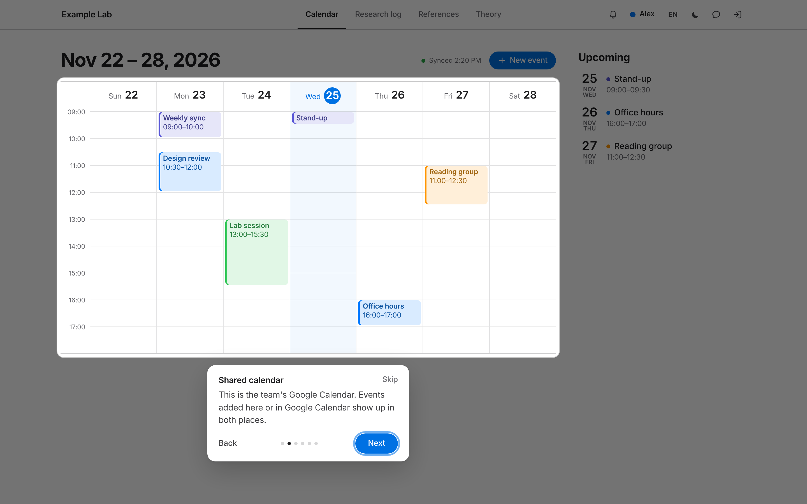
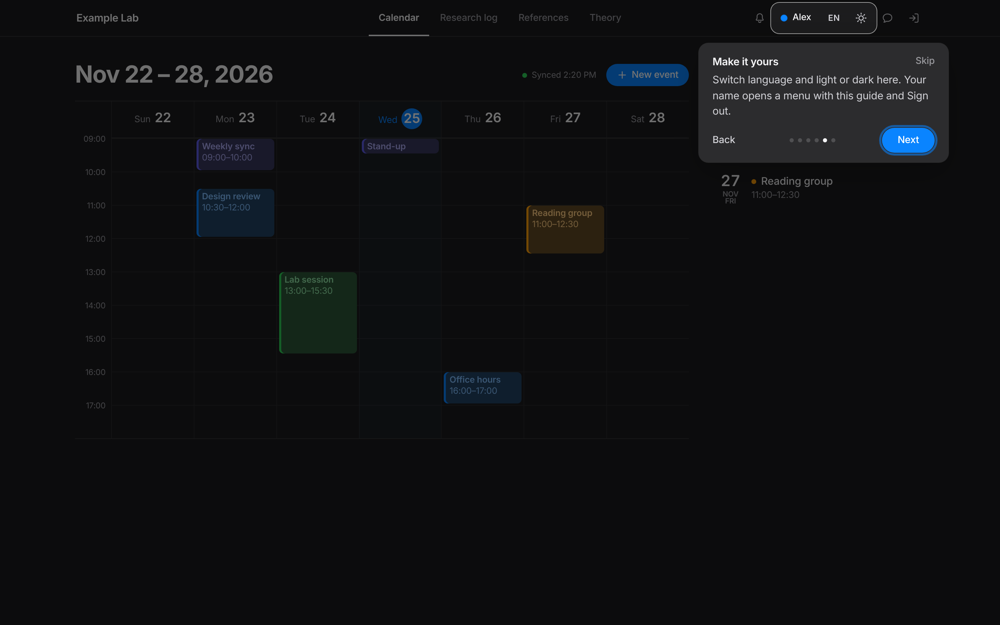
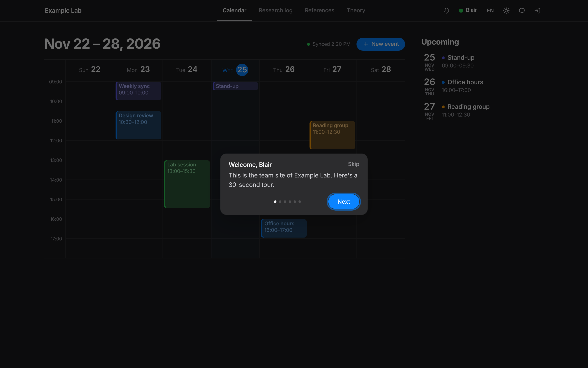
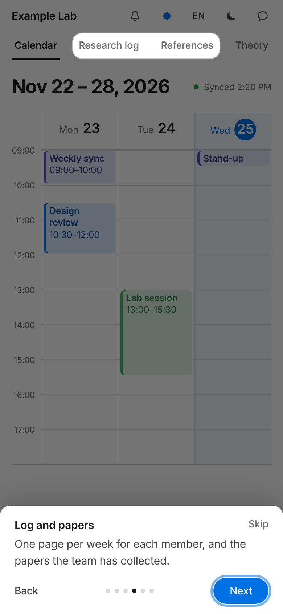
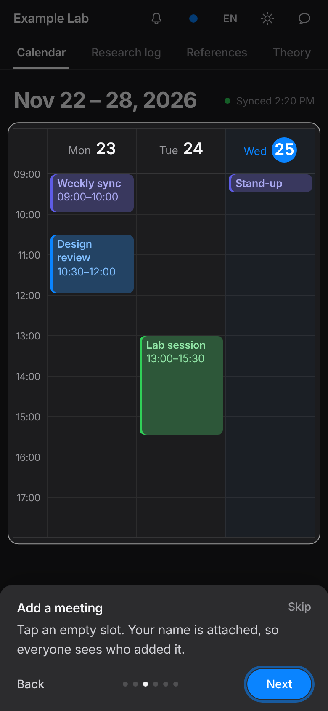

# First-visit spotlight guide

A new member's first visit gets a 30-second tour of the real page: the page dims, a rounded hole shows the thing being
explained, and a small paper panel says it in a sentence or two, with Skip, Back / Next and dots. Arrow keys, Enter and
Esc work, focus stays in the panel, and the page underneath cannot be clicked. It shows once per member, on any device,
and is always one tap away under "Site guide" in the name menu.



| | |
|---|---|
|  |  |
|  |  |

Origin: built for the NAND Capstone team site (Nov 2026), after the tutorial of an earlier project; restyled and
generalised here.

## When to use

Use it when:
- a site has a handful of features a newcomer should find (a shared calendar, a log, a menu) and you can point at them;
- members are known (signed in, or they pick their name), so "once per member" means something;
- the site follows the design system (`team-site-design-system` tokens), or you map its tokens to yours.

Do not use it when:
- the tour would need more than about eight steps (write a help page instead);
- the steps must make people do things (an interactive tutorial): this guide only shows and explains;
- visitors are anonymous: without a member id it can only remember per browser.

## What you get

| File | What it does |
|---|---|
| `assets/site/js/guide.js` | `createGuide({ steps, me, serverSeen, markSeen, noAuto, … })` → `{ start, stop, picked, isOpen }`: the spotlight that follows its target every frame, panel placement, phone sheet, keys, focus trap, inert page, once-per-member, menu item. No dependencies. |
| `assets/site/js/first-visit.js` | `firstVisit({ member, guide, offerInstall, appWelcome })`: one thing at a time after the page (or the intro) is up: "Add to Home Screen" first in an iPhone browser, the app's own sheet inside the installed app, else the tour. |
| `assets/site/css/guide.css` | The look: dim, hole, panel, buttons, dots, the phone sheet, the "Site guide" link, reduced motion. Tokens only. |
| `assets/demo/index.html` | A placeholder app page (design-system header, a week calendar, upcoming list, name menu) with a six-step tour and a faked `/api/me`. |
| `assets/demo/test-guide.mjs` | 55 browser checks (Playwright): once per member here and on the server, keys, Tab trap, inert page, placement, tight tabs, joined holes, phone sheet, `alt` fallback, 44 px targets, reopen from the menu, owner, dialogs, reduced motion. |
| `assets/demo/shoot.mjs` | The five screenshots. |

## Steps

1. **Load the design system** (`tokens.css`, `components.css`) and link `css/guide.css` after it.
2. **Copy** `assets/site/js/guide.js` and `first-visit.js` to `site/js/`, `assets/site/css/guide.css` to `site/css/`.
3. **Wrap the page** (header and main, not the dialogs) in one element, e.g. `<div id="app">`: the guide makes it
   `inert`. Give the sticky header the class `bar` (or pass `bar`).
4. **Write the steps**: five to eight, the first and last without a target. Point `at` real, stable selectors (ids, or
   `data-` attributes), add `alt` for anything hidden on phones, `tight: true` for header tabs. One idea per step, at
   most two short sentences, nothing private. See [references/behaviour.md](references/behaviour.md) §2.
5. **Add "Site guide"** to the member's name menu: `<button type="button" class="guide-link" id="menu-guide">Site guide</button>`.
6. **Create it** with the member and the server's record (google-signin-team-gate's `/api/me`):
   ```js
   const account = await fetch("/api/me").then((r) => r.json());
   const guide = createGuide({ steps, me: () => ({ id: account.member, name }),
     serverSeen: () => (account.seen ? account.seen.guide : null),
     markSeen: () => fetch("/api/me", { method: "POST", body: JSON.stringify({ seen: "guide" }) }),
     noAuto: ["<owner id>"], home: { pane: "#pane-calendar", hash: "#calendar" }, menuItem: "#menu-guide" });
   firstVisit({ member: account.member, guide, offerInstall: push.offerInstall, appWelcome: push.welcome });
   ```
   Without ios-webapp-push, leave out `offerInstall` and `appWelcome`. Without the gate, leave out `serverSeen` and
   `markSeen` ("seen" is then per browser).
7. **Check the server knows "guide"**: `ONCE` in google-signin-team-gate's `lib/auth.js` must list `"guide"` (it does
   as shipped).
8. **Test** with the demo (below), then on the site at 1440, 1024, 390, 375 × 600, light and dark: every step's panel
   whole on screen, the hole on the right thing, nothing cut off.

## Rules

- **Once per member.** Done, Skip and Esc all record it, in the browser and on the server. Never start it by itself
  again; "Site guide" is the way back.
- **Never by itself for the owner** (`noAuto`).
- **Read-only.** The page under the guide is inert; a step may point at a button but never press it.
- **One thing at a time.** Never over the intro or an open dialog; the install sheet comes first.
- **Spotlight what is visible**, never under the sticky header, never under the panel.
- **No boxes or effects.** Paper panel, one hairline, 14 px radius; no outlines, pulsing, confetti or 8-bit styling.
- **44 px targets** for Skip, Back and Next everywhere.
- **No addresses or private data** in a step.

## Configuration

| Name | Where | Meaning | Demo value |
|---|---|---|---|
| `steps` | `createGuide` | the tour | six steps (welcome, calendar, add, tabs, header, done) |
| `me`, `serverSeen`, `markSeen` | `createGuide` | who is here; the server's record and how to write it | from the faked `/api/me` |
| `noAuto` | `createGuide` | owner ids, never toured by themselves | `["casey"]` |
| `app`, `bar`, `home`, `returnFocus`, `menuItem` | `createGuide` | page wrapper, sticky header, pane to tour on, focus after, reopen button | `#app`, `.bar`, calendar pane, `#me-btn`, `#menu-guide` |
| `key` | `createGuide` | the browser's record | `site_guide_v1_<id>` |
| `delay`, `words` | `createGuide` | start delay; button words (for a translation) | 400 ms; English |
| `PHONE`, `EASE`, `PAD` | `guide.js` | sheet breakpoint, movement time, hole padding | ≤ 760 px, 280 ms, 6 px |

No secrets and no environment variables.

## Self-check before shipping

```bash
python3 -m http.server 8125 -d skills      # then open http://localhost:8125/first-visit-spotlight-guide/assets/demo/?reset
node assets/demo/test-guide.mjs            # 55 checks passed
node assets/demo/shoot.mjs                 # five screenshots
```

- Demo: `?reset` forgets everything; `?as=alex|blair|casey` picks the member (casey is the owner: no tour by itself).
- First visit: the tour starts; Done, Skip or Esc ends it; a reload does not bring it back; neither does deleting
  `site_guide_v1_<id>` (the server still knows).
- The name menu's "Site guide" reopens it.
- Tab never leaves the panel; the page neither scrolls nor clicks underneath.
- 1440, 1024, 390, 375 × 600 and 320 × 568, light and dark: the panel is whole, the hole is on its target.
- Reduced motion: no fade, no easing.
- `bash tools/privacy-scan.sh` and `node tools/check-skills.mjs` print only ✓ for this folder.

All of the above were run on this skill as shipped: `test-guide.mjs` passes 55 checks.

## References

- [references/design.md](references/design.md): every size, colour and margin of the dim, hole and panel; placement with measured positions; the phone sheet; motion; states; sketches.
- [references/behaviour.md](references/behaviour.md): the API, steps, the frame loop, once per member, keys and focus, the first-visit order, start and end, accessibility.
- [references/decisions.md](references/decisions.md): what was kept and changed from the earlier tutorial, the timeline, rules from use.
- [team-site-design-system/references/mobile.md](../team-site-design-system/references/mobile.md): the phone rules this skill follows (zoom, where scrolling is locked, sheets, keyboard, safe areas), with the code and the reason for each.
