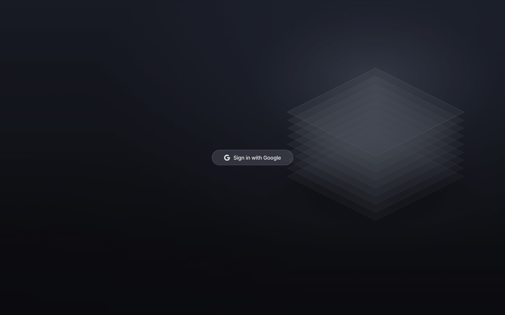
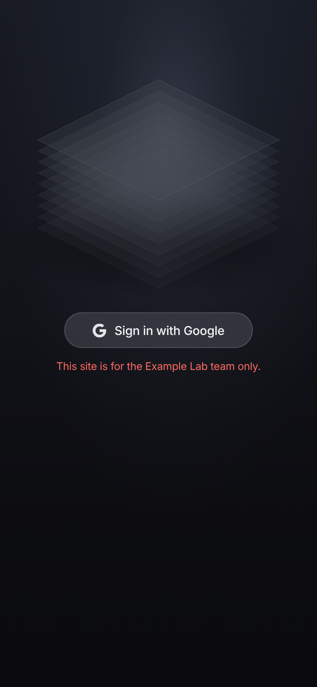
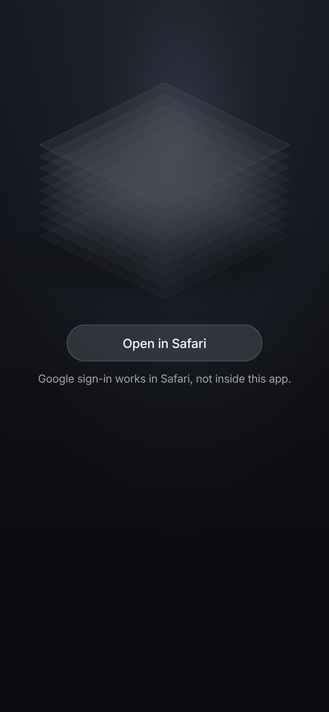

# Google sign-in team gate

Every request to the site passes one middleware. A stranger sees the site's own picture with one translucent
"Sign in with Google" pill; a team member signs in once with Google and stays in for 180 days, in the browser and in the
installed Home Screen app. Only addresses on a Cloudflare secret get in, and pages learn who is here as a member id,
never an address. No password, no client secret, no Google script on the page.



| | | |
|---|---|---|
|  |  |  |
| Phone | Not on the list: one line | Inside KakaoTalk: open Safari first |

`screenshots/signin-1440-light.png` is the same page with the system set to light: the sign-in page is always dark.

Origin: built for the NAND Capstone team site (Nov 2026); generalised here with placeholder accounts.

## When to use

Use it when:
- a small team (a lab, a course project, a club) has a site on Cloudflare Pages that only its members should see;
- each member has a Google account (one Workspace domain, or personal accounts);
- you want no shared password, nothing to approve, and adding or removing a person to be a variable change.

Do not use it when:
- you need roles, self sign-up or an approval queue (use Cloudflare Access or a real identity provider);
- the site is not on Cloudflare Pages Functions (the gate is a Pages `_middleware.js`; the checks in `auth.js` port to
  any Workers-style runtime, the routing does not);
- members cannot use Google at all.

## What you get

| File | What it does |
|---|---|
| `assets/functions/_middleware.js` | The gate: public paths, secret-header machine paths, `DEV_MEMBER` on localhost, the sign-in page (poster, pill, one line, KakaoTalk variant), the Google return, sign out, the origin check for API writes, signed-in rewrites, security headers. Sets `context.data.user = { email, member }`. |
| `assets/lib/auth.js` | Allow-list, Google sign-in address, RS256 ID-token checks with Google's keys (cached), sessions in D1 (SHA-256 only), `sub` pinning, "shown once" per member (`ONCE`). |
| `assets/functions/api/me.js` | `GET /api/me` → `{ auth, member, seen }` (no address); `POST /api/me { seen }`. |
| `assets/site/assets/poster.svg`, `poster-tall.svg` | Placeholder sign-in backgrounds (landscape, portrait). Replace them. |
| `assets/.dev.vars.example` | The local variables, all empty. |
| `assets/tools/test-auth.mjs` | 111 offline checks: allow-list, every token check, the gate, cookies, sessions over time, `/api/me`, local preview. Fake Google key, D1 on `node:sqlite`. |
| `assets/demo/serve.mjs` | The real gate in Node with a mock Google and D1 in memory: try the whole flow at `http://localhost:8124`. |
| `assets/demo/test-flow.mjs` | 32 browser checks of the flow against the demo (sign in, refusal, cancel, sign out, deep link, KakaoTalk, not set up). |
| `assets/demo/shoot.mjs`, `shrink_png.py` | The screenshots (with a KakaoTalk user agent), kept under 1 MB. |

## Steps

1. **Copy the code** into the site: `assets/functions/_middleware.js` → `functions/_middleware.js`,
   `assets/functions/api/me.js` → `functions/api/me.js`, `assets/lib/auth.js` → `lib/auth.js`,
   `assets/tools/test-auth.mjs` → `tools/test-auth.mjs`, `assets/.dev.vars.example` → `.dev.vars.example`.
   If the site already has a `functions/_middleware.js` (team-site-setup's skeleton), replace it: this one keeps its
   security headers.
2. **Fill the placeholders** in `_middleware.js`: `{{SITE_NAME}}` (the refusal line and the tab title) and
   `{{SITE_SHORT_NAME}}` (the Home Screen name).
3. **The background.** Put two pictures at `site/assets/` and set `GATE_BG` / `GATE_BG_TALL`: ideally the intro's settled
   first frame (scroll-3d-intro), landscape and portrait. Until then, copy the placeholder SVGs. Keep the subject off
   the centre. Read [references/design.md](references/design.md).
4. **Plug in the other skills** at the top of `_middleware.js` (each is one import and one entry):
   - lecture-notes-reader: `import { readerRewrite } from "../lib/reader-route.js"` and add `readerRewrite` to `REWRITES`;
   - ios-webapp-push: `import { tickAllowed } from "../lib/push.js"` and add
     `"/api/push/tick": { header: "X-Push-Tick", allowed: tickAllowed }` to `MACHINE` (the manifest, `sw.js` and
     `/icons/*.png` are already public);
   - kakao-link-preview: `import { ogTags } from "../lib/og-tags.js"` and set `HEAD_EXTRA` as the comment shows.
   The team chat, the shared calendar and `/api/me` need nothing: they read `context.data.user`.
5. **Run the tests:** `node tools/test-auth.mjs` (Node 22.13+) → `111 checks passed`. With team-chat installed,
   `node tools/test-chat.mjs` also runs its section 10 through this gate.
6. **Set up Google and Cloudflare** by hand, from [references/setup.md](references/setup.md): Cloud project, Google Auth
   Platform (Internal or External), a Web client with the redirect URI `https://<site>/__auth/google`,
   `GOOGLE_CLIENT_ID` (Text), `ALLOWED_EMAILS` (Secret), `GOOGLE_HD` (Text, optional), the D1 binding `DB`, then
   Retry deployment. The user types the addresses into Cloudflare themselves; never ask for them in chat.
7. **Check the live site** (setup.md, "Check it"): signed-out 200 with one pill, `/api/me` 401, each member signs in,
   a stranger gets one line, Sign out works, KakaoTalk shows "Open in Safari".
8. **Wire the header's sign-out** to `/__logout`, and read who is here from `GET /api/me`.

## Rules

- **Secrets stay in Cloudflare.** `ALLOWED_EMAILS` is a Secret; `GOOGLE_CLIENT_ID` and `GOOGLE_HD` are Text. No address,
  id or token in the repository, a page, a log line or a chat. `.dev.vars` is never committed.
- **No client secret.** The flow does not use it; do not download or store it.
- **Never weaken a check to make a demo work.** Use `DEV_MEMBER` (localhost only) or the demo's mock Google.
- **Never set `DEV_MEMBER` in Cloudflare.**
- **Every path is closed unless listed.** Add to `PUBLIC` only files a crawler or a cookie-less browser fetch must reach
  and that hold nothing private. Machine paths go in `MACHINE` with their own constant-time secret check.
- **Pages never see an address.** Use `data.user.member` in functions and `/api/me` in pages.
- **One line for every refusal.** Do not tell a stranger why.
- **`/` answers 200** (the sign-in page), never a redirect, so link previews work.
- **Removing a person is a variable change.** Edit `ALLOWED_EMAILS`, redeploy; they are out on their next request.

## Configuration

| Name | Where | Meaning | Demo value |
|---|---|---|---|
| `GOOGLE_CLIENT_ID` | Cloudflare, Text | the OAuth Web client id | `demo-client.apps.googleusercontent.com` |
| `ALLOWED_EMAILS` | Cloudflare, **Secret** | `address=member` per person, commas or new lines | `alex@example.edu=alex, blair@example.edu=blair, casey@example.edu=casey` |
| `GOOGLE_HD` | Cloudflare, Text (optional) | the one Workspace domain allowed; empty = any Google account on the list | `example.edu` (`{{GOOGLE_HD}}`) |
| `DB` | Cloudflare, D1 binding | sessions, pinned accounts, "seen" | in-memory SQLite |
| `DEV_MEMBER` | `.dev.vars` only | sign in as this member on localhost, no Google | `alex` |
| `{{SITE_NAME}}`, `{{SITE_SHORT_NAME}}` | `_middleware.js` | refusal line, title; Home Screen name | `Example Lab`, `Lab` |
| `GATE_BG`, `GATE_BG_TALL` | `_middleware.js` | sign-in background, landscape and portrait | `/assets/poster.svg`, `/assets/poster-tall.svg` |
| `PUBLIC`, `MACHINE`, `REWRITES`, `HEAD_EXTRA` | `_middleware.js` | open paths, secret-header paths, signed-in rewrites, extra `<head>` tags | see Steps 4 |
| `SESSION_DAYS`, `SID`, `NONCE`, `ONCE` | `lib/auth.js` | 180 days; cookie names `site_sid`, `site_nonce`; once-only names `install`, `guide` | as listed |

## Self-check before shipping

```bash
node assets/tools/test-auth.mjs          # 111 checks passed (offline, Node 22.13+)
node assets/demo/test-flow.mjs           # 32 checks passed (Playwright, the real gate + mock Google)
node assets/demo/serve.mjs 8124          # try it: sign in as alex, blair or casey; dana is refused
node assets/demo/shoot.mjs               # the five screenshots, each under 1 MB
```

- Signed out: `/` is 200 with the pill; `/api/me` is 401 JSON; `/js/app.js` is 401; `/assets/og.jpg` and the posters are 200.
- The sign-in page has no `<input type=password>` and no `accounts.google.com/gsi/client` script.
- The `site_sid` cookie is HttpOnly, SameSite=Lax, Secure on https, 180 days; D1 holds only its hash.
- A stranger's account shows one red line under the pill; Cancel shows nothing.
- KakaoTalk (iPhone UA with `KAKAOTALK`) shows "Open in Safari" and the hint, no Google pill.
- 320, 375, 390, 1024 and 1440 px: the pill is centred, nothing scrolls.
- `bash tools/privacy-scan.sh` and `node tools/check-skills.mjs` print only ✓ for this folder.

All of the above were run on this skill as shipped: 111 + 32 checks pass, and team-chat's `test-chat.mjs` (97 checks)
passes through this gate.

## References

- [references/setup.md](references/setup.md): Google Cloud and Cloudflare click by click, D1, adding and removing people, local runs, common errors.
- [references/design.md](references/design.md): the sign-in screen: layout per width, background layers, the pill and its states, messages, KakaoTalk, the hand-off to the intro.
- [references/security.md](references/security.md): the flow, every check and what it stops, cookies, the gate order, D1 tables, what it does not do.
- [references/decisions.md](references/decisions.md): password → Google, GIS button → own pill, and the rules that came from use.
- [team-site-design-system/references/mobile.md](../team-site-design-system/references/mobile.md): the phone rules this skill follows (zoom, where scrolling is locked, sheets, keyboard, safe areas), with the code and the reason for each.
