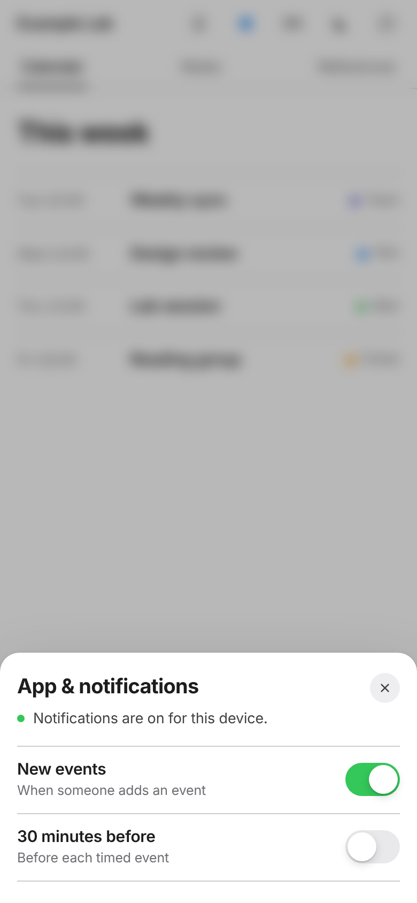
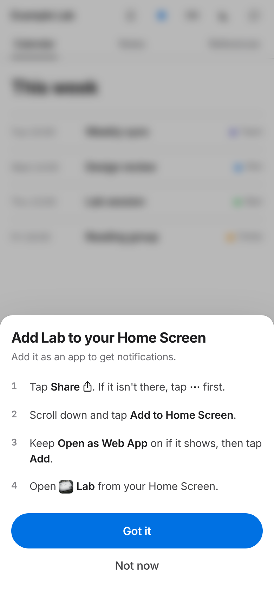
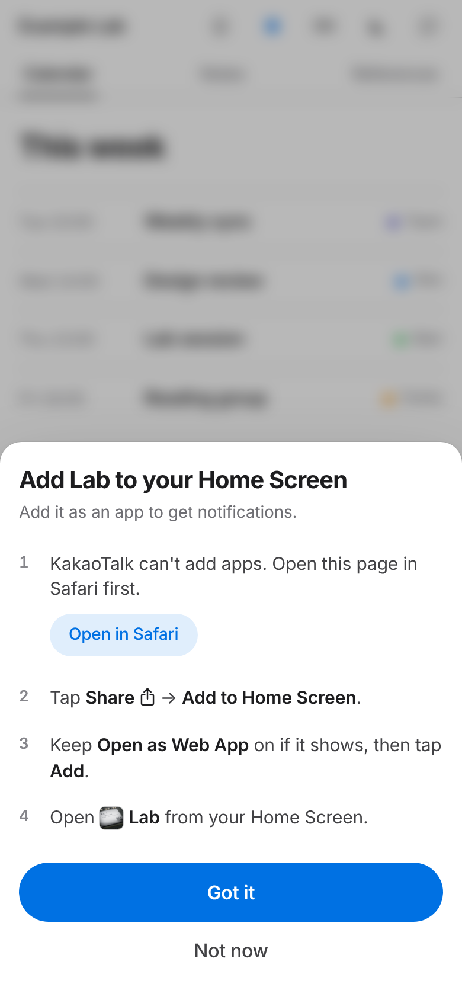
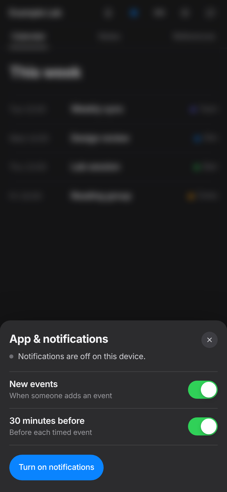
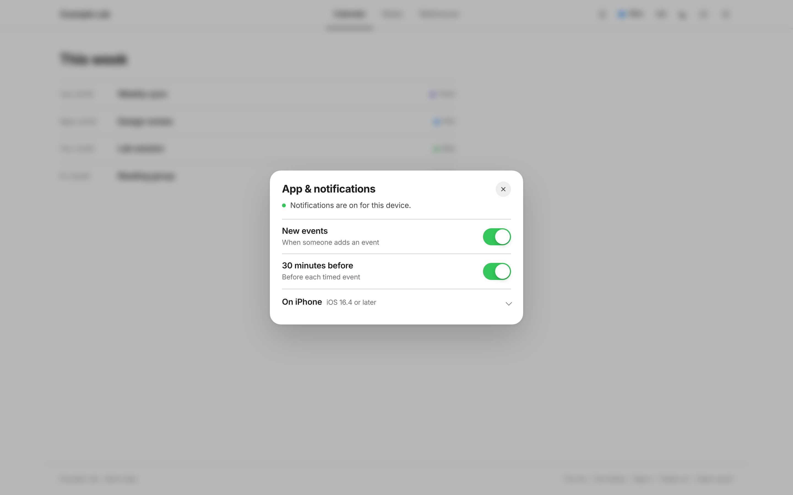

# iPhone web app and push notifications

The site becomes an app on the Home Screen, and the team gets two kinds of notification, each with its own switch:
**New event** (someone added one on the site or in Google Calendar) and **In 30 minutes** (before each timed event). A
bell in the header opens the switches; in an iPhone browser a pop-up shows once how to add the app, with a special
first step inside KakaoTalk.

## When to use / when not to

- Use for a small team site on Cloudflare Pages with a shared Google Calendar (`shared-google-calendar`) and Google
  sign-in (`google-signin-team-gate`), when the team uses iPhones (iOS 16.4 or later). Android and desktop browsers
  work too, with the same bell.
- Use when you want no App Store app, no build step and no secret to manage: the keys are made inside D1.
- Not for offline use: the service worker caches nothing on purpose (the sign-in gate and the live calendar stay in
  charge of every request).
- Not for marketing pushes or anyone outside the team list.

## What you get

| File | What it does |
|---|---|
| `assets/site/manifest.webmanifest` | Name, short name, standalone, colours, the four icons. |
| `assets/site/head.html` | The `<head>` tags: manifest, apple-touch-icon, `apple-mobile-web-app-*`, theme colours, push.css. |
| `assets/site/sw.js` | Shows every push as a notification and opens the app on a tap. No caching, no fetch handler. |
| `assets/site/push-dialogs.html` | The bell, the "App & notifications" sheet and the "Add to Home Screen" pop-up. |
| `assets/site/js/push.js` | The client: platform detection (iPhone, KakaoTalk, old iOS, standalone), status line, switches, subscribe, the once-per-member pop-up, the first-start sheet. |
| `assets/site/js/push-strings.js` | English and Korean words, merged into the design system's `i18n.js`. |
| `assets/site/css/push.css` | Status line, rows, iPhone steps, Share glyph, app glyph, pop-up. |
| `assets/lib/webpush.js` | RFC 8291 (aes128gcm) encryption and RFC 8292 VAPID with WebCrypto only. |
| `assets/lib/push.js` | Subscriptions, the minute tick (new events by syncToken, reminders, a leased job queue with retries), D1 schema, keys made on first use. |
| `assets/functions/api/push/index.js`, `tick.js` | `GET/POST/DELETE /api/push`, `POST /api/push/tick`. |
| `assets/push-cron/worker.js`, `wrangler.toml` | The companion Worker that calls the tick every minute. |
| `assets/tools/make-icons.mjs` | 1024 master → 512, 192, 180, maskable 512, and a 60 px contact sheet. |
| `assets/tests/test-push.mjs` | 49 offline checks: the RFC vector, every alert rule, the API, the tick secret. Fake clock, fake Google, fake Apple, D1 on `node:sqlite`. |
| `assets/demo/index.html` | The screens with a fake device and a fake server (`?ua=ios`, `kakao`; `?app=1`; `?state=on`, `off`, `server`, `denied`; `?open=push`, `install`). |
| `assets/.dev.vars.example` | The variables the code reads at run time, all from other skills, empty. |

| Install pop-up, Safari | Install pop-up, KakaoTalk | Sheet, dark, off |
|---|---|---|
|  |  |  |

## Steps

1. **Run the tests.** `node assets/tests/test-push.mjs` (Node 22.13 or later). It must end with `49 checks passed`.
2. **Look at the demo.** Serve the repository root (`python3 -m http.server 8123`) and open
   `/skills/ios-webapp-push/assets/demo/?ua=ios`, then `?ua=kakao`, `?ua=ios&app=1&open=push`, `?state=on&open=push`.
3. **Make the icon** ([references/app-icon.md](references/app-icon.md)): a rendered 1024 master,
   `node assets/tools/make-icons.mjs master.png site/icons --name "{{SITE_SHORT_NAME}}"`, then judge the 60 px row of
   `contact-sheet.png`. Do not commit the contact sheet into the site.
4. **Copy and fill the code** ([references/setup.md](references/setup.md) part A): files, placeholders, the `<head>`
   tags on the main and sign-in pages, the bell first in `.bar-right`, the dialogs at the end of `<body>`.
5. **Wire the neighbours** (setup A.6): the gate's `MACHINE` entry for `/api/push/tick` (its `PUBLIC` list already
   opens the manifest, `sw.js` and `/icons/*.png`); the calendar POST's `notifyCreated` lines; `"install"` in the
   gate's `ONCE`.
6. **Start it in the page** (setup A.7): `createPush({ appName, member, seen, onOpen })`, then after the intro (or at
   once without it) `welcome()` in the installed app or `offerInstall(showGuide)` after ~0.5 s in a browser. Call the
   design system's `sheetDialogs()` (sheet.js) once the dialogs are in the page, so on a phone the page stays still
   behind them and a tap outside or a pull down closes them.
7. **The user does the console part** (setup B and C): D1 bound as `DB` on the Pages project → Retry deployment; a
   Worker with `worker.js`, `SITE_URL`, the `DB` binding and a `* * * * *` cron trigger. Give the exact clicks from
   setup.md and wait. There is no secret to paste.
8. **Verify** (setup B.4, C, D): the bell's status line no longer says "aren't set up on the server yet"; the Worker's
   logs show one run a minute; on an iPhone, add the app, turn notifications on, add a test event 35 minutes ahead and
   get both notifications.

## Rules

- iOS delivers web push only to the app opened from the Home Screen (iOS 16.4+). In Safari the bell shows the steps,
  never dead switches.
- Ask for permission only from the "Turn on notifications" tap. Never on load.
- Two switches, both on by default, saved per device. The server, not the page, decides who a device belongs to.
- First tick = baseline only. A series counts once. More than 3 at once → one summary. The author is skipped.
- Reminders only for timed events, 24–30.5 minutes ahead, once per (event, start, device), checked again before
  sending; a moved event gets a new one, a deleted one none.
- Notification text: a title, the day, the time and the event title. Never a place, a note, a guest, an email or a
  name. Tap → that day with the event open, no intro.
- Every push shows a notification (iOS stops sending to sites with silent pushes). The service worker caches nothing.
- No secret in code, variables or chat: VAPID keys and the tick secret are made in D1 and read from there. The VAPID
  subject is the site's URL.
- The manifest, `sw.js` and the icons open without signing in; the push API stays behind the gate; the tick passes only
  with its header, compared in constant time.
- The install pop-up shows once per member (browser and D1), never over another dialog, before the site guide.
- Icons: square, opaque, rendered (not flat), legible at 60 px; the short name fits under the icon (≤ 12 characters).

## Configuration

| Placeholder or setting | Where | Meaning | Example |
|---|---|---|---|
| `{{SITE_NAME}}` | manifest `name`, `sw.js` default title | Full site name | `Example Lab` |
| `{{SITE_SHORT_NAME}}` | manifest `short_name`, `head.html`, `createPush({ appName })` | Name under the icon, ≤ 12 characters | `Lab` |
| `{{SITE_ORIGIN}}` | `lib/push.js` (VAPID subject), `push-cron/worker.js`, `wrangler.toml` | Production origin | `https://example-lab.pages.dev` |
| `{{PAGES_PROJECT}}` | `wrangler.toml` Worker name | Pages project name | `example-lab` |
| `{{D1_NAME}}` | `wrangler.toml`, setup | D1 database name (shared with the other skills) | `example-lab-db` |
| `theme_color`, `background_color` | manifest | Splash and status bar before the page paints | `#111216` |
| `DB` | Pages and Worker binding | D1 | — |
| `SITE_URL` | Worker variable (Text) | Where the Worker sends the tick | `https://example-lab.pages.dev` |
| `member`, `seen` | `createPush()` | The signed-in member id and `GET /api/me`'s `seen` | `alex`, `{ install: false }` |
| `push_prefs`, `install_seen_<member>`, `push_welcomed` | `localStorage` keys | Switches before subscribing; pop-up shown; first-start sheet shown | — |
| `NEW_WINDOW`, `LEAD_MIN`, `LEAD_MAX`, `BULK` | `lib/push.js` | 12 h, 24 min, 30.5 min, 3 | — |

The variables the code reads (`GOOGLE_SA_JSON`, `GOOGLE_CALENDAR_ID`, `GOOGLE_CLIENT_ID`, `ALLOWED_EMAILS`) belong
to the calendar and sign-in skills; see `assets/.dev.vars.example`.

## Self-check before shipping

- **Widths:** the sheet and the pop-up at 375, 390 and 430 px (bottom sheets, nothing cut, buttons ≥ 44 px), 820 px
  (iPad: a centred dialog) and 1440 px. The header keeps bell · name · language · theme · chat (· sign-out above 960 px).
- **Light and dark:** both dialogs, all status dots readable.
- **Reduced motion:** sheets appear without sliding; switches and the chevron jump.
- **Every state** in the demo: `?ua=ios`, `?ua=kakao`, `?ua=oldios&open=push`, `?app=1&state=off&open=push`,
  `?state=server&open=push`, `?state=denied&open=push`, `?lang=ko&ua=ios`.
- **Tests:** `node assets/tests/test-push.mjs` → `49 checks passed`. Chrome DevTools → Application → Manifest: no
  errors, icons load signed out; Service workers: `/sw.js`, scope `/`.
- **On the iPhone:** add, open, turn on, receive both kinds, tap one (opens the day), add one yourself (nothing for you).
- **Privacy:** notification bodies carry no place, note or address; `bash tools/privacy-scan.sh` prints only ✓; the
  filled-in `wrangler.toml` is not committed.

## References

- [references/setup.md](references/setup.md): code wiring, D1, the cron Worker (dashboard or wrangler), the iPhone test, common failures, local runs.
- [references/design.md](references/design.md): the bell, the sheet, the pop-up, every status line, the notification text.
- [references/server.md](references/server.md): D1 tables, endpoints, the minute tick, every alert rule, retries and leases.
- [references/protocol.md](references/protocol.md): RFC 8291 encryption and RFC 8292 VAPID, byte by byte.
- [references/app-icon.md](references/app-icon.md): making and checking the icon; the candidates the source site tried.
- [references/decisions.md](references/decisions.md): what changed on the way, and why.
- [team-site-design-system/references/mobile.md](../team-site-design-system/references/mobile.md): the phone rules this skill follows (zoom, where scrolling is locked, sheets, keyboard, safe areas), with the code and the reason for each.

Origin: the NAND Capstone 2026 Winter team site.
