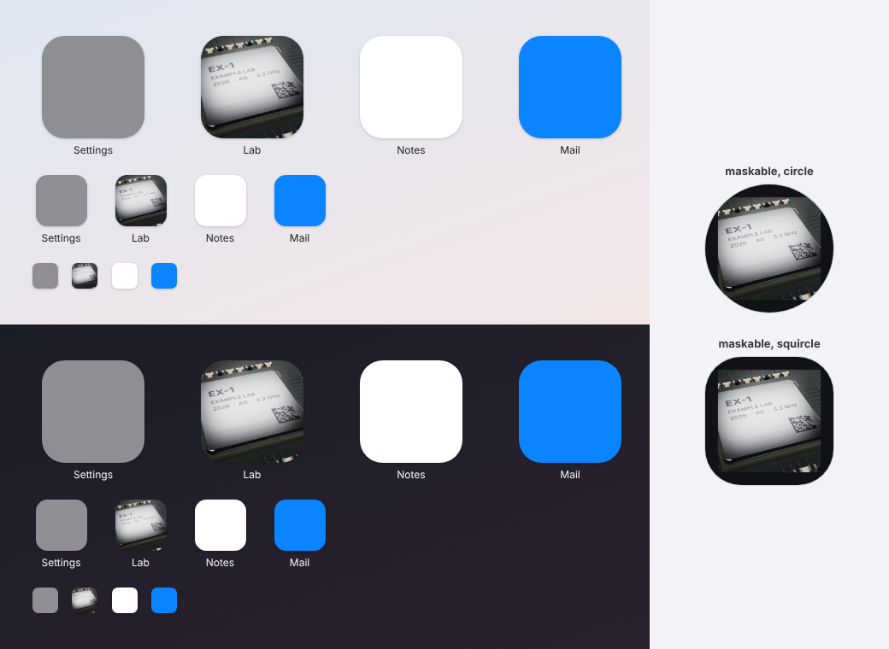

# The app icon: one master, five files, one contact sheet

## What iOS and the manifest need

| File | Size | Used by |
|---|---|---|
| `icons/app-1024.png` | 1024 × 1024 | the master; the manifest (`any`) |
| `icons/app-512.png` | 512 × 512 | manifest (`any`), Android splash |
| `icons/app-192.png` | 192 × 192 | manifest (`any`), the notification icon on Android and desktops |
| `icons/apple-touch-icon.png` | 180 × 180 | iOS Home Screen (`<link rel="apple-touch-icon">`) |
| `icons/app-maskable-512.png` | 512 × 512 | manifest (`maskable`): Android crops it to a circle or squircle |

- **Square, full bleed, no transparency.** iOS rounds the corners itself and fills transparent pixels with black. Do
  not draw your own rounded corners or shadow.
- **Maskable safe zone:** only the centre circle with a radius of 40 % of the width is always visible. The subject
  goes inside it; the rest is background (`make-icons.mjs` scales the master to 80 % on the background colour).
- **The name under the icon** is `apple-mobile-web-app-title` (and the manifest's `short_name`): iOS cuts it with "…"
  after about 12 characters at the default text size. Pick a short name that fits (`{{SITE_SHORT_NAME}}`); the full
  name stays in `name`.
- The icons, the manifest and `/sw.js` must open without signing in (the gate's `PUBLIC` list): iOS reads them while
  adding to the Home Screen, without cookies.

## How to make the master

1. **Render it, don't draw it.** The icon should look like the same world as the site's intro: the same materials,
   the same studio light. The easiest master is a still of your 3D scene: `scroll-3d-intro`'s
   `intro-frames.mjs <url> out --w 1024 --h 1024 --dpr 1.28 --ui 0 --p <a close-up>`, then crop a 1024 square.
   The demo icon here is exactly that: the example scene at p 0.78 (the chip's metal lid), cropped.
2. **One subject, big.** At 60 px only a silhouette and one or two contrasts survive. Fill most of the square with
   the subject; keep small text and fine lines out of the centre of attention.
3. **Restrained colour.** A dark studio background, metal and one material colour at most. No neon, no glow, no
   gradients that are not light.
4. Make 2–4 candidates, run them all through the contact sheet, keep the one that reads best at 60 px.

## Export and check

```bash
node assets/tools/make-icons.mjs master-1024.png site/icons --name "{{SITE_SHORT_NAME}}" --bg "#111216"
```

It writes the five files and `contact-sheet.png`: the icon at 120, 60 and 30 px on a light and a dark wallpaper,
between plain grey, white and blue neighbours, with the short name under it as iOS shows it, and the maskable version
in a circle and a squircle.



Look at it at 100 %, and judge the **60 px row**: that is the size people see every day.

- Can you tell what it is? Is the silhouette clear on both wallpapers?
- Does it look like it belongs next to the system icons, or like a photo pasted in?
- Is the name whole (no "…")?
- In the circle, is anything important cut?

If the answer is no, change the master (closer crop, stronger contrast, fewer details), never only the small files.
In the demo icon the "EX-1" mark is still legible at 60 px but the lettering under it is not; the chip shape carries
it. Its maskable version shows the edge of the square photo inside the circle: a master whose edges are already the
background colour avoids that.

## What the source site tried

Four candidates, each a 1024 master and a maskable version, on one contact sheet:

| Candidate | What it was | Verdict |
|---|---|---|
| A · Die | a silicon die with a gold wire-bond edge, three-quarter view | good material, but at 60 px the die reads as a dark rectangle |
| B · Channel | one channel hole in a cut-away stack of layers, a short cylinder with its films | **shipped**: a clear silhouette at every size, the site's subject in one shape |
| C · Stack corner | the stepped corner of a layer stack with contact holes | good at 120 px, busy at 30 px |
| D · Simple (flat) | flat white bars with a blue line on dark | rejected: "flat" is the look the owner had already turned down for the intro |

The short name: the full project name was cut under the icon, so a one-word short name was chosen.
