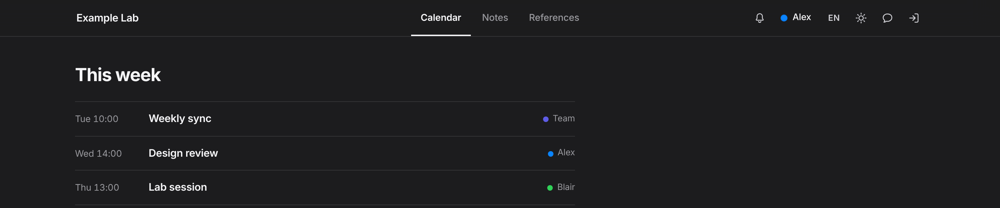
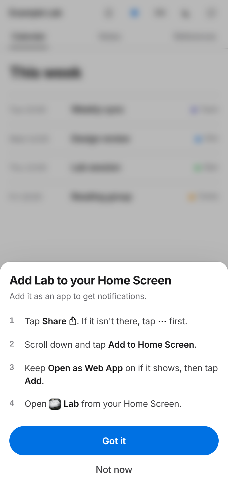
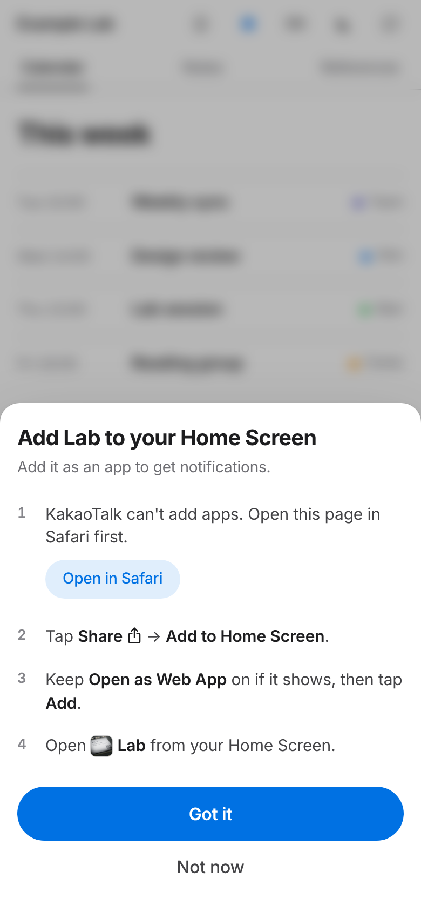

# Design: the bell, the sheet, the pop-up and the notifications

Everything uses the design system (`team-site-design-system`): `tokens.css` colours, `.dlg` dialogs that become bottom
sheets at ≤ 760 px, `.btn`, `.icon-btn`, and the iOS switch `.sw` (`--sw-on` green). All sizes are CSS px.

## The bell

- An `.icon-btn` (32 × 32, 44 × 44 on phones) with an 18 px outline bell, first in the header's right side:
  **bell · name · language · theme · chat · sign-out**.
- Title and label "App & notifications", English in both languages like the rest of the header.
- On phones and narrow windows (≤ 960 px) the sign-out button hides (it moves into the name menu), so the bell fits.
- In an iPhone or iPad browser (not the installed app) the bell opens the "Add to Home Screen" pop-up instead of the
  sheet: the switches cannot work there.

## The sheet: "App & notifications"

| Part | Spec |
|---|---|
| Width | `min(460px, 100vw − 32px)`; a bottom sheet at ≤ 760 px (radius 18 px on top, safe-area padding) |
| Title | 19 px / 700 / −.02em, close button 28 × 28 on `--fill` (44 px hit area on phones) |
| Status line | 13.5 px, `--ink2`, a 7 px dot before it: green `--sw-on` = on, `--accent` = install first, `--warn` = something to fix, `--ink4` = checking or a passing note |
| Switch rows | full-width buttons with `role="switch"`, min-height 60 px, hairline `.5px var(--sep2)` above and below; title 15 px / 600 / −.012em, line under it 12.5 px `--ink3`; the switch 51 × 31 on the right |
| Disabled rows | `opacity .42` on text and switch while the device cannot use them (install, denied, server) or while saving |
| "Turn on notifications" | `.btn.primary`, only in the "off" state; disabled when both switches are off |
| iPhone steps | `
` "On iPhone · iOS 16.4 or later" (15 px / 600, chevron 7 px); open by itself in an iPhone browser, folded elsewhere, gone inside the installed app; numbered steps 14 px, numbers 13 px / 600 `--ink4` |
| Focus | the sheet itself takes the focus when it opens (no ring on the close button after a tap); Tab reaches every control |

The two switches are both **on by default** and saved **per device**: "New events" (When someone adds an event) and
"30 minutes before" (Before each timed event). Before the device is subscribed they are only kept in this browser and
sent along when it subscribes. A switch moves at once and moves back if saving fails ("Couldn't save. Try again.").

### Status lines (one per state)

| State | When | English |
|---|---|---|
| `install` | iPhone or iPad browser, not installed | Add the app to your Home Screen to get notifications. |
| `kakao` | inside KakaoTalk's browser | Open this page in Safari to install the app. |
| `oldios` | iOS below 16.4 | Notifications need iOS 16.4 or later. |
| `nosupport` | no service worker, PushManager or Notification | This browser can't show notifications. |
| `checking` | while asking the server | Checking… |
| `server` | no `DB` binding (or no key) | Notifications aren't set up on the server yet. |
| `denied` | permission refused (iOS: names the Settings path) | Notifications are off for this app. Turn them on in Settings → Notifications → {app}. |
| `off` | can subscribe, has not | Notifications are off on this device. |
| `on` | the server has this device | Notifications are on for this device. |
| note | saving, an error | Saving… · Couldn't save. Try again. |

Korean strings are in `assets/site/js/push-strings.js`. Use the Korean iOS labels there (공유, 홈 화면에 추가,
웹 앱으로 열기, 추가), and the English iOS labels in English. Terms like Safari stay English.

## The pop-up: "Add {app} to your Home Screen"

| Part | Spec |
|---|---|
| When | in an iPhone or iPad browser, **once per member**, about 0.5 s after the page opens (after `intro:done` when the intro shows), before the site guide; never while another dialog is open; also from the bell there |
| "Once" | kept twice: in this browser (`install_seen_<member>` in `localStorage`) and on the server (`member_seen`, `POST /api/me { seen: "install" }`), so a second device or browser does not show it again. If the server cannot say (`seen` is null), it never opens by itself. |
| Width | `min(440px, 100vw − 32px)`; a bottom sheet on phones |
| Title | 20 px / 700 / −.022em, balanced wrapping; under it "Add it as an app to get notifications." 14 px `--ink3` |
| Steps (Safari) | 1 Tap **Share** (with Safari's Share glyph). If it isn't there, tap **⋯** first. · 2 Scroll down and tap **Add to Home Screen**. · 3 Keep **Open as Web App** on if it shows, then tap **Add**. · 4 Open **{app}** (with the app's own icon, 1.3 em, rounded) from your Home Screen. |
| Steps (KakaoTalk) | 1 KakaoTalk can't add apps. Open this page in Safari first. + a tinted **Open in Safari** button (`kakaotalk://web/openExternal?url=…`) · 2 Tap **Share** → **Add to Home Screen**. · 3 and 4 as above |
| Steps text | 15 px, line-height 1.45; numbers in `--ink4` |
| Buttons | desktop and iPad: "Not now" (plain) and "Got it" (primary), 36 px, right-aligned. Phones: "Got it" full width 50 px 16 px / 600, "Not now" under it 44 px, both within thumb reach. No close cross. |
| Focus | the sheet takes the focus (no ring on a tap-first screen) |

| Safari, 390 | KakaoTalk, 390 |
|---|---|
|  |  |

## The installed app

- Opens standalone (no Safari bars). The status bar takes the colour of what is under it (`paintStatusBar()` in the
  design system's `theme.js`): the intro's dark stage, then the page.
- iOS gives the installed app its own storage, separate from Safari, so local flags start empty. On its first start
  on a device the sheet opens once by itself (0.4 s after the page), so "Turn on notifications" is one tap away. This
  replaces the site guide there; the guide stays in the name menu.
- The permission is asked only from the "Turn on notifications" tap (iOS allows it only from a tap).

## The notifications

| | New event | 30 minutes before | Many at once |
|---|---|---|---|
| Title | New event | In 30 minutes | New events |
| Body | `Tue 12/22 · 10:50 · Weekly sync` (all-day: `Tue 12/22 · Weekly sync`) | `Tue 12/22 · 10:50 · Design review` | `5 events added · from Tue 12/22` |
| Tap opens | `/?event=<id>&date=<day>#calendar`: that day, the event open, no intro | same | `/?date=<first day>#calendar` |

- English only, the team's time zone, the title cut at 70 characters.
- **Never** a place, a note, a guest, an email address or a member's name: a lock screen is public.
- The icon is the app icon (iOS shows it by itself; Android and desktops use `/icons/app-192.png`).
- The same tag replaces an older notification for the same event instead of stacking.
- A tap while the site is already open focuses that window and sends `{ type: "app:open", url }` to the page (no
  reload); otherwise it opens the app at that address.

## Light, dark, reduced motion

Both dialogs follow the theme through the tokens. Reduced motion: no sheet animation, the switch and the chevron jump
(components.css and push.css). Screenshots: `bell-sheet-390-light.png` (on, one switch off), `bell-sheet-390-dark.png`
(off, with the button), `bell-sheet-1440-light.png` (desktop, the iPhone steps folded).
