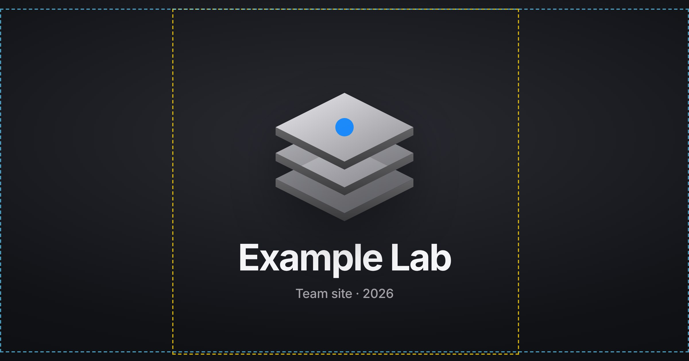

# Link previews for KakaoTalk (and every other messenger)

A team site behind a sign-in still needs a good preview when its link is pasted into KakaoTalk, Slack or iMessage. The
crawlers never sign in, so the preview has to come from the sign-in page itself, and the picture has to survive
KakaoTalk's crop and its long-lived cache.

## When to use / when not to

- Use when a site's link preview is missing, shows the wrong picture, looks blurry on phones, is cut off, or will not
  update after a change.
- Use when you post a notice into a KakaoTalk group and want the picture to show inline, not as a file.
- Not needed for a page nobody shares by link.

## What you get

| File | What it is |
|---|---|
| `assets/og-tags.js` | `ogTags(origin, {siteName, title, description})`: every `og:*` and `twitter:*` tag, with the versioned image URL |
| `assets/og_version.py` | Checks the picture is a 2400 × 1260 JPEG and writes its version (`?v=` = first 8 hex of its SHA-1) into `lib/og.js`; `--check` for CI |
| `assets/template/og.html` | A 1200 × 630 HTML template with crop guides (`?guides`) |
| `assets/make-og.mjs` | Renders a template to a 2400 × 1260 JPEG with Playwright |

## Steps

1. **Make the picture.** 2400 × 1260 JPEG (1.91 : 1, twice the usual 1200 × 630 so it stays sharp on phones).
   Keep everything that must be read inside the centre square (the middle 1200 px of the 2400 px width); KakaoTalk
   shows previews at about 800 × 400 (2 : 1) and some cards as a square. Use a real render (a 3D still of the site's
   subject), one short title, one quiet subtitle. Render from `assets/template/og.html` with
   `node assets/make-og.mjs template/og.html og.jpg`, then check it once with the guides
   (`node assets/make-og.mjs template/og.html check.jpg guides`).
2. **Put it at `site/assets/og.jpg`** and run `python3 og_version.py` (keep the script at the repo root or fix `ROOT`).
   It writes `lib/og.js` with the version. Commit both. Add `python3 og_version.py --check` to the build check so a
   stale version fails the build.
3. **Serve the picture without sign-in.** `google-signin-team-gate` already lists `/assets/og.jpg` in its `PUBLIC`
   paths; if you move the picture, change it there too.
4. **Put the tags on the sign-in page.** Copy `assets/og-tags.js` to `lib/og-tags.js` (next to `lib/og.js`). In
   `functions/_middleware.js` uncomment `import { ogTags } from "../lib/og-tags.js"` and the `HEAD_EXTRA` line that calls
   `ogTags(origin, …)`. The sign-in page must answer **200** at `/` (not a 302 to another URL); many crawlers do not
   follow redirects for previews.
5. **Reset the caches** after any change (see below), then paste the link into a chat with yourself to check.
6. **For a notice post with a picture** (a KakaoTalk group "notice"), attach the image from the **photo album**, not
   through "File". Album attachments show inline; files show as a download box whatever their size. Keep a few sizes
   ready (a 3840 px wide JPEG, and 1000/800/640 px tall versions).

## Rules

- The picture URL always carries `?v=<hash>`. Never reuse a URL for a different picture.
- 2400 × 1260 JPEG, under ~400 KB. No PNG for photos (size), no WebP (some crawlers skip it).
- Text inside the centre square only. No small text: it is unreadable at 800 × 400.
- `og:image:width`, `og:image:height`, `og:image:type` and `og:image:alt` are always set; KakaoTalk uses the size to lay
  out the card before it downloads the picture.
- The description is one plain sentence about the site, no marketing words, nothing private.
- The site stays out of search engines (`robots.txt` disallow, `X-Robots-Tag: noindex`) while previews still work: those
  are separate.

## Resetting caches

| Where | How |
|---|---|
| KakaoTalk | Open the Kakao Developers sharing debugger (`https://developers.kakao.com/tool/debugger/sharing`), sign in with a Kakao account, enter the site address, press **Clear cache** (초기화). Then send the link again; old messages keep the old card. |
| Facebook / Messenger | Sharing Debugger → **Scrape Again**. |
| Slack | Previews refresh on their own within about 30 minutes; a new `?v=` URL refreshes at once. |
| iMessage | Caches per device; the new `?v=` makes it fetch again. |

## Configuration

| Placeholder | Meaning | Example |
|---|---|---|
| `{{SITE_NAME}}` | `og:site_name` and `og:title` | `Example Lab` |
| `{{OG_DESCRIPTION}}` | one sentence | `Team site for Example Lab, 2026.` |
| `{{OG_ALT}}` | the picture described in words | `A stack of three plates with the words Example Lab` |

## Self-check before shipping

- [ ] `curl -s https://<site>/ | grep og:image` shows the versioned URL, without being signed in, with status 200.
- [ ] `curl -sI "https://<site>/assets/og.jpg?v=<v>"` is `200` and `image/jpeg`, without a cookie.
- [ ] `python3 og_version.py --check` passes in the build.
- [ ] The guide render shows all text inside the yellow square.
- [ ] After clearing the Kakao cache, a fresh paste in KakaoTalk shows the new card on a phone, sharp.

## References

- [references/kakao.md](references/kakao.md): how KakaoTalk builds the card, crop behaviour, and what was tried.

Origin: the NAND Capstone 2026 Winter team site.
