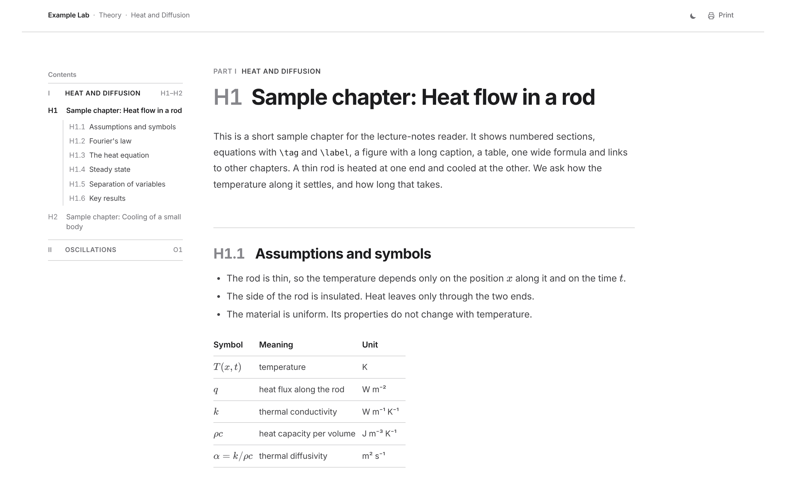
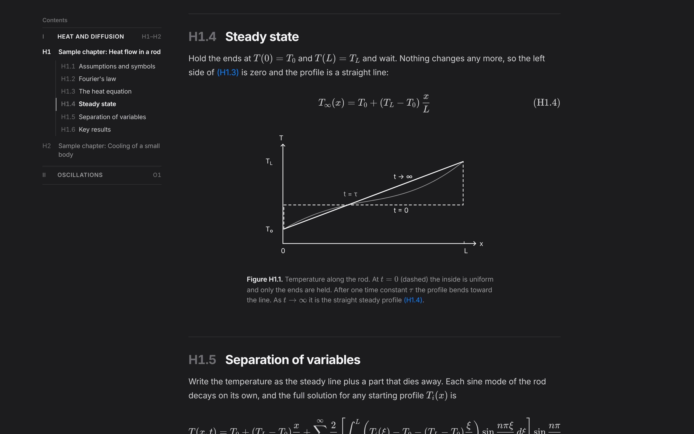
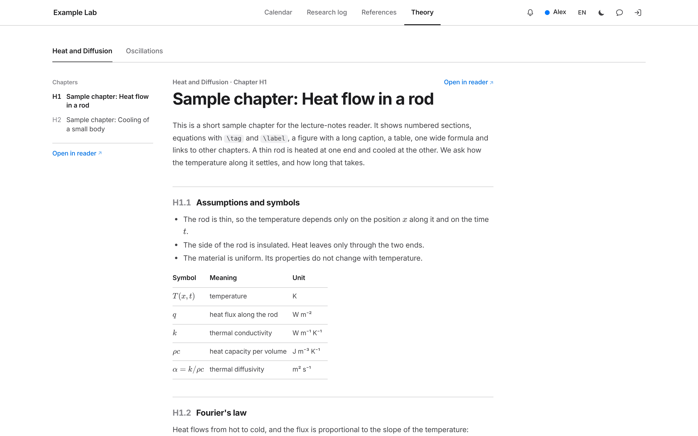
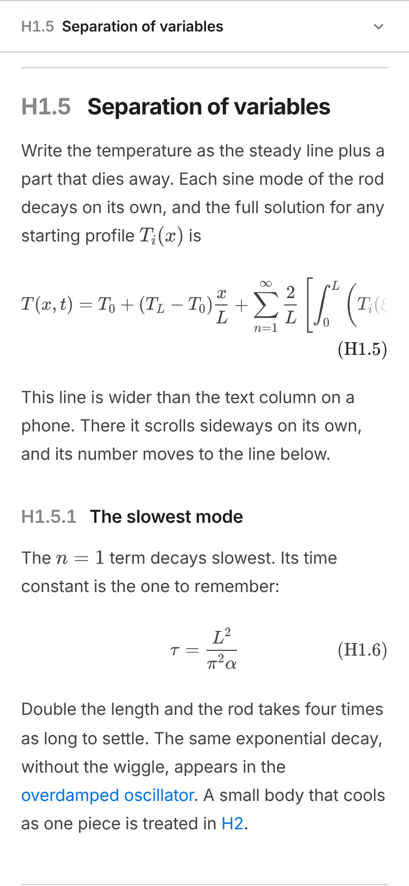
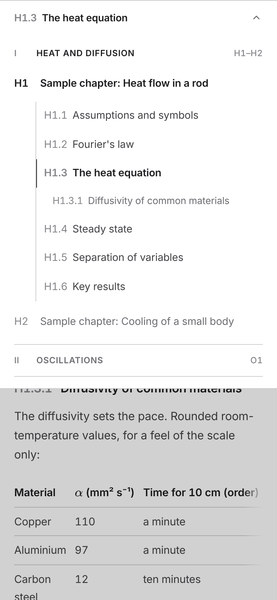
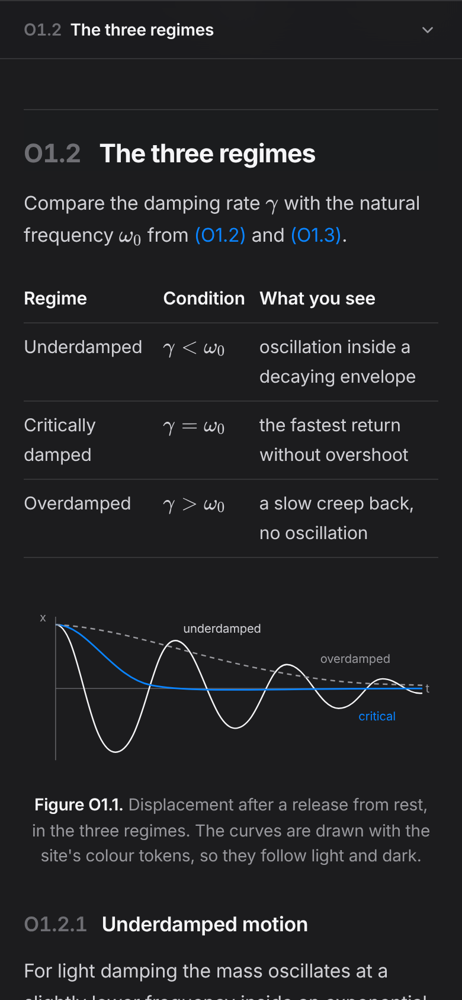
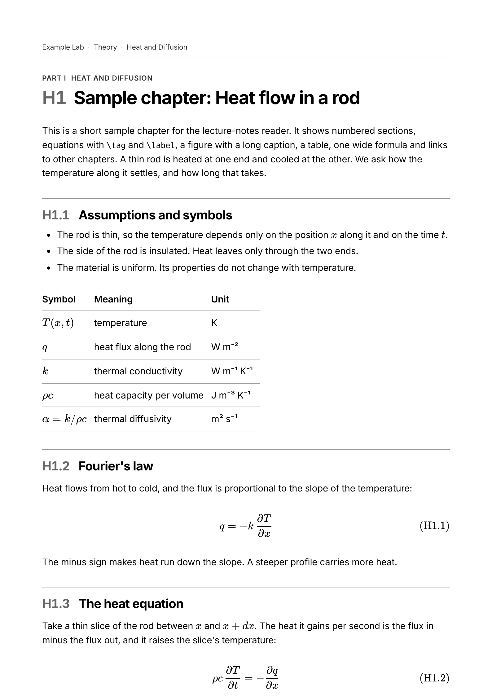

# Lecture-notes reader

Chapters written in Markdown with KaTeX become numbered lecture notes on two surfaces: a Theory tab inside the app
(parts as sub-tabs), and a standalone reader page at `/theory/<part>/<chapter>`. The reader sets the text at 72
characters, keeps an outline of every part beside it, remembers where each chapter was left, and prints cleanly on A4.



| | |
|---|---|
|  |  |
|  |  |
|  |  |

Origin: built for the NAND Capstone team site (Nov 2026); every chapter here is a fresh sample.

## When to use / when not to

Use it when:
- a team or a course writes long technical notes (equations, figures, cross-references) in a Git repository and wants
  them readable on a site, on phones and on paper;
- numbers must stay right while chapters are edited (sections, equations and figures are numbered by the site);
- the site already uses the design system skill (`team-site-design-system`) or can load its `tokens.css`.

Do not use it when:
- you need a full book toolchain (PDF books, bibliographies, theorem environments): use Quarto, Jupyter Book or LaTeX;
- the content is a few short pages with no math: plain `.doc` Markdown from the design system is enough;
- you cannot serve a rewrite for `/theory/<part>/<chapter>` (then link to the tab only, `#theory/<part>/<chapter>`).

## What you get

| File | What it does |
|---|---|
| `assets/site/js/md.js` | Markdown → HTML with marked + KaTeX. Takes math out before marked, puts it back as KaTeX. Rewrites relative images and links. |
| `assets/site/js/chapter.js` | One chapter → numbered HTML for both surfaces: sections (H1.1), equations (`\tag`, `\label`, `\eqref`), figures ("Figure H1.1."), cross-chapter links, lazy sections, `fitWide` for wide formulas, `sectionAt`, and the kept place (`rd_at`). |
| `assets/site/js/reader.js` | The reader page: contents of all parts with scroll-spy, part line, previous / next (with "Previous part" / "Next part"), open at `#section` or the kept place, phone bar and sheet, theme toggle, print. |
| `assets/site/js/theory-tab.js` | The Theory tab: sub-tabs = parts, chapter list, "Open in reader" aimed at the section being read, keeps the place while reading. |
| `assets/site/reader.html` | The reader page template (`{{SITE_NAME}}`). |
| `assets/site/css/doc.css` | Shared Markdown styles (`.doc`), wide-formula number and edge fades. |
| `assets/site/css/reader.css` | The reader: layout at three widths, contents, title, text, equations, figures, phone bar and sheet, print. |
| `assets/site/css/theory.css` | The Theory tab. |
| `assets/lib/reader-route.js` | For the Pages middleware: `/theory/<a>/<b>` → `reader.html` (via `env.ASSETS`, as `/reader`). |
| `assets/build_theory.py` | Chapters folder → `data/theory.json` (+ figure copies). `--check` enforces the naming rules. Standard library only. |
| `assets/check_chapters.mjs` | Lints chapters with the pinned KaTeX: parse errors, stray `$`, numbering, unresolved references, captions, images. |
| `assets/fetch-vendor.sh` | Downloads marked 15.0.12 and KaTeX 0.16.22 (MIT) from npm into `vendor/`. Not committed. |
| `assets/demo/` | Three sample chapters in two parts, a Theory tab host page, `serve.mjs` (static server with the reader rewrite), `test-reader.mjs` (59 browser checks), `shoot-print.mjs`. |

## Steps

1. **Load the design system.** Copy `team-site-design-system/assets/tokens.css` (and `components.css` for the app
   page) into the site's `css/`. The reader needs only `tokens.css`.
2. **Copy the code.** `assets/site/js/*` → `site/js/`, `assets/site/css/*` → `site/css/`, `assets/site/reader.html`
   → `site/reader.html`. Replace `{{SITE_NAME}}` in `reader.html`.
3. **Get the libraries.** `bash assets/fetch-vendor.sh site` puts `vendor/marked/marked.esm.js` and `vendor/katex/`
   under `site/`. Check the two files exist; `md.js` imports `/vendor/marked/marked.esm.js` and loads
   `/vendor/katex/katex.min.js` on first use.
4. **Create the chapters folder.** `theory/sections.json` and one folder per part. Start from
   `assets/demo/theory/` and read [references/authoring.md](references/authoring.md).
5. **Build the data.** In the site build (Cloudflare Pages build command), run
   `python3 build_theory.py --src theory --out dist --repo <owner>/<repo> --check` after copying `site/` to `dist/`.
   Check `dist/data/theory.json` exists and `dist/repo/theory/<part>/figures/` holds the figures.
6. **Route the reader.** Put `assets/lib/reader-route.js` in `lib/` (not `functions/`, where it would become a route).
   With no other middleware: `functions/_middleware.js` = `export { onRequest } from "../lib/reader-route.js";`. Behind
   the sign-in gate (`google-signin-team-gate`), add `readerRewrite` to the gate's `REWRITES`, so it runs for signed-in
   requests only. Check: `curl -I` on
   `/theory/<part>/<chapter>` gives 200 HTML, and on a figure gives `image/svg+xml`.
7. **Mount the tab.** In the app page, add the pane markup (`#pane-theory` > `#th-tabs`, `#th-layout` > `#th-toc`,
   `#th-body`; see `assets/demo/index.html`), link `doc.css` and `theory.css`, and call
   `createTheory({ t })` once; call `theory.show(part, chapter)` from your router for `#theory/<part>/<chapter>`.
   Fire `window.dispatchEvent(new Event("site:lang"))` after a language switch if you pass your own `t`.
8. **Share the theme key.** The app must save light / dark under `site_theme` (design system `theme.js`); the reader
   reads and writes the same key.
9. **Lint the chapters.** `node assets/check_chapters.mjs theory` must report 0 issues.
10. **Run the demo tests** (below) once on the skill as shipped, then point a copy at your site to check your chapters.
11. **Screenshots.** Shoot the reader at 1440 light and dark, 390 light with the bar, the phone contents open, the tab,
    and print; look at each one.

## Rules

- **Never number by hand in the HTML.** Numbers come only from `chapter.js`, so the tab, the reader and paper agree.
- **No boxes.** No card background, shadow or rounded panel. Parts are set apart by space, a roman numeral and a
  0.5 px hairline. Code and quotes are a 1.5 px left rule.
- **Measure in `ch`.** The text column is `minmax(0, 72ch)` at 17 px (tab: 70ch at 15 px).
- **Numbers are quiet.** Section, equation and list numbers are `--ink4`, tabular. Links are the only colour.
- **A wide formula never hides its number.** It scrolls on its own; the number moves under it. Nothing ever widens
  the page.
- **Measure sections, not headings,** for the scroll-spy and the kept place (lazy layout must stay lazy).
- **One place key for both surfaces** (`rd_at`), kept per chapter, 60 chapters at most, every access in `try/catch`.
- **The top of a chapter is not a place** and **the first 600 ms are not reading** (see decisions).
- **Phones get 44 px targets** everywhere, anchors clear the 48 px bar (`scroll-margin-top: 64px`).
- **Fetch `/reader`, not `/reader.html`,** in the rewrite (Pages redirects `.html`).
- **Figures are black on transparent** files or token-coloured inline SVG; never a white background.
- **Print is plain:** A4, black on white, no controls, nothing split.

## Configuration

| Name | Where | Meaning | Demo value |
|---|---|---|---|
| `{{SITE_NAME}}` | `reader.html` (title, `application-name`, first crumb) | site name | `Example Lab` |
| `--src` | `build_theory.py` | chapters folder | `assets/demo/theory` |
| `--root` | `build_theory.py` | that folder's path in the repository (for links) | `theory` |
| `--base` | `build_theory.py` | where figures are served | `/repo/` (demo `/`) |
| `--repo`, `--branch` | `build_theory.py` | GitHub repository for non-chapter links | empty (demo) |
| `READER_PATH` | `chapter.js` (+ `READER` in `reader-route.js`) | reader address prefix | `/theory/` |
| `THEME_KEY` | `reader.js`, inline script in `reader.html` | saved light / dark | `site_theme` |
| `AT_KEY` | `chapter.js` | kept places | `rd_at` |
| `HOME` | `reader.js` | the tab's address for "Back to Theory" | `/#theory` |
| `t(key, vars)` | `createTheory({ t })` | UI words of the tab | English built in |

No secrets. Nothing here needs an environment variable.

## Self-check before shipping

```bash
bash assets/fetch-vendor.sh                                       # once
python3 assets/build_theory.py --src assets/demo/theory --out assets/demo --base / --no-images --check
node assets/check_chapters.mjs assets/demo/theory                 # 3 chapters, 0 issues
node assets/demo/test-reader.mjs                                  # 59 checks passed
node assets/demo/serve.mjs 8123                                   # then open the two addresses below
```

- `http://localhost:8123/theory/heat/h1-heat-flow-in-a-rod` (reader) and `http://localhost:8123/#theory/heat/h1-heat-flow-in-a-rod` (tab).
- Widths: 1440, 1024, 390, 375 and 340. At each, no sideways page scroll; the wide formula H1.5 scrolls on its own.
- Light and dark, by the button and by the system. Figures invert in dark; inline SVG follows tokens.
- Phones: the bar names the section; the sheet opens at this chapter; Esc and the scrim close it; anchors land below the bar.
- Place: read to the middle, reload: back at the same spot. "Open in reader" from the tab opens at the same section.
- Print preview: A4, no contents, no controls, equations whole.
- Reduced motion: no flash on jumps, no turning chevron.
- `bash tools/privacy-scan.sh` and `node tools/check-skills.mjs` print only ✓.

All of the above were run on this skill as shipped: the checker reports 0 issues, `test-reader.mjs` passes 59 checks.

## References

- [references/design.md](references/design.md): every size, weight, line height, colour token, margin and state, per width, with layout sketches; phone bar; print.
- [references/behaviour.md](references/behaviour.md): data shape, the numbering pipeline, lazy layout, fitWide, links, scroll-spy, the reading line, kept places, routing.
- [references/authoring.md](references/authoring.md): how to write a chapter (files, labels, math, figures, links, the checker).
- [references/decisions.md](references/decisions.md): why it is built this way, and the before → after history.
- [team-site-design-system/references/mobile.md](../team-site-design-system/references/mobile.md): the phone rules this skill follows (zoom, where scrolling is locked, sheets, keyboard, safe areas), with the code and the reason for each.
