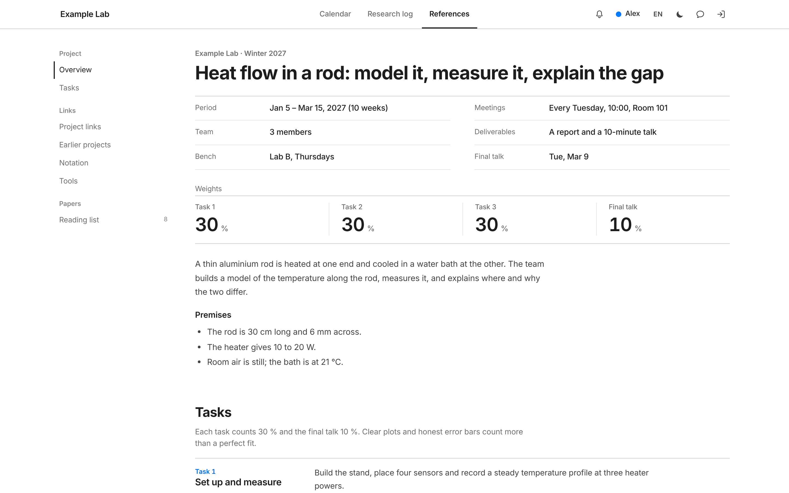
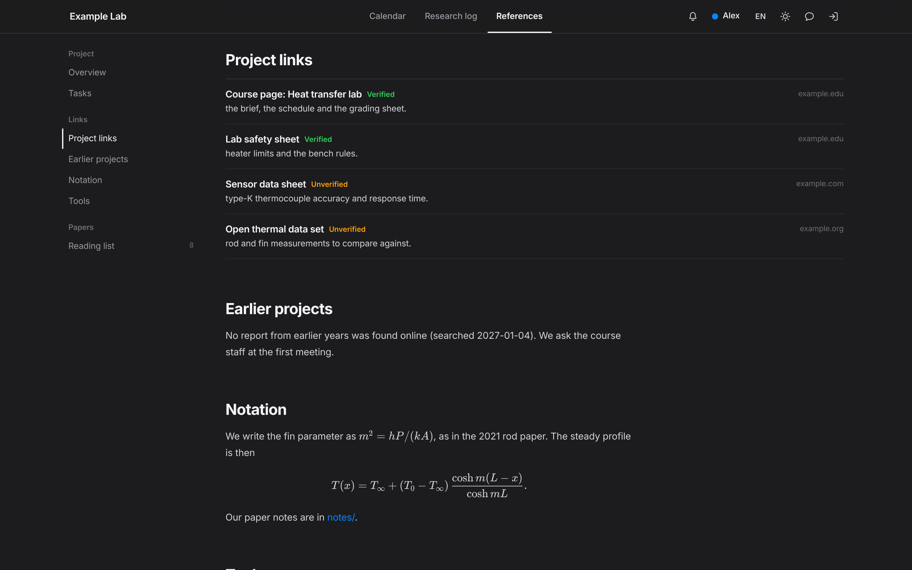
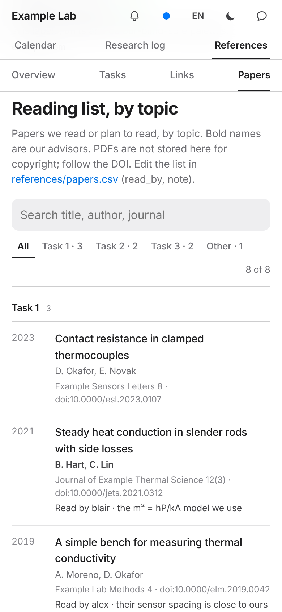

# References library

One place for what the team reads. Links live in `references/README.md`, papers in `references/papers.csv`, both
edited on GitHub. The build turns them into `refs.json`, and the site's References tab shows them: the project at a
glance (optional), the link lists with a **Verified** or **Unverified** mark on every link, and the reading list with
search and topic filters. A contents column follows the reading on desktop. On phones, a row of four jumps stays under
the header. A lint fails the build when a PDF, an unmarked link or a DOI written as a URL gets in.

| Overview, desktop | Link lists, dark | Reading list, phone |
|---|---|---|
|  |  |  |

More: [reading list, desktop](screenshots/papers-1440-light.png) ·
[one fact column at 1024](screenshots/overview-1024-light.png) · [phone, dark](screenshots/overview-390-dark.png) ·
[phone, search and filter](screenshots/filter-390-dark.png).

## When to use / when not to

- Use for a small team that shares papers and links for one project: a capstone, a lab group, a course project.
- Use with a GitHub repository and a site built from it (team-site-setup). People edit the CSV and the README on GitHub
  or in a spreadsheet; nobody needs a database.
- Not a reference manager. There is no BibTeX export, no PDF store and no per-user library. Use Zotero for that, and
  copy the rows you want the team to see into `papers.csv`.
- Not for hundreds of papers. The whole list is one JSON file and the search runs in the page. It reads well up to
  about 200 rows.

## What you get

| Path in `assets/` | What it is |
|---|---|
| `build_refs.py` | Build step: `references/README.md` + `papers.csv` → `refs.json`. `check_refs()` lints the CSV, the link lines and the folder. Runs alone too (`--root`, `--out`, `--check`). Standard library only. |
| `references/README.md` | Template for the team's link lists, with the rules at the top. Placeholder `{{PROJECT_TITLE}}`. |
| `references/papers.csv` | The header row only: `group,title,authors,year,venue,doi,url,read_by,note`. |
| `references/notes/README.md` | How to name and write a paper note (`year-firstauthor-keyword.md`). |
| `site/js/refs.js` | `createRefs(ctx)`: the tab (contents, overview, tasks, link lists, text sections, reading list, jump row, tracker). Also exports `sections()` and `tagOf()`. |
| `site/js/refs-strings.js` | Every word the tab shows. `useStrings()` swaps the table for another language. |
| `site/js/refs-util.js` | `$`, `$$`, `esc`, and `keepPairs` (numbers stay on one line with their unit). |
| `site/js/md.js` | Markdown → HTML with marked and KaTeX, for README sections that are text (the same file as in weekly-research-log). |
| `site/css/refs.css` | All styles of the tab. Every value is in [references/design.md](references/design.md). |
| `site/refs.html` | The pane's markup. |
| `site/data/problem.example.json` | The optional overview: title, facts, a row of numbers, background, premises, tasks, grading. |
| `tools/test_refs.py` | 38 offline tests of the build step and the lint, and a check that the demo's `refs.json` is up to date. |
| `tools/test-refs.mjs` | 26 offline tests of the README parser and the marks, and a check that the page and the lint read links with the same pattern. |
| `fetch-vendor.sh` | Downloads marked 15.0.12 and KaTeX 0.16.22 (MIT) from npm. Do not commit what it downloads. |
| `demo/` | The tab with made-up data: a heat-flow project, 6 links, a text section with math, 8 papers in 4 topics. |

## Steps

1. Have the base: `team-site-setup` (repository, `build.py`, `team.json`), `team-site-design-system` (tokens,
   components, `doc.css`, header) and the repository rules from `team-project-playbook`.
2. Ask the user for: the project title; the topics papers are filed under (for example Task 1, Task 2, Task 3); whether
   they want the overview (and its facts); and any names to show in bold in author lists (advisors, the team's own
   papers), written exactly as they appear in the CSV. Never guess names.
3. Copy the files:

   | From `assets/` | To the repository |
   |---|---|
   | `references/` (README.md, papers.csv, notes/README.md) | `references/` |
   | `build_refs.py` | next to `build.py` (the repository root) |
   | `tools/test_refs.py`, `tools/test-refs.mjs` | `tools/` |
   | `site/js/refs.js`, `refs-strings.js`, `refs-util.js`, `md.js` | `site/js/` (keep one `md.js` if weekly-research-log already added it) |
   | `site/css/refs.css` | `site/css/` |
   | `site/data/problem.example.json` | `site/data/problem.json` (only if the user wants the overview) |

4. Fill `{{PROJECT_TITLE}}` in `references/README.md`. If there is an overview, fill `problem.json` with the user's
   words. Do not invent facts, dates or numbers. Leave a fact out when it is not known yet.
5. Keep PDFs out of git. Add `*.[pP][dD][fF]` to `.gitignore`. Git matches `*.pdf` case-sensitively on Linux.
6. Add the build step to `build.py`:

   ```python
   from build_refs import refs, check_refs
   STEPS = {"build": build_info, "refs": refs}           # plus the steps you already have
   IMAGE_DIRS = [ROOT / "references"]                    # images in references/README.md
   MUST += ["data/refs.json", "js/refs.js", "css/refs.css", "vendor/marked/marked.esm.js"]
   # first lines of check():
   #     bad = check_refs()
   #     if bad: print("\n".join(bad)); sys.exit(1)
   ```

   Then fetch the libraries (`bash fetch-vendor.sh site`), and add `site/vendor/` to `.gitignore` unless the team
   commits them.
7. Paste `site/refs.html` into the page. Link `refs.css` after the design system's CSS (and `katex.min.css` if the
   README uses math). Start the tab:

   ```js
   import { createRefs } from "./refs.js";
   const refs = createRefs({
     team,                                               // team.json: repo "owner/name" and branch, for the GitHub links
     highlight: { names: ["B. Hart"], label: "our advisors" },  // or leave out
     overviewUrl: "/data/problem.json",                  // or null for no overview
   });
   // when the tab opens: refs.show()
   ```

8. Run the tests: `python3 tools/test_refs.py` → `✓ 38 passed, 0 failed` and `node tools/test-refs.mjs` →
   `✓ 26 passed, 0 failed`. The demo checks in `test_refs.py` run only inside this library. In a project, 34 pass.
9. Run `python3 build_refs.py --check` → `references: ok`, then `python3 build.py --check`.
10. Put the first real links and papers in with the user. Mark each link `(verified)` only after someone has opened it
    and checked what the description claims. Otherwise mark it `(unverified)`.
11. Take the screenshots and run the self-check.

## The papers CSV

One row per paper. The first row is the header. Save as UTF-8; a byte-order mark (Excel's "CSV UTF-8") is fine. Quote a
cell that has a comma (`"B. Hart, C. Lin"`).

| Column | Required | What goes in it | Example |
|---|---|---|---|
| `group` | no | The topic. Blank → Other (always last). The source site called it `step`; both names work. | `Task 2` |
| `title` | yes | The paper's title. A row without one is skipped (use that for a spacer or a comment row). | `Fitting convection coefficients …` |
| `authors` | yes | As printed, comma-separated. Names in `highlight.names` show bold. | `C. Lin, B. Hart, F. Ito` |
| `year` | no | Four digits. Newest first within a topic; a blank year goes last. | `2022` |
| `venue` | no | Journal or conference with volume. | `Journal of … 13(1)` |
| `doi` | one of doi/url | The bare DOI, `10.xxxx/…`. Not `https://doi.org/…` and not `doi:…`. | `10.0000/jets.2022.0105` |
| `url` | one of doi/url | The publisher's page when there is no DOI. Never a link to a PDF file. If both are set, the title links the URL. | `https://example.org/paper` |
| `read_by` | no | Member ids of who has read it. | `alex, casey` |
| `note` | no | One line: why it matters to the team. | `the model we use` |

## Link lists

A `## Title` in `references/README.md` starts a section, in file order. A section is a **link list** when each line is
`- [Name](url) — description (verified)`, with an optional lead sentence above the list. A section with anything else
(a paragraph, a plain bullet, a table, math) is shown as Markdown text, whole. Text before the first `##` is the file's
own introduction and is not shown.

- The mark at the end of the description shows after the title: `(verified)` → **Verified** (green),
  `(unverified)` → **Unverified** (amber).
- The host (`example.org`) shows on the right of the row.
- Descriptions are plain text: no Markdown and no math. Put those in a text section.

## Rules

- No paper PDFs in the repository, ever (copyright). Link the DOI or the publisher's page. The lint fails on a PDF file
  under `references/` (any case), a `.pdf` URL in the CSV, and a `.pdf` link in the README.
- Every link in a link list ends with `(verified)` or `(unverified)`. A guess is marked as a guess. The lint fails on an
  unmarked link.
- A DOI is written bare (`10.xxxx/…`). The page builds `https://doi.org/…` itself.
- Paper notes are written in your own words. No pasted abstracts, paragraphs or figures.
- One file per kind: links in `README.md`, papers in `papers.csv`, notes in `notes/`. The site only reads them; edits
  happen on GitHub.
- The contents column and the jump row are marked by one tracker. A jump lands with the section title just under the
  header (and the jump row on phones).
- Every colour is a design system token. Rows and rules, no cards. Tap areas are 44 px on phones. The search box is
  16 px text on phones, so iOS does not zoom.
- Numbers stay on one line with their unit (`keepPairs`).

## Configuration

| Name | Where | Meaning | Example |
|---|---|---|---|
| `{{PROJECT_TITLE}}` | `references/README.md`, `problem.json` | The project's title | `Heat flow in a rod` |
| `{{SITE_NAME}}` | `problem.json` eyebrow | The site's name | `Example Lab` |
| `{{START_DATE}}`, `{{END_DATE}}` | `problem.json` | The program's first and last day, as people write them | `Jan 5`, `Mar 15, 2027` |
| `{{WEEK_START}}` | `problem.json` | When the team meets | `Tuesday, 10:00` |
| `team` | `createRefs` | `team.json`; `repo` ("owner/name") and `branch` make the GitHub links | `{ repo: "example-org/example-lab" }` |
| `refsUrl` | `createRefs` | Where the build writes `refs.json` | `"/data/refs.json"` (default) |
| `overviewUrl` | `createRefs` | The overview file, or `null` for none | `"/data/problem.json"` (default) |
| `highlight` | `createRefs` | Names to show bold, and the tooltip | `{ names: ["B. Hart"], label: "our advisors" }` |
| `groups` | `createRefs` | The order of the topic filters (others follow in natural order, Other last) | `["Task 1", "Task 2", "Task 3"]` |
| `pane` | `createRefs` | The tab's element; the tracker rests while it is hidden | `"#pane-refs"` (default) |
| `lang` | `createRefs` | Which language block of `problem.json` to show | `() => document.documentElement.lang` (default) |
| `--refs-bar-h` | CSS, `:root` | The phone header's height, where the jump row sticks | `82px` (default) |
| `MD_VENDOR.katex` | `md.js` | Where KaTeX is, if not `/vendor/katex/katex.min.js` | `"/assets/katex/katex.min.js"` |
| strings | `refs-strings.js` | Every word on the tab; change `refs.steps`, `refs.stepsH`, `refs.step`, `refs.papersH`, `refs.papersLead` to the project's words | `"refs.step": "Step {n}"` |

Another language: call `useStrings({...})` with the same keys, add a block to `problem.json` (`"ko": {…}`), and fire
`site:lang` on `window`. The tab draws again and keeps the search and filter.

## Self-check before shipping

- [ ] `python3 tools/test_refs.py` and `node tools/test-refs.mjs` pass; `python3 build_refs.py --check` says
      `references: ok`; `python3 build.py --check` passes.
- [ ] The tab at 320, 390, 768, 1024 and 1440: no sideways page scroll. The facts are one column from 761 to 1100 and
      on phones. The numbers are two in a row below 900.
- [ ] Desktop: scroll the page; the contents mark each section as its title passes under the header. Click an entry;
      the title lands just under the header. At the very bottom, Reading list is marked.
- [ ] Phone: the jump row sticks under the header; each jump lands the title under it and marks the entry; a README
      section marks Links.
- [ ] Search "a word from a title" and a topic filter together; the count reads "n of N". A search with no match shows
      "No matching papers."
- [ ] Every link row has a mark and a host; the paper titles open the DOI.
- [ ] Light and dark: the Verified and Unverified marks, the bold names and the frosted jump row are readable.
- [ ] Reduced motion: jumps are instant.
- [ ] No PDF in `git ls-files`. In this library: `bash tools/privacy-scan.sh` prints only ✓.

The demo links the design system by relative path, so serve the **repository root**:

```bash
bash skills/references-library/assets/fetch-vendor.sh       # once: marked and KaTeX into the demo (git-ignored)
python3 -m http.server 8123 --bind 127.0.0.1                 # from the repository root
# http://127.0.0.1:8123/skills/references-library/assets/demo/
#   ?at=sec-papers   jump to a section · ?q=hart   search · ?f=Task%202   filter
# after editing demo/references: (cd skills/references-library/assets/demo && python3 ../build_refs.py --root . --out data/refs.json)
```

## References

- [references/design.md](references/design.md): every measurement, token, breakpoint, state and motion, with sketches
  for 1440, 1024, 390 and 320.
- [references/decisions.md](references/decisions.md): before → after for the look and the rules, and what was
  rejected.
- Origin: rebuilt from the References tab of the NAND Capstone team site (2026).
- [team-site-design-system/references/mobile.md](../team-site-design-system/references/mobile.md): the phone rules this skill follows (zoom, where scrolling is locked, sheets, keyboard, safe areas), with the code and the reason for each.
