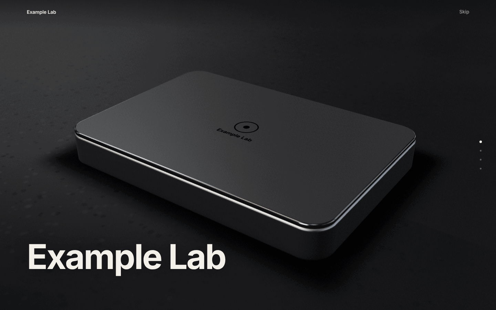
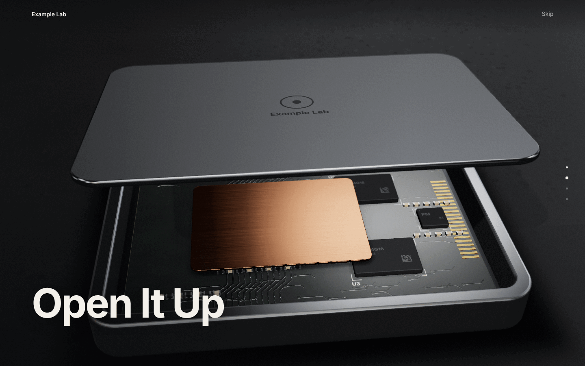
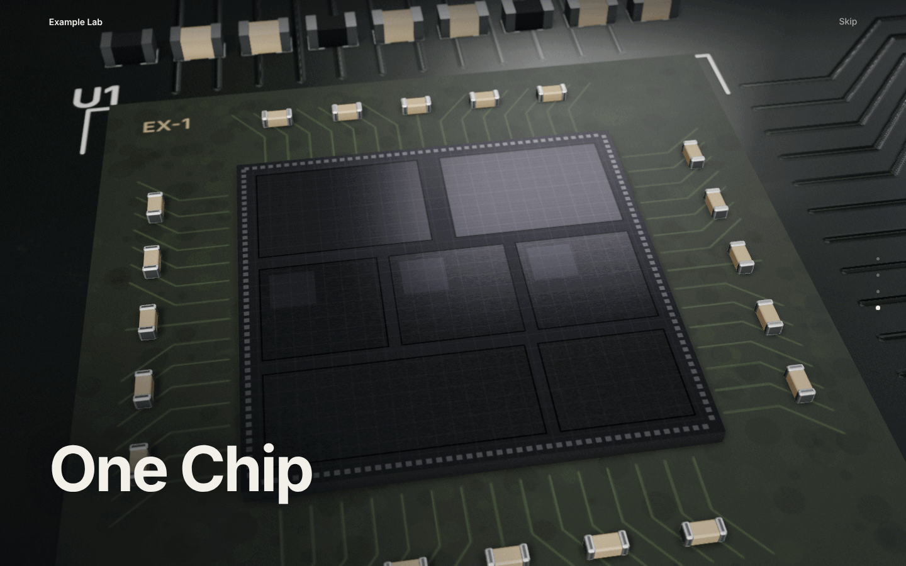
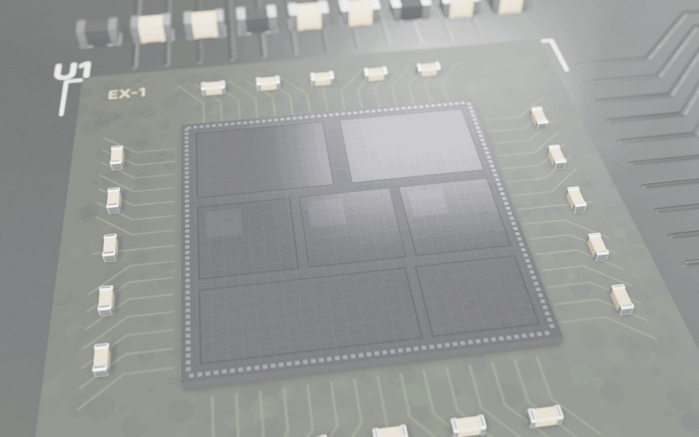

# Scroll 3D intro

A full-screen intro in front of the site: as the visitor scrolls, one camera dives into a product-render scene (here a
small device that opens into its layers and ends on one chip), one short headline per beat. Small things move on a
clock even when the scroll stops. At the end the picture brightens into the page colour and the site fades in at the
top. Phones skip it and open on the site.

## When to use / when not to

- Use for the landing view of a team, lab or product site on desktops and tablets, when there is one object worth
  diving into (a device, an instrument, a structure from your research).
- Use when you can spend the effort on the picture: the bar is a high-end product render (see
  [references/quality.md](references/quality.md)). A line drawing or flat-coloured blocks will be rejected.
- Not for phones: they never get the intro (≤ 760 px wide, or a phone on its side). Not for pages people open many
  times a day: it shows once per browser tab, and the site name in the header replays it.
- Not when you cannot serve about 900 KB of scripts (three.js r170, its addons and the scene; about 230 KB gzipped) from your own origin.

## What you get

| File | What it does |
|---|---|
| `assets/intro-markup.html` | The head script (decides intro on/off before the first paint), the import map, the section markup with brand, Skip, dots and headlines, the app wrapper, the sign-in hand-off line. |
| `assets/intro.css` | Stage, sticky run (`373svh`), text on the picture, portrait framing, sign-in arrival, end fade, reduced motion. |
| `assets/intro-story.js` | The run (`STORY`, `HOLD`, `FADE` screens) and the headline beats. Edit with your scene. |
| `assets/intro.js` | Controller: scroll → story progress, headlines, dots, Skip, end, replay, frame caps, `window.introDebug`. Lazy-loads the engine. |
| `assets/intro-scene.js` | Engine: renderer, MSAA scene pass, GTAO, Bokeh, finish pass, studio light, camera rig (monotone curves in log distance), clock, events, warm-up, adaptive quality, snap mode. |
| `assets/scenes/example-device.js` | The example scene: a device, its layers, a board, one chip and its die. Procedural geometry and canvas textures only. Replace with yours. |
| `assets/fetch-vendor.sh` | Downloads three.js r170 from npm, checks its sha512, copies the build and the 16 addon files used into `vendor/three/`. |
| `assets/tools/intro-frames.mjs` | Headless stills, the end-fade frame, posters and the motion metrics (Playwright + SwiftShader). |
| `assets/demo/index.html` | The example running in front of a placeholder site (needs the design system skill next door). |

| Open It Up (p 0.33) | Every Layer (p 0.62) |
|---|---|
|  |  |
| **One Chip (p 0.97)** | **End fade, light theme** |
|  |  |

## Steps

1. **Vendor three.js.** `bash assets/fetch-vendor.sh site/vendor` (or with no argument for the demo). It must print no
   error; the sha512 check refuses a changed tarball. Serve `vendor/three/` at `/vendor/three/`. Never commit it.
2. **Run the demo once.** From the repository root: `python3 -m http.server 8123`, open
   `http://localhost:8123/skills/scroll-3d-intro/assets/demo/?again` at 1440 × 900 and scroll to the end. Check: the
   stage stays pinned, headlines change, the end fades into the page, the placeholder site appears at the top.
3. **Copy the files** as in [references/architecture.md](references/architecture.md) §8: `intro.js`,
   `intro-story.js`, `intro-scene.js`, `scenes/` into `/js/`, `intro.css` into `/css/`. Paste the HEAD and BODY parts of
   `intro-markup.html` into `index.html`; wrap the rest of the page in `
`.
4. **Wire the site.** Give the header's site name `data-replay`. Point Skip's `href` at the first tab (`#calendar`).
   Make anything that opens over the page (pop-ups, the site guide) wait for the `intro:done` event on `window`, or run
   at once when `<html>` has `intro-off`.
5. **Write your story.** Headlines first (4–6 beats, 1–3 words, the first is `{{SITE_NAME}}`) in the markup and in
   `BEATS`. Then copy `scenes/example-device.js` to `scenes/<yours>.js`, change the import at the top of
   `intro-scene.js`, and build the objects, anchors, camera keys and events (contract:
   [references/architecture.md](references/architecture.md) §4; a full-length plan:
   [references/worked-example.md](references/worked-example.md)).
6. **Render and look.** `node assets/tools/intro-frames.mjs <url> out --p 0,0.1,…,1` at 1440 × 900 and at 820 × 1180
   with `--tier low`. Open every PNG. Fix what looks drawn, flat, empty or badly cropped. Two or three passes is normal.
7. **Measure motion.** `--metrics 51` (at 960 × 600 it takes about 2 minutes). `metrics.txt` must end in `PASS`: no run
   of 4 near-zero steps, no frame with the subject under 35 %.
8. **Posters and sign-in.** Render `--p 0 --ui 0 --dpr 2` (and a portrait one at 780 × 1688, `--dpr 1.5`), convert to
   WebP, set `--ix-poster` / `--ix-poster-tall` on `.ix`, and use the same picture, dimmed, as the sign-in background.
   The sign-in page sets `intro_arrive` (architecture §7).
9. **Check on a real GPU** (not headless): scroll the whole run with a trackpad; no hitch when a new part appears
   ([references/performance.md](references/performance.md) §6).
10. Run the self-check below.

## Rules

- One continuous camera; the subject stays on screen and covers at least ~35 % of the frame. Never cut.
- Photoreal materials only: PBR, procedural roughness, bevels, studio environment, AO, depth of field. No line art, no
  flat blocks, no bloom, no glow, no neon. Accent colours only where they mean something.
- Text on screen: the site name (top left), Skip (top right, plain text, 44 px target), small dots, and one 1–3 word
  headline per beat. Nothing else. English.
- The title is on screen from the first paint (it only rises after sign-in).
- Scroll is the story axis and never moves by itself. Time drives only the arrival, the idle drift and the ~1 s beat
  events, which always finish.
- No dead scroll: every headline arrives during motion; only the last beat holds.
- Body `overflow-x: clip`, never `hidden` (the sticky stage breaks). The app is out of the page flow while the intro is
  on, and fades in at the top at the end; it never slides up.
- Phones (≤ 760 px wide, or coarse pointer and ≤ 500 px tall) get no intro. Portrait tablets get their own framing and
  the low tier.
- three.js is lazy-loaded and served from your own origin, pinned to r170.
- Every shader compiles before the first frame. Quality drops within three late frames and climbs back slowly.
- Reduced motion: no clock, no camera moves on their own, final states, instant switches.

## Configuration

| Placeholder or setting | Where | Meaning | Example |
|---|---|---|---|
| `{{SITE_NAME}}` | `intro-markup.html` (brand and first headline) | Full site name | `Example Lab` |
| Headlines | `intro-markup.html` `.ix-heads` | One per beat, 1–3 words | `Open It Up` |
| `RUN` | `intro-story.js` | Story, hold and fade length in screens; the `.ix` height in `intro.css` must be `100 × (1 + sum)` svh | `{ STORY: 2, HOLD: 0.45, FADE: 0.28 }` → `373svh` |
| `BEATS` | `intro-story.js` | Headline fade-in and fade-out in story progress | `[0.20, 0.25, 0.42, 0.47]` |
| Scene import | top of `intro-scene.js` | Your scene module | `./scenes/example-device.js` |
| `--ix-bg` | `intro.css` `.ix` | Stage colour (also the poster background) | `#111216` |
| `--ix-poster`, `--ix-poster-tall` | `intro.css` `.ix` or inline | Sign-in and no-WebGL background | `url(/img/poster.webp)` |
| Skip `href` | `intro-markup.html` | Where Skip lands | `#calendar` |
| Import map | `intro-markup.html` | Where three.js is served | `/vendor/three/three.module.min.js` |
| `intro_seen`, `intro_arrive` | `sessionStorage` keys | Shown once per tab; just signed in | — |

URL parameters for stills and checks: `?p=0.42` (jump), `?t=4` (frozen clock, draw on demand), `?ev=0.5` (phase of
the latest event), `?tier=low|high`, `?fx=0..3`, `?dpr=2`, `?ui=0` (no text), `?arrive=login`; in the demo `?again`
shows the intro again in the same tab. `window.introDebug`: `snap({p,t,ev,end,light})`, `go(p)`, `run(s)`,
`fadeAt(e)`, `quality()`, `frames()`, `ready()`.

## Self-check before shipping

- **Widths:** 1440 × 900 and 1280 × 720 (landscape framing); 820 × 1180 (portrait framing, low tier, headline wraps);
  761 px wide (intro on); 760 and 390 px wide (no intro, the site opens on its first tab); a phone on its side
  (844 × 390, coarse pointer: no intro). At every width: no horizontal scroll, the stage stays pinned.
- **Light and dark:** the stage is dark in both; the end fades into `--paper` of the current theme (shoot the end at
  `--end 0.5` in both).
- **Reduced motion:** turn it on in the OS. No arrival, no drift, events final, Skip and the end are instant.
- **States:** no WebGL (block WebGL in the browser: the poster shows, headlines still follow); `?arrive=login`;
  replay from the site name; a deep link (`/?date=…`, `/#notes`) skips the intro; reload in the same tab skips it.
- **Tests:** `metrics.txt` says `PASS`; `introDebug.quality().programs` is the same before and after a full scroll;
  the console shows no "Intro:" warning (height and `RUN` agree; headline count and `BEATS` agree).
- **Privacy:** no real names, emails or project ids in the scene's canvas text (part numbers, labels); then
  `bash tools/privacy-scan.sh` prints only ✓.

## References

- [references/design.md](references/design.md): every size, colour, motion and state; sketches per width.
- [references/architecture.md](references/architecture.md): head script, run math, scene contract, clock, end, sign-in hand-off.
- [references/performance.md](references/performance.md): tiers, pixel budget, warm-up, adaptive quality, frame caps.
- [references/quality.md](references/quality.md): the quality bar, what passed, the stills and metrics workflow, weakest frames.
- [references/decisions.md](references/decisions.md): what was tried and replaced, and why.
- [references/worked-example.md](references/worked-example.md): the source site's full scene plan (drive → one memory cell).
- [team-site-design-system/references/mobile.md](../team-site-design-system/references/mobile.md): the phone rules this skill follows (zoom, where scrolling is locked, sheets, keyboard, safe areas), with the code and the reason for each.

Third-party: three.js r170 (MIT), downloaded by `assets/fetch-vendor.sh`; not committed.

Origin: the NAND Capstone 2026 Winter team site.
