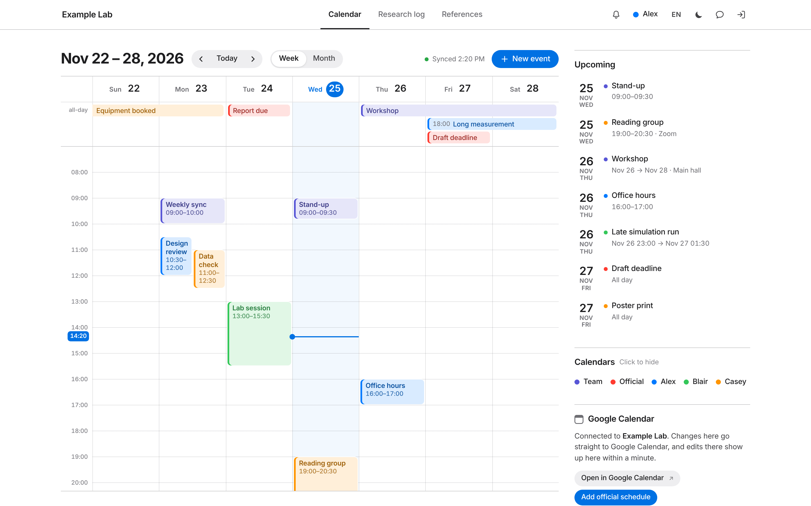
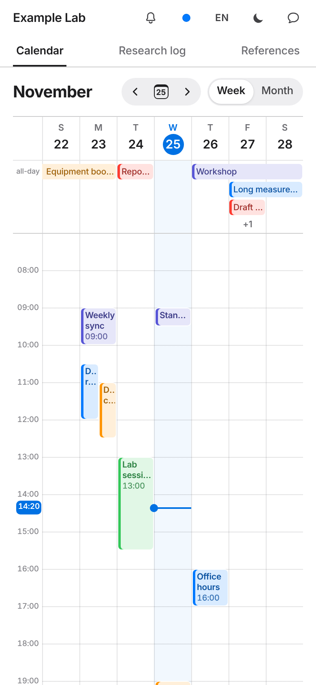
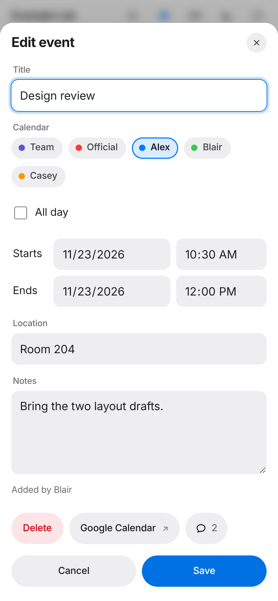

# Shared Google Calendar

A calendar tab that reads and writes one shared Google Calendar. Google is the only store: events added on the site
appear in everyone's Google Calendar app, and edits made there show on the site within a minute. The look follows Apple
Calendar: a week view with a time grid, a month view, hairlines instead of boxes, and one colour per owner.

| Week, desktop | Week, phone | Event sheet, phone |
|---|---|---|
|  |  |  |

More: [dark week](screenshots/week-1440-dark.png) · [month](screenshots/month-1440-light.png) ·
[phone dark](screenshots/week-390-dark.png) · [desktop dialog](screenshots/dialog-1440-light.png).

## When to use / when not to

- Use for a small team (2–20 people) that already shares a Google Calendar, or wants one, and wants it inside its own
  site with the same look as the rest of the site.
- Use when the site has a sign-in gate (google-signin-team-gate). The API trusts the gate and writes as the server's
  robot account; without a gate anyone could edit the calendar.
- Not for public booking pages, invitations, RSVPs, reminders by email, or free/busy across people's own calendars.
  Those are Google Calendar's own features; link to it.
- Not if the team cannot create a service account key (some Google Workspace organisations forbid it). Use a personal
  Gmail account to own the calendar instead; see [references/setup.md](references/setup.md#0-which-google-account).

## What you get

| Path in `assets/` | What it is |
|---|---|
| `lib/gcal.js` | Google access: service-account JWT (RS256, WebCrypto) → token (cached per isolate) → Calendar API v3. Event shape both ways, time zones with `Intl` (DST-aware), error codes. `TZ = "{{TIMEZONE}}"`. |
| `lib/seed.js` | The official schedule (placeholder dates) with fixed ids, and the `match` regex that finds a hand-made twin. |
| `functions/api/status.js` | `GET /api/status`: configured, ok, calendar name, zone, seeded. |
| `functions/api/events/index.js` | `GET` (a date range) and `POST` (create). "Added by" from the session. |
| `functions/api/events/[id].js` | `GET`, `PATCH`/`PUT` (one occurrence), `DELETE` (twice is fine). |
| `functions/api/seed.js` | `GET` (the schedule, for the striped preview) and `POST` (add it once: added / restored / kept / skipped). |
| `site/js/calendar.js` | `createCalendar(ctx)`: week and month views, the right column, the event sheet, the one-day list, polling, swipe, keyboard. |
| `site/js/cal-layout.js` | Pure layout: the 07:00 day (`DAY0`, `off`, `calToday`, `place`), lanes (`layoutWeek`, `MAX_LANES`), overlap columns (`packDay`). |
| `site/js/cal-util.js`, `cal-strings.js` | Small helpers and the `api()` call; every word the calendar shows and the error sentences. |
| `site/js/cal-config.js` | `TIMEZONE`, `DAY_START_HOUR` (7), `PREF_PREFIX`. |
| `site/css/calendar.css` | All calendar styles on top of the design system. Every value is explained in [references/design.md](references/design.md). |
| `site/calendar.html` | The markup to paste: the no-zoom viewport script, the calendar pane, the event sheet, the one-day list. |
| `site/data/team.example.json` | Members and owners with their Google colour ids. |
| `tools/mock-google.mjs` | A fake Google (token endpoint + Calendar API) that checks real JWT signatures. For tests and local runs. |
| `tools/test-calendar.mjs` | 74 offline tests: the Functions against the mock, in `Asia/Seoul` and `America/New_York` (DST), plus the layout code. |
| `.dev.vars.example` | The variable names, empty. |
| `demo/` | The calendar with an in-page fake `/api`: about 14 placeholder events around "now" (timed, overlapping, all-day, multi-day, a late night). |

## Steps

1. Have the base in place: `team-site-setup` (Pages project, `build.py`, `functions/`), `team-site-design-system`
   (`tokens.css`, `components.css`, the header), and `google-signin-team-gate` (the middleware sets
   `context.data.user.member`).
2. Copy `assets/lib/*` → `lib/`, `assets/functions/api/*` → `functions/api/`, `assets/tools/*` → `tools/`,
   `assets/.dev.vars.example` → `.dev.vars.example`. Add `.dev.vars` to `.gitignore`.
3. Copy `assets/site/js/*` → `site/js/` and `assets/site/css/calendar.css` → `site/css/`. Link `calendar.css` after
   the design system's CSS.
4. Fill the placeholders: `{{TIMEZONE}}` in `lib/gcal.js` **and** `site/js/cal-config.js` (the same IANA name). Set
   `DAY_START_HOUR` (7 unless the team asks for midnight days).
5. Put the members in `site/data/team.json` (shape of `team.example.json`): id, shown name, `colorId` 1–11. Ask the
   user for the names and colours; never guess them. Keep ids fixed forever: events store them.
6. Replace the example dates in `lib/seed.js` with the program's own (or empty the list if there is no official
   schedule).
7. Paste the three parts of `site/calendar.html` into the page: the script into `<head>`, the pane into `<main>`, the two
   dialogs before `</body>`.
8. Start it from the app script:

   ```js
   import { createCalendar } from "./calendar.js";
   const owners = [...team.owners, ...team.members.map((m) => ({ id: m.id, label: m.name, colorId: m.colorId }))];
   const cal = createCalendar({
     owners,                       // [{ id, label, colorId }]: team, official, then each member
     me: () => currentMember,      // the signed-in member { id } (from /api/me), or null
     nameOf: (id) => nameById[id], // for "Added by"
     isActive: () => tab === "calendar", // optional: polling and arrow keys only while the tab shows
     frame: document.documentElement,    // optional: the element that scrolls
     chat,                         // optional: createChat() from team-chat; adds a Comment button to the sheet
   });
   cal.load();
   // a tapped notification (/?event=<id>&date=<YYYY-MM-DD>): cal.focus(date, id)
   ```

9. Run the tests: `node tools/test-calendar.mjs` (Node 20+). It must end with `✓ all 74 calendar tests passed`.
10. Run it locally against the mock: `node tools/mock-google.mjs 8790 .dev.vars`, then
    `npx wrangler pages dev dist --binding DEV_MEMBER=alex`. Add, edit and delete an event. Check `/api/status`.
11. Give the user the console steps in [references/setup.md](references/setup.md) (calendar, service account, key,
    sharing, Cloudflare variables). Wait for them. Never ask them to paste the key into chat.
12. After the user's Retry deployment: `/api/status` says `ok:true`; add an event on the site and see it in Google
    Calendar; press **Add official schedule** once if the program has one.
13. Take the screenshots and run the self-check below.

## Rules

- **Google Calendar is the source of truth.** The site stores no events. Every view reads Google; every change goes
  to Google first and the view reloads from it.
- **Secrets only in Cloudflare.** `GOOGLE_SA_JSON` is a Secret variable; `GOOGLE_CALENDAR_ID` is Text. Neither is ever
  in the repository, a log, a screenshot or a chat. The page never sees the key.
- **The server sets "Added by" and "Edited by"** from the session (`context.data.user.member`). The page's `who` is
  only a fallback for local runs with no sign-in.
- **Colour follows the owner.** The page sends the owner's `colorId`; Google shows the same colour.
- **A calendar day runs 07:00 → 07:00** in the team's zone, so a late-night session stays one block on the day it
  started. Google keeps the real times; only the drawing changes. See [references/time-model.md](references/time-model.md).
- **Team time everywhere.** "Today", the now line and every time use `TIMEZONE`, wherever the viewer is.
- **Week view is the default.** The week always fits the width: no sideways scrolling, at any width.
- **One screen on phones.** The grid runs to the bottom edge (`fit()` and `--cal-top`); only the hours scroll. No New
  event button and no sync note on phones: a tap on a slot or a day adds. Month events are thin colour bars.
- **No zoom on an upright phone**, and `touch-action: pan-y` on the grid, so a swipe changes the week instead of
  panning.
- **Every control is at least 44 px to tap on phones.** Small pills keep their look with an invisible 44 px `::after`.
- **No weekend shading.** A research team works weekends.
- **Delete asks twice** (the button arms, then deletes). Deleting an event that is already gone is a success.
- **"Add official schedule" is safe to press any number of times** (fixed ids; restore if deleted; skip a hand-made
  twin).
- **Never poll while the sheet is open**, and run one request at a time. Poll every 60 s while visible, and on return
  after 15 s away.
- **Google's 401/403 become 502** with a sentence that says what to fix. The page reloads only on its own 401 `auth`.
- **Colours are design-system tokens.** No hex values in `calendar.css`.

## Configuration

| Name | Where | Meaning | Example |
|---|---|---|---|
| `{{TIMEZONE}}` | `lib/gcal.js` (`TZ`), `site/js/cal-config.js` (`TIMEZONE`) | the team's IANA zone; both must match | `Asia/Seoul` |
| `DAY_START_HOUR` | `cal-config.js` | when a calendar day starts; 0 = midnight days | `7` |
| `PREF_PREFIX` | `cal-config.js` | localStorage key prefix (view, hidden owners) | `cal_` |
| members | `site/data/team.json` | id, shown name, `colorId` 1–11 | `alex` Alex 7, `blair` Blair 10, `casey` Casey 6 |
| owners | `site/data/team.json` | the shared calendars | `team` Team 9, `official` Official 11 |
| official schedule | `lib/seed.js` | dates, titles, `match` regexes, `SEED_PREFIX` | Kickoff 2027-01-05, weekly session, last day |
| `GOOGLE_CALENDAR_ID` | Cloudflare, Text | the shared calendar's ID | (from Google Calendar settings) |
| `GOOGLE_SA_JSON` | Cloudflare, **Secret** | the whole service-account key file | (never written down) |
| `GOOGLE_TOKEN_URL`, `GOOGLE_API_BASE` | `.dev.vars` only | point at the mock in local runs | written by `mock-google.mjs` |
| `{{SITE_NAME}}` | the calendar's name in Google | shown on the Google Calendar card | `Example Lab` |

## Self-check before shipping

- [ ] `node tools/test-calendar.mjs` → `✓ all 74 calendar tests passed`.
- [ ] Widths 320, 375, 390, 768, 1024, 1440: no sideways page scroll; the head row fits; the week fits; month bars on
      phones.
- [ ] Light and dark: owner tints readable; today's 3 % tint visible in dark; the now line and label on top.
- [ ] Phone: the grid ends at the bottom edge; a swipe changes the week; pinch does nothing; a tap on a slot opens the
      sheet at that hour; the sheet's Starts and Ends are one row each; fields do not zoom on focus.
- [ ] A 23:00–01:30 event is one block on its start day; 02:00 sits at the bottom of the day before; the midnight line
      shows.
- [ ] States: not configured (stripes, warn banner, read only), error (red banner, Try again), live (green "Synced").
- [ ] Reduced motion: no slide on next/previous, the sync dot stops pulsing.
- [ ] Add, edit (timed ↔ all day), delete twice; "Added by" shows the signed-in member; the change shows in Google
      Calendar.
- [ ] **Add official schedule** twice adds nothing the second time.
- [ ] No secret in the repo: `git ls-files .dev.vars` prints nothing, and `git grep -n private_key_id` finds only
      `tools/mock-google.mjs` (its fake key is made at run time).
- [ ] In this library: `bash tools/privacy-scan.sh` prints only ✓.

The demo needs the design system next to it, so serve the **repository root** and open the demo path:

```bash
python3 -m http.server 8123 --bind 127.0.0.1        # from the repository root
# http://127.0.0.1:8123/skills/shared-google-calendar/assets/demo/?now=2026-11-25T14:20:00%2B09:00
#   ?now=…        freezes the clock (stable screenshots)
#   ?mode=preview Google not connected · ?mode=error the service account has no access
```

## References

- [references/design.md](references/design.md): every measurement, colour token, breakpoint, state and motion, with
  sketches for 1440, 1024 and 390.
- [references/time-model.md](references/time-model.md): the 07:00 day, `place()`, and time zones.
- [references/api.md](references/api.md): endpoints, the event shape, status, error codes, the seed, polling.
- [references/setup.md](references/setup.md): Google Cloud, the calendar, sharing, Cloudflare variables, click by click,
  and the common errors.
- [references/decisions.md](references/decisions.md): before → after for every design change, and what was rejected.
- [team-site-design-system/references/mobile.md](../team-site-design-system/references/mobile.md): the phone rules this skill follows (zoom, where scrolling is locked, sheets, keyboard, safe areas), with the code and the reason for each.
- Origin: rebuilt from the calendar of the NAND Capstone team site (2026).
