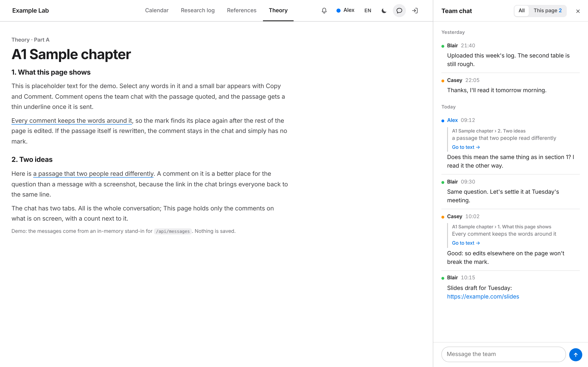
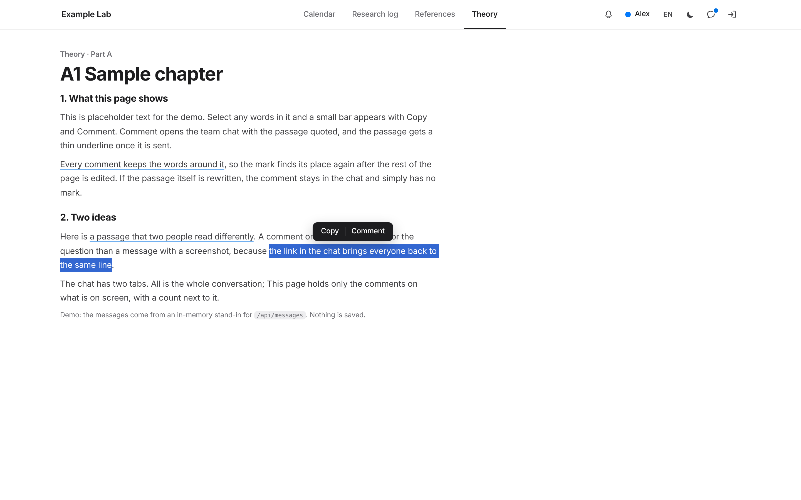
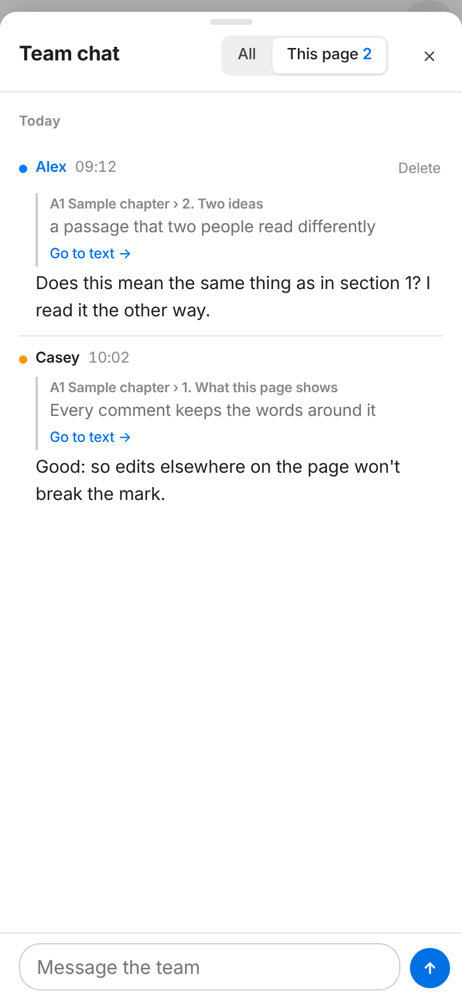
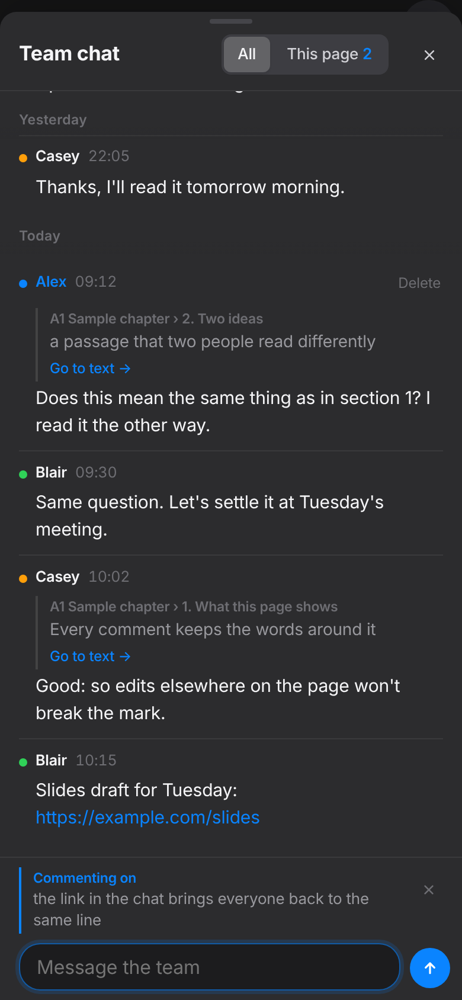

# Team chat

A chat that lives inside the site, so a question about a passage is asked on the passage. Select words anywhere that
allows comments and a small **Copy · Comment** bar appears. Comment opens the chat with the passage quoted; once sent,
the passage gets a thin underline, a tap on it opens the comment, and **Go to text** in the chat brings anyone back to
the same line.

| Desktop, panel beside the page | Select → Copy · Comment | Phone sheet, "This page" | Phone, quoting a passage |
|---|---|---|---|
|  |  |  |  |

Dark: [screenshots/chat-1440-dark.png](screenshots/chat-1440-dark.png).

## When to use / when not to

- Use on a site behind `google-signin-team-gate` (the author comes from the session; nobody types a name).
- Use when the team keeps pasting screenshots of notes into a messenger to ask about one sentence.
- Not a replacement for a real messenger: no push for chat messages, no files, no threads, no editing. It polls (4 s
  while open, 45 s while closed), which is fine for a handful of people and wrong for hundreds.
- Not for public sites: messages are visible to every signed-in member and the endpoint trusts the gate.

## What you get

| Path | What it is |
|---|---|
| `assets/lib/chat.js` | D1 storage: the `chat_messages` table (made on first use), field cleaning and cutting, `recent`, `since`, `add`, `remove` (soft). |
| `assets/functions/api/messages.js` | `GET / POST / DELETE /api/messages`, behind the gate. Contract in the file header and in [references/api.md](references/api.md). |
| `assets/site/js/chat.js` | The client: header button and unread dot, panel or sheet, All / This page tabs, the composer, Copy · Comment, marks in the text, links back to a passage, polling. |
| `assets/site/js/chat-strings.js` | The chat's EN/KO strings, added to the `i18n.js` tables. |
| `assets/site/js/chat-util.js` | The few helpers `chat.js` needs (`api`, `$`, prefs, `dLong`, `TIMEZONE`). Use your site's own `util.js` instead if it has them. |
| `assets/site/js/i18n.js`, `theme.js` | Copies from `team-site-design-system`, so the demo runs on its own. |
| `assets/site/css/chat.css` | Panel, sheet, list, composer, the selection bar, marks. Every measurement is in [references/design.md](references/design.md). |
| `assets/tools/test-chat.mjs` | 92 checks against an in-memory D1 (Node 22.13+, `node:sqlite`); with the gate present, 5 more through it. |
| `assets/demo/index.html` | The chat on a sample chapter with an in-memory `/api/messages`. `?state=open`, `here`, `select`, `quote`. |

## Steps

1. Have `team-site-design-system` (tokens, components, `i18n.js`, `theme.js`) and `google-signin-team-gate` (the
   middleware puts `data.user.member` on every request and refuses cross-origin writes) in place, and the `DB` binding
   from `team-site-setup`.
2. Copy `assets/lib/chat.js` → `lib/chat.js`, `assets/functions/api/messages.js` → `functions/api/messages.js`,
   `assets/tools/test-chat.mjs` → `tools/test-chat.mjs`.
3. Copy `assets/site/js/chat.js`, `chat-strings.js`, `chat-util.js` → `site/js/`, and `assets/site/css/chat.css` →
   `site/css/`. Set `TIMEZONE` in `chat-util.js` (`{{TIMEZONE}}`). Link `chat.css` after the design-system CSS.
4. Add the chat button to the header, between the theme button and sign-out (markup in `assets/demo/index.html`):
   `<button class="icon-btn chat-btn" id="chat-btn" aria-expanded="false" aria-controls="chat">` with the bubble SVG
   and `<i class="chat-dot" hidden></i>`.
5. Mark what can be commented on: any element with `data-chat-page="<stable key>"` and `data-chat-title="<words shown
   above the quote>"`. Keys the client knows how to link back to: `theory/<part>/<chapter>`, `log/<week>/<member>`,
   `refs`, `event/<id>`. A new kind needs a line in `hrefOf()` and `goTo()`.
6. In your app script: `const chat = createChat({ team, openEvent })`. `team.members` is `[{ id, name, colorId }]`
   (from `site/data/team.json`); `openEvent(date, id)` is optional and opens a calendar event (the calendar's event
   dialog calls `chat.commentOn(ev, quote)` for its own Comment button).
7. Run `node tools/test-chat.mjs` from the repo root. Open the site, post a message from two accounts, comment on a
   passage, reload, and check the underline comes back.

## Rules

- **The author is the session's member.** The server ignores any `member`, `name`, `email`, `id`, `rev`, `ts` in the
  body. No email address is stored or returned (the test checks every answer for `@`).
- **Others' words only go on the page with `textContent`.** Links are made from `https://` text as `<a>` nodes with
  `rel="noopener noreferrer"`, never with `innerHTML`.
- **One table, one change counter.** Every insert and delete takes `MAX(rev) + 1` in the same statement, so polling
  with `?since=rev` never misses or repeats a change. Deletes are soft (a marker row with its words cleared).
- **Cut, don't refuse,** long quote, title and context fields; refuse only empty or over-long message text (4,000
  characters, counted as code points so an emoji is never split).
- **Quotes are found again by their words,** with up to 40 characters on each side, never by DOM offsets. A comment
  whose passage was rewritten stays in the chat without a mark.
- **Typing Korean:** Enter never sends while a syllable is being composed (`isComposing`, keyCode 229). On touch
  screens Enter is a new line and the arrow sends.
- **Phones:** the sheet fits the space the keyboard leaves (`visualViewport`), inputs are 16 px (no zoom on focus), the
  selection bar docks at the bottom, clear of the phone's own selection menu.
- **The header button stays English** like the rest of the header; the panel follows the language switch.

## Configuration

| Name | Where | Default | Meaning |
|---|---|---|---|
| `TIMEZONE` | `chat-util.js` | `Asia/Seoul` | `{{TIMEZONE}}`: day labels and times |
| `SEEN` | `chat.js` | `site_chat_seen` | localStorage key for the newest message seen |
| `WIDE` / `PHONE` | `chat.js` | 1100 / 760 px | panel beside the page / sheet from the bottom |
| `POLL_OPEN`, `POLL_SHUT`, `POLL_OFF` | `chat.js` | 4 s, 45 s, 5 min | polling while open, closed, and while the API is missing |
| `MAX_TEXT`, `RECENT`, `SINCE_MAX`, `LIMITS` | `lib/chat.js` | 4000, 500, 1000, see file | message length, first load size, rows per poll, field cuts |
| `SKIP`, `BLOCK` | `chat.js` | see file | what is never quoted (math source, buttons, `[data-chat-skip]`), what counts as a block |

## Self-check before shipping

- [ ] `node tools/test-chat.mjs` passes, including the gate section.
- [ ] Signed out, `GET /api/messages` answers 401; a `DELETE` from another origin answers 403.
- [ ] Two members: each sees the other's message within 5 s with the panel open; the unread dot shows when closed.
- [ ] A comment on a passage underlines it after a reload, and "Go to text" scrolls to it from another tab.
- [ ] A message with `` shows as text.
- [ ] Korean typing: Enter in the middle of a syllable doesn't send.
- [ ] Phone: the sheet stays above the keyboard; selection shows the docked bar; no zoom on focus.
- [ ] 1440 and 390 px, light and dark, look like the screenshots.

## References

- [references/design.md](references/design.md): every measurement, state and motion.
- [references/api.md](references/api.md): the endpoint, the table, polling with rev, and how quotes are anchored.
- [references/decisions.md](references/decisions.md): why it works this way.
- [team-site-design-system/references/mobile.md](../team-site-design-system/references/mobile.md): the phone rules this skill follows (zoom, where scrolling is locked, sheets, keyboard, safe areas), with the code and the reason for each.

Origin: the NAND Capstone 2026 Winter team site.
