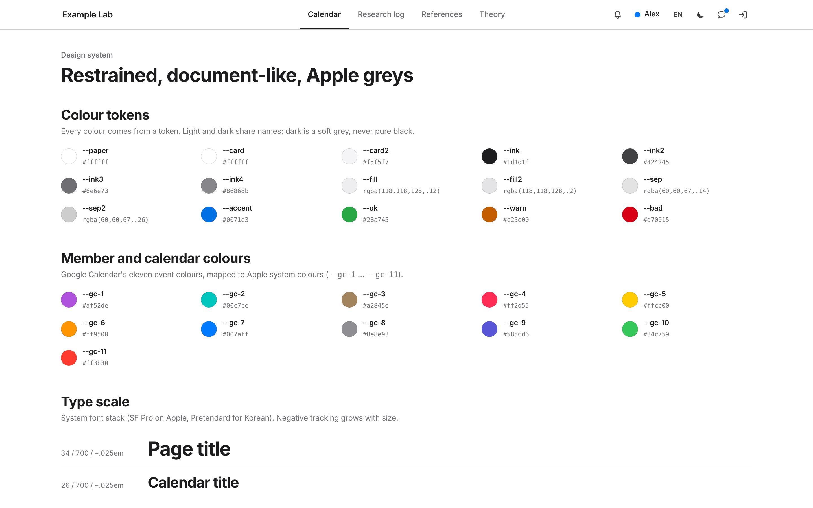

# Team site design system

The look every other skill in this repository uses: system colours, a soft-grey dark mode, one system font, hairlines
instead of boxes, pill-shaped controls, dialogs that turn into bottom sheets on phones, and a header that stays one
row on desktop and two rows on phones without ever cutting anything off.

## When to use / when not to

- Use for any page of a small team or lab site that should look calm and native on macOS and iOS.
- Use whenever another skill here (calendar, reader, sign-in, push, guide, chat) draws UI: they all assume these tokens
  and class names.
- Not for a marketing site with a brand palette of its own (keep the layout rules, swap the tokens), and not for the 3D
  intro, which has its own night palette and melts into `--paper` at the end.

## What you get

| File | What it is |
|---|---|
| `assets/tokens.css` | Every colour, font stack, shadow and member colour as CSS custom properties, for light, explicit dark (`[data-theme=dark]`) and system dark (media query). Base element styles. |
| `assets/components.css` | Header and tabs, buttons, pill nav (‹ Today ›), segmented control, dialogs → bottom sheets, fields, choice pills, the iOS switch, the 44 px tap-area rules, the small-phone tightening. |
| `assets/doc.css` | Document style for rendered Markdown (`.doc`): headings, lists, task lists, tables, code, quotes. |
| `assets/theme.js` | Pre-paint snippet (theme, language, the home-indicator room), light/dark toggle, status-bar colour in the installed app, no zoom on upright phones. |
| `assets/sheet.js` | Phone sheets: `lockPage` / `unlockPage` (the page behind never moves), `pullToClose`, and `sheetDialogs()` that wires every `dialog.dlg` (lock, tap outside, pull down). |
| `assets/i18n.js` | The two-table EN/KO pattern with `data-i18n*` attributes and `data-lang-fixed` sections. |
| `assets/demo/index.html` | A style guide page that uses all of the above (the screenshots). |

## Steps

1. Copy `assets/tokens.css`, `components.css`, `doc.css`, `theme.js` (and `i18n.js` if you need two languages) into
   the site (`site/css/`, `site/js/`).
2. In `<head>`, before the stylesheets, inline the pre-paint snippet (`PREPAINT` in `theme.js`) so a saved theme applies
   before the first paint. Add both `theme-color` metas (light `#f5f5f7`, dark `#000000`, with `media`).
3. Link `tokens.css` first, then `components.css`, then `doc.css`, then feature stylesheets.
4. Build the header from the markup in `assets/demo/index.html`: `.bar > .bar-in` with `.brand`, `nav.tabs`
   (`role=tablist`, `aria-selected`), and `.bar-right` (bell, name pill `.me`, one language button `.lang-btn`, `.theme-btn`,
   chat `.chat-btn` if you add `team-chat`, sign-out `.out-btn`). Keep that order; the responsive rules depend on it.
5. Call `initTheme({ button })` and `lockPhoneZoom()` from `theme.js`, and `wireLangButton()` from `i18n.js`. In the installed Home Screen app also call
   `paintStatusBar()`. Once the dialogs are in the page, call `sheetDialogs()` from `sheet.js`.
6. Put page content in `main.main` and use `.eyebrow` + `.page-h` for a page title, `.card` + `.card-h` for a section
   (a hairline on top, never a box), `.doc` for Markdown.
7. Use only token colours. Member and calendar colours are `--gc-1` … `--gc-11` (Google Calendar's colorId 1–11);
   tint an event or a chosen pill with `color-mix(in srgb, var(--c) var(--ev-bg), var(--card))`.
8. Every dialog is a `<dialog class="dlg">` with `.dlg-in`, `.dlg-top`, fields `.fld`, actions `.dlg-act`. On phones it
   becomes a bottom sheet automatically.
9. Run the self-check below at every width before merging.

## Rules

- **No boxes.** No card borders, no filled panels for layout. A section is a hairline on top (`.5px solid var(--sep2)`)
  and space. Fills (`--fill`) are only for controls and inputs.
- **No neon, no glow.** Apple system colours only, via tokens. One accent (`--accent`), used for primary actions, links
  and focus.
- **Dark is soft grey** (`--paper #1c1c1e`, `--card #2c2c2e`), never `#000` on the page. (The dark `theme-color` meta is
  `#000000`: it only tints the browser's own bar, as iOS does.) Hairlines get fainter in dark (`.07`/`.11` white).
- **One font stack**: `-apple-system, "SF Pro Text", "Pretendard Variable", …`. Korean breaks between words only
  (`word-break: keep-all`). Never break inside a label–number pair ("Week 3", "12/22 – 12/28", "10:50 AM"): wrap such
  pairs in an element with `white-space: nowrap`.
- **Pills.** Buttons are fully rounded (`999px`), 32 px tall on desktop; text controls 13–13.5 px, weight 500.
- **Phones first-class.** Every page works at 375 px (and 320 px) with nothing cut off and no sideways scroll. Every
  control has a 44 px tap area (real size, or an invisible `::after`). Inputs use 16 px text so iOS does not zoom.
  Sheets keep room for the home indicator (`--sab`, also in the Home Screen app where `env()` is 0). While a sheet is
  open the page behind never moves; a tap outside or a pull down closes it. Upright phones do not zoom. Every phone
  rule, with code and reasons: [references/mobile.md](references/mobile.md).
- **Header never collides.** The tabs sit in the middle while both sides fit; when they do not, a side keeps its width
  and the tabs move over (CSS grid `minmax(max-content,1fr) auto minmax(max-content,1fr)`). On phones the tabs go to a
  second row spread edge to edge.
- **No helper text that repeats the obvious.** Labels are one or two words. Empty states say what to do, once.
- **English by default.** The header, intro, sign-in and main screen stay English even in KO mode (`data-lang-fixed`);
  terms and names stay English in both languages.
- **Motion is short.** 150 ms colour transitions, 220 ms dialog rise, 320 ms sheet slide; `prefers-reduced-motion`
  removes the dialog, sheet and switch motion (colour fades stay). Every value: `docs/design/motion.md`.

## Configuration

| Token | Light | Dark | Use |
|---|---|---|---|
| `--accent` | `#0071e3` | `#0a84ff` | swap for your brand blue if you must; keep it one colour |
| `--gc-1` … `--gc-11` | Apple system colours | dark variants | member and calendar colours, keyed by Google colorId |
| `THEME_KEY`, `LANG_KEY` in `theme.js` | `site_theme`, `site_lang` | | localStorage keys; keep them in sync with `PREPAINT` |
| `{{SITE_NAME}}` | | | brand text in the header |

Everything else stays as is. Full tables: [references/design.md](references/design.md).

## Self-check before shipping

- [ ] Screenshots at 1440, 1024, 768, 390, 375 and 320 px wide, light and dark: nothing overlaps, nothing is cut off,
      no horizontal scroll (`document.documentElement.scrollWidth === innerWidth`).
- [ ] The header at 761–1023 px stays one row; at ≤ 760 px it is two rows and the tabs fit at 320 px.
- [ ] Every tappable thing on a phone is at least 44 × 44 px (Playwright: `elementHandle.boundingBox()` of the element
      or its `::after` area).
- [ ] Toggle the theme and reload: no flash of the other theme.
- [ ] `prefers-reduced-motion: reduce`: dialogs open without animation.
- [ ] Open a dialog at 390 px: it is a bottom sheet, its buttons sit above the home indicator, focusing an input does not
      zoom, `<html>` has the class `locked` while it is open and loses it on close.
- [ ] No colour literal outside `tokens.css` (`grep -nE '#[0-9a-f]{3,6}\b' site/css/*.css` shows only tokens and the
      intro's own palette).
- [ ] In KO mode the header and main screen are still English; `check()` in `i18n.js` returns `[]`.

## References

- [references/design.md](references/design.md): every token, size, breakpoint, component and state, with layout sketches.
- [references/language.md](references/language.md): the EN/KO rules and how strings are organised.
- [references/mobile.md](references/mobile.md): every phone rule (zoom, where scrolling is locked and how, sheets, the
  keyboard, safe areas, selection, taps, viewport units), with the code, the reason and a real-phone checklist.
- [references/decisions.md](references/decisions.md): what changed and why (before → after), and what was rejected.

Origin: the NAND Capstone 2026 Winter team site.
