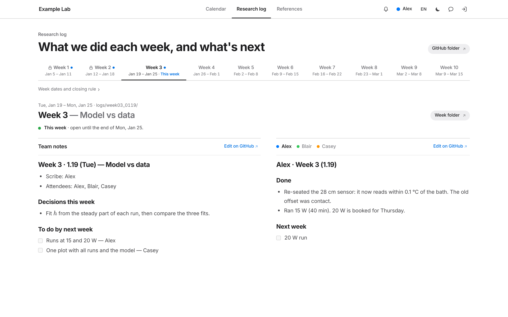
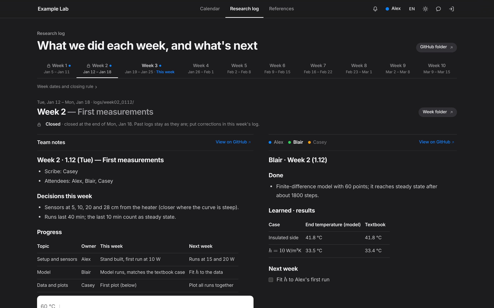
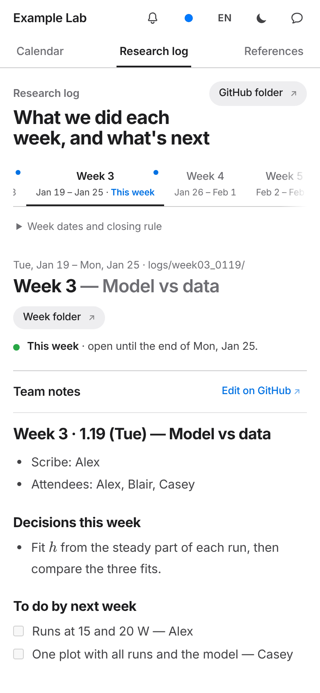

# Weekly research log

A lab notebook in the repository: one folder per week (`logs/week03_0119/`), one Markdown file per member plus the
meeting notes. A week runs seven days from the meeting day; when its last day ends (team time) it is **closed**. The
site's Research log tab shows each week as a tab, hides the edit links of closed weeks, and a GitHub Action marks any
commit that edits a closed week with a red X.

| This week, desktop | Closed week, dark | Phone |
|---|---|---|
|  |  |  |

More: [closing table and empty states](screenshots/table-1440-light.png) ·
[phone, closed week, dark](screenshots/closed-390-dark.png).

## When to use / when not to

- Use for a small team (2–10) that meets once a week and wants a record that is not rewritten later: a research
  group, a capstone, a lab rotation.
- Use with a GitHub repository (the logs are edited on GitHub) and, for the tab, a site built from that repository
  (team-site-setup).
- Not for a daily standup log (the week is the unit), and not for private diaries: everyone with access to the
  repository or the site reads every log.
- The lock is a check, not a wall: an admin can still merge past a red X. Turn on the branch rules in
  [references/setup.md](references/setup.md) so it counts.

## What you get

| Path in `assets/` | What it is |
|---|---|
| `weeks.py` | Prints the week table (Week · Folder · Dates · Closed from) for `logs/README.md`, from the first day, the number of weeks and the time zone, or from `team.json`. Same rule as the lock. |
| `tools/check_record_lock.py` | Reads changed paths on stdin; exits 1 if any is in a closed week's folder. `--today` for tests. |
| `.github/workflows/record-lock.yml` | Runs the check on every push and pull request that touches `logs/`. |
| `tools/test_records.py` | 37 offline tests: the week rule, the lock (edge days, odd paths), that the check, `weeks.py` and the page agree on every day, and the build step. |
| `build_records.py` | Build step: `logs/` → `records.json` (every program week, its files, titles, other files). For build.py or alone. |
| `site/js/records.js` | `createRecords(ctx)`: the tab (week strip, closing table, state line, team notes, member tabs, empty states, GitHub links and templates). |
| `site/js/md.js` | Markdown → HTML with marked and KaTeX (math kept away from marked), relative links and images resolved; `isBlank()` for "only the template". |
| `site/js/rec-util.js`, `rec-strings.js` | Dates in the team's zone, helpers; every word the tab shows. |
| `site/css/records.css` | All styles of the tab. Every value is in [references/design.md](references/design.md). |
| `site/records.html` | The pane's markup. |
| `logs/README.md` | The rules for the team, with placeholders and a spot for the week table. |
| `fetch-vendor.sh` | Downloads marked 15.0.12 and KaTeX 0.16.22 (MIT) from npm. Never commit what it downloads in this library. |
| `demo/` | The tab with made-up logs for Alex, Blair and Casey (weeks 1–3 of 10), the clock frozen in week 3. |

## Steps

1. Have the base: `team-site-setup` (repository, `build.py`, `team.json`), `team-site-design-system` (tokens,
   components, `doc.css`, header) and the repository rules from `team-project-playbook`.
2. Ask the user for: the first meeting day, the number of weeks (or the last day), the time zone, and the member ids.
   Never guess them.
3. Add `"program": { "start", "end" or "weeks", "timeZone" }` to `site/data/team.json`.
4. Copy the files as listed in [references/setup.md](references/setup.md#1-put-the-files-in-the-repository).
5. Print the week table: `python3 tools/weeks.py --team site/data/team.json`. Paste it into `logs/README.md`; fill the
   other placeholders there.
6. Add the build step and the image folder to `build.py` (setup.md step 6). Fetch the libraries:
   `bash fetch-vendor.sh site`.
7. Paste `site/records.html` into the page, link `records.css` after the design system's CSS, and start the tab:

   ```js
   import { createRecords } from "./records.js";
   const records = createRecords({ team, me: () => currentMember }); // team.json; the signed-in member or null
   // when the tab opens (from the address "#records/3" or a click): records.show(3) or records.show()
   ```

8. Run `python3 tools/test_records.py` → `✓ 37 passed, 0 failed`. Run `python3 build.py --check`.
9. Give the user the GitHub clicks in setup.md (Actions on, branch ruleset with the `check` status). Then prove the
   lock: a test pull request that edits a closed week turns red (setup.md step 5).
10. Make the first week's folder with **Create from template** on the site, or push `logs/week01_MMDD/team.md`.
11. Take the screenshots and run the self-check.

## The week rule, by example

`program.start = 2027-01-05` (a Tuesday), `timeZone = Asia/Seoul`:

| Week | Folder | Dates | Closed from |
|---|---|---|---|
| 1 | `week01_0105` | Tue 01-05 – Mon 01-11 | Tue 01-12 00:00 |
| 2 | `week02_0112` | Tue 01-12 – Mon 01-18 | Tue 01-19 00:00 |
| 8 | `week08_0223` | Tue 02-23 – Mon 03-01 | Tue 03-02 00:00 |

On Thursday 2027-01-21 (Seoul time) weeks 1–2 are closed, week 3 is this week, weeks 4 and later are not started. A
push at 23:59 on Monday 01-18 in Seoul may still edit week 2; at 00:00 it is refused, even if the pusher is in another
zone where it is still Monday. The check uses the time it runs, so a pull request that is re-run after midnight
turns red: merge last-minute log fixes before the week closes.

## Rules

- **One week = one folder** `logs/weekNN_MMDD/`: two-digit week number, then the month and day of the week's first
  day. The number decides the week; the date is for people.
- **A week runs seven days from `program.start`'s weekday** and closes at 24:00 of its last day in `program.timeZone`.
  The last day stays open all day because the next meeting is the day after.
- **One rule, three places, never out of step:** `check_record_lock.py`, `weeks.py` and `records.js` (`today > end`).
  `test_records.py` checks they agree on every day. Change all three or none.
- **Each person edits only their own file;** `team.md` belongs to that week's scribe. Separate files mean no merge
  conflicts on upload night.
- **A closed week is not edited.** Corrections go into this week's log. The site shows View instead of Edit, and no
  create or write buttons.
- **A log is short:** what was done, what was learned, where it is stuck, what is next, and links. The work itself goes
  in `research/` or `code/`.
- **Logs are written in the team's documentation language** (English by default); the templates are not translated
  with the UI.
- **No PDFs, no personal data, no secrets in logs.** The site shows them to every member.
- **No boxes:** columns are separated by space and hairlines; colours are design-system tokens only.
- **Today means team time:** the page computes "today" in `timeZone` from `records.json`, wherever the viewer is.

## Configuration

| Name | Where | Meaning | Example |
|---|---|---|---|
| `program.start` | `site/data/team.json` | week 1's first day (the meeting day) | `2027-01-05` |
| `program.end` or `program.weeks` | `team.json` | the last program day, or the number of weeks | `2027-03-08` or `10` |
| `program.timeZone` | `team.json` | the team's IANA zone ({{TIMEZONE}}) | `Asia/Seoul` |
| `repo`, `branch` | `team.json` | `{{REPO}}` (owner/name) and the branch the links point at | `example-org/example-lab`, `main` |
| `members[].id`, `name`, `colorId` | `team.json` | file names, tab names, dot colours (1–11) | `alex` Alex 7 |
| `{{WEEK_START}}`, `{{MEMBER_IDS}}`, `{{WEEK_TABLE}}` | `logs/README.md` | the start weekday, the ids, the table from `weeks.py` | `Tuesday`, `alex, blair, casey` |
| templates | `records.js` (`TEAM_TPL`, `PERSON_TPL`) or `ctx.templates` | the headings of a new file | Done · Learned · Stuck · Next · Links |
| `dataUrl`, `imgBase`, `hash` | `createRecords(ctx)` | where records.json and images are; the address prefix | `/data/records.json`, `/repo/`, `#records/` |
| `MD_VENDOR.katex` | `md.js` | where KaTeX is | `/vendor/katex/katex.min.js` |

## Self-check before shipping

- [ ] `python3 tools/test_records.py` → all pass. `python3 build.py --check` → nothing missing.
- [ ] `python3 tools/weeks.py --team site/data/team.json` matches the table in `logs/README.md`.
- [ ] A test pull request that edits a closed week gets a red X; one that edits this week is green.
- [ ] The tab at 390, 768, 1024 and 1440: no sideways page scroll; the week strip scrolls and fades; columns stack below
      1101.
- [ ] Light and dark: lock icons, "This week" accent, member dots, figures readable.
- [ ] States: this week (green dot, Edit links), a closed week (lock, View links, no buttons), a week not started
      (hollow dot, Create from template), a template-only file ("Template only…"), a missing file.
- [ ] Math renders (KaTeX present), images show (`IMAGE_DIRS`), relative links open GitHub.
- [ ] Reduced motion: no transitions on tabs.
- [ ] In this library: `bash tools/privacy-scan.sh` prints only ✓.

The demo links the design system by relative path, so serve the **repository root**:

```bash
bash skills/weekly-research-log/assets/fetch-vendor.sh      # once: marked and KaTeX into the demo (git-ignored)
python3 -m http.server 8123 --bind 127.0.0.1                # from the repository root
# http://127.0.0.1:8123/skills/weekly-research-log/assets/demo/            week 3, open
#   ?week=2&person=blair   a closed week · ?week=4&table=1   not started + the closing table
#   ?now=2027-01-12T09:00:00%2B09:00   another moment
# after editing demo/logs: (cd skills/weekly-research-log/assets/demo && python3 ../build_records.py --root . --out data/records.json)
```

## References

- [references/design.md](references/design.md): every measurement, token, breakpoint and state, with sketches for 1440
  and 390.
- [references/setup.md](references/setup.md): files, `team.json`, GitHub Actions, the branch ruleset, the build, and
  common problems.
- [references/decisions.md](references/decisions.md): before → after for the look and the rules, and what was
  rejected.
- Origin: rebuilt from the Research log of the NAND Capstone team site (2026).
- [team-site-design-system/references/mobile.md](../team-site-design-system/references/mobile.md): the phone rules this skill follows (zoom, where scrolling is locked, sheets, keyboard, safe areas), with the code and the reason for each.
