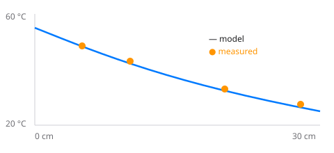

# Week 2 · 1.12 (Tue) — First measurements

- Scribe: Casey
- Attendees: Alex, Blair, Casey

## Decisions this week
- Sensors at 5, 10, 20 and 28 cm from the heater (closer where the curve is steep).
- Runs last 40 min; the last 10 min count as steady state.

## Progress
| Topic | Owner | This week | Next week |
|---|---|---|---|
| Setup and sensors | Alex | Stand built, first run at 10 W | Runs at 15 and 20 W |
| Model | Blair | Model runs, matches the textbook case | Fit $h$ to the data |
| Data and plots | Casey | First plot (below) | Plot all runs together |

## To do by next week
- [ ] Three runs at 10, 15 and 20 W — Alex
- [ ] Fit the loss coefficient — Blair
